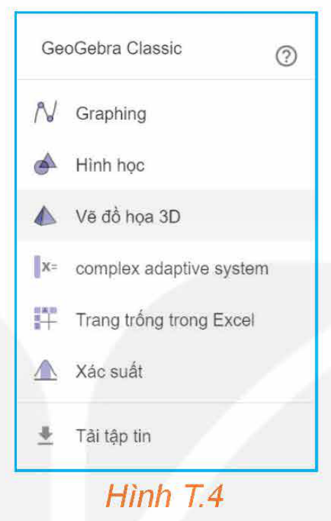
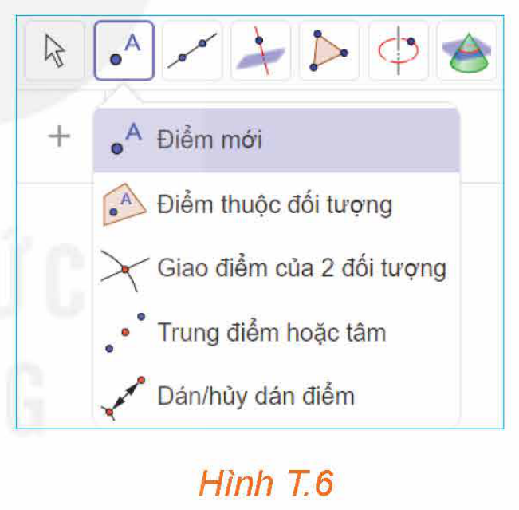
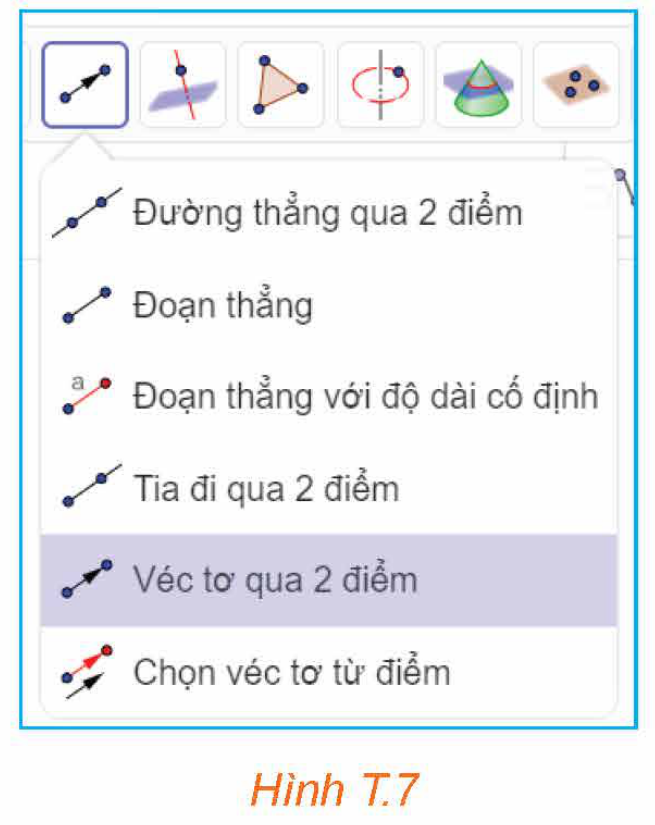
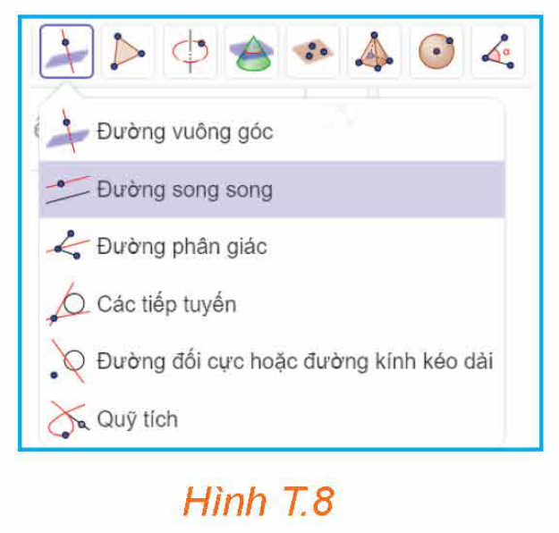
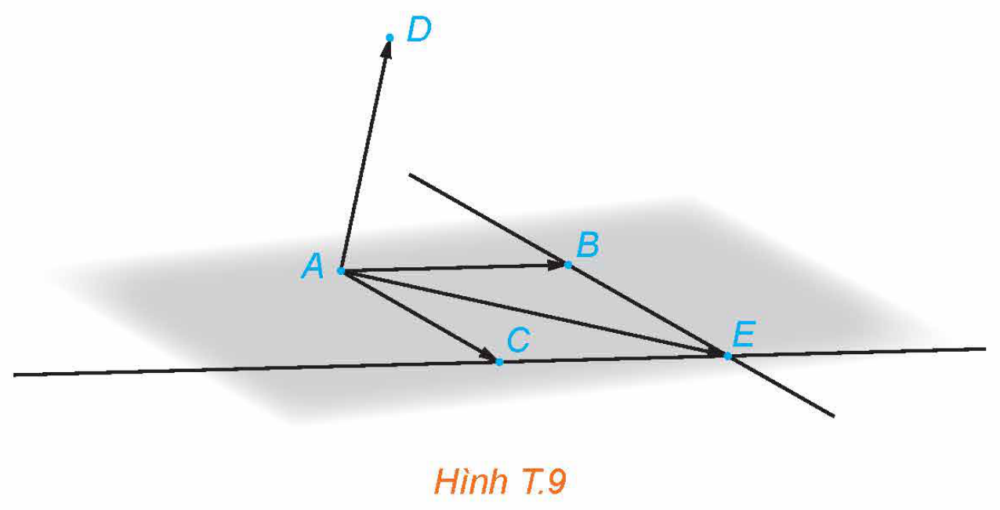
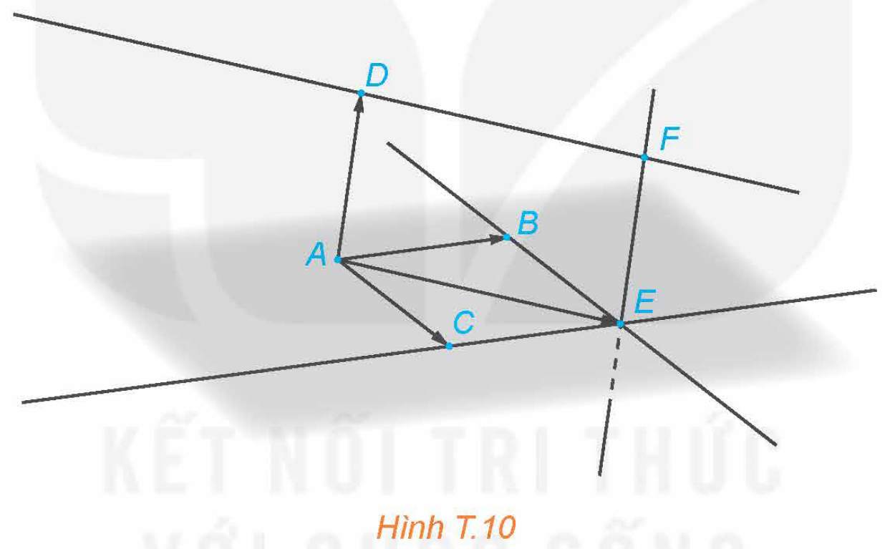
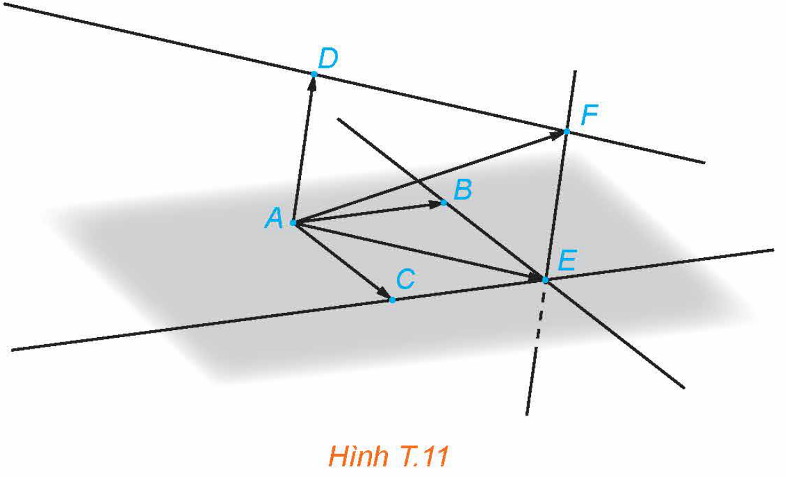

<!-- pdf:94 -->

# VẼ VECTƠ TỔNG CỦA BA VECTƠ TRONG KHÔNG GIAN BẰNG PHẦN MỀM GEOGEBRA

## 🎯 Mục tiêu

- Sử dụng phần mềm GeoGebra, vẽ vectơ tổng của ba vectơ cho trước.

**Hoạt động:** Lấy bốn điểm $A, B, C, D$ trong không gian ba chiều và vẽ vectơ $\vec{u} = \overrightarrow{AB} + \overrightarrow{AC} + \overrightarrow{AD}$.

**Hướng dẫn thực hiện:**

*Bước 1.* Mở phần mềm GeoGebra, vào mục **Phối cảnh\Vẽ đồ hoạ 3D** (H.T.4).

Bấm chuột trái, chọn “Hiển thị hệ trục toạ độ” để tắt phần hiển thị hệ trục toạ độ (H.T.5).

*Hình T.4*

*Hình T.5*

*Bước 2.* Chọn công cụ “Điểm mới” để vẽ các điểm $A, B, C, D$ trên mặt phẳng màu xám (H.T.6).

**Chú ý:** Ta có thể di chuyển các điểm bằng cách kích chuột phải vào điểm để hiện ra các mũi tên di chuyển 4 chiều và 2 chiều, sau đó di chuyển điểm theo hướng tương ứng với chiều mũi tên.

*Hình T.6*

*Bước 3.* Sử dụng công cụ vẽ vectơ qua 2 điểm (H.T.7) để vẽ ba vectơ $\overrightarrow{AB}, \overrightarrow{AC}, \overrightarrow{AD}$.

*Hình T.7*

*Bước 4.* Sử dụng công cụ “Đường song song” (H.T.8) để vẽ các đường thẳng song song với các vectơ $\overrightarrow{AB}, \overrightarrow{AC}$.

*Hình T.8*

<!-- pdf:95 -->

Xác định giao điểm $E$ của hai đường thẳng đó bằng công cụ “Giao điểm của 2 đối tượng”. Vẽ vectơ $\overrightarrow{AE}$.

Theo nguyên tắc hình bình hành, ta có: $\overrightarrow{AE} = \overrightarrow{AB} + \overrightarrow{AC}$.

*Hình T.9*

*Bước 5.* Sử dụng công cụ vẽ đường thẳng song song để vẽ các đường thẳng song song với các vectơ $\overrightarrow{AD}, \overrightarrow{AE}$ và xác định giao điểm $F$ của hai đường thẳng đó.

*Hình T.10*

*Bước 6.* Vẽ vectơ $\overrightarrow{AF}$.

Theo nguyên tắc hình bình hành, ta có: $\overrightarrow{AF} = \overrightarrow{AE} + \overrightarrow{AD} = \overrightarrow{AB} + \overrightarrow{AC} + \overrightarrow{AD}$.

Vậy $\overrightarrow{AF}$ chính là vectơ $\vec{u}$ cần dựng.

*Hình T.11*

## 📷 Danh sách hình trong bài

| Mã hình | Trang PDF | Chú thích trong sách | Mô tả ngắn |
| :--- | :---: | :--- | :--- |
| H12-toan-hd-thtn-02-01 | 94 | Hình T.4 | Menu chọn chế độ Vẽ đồ hoạ 3D trong GeoGebra Classic |
| H12-toan-hd-thtn-02-02 | 94 | Hình T.5 | Menu tuỳ chọn hiển thị hệ trục toạ độ và mặt phẳng trong chế độ 3D |
| H12-toan-hd-thtn-02-03 | 94 | Hình T.6 | Thanh công cụ chọn Điểm mới trong GeoGebra |
| H12-toan-hd-thtn-02-04 | 94 | Hình T.7 | Thanh công cụ chọn Véc tơ qua 2 điểm trong GeoGebra |
| H12-toan-hd-thtn-02-05 | 94 | Hình T.8 | Thanh công cụ chọn Đường song song trong GeoGebra |
| H12-toan-hd-thtn-02-06 | 95 | Hình T.9 | Minh hoạ dựng vectơ $\overrightarrow{AE} = \overrightarrow{AB} + \overrightarrow{AC}$ theo quy tắc hình bình hành |
| H12-toan-hd-thtn-02-07 | 95 | Hình T.10 | Minh hoạ dựng giao điểm $F$ của hai đường thẳng song song với $\overrightarrow{AD}, \overrightarrow{AE}$ |
| H12-toan-hd-thtn-02-08 | 95 | Hình T.11 | Minh hoạ dựng vectơ tổng $\overrightarrow{AF} = \overrightarrow{AB} + \overrightarrow{AC} + \overrightarrow{AD}$ |
