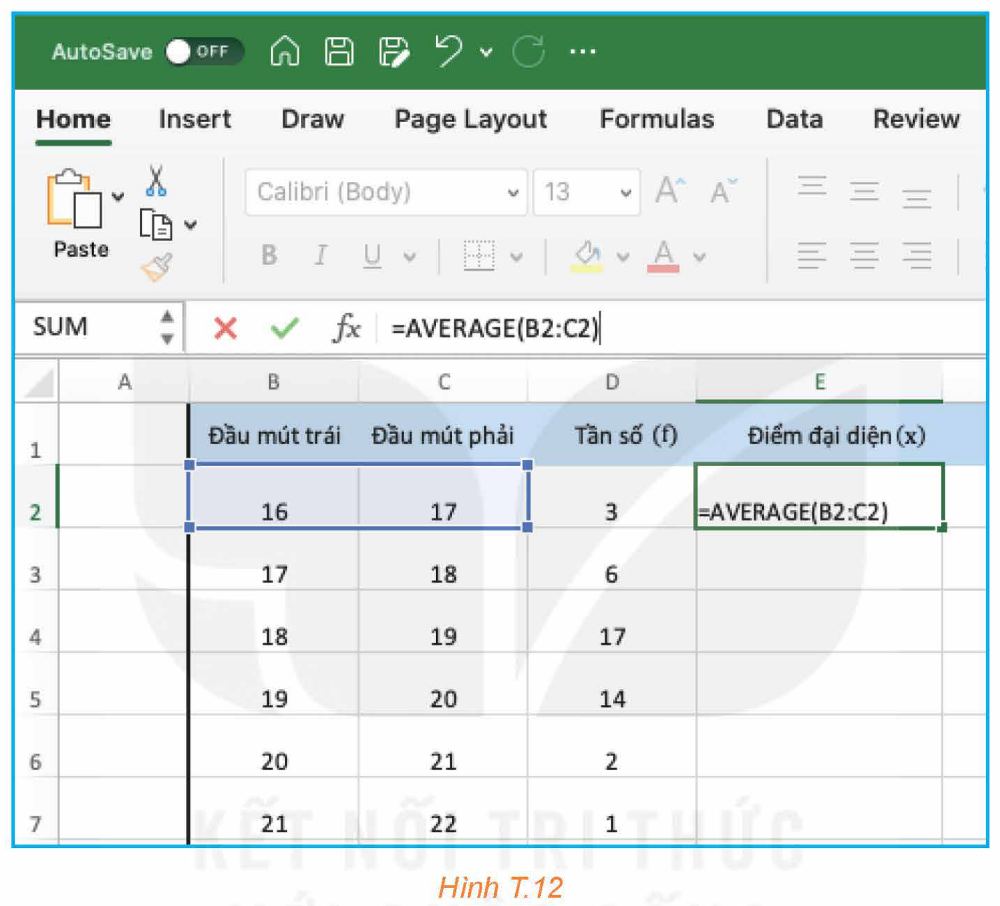
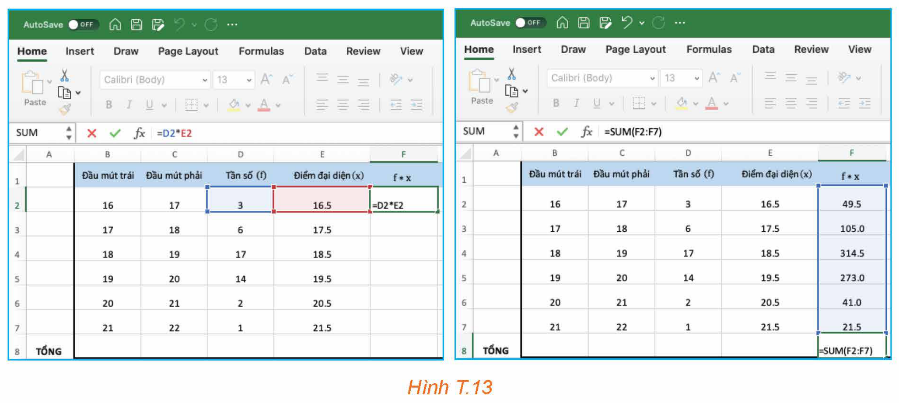
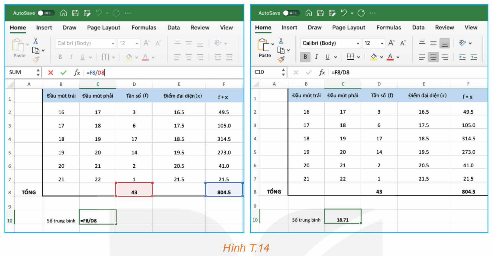
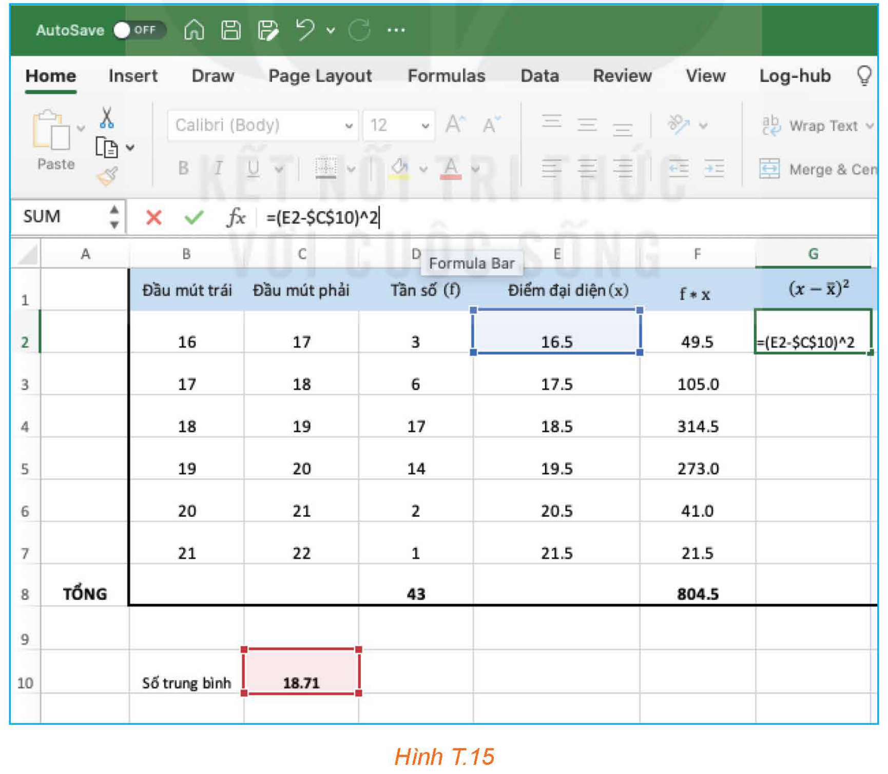
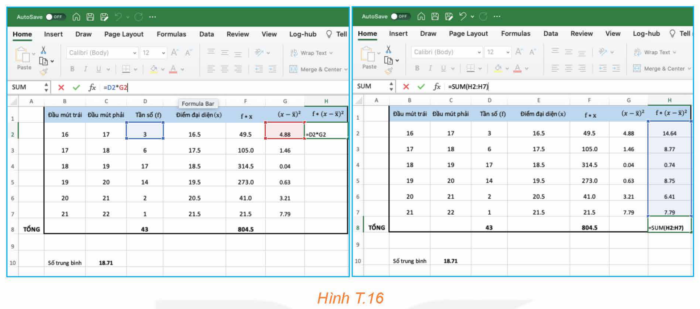
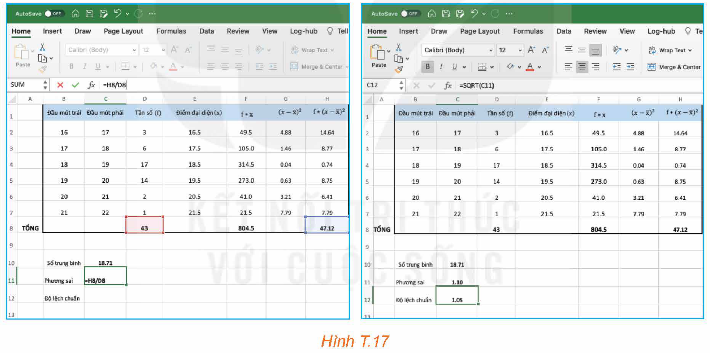

<!-- pdf:96 -->

# ĐỘ DÀI GANG TAY (GANG TAY CỦA BẠN DÀI BAO NHIÊU?)

## 🎯 Mục tiêu

- Thực hiện thu thập và phân tích dữ liệu để so sánh độ dài gang tay của hai nhóm học sinh nam và học sinh nữ trong lớp học.

Độ dài gang tay là một số đo của cơ thể. Các nhà sản xuất găng tay căn cứ vào đó để sản xuất các sản phẩm với kích thước khác nhau dùng trong y tế, thể thao, lao động,... Liệu chiều dài gang tay của nam giới có khác biệt so với nữ giới? Phân bố của chiều dài gang tay như thế nào?

Trong bài này, chúng ta sẽ thực hiện một phân tích nhỏ trong phạm vi lớp học để so sánh chiều dài gang tay của các bạn nam và các bạn nữ. Ta sẽ thu thập dữ liệu trên hai nhóm và so sánh thông qua tính toán những số đo thống kê mô tả đã học.

## 1. THU THẬP DỮ LIỆU

*Chuẩn bị:*

- Thước kẻ có vạch chia centimét;
- Bút, giấy.

*Thực hiện:*

a) Cách đo độ dài gang tay như sau:

- Đặt thước trên bàn;
- Đưa ngón tay cái và ngón tay út của bàn tay phải lên phía trên thước;
- Đặt ngón cái tại điểm đánh dấu $0\text{ cm}$;
- Dãn ngón út tối đa và xác định vị trí của đầu ngón út trên thước.

b) Thu thập dữ liệu theo mẫu phiếu sau:

> **Khảo sát về độ dài gang tay**
>
> **Giới tính của bạn**
> - Nữ
> - Nam
>
> **Độ dài gang tay (đơn vị: cm) của bạn thuộc phạm vi nào sau đây?**
> - $[16; 17)$
> - $[17; 18)$
> - $[18; 19)$
> - $[19; 20)$
> - $[20; 21)$
> - $[21; 22)$
> - $[22; 23)$
> - $[23; 24)$

Phiếu khảo sát có thể tạo trên Google biểu mẫu (Google form).

<!-- pdf:97 -->

**HĐ1:** Lưu dữ liệu thu được vào bảng theo mẫu sau:

| Chiều dài gang tay (cm) | Nữ | Nam |
| :---: | :---: | :---: |
| $[16; 17)$ | | |
| $[17; 18)$ | | |
| $[18; 19)$ | `\` | |
| $[19; 20)$ | `\` | |
| $[20; 21)$ | | `\` |
| $[21; 22)$ | | |
| $[22; 23)$ | | `\` |
| $[23; 24)$ | | |

*Bảng T.1. Kết quả đo gang tay của hai nhóm học sinh nữ và nam*

## 2. TÓM TẮT VÀ PHÂN TÍCH DỮ LIỆU

**HĐ2:** Lập bảng tần số ghép nhóm cho dữ liệu thu được trên từng nhóm theo mẫu sau đây và minh hoạ bằng biểu đồ tần số.

| Chiều dài gang tay (cm) | $[16; 17)$ | $[17; 18)$ | $[18; 19)$ | $[19; 20)$ | $[20; 21)$ | $[21; 22)$ | $[22; 23)$ | $[23; 24)$ |
| :--- | :---: | :---: | :---: | :---: | :---: | :---: | :---: | :---: |
| Số học sinh nam | ? | ? | ? | ? | ? | ? | ? | ? |
| Số học sinh nữ | ? | ? | ? | ? | ? | ? | ? | ? |

**HĐ3:** Sử dụng bảng tần số thu được ở HĐ2, em hãy:

a) Tính độ dài gang tay trung bình của các học sinh nữ, học sinh nam trong lớp và so sánh.

b) Tính phương sai, độ lệch chuẩn và từ đó tính hệ số biến thiên của độ dài gang tay của hai nhóm học sinh và so sánh.

**HĐ4:** Bảng tần số sau đây là dữ liệu thu được trên một lớp học. Hãy thực hiện HĐ3 cho mẫu số liệu này.

| Chiều dài gang tay (cm) | Số học sinh nữ | Số học sinh nam |
| :---: | :---: | :---: |
| $[16; 17)$ | 3 | 0 |
| $[17; 18)$ | 6 | 0 |
| $[18; 19)$ | 17 | 1 |
| $[19; 20)$ | 14 | 4 |
| $[20; 21)$ | 2 | 8 |
| $[21; 22)$ | 1 | 6 |
| $[22; 23)$ | 0 | 3 |
| $[23; 24)$ | 0 | 2 |

*Bảng T.2*

<!-- pdf:98 -->

**HĐ5:** Góc công nghệ thông tin

Việc tính số trung bình, phương sai, độ lệch chuẩn của mẫu số liệu được cho trong bảng tần số ghép nhóm có thể thực hiện trên phần mềm bảng tính Excel. Sau đây là minh hoạ việc tính trên mẫu số liệu thu được của học sinh nữ trong bảng cho trong HĐ4.

*Bước 1.* Nhập các đầu mút trái, các đầu mút phải, tần số của các nhóm tương ứng vào các cột. Sau đó xác định điểm đại diện của từng nhóm (H.T.12).

*Hình T.12*

*Bước 2.* Nhân tần số với điểm đại diện của từng nhóm và tính tổng bằng cách dùng hàm `SUM` (H.T.13).

*Hình T.13*

<!-- pdf:99 -->

*Bước 3.* Tính tổng các tần số và thực hiện tính số trung bình. Kết quả thu được số trung bình bằng $18,71$ (H.T.14).

*Hình T.14*

*Bước 4.* Để tính phương sai, độ lệch chuẩn, ta lần lượt lấy các điểm đại diện trừ đi số trung bình và bình phương kết quả (H.T.15).

*Hình T.15*

<!-- pdf:100 -->

*Bước 5.* Lần lượt lấy tần số nhân với các bình phương vừa tạo ra ở Bước 4, rồi lấy tổng các kết quả thu được (H.T.16).

*Hình T.16*

*Bước 6.* Tính phương sai, độ lệch chuẩn (H.T.17).

*Hình T.17*

Kết quả thu được, phương sai của mẫu số liệu là $1,10$ và độ lệch chuẩn là $1,05$.

**Em có biết?**

Vào những năm 1990, Christopher Donison và David Steinbuhler đã lần đầu tiên giới thiệu loại bàn phím piano 7/8 và 15/16 giúp những người có độ dài gang tay nhỏ có trải nghiệm chơi đàn piano tốt hơn. Hai loại bàn phím này có độ dài mỗi quãng tám là $5,5$ và $6,0\text{ (inches)}$ tương ứng (nhỏ hơn so với $6,5\text{ inches}$ của những chiếc đàn phổ biến lúc đó) và chúng được kí hiệu là DS5.5 và DS6.0. Ngoài ra họ còn giới thiệu bàn phím DS5.1 dành cho trẻ em. Việc này đã tạo ra tiêu chuẩn mới cho việc sản xuất bàn phím piano hiện đại.

*(Theo dsstandardfoundation.org)*

## 📷 Danh sách hình trong bài

| Mã hình | Trang PDF | Chú thích trong sách | Mô tả ngắn |
| :--- | :---: | :--- | :--- |
| H12-toan-hd-thtn-03-01 | 98 | Hình T.12 | Minh hoạ Bước 1 trên Excel: nhập đầu mút, tần số và tính điểm đại diện bằng hàm `AVERAGE` |
| H12-toan-hd-thtn-03-02 | 98 | Hình T.13 | Minh hoạ Bước 2 trên Excel: nhân tần số với điểm đại diện và tính tổng bằng hàm `SUM` |
| H12-toan-hd-thtn-03-03 | 99 | Hình T.14 | Minh hoạ Bước 3 trên Excel: tính tổng tần số và số trung bình |
| H12-toan-hd-thtn-03-04 | 99 | Hình T.15 | Minh hoạ Bước 4 trên Excel: tính bình phương độ lệch giữa điểm đại diện và số trung bình |
| H12-toan-hd-thtn-03-05 | 100 | Hình T.16 | Minh hoạ Bước 5 trên Excel: nhân tần số với bình phương độ lệch và tính tổng |
| H12-toan-hd-thtn-03-06 | 100 | Hình T.17 | Minh hoạ Bước 6 trên Excel: tính phương sai và độ lệch chuẩn bằng hàm `SQRT` |
