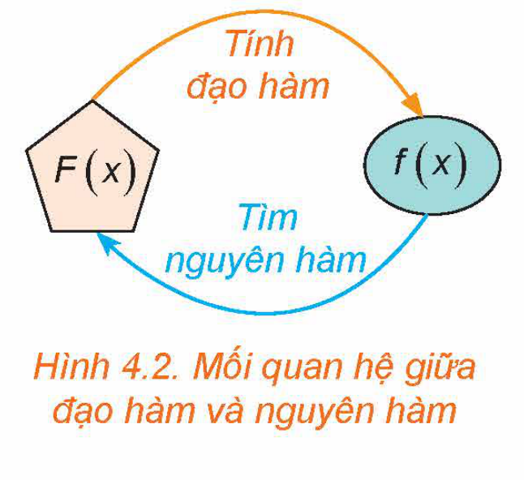

<!-- pdf:6 -->

<!-- Phần giới thiệu Chương IV (in chung đầu trang PDF 6): CHƯƠNG IV. NGUYÊN HÀM VÀ TÍCH PHÂN -->

Chương này trình bày khái niệm, tính chất cơ bản của nguyên hàm và tích phân cũng như ứng dụng tích phân để tính diện tích hình phẳng và thể tích vật thể.

# BÀI 11: NGUYÊN HÀM

## 🔤 Thuật ngữ

- Nguyên hàm
- Họ các nguyên hàm
- Bảng nguyên hàm

## 🎯 Mục tiêu

- Nhận biết khái niệm nguyên hàm của một hàm số.
- Giải thích một số tính chất của nguyên hàm.
- Tìm nguyên hàm của một số hàm số sơ cấp thường gặp.

## 🔴 Mở đầu

Một máy bay di chuyển ra đến đường băng và bắt đầu chạy đà để cất cánh. Giả sử vận tốc của máy bay khi chạy đà được cho bởi $v(t) = 5 + 3t\text{ (m/s)}$, với $t$ là thời gian (tính bằng giây) kể từ khi máy bay bắt đầu chạy đà. Sau $30$ giây thì máy bay cất cánh rời đường băng. Quãng đường máy bay đã di chuyển từ khi bắt đầu chạy đà đến khi rời đường băng là bao nhiêu mét?

Ta cần tìm quãng đường $S(t)$ mà máy bay di chuyển được sau $t$ giây kể từ lúc bắt đầu chạy đà. Từ ý nghĩa cơ học của đạo hàm, ta biết rằng $S'(t) = v(t)$. Như vậy, ta cần tìm một hàm số có đạo hàm bằng hàm số $v(t)$ đã cho. Bài toán này dẫn đến một khái niệm quan trọng trong Toán học, đó là khái niệm *nguyên hàm*.

*Hình 4.1*

## 1. NGUYÊN HÀM CỦA MỘT HÀM SỐ

**HĐ1:** Nhận biết khái niệm nguyên hàm

Cho hai hàm số $f(x) = x^2 + 1$ và $F(x) = \frac{1}{3}x^3 + x$, với $x \in \mathbb{R}$.
<!-- ocr-ok: đối chiếu ảnh p.6 -->

a) Tính đạo hàm của hàm số $F(x)$.

b) $F'(x)$ và $f(x)$ có bằng nhau không?
<!-- ocr-ok: đối chiếu ảnh p.6 -->

<!-- pdf:7 -->

> Cho hàm số $f(x)$ xác định trên một khoảng $K$ (hoặc một đoạn, hoặc một nửa khoảng). Hàm số $F(x)$ được gọi là một **nguyên hàm** của hàm số $f(x)$ trên $K$ nếu $F'(x) = f(x)$ với mọi $x$ thuộc $K$.

**Chú ý:** Trường hợp $K = [a; b]$ thì các đẳng thức $F'(a) = f(a)$ và $F'(b) = f(b)$ được hiểu là đạo hàm bên phải tại điểm $x = a$ và đạo hàm bên trái tại điểm $x = b$ của hàm số $F(x)$, tức là

$\lim_{x \to a^+} \frac{F(x) - F(a)}{x - a} = f(a)$ và $\lim_{x \to b^-} \frac{F(x) - F(b)}{x - b} = f(b).$

**Ví dụ 1:** Cho hàm số $f(x) = x^2 - 2x$. Trong các hàm số cho dưới đây, hàm số nào là một nguyên hàm của hàm số $f(x)$ trên $\mathbb{R}$?

a) $F(x) = \frac{x^3}{3} - x^2$;

b) $G(x) = \frac{x^3}{3} + x^2$.

**Giải:**

Ta có: $F'(x) = x^2 - 2x, G'(x) = x^2 + 2x$.

Vì $F'(x) = f(x)$ với mọi $x \in \mathbb{R}$ nên hàm số $F(x)$ là một nguyên hàm của $f(x)$ trên $\mathbb{R}$.

Hàm số $G(x)$ không là nguyên hàm của $f(x)$ trên $\mathbb{R}$ vì với $x = 1$, ta có
<!-- ocr-ok: đối chiếu ảnh p.7 -->

$G'(1) = 3 \ne -1 = f(1).$

**Luyện tập 1:** Hàm số nào dưới đây là một nguyên hàm của hàm số $f(x) = x + \frac{1}{x}$ trên khoảng $(0; +\infty)$?

a) $F(x) = \frac{1}{2}x^2 + \ln x$;

b) $G(x) = \frac{x^2}{2} - \ln x$.

**HĐ2:** Nhận biết họ nguyên hàm của một hàm số

a) Chứng minh rằng hàm số $F(x) = \frac{x^4}{4}$ là một nguyên hàm của hàm số $f(x) = x^3$ trên $\mathbb{R}$.

b) Hàm số $G(x) = \frac{x^4}{4} + C$ (với $C$ là hằng số) có là một nguyên hàm của hàm số $f(x)$ trên $\mathbb{R}$ không? Vì sao?

> Giả sử hàm số $F(x)$ là một nguyên hàm của $f(x)$ trên $K$. Khi đó:
>
> a) Với mỗi hằng số $C$, hàm số $F(x) + C$ cũng là một nguyên hàm của $f(x)$ trên $K$;
>
> b) Nếu hàm số $G(x)$ là một nguyên hàm của $f(x)$ trên $K$ thì tồn tại một hằng số $C$ sao cho $G(x) = F(x) + C$ với mọi $x \in K$.
>
> Như vậy, nếu $F(x)$ là một nguyên hàm của $f(x)$ trên $K$ thì mọi nguyên hàm của $f(x)$ trên $K$ đều có dạng $F(x) + C$ ($C$ là hằng số). Ta gọi $F(x) + C$ ($C \in \mathbb{R}$) là **họ các nguyên hàm** của $f(x)$ trên $K$, kí hiệu bởi $\int f(x)\,\text{d}x$.

<!-- pdf:8 -->

**Chú ý:**

a) Để tìm họ các nguyên hàm (gọi tắt là tìm nguyên hàm) của hàm số $f(x)$ trên $K$, ta chỉ cần tìm một nguyên hàm $F(x)$ của $f(x)$ trên $K$ và khi đó

$\int f(x)\,\text{d}x = F(x) + C, \ C\text{ là hằng số.}$

b) Người ta chứng minh được rằng, nếu hàm số $f(x)$ liên tục trên khoảng $K$ thì $f(x)$ có nguyên hàm trên khoảng đó.

c) Biểu thức $f(x)\,\text{d}x$ gọi là **vi phân** của nguyên hàm $F(x)$, kí hiệu là $\text{d}F(x)$. Vậy $\text{d}F(x) = F'(x)\,\text{d}x = f(x)\,\text{d}x$.

d) Khi tìm nguyên hàm của một hàm số mà không chỉ rõ tập $K$, ta hiểu là tìm nguyên hàm của hàm số đó trên tập xác định của nó.

*Hình 4.2. Mối quan hệ giữa đạo hàm và nguyên hàm*

**Ví dụ 2:** Tìm một nguyên hàm của hàm số $f(x) = x^2$ trên $\mathbb{R}$. Từ đó hãy tìm $\int x^2\,\text{d}x$.

**Giải:**

Vì $\left(\frac{x^3}{3}\right)' = \frac{3x^2}{3} = x^2$ nên $F(x) = \frac{x^3}{3}$ là một nguyên hàm của hàm số $f(x)$ trên $\mathbb{R}$.

Do đó, $\int x^2\,\text{d}x = \frac{x^3}{3} + C$.

**Luyện tập 2:** Tìm $\int x^3\,\text{d}x$.

## 2. TÍNH CHẤT CƠ BẢN CỦA NGUYÊN HÀM

**HĐ3:** Khám phá nguyên hàm của tích một hàm số với một hằng số khác $0$

Cho $f(x)$ là hàm số liên tục trên $K$, $k$ là một hằng số khác $0$. Giả sử $F(x)$ là một nguyên hàm của $f(x)$ trên $K$.

a) Chứng minh $kF(x)$ là một nguyên hàm của hàm số $kf(x)$ trên $K$.

b) Nêu nhận xét về $\int kf(x)\,\text{d}x$ và $k\int f(x)\,\text{d}x$.

> $\int kf(x)\,\text{d}x = k\int f(x)\,\text{d}x \quad (k \ne 0).$

**Ví dụ 3:** Sử dụng kết quả của Ví dụ 2, hãy tìm:

a) $\int 3x^2\,\text{d}x$;

b) $\int -\frac{3}{2}x^2\,\text{d}x$.

**Giải:**

Ta có:

a) $\int 3x^2\,\text{d}x = 3\int x^2\,\text{d}x = 3\cdot\frac{x^3}{3} + C = x^3 + C$.

b) $\int -\frac{3}{2}x^2\,\text{d}x = -\frac{3}{2}\int x^2\,\text{d}x = -\frac{3}{2}\cdot\frac{x^3}{3} + C = -\frac{1}{2}x^3 + C$.

<!-- pdf:9 -->

**Luyện tập 3:** Cho hàm số $f(x) = x^n$ ($n \in \mathbb{N}^*$).

a) Chứng minh rằng hàm số $F(x) = \frac{x^{n + 1}}{n + 1}$ là một nguyên hàm của hàm số $f(x)$. Từ đó tìm $\int x^n\,\text{d}x$.

b) Từ kết quả câu a, tìm $\int kx^n\,\text{d}x$ ($k$ là hằng số thực khác $0$).

**HĐ4:** Khám phá nguyên hàm của một tổng

Cho $f(x)$ và $g(x)$ là hai hàm số liên tục trên $K$. Giả sử $F(x)$ là một nguyên hàm của $f(x)$, $G(x)$ là một nguyên hàm của $g(x)$ trên $K$.

a) Chứng minh $F(x) + G(x)$ là một nguyên hàm của hàm số $f(x) + g(x)$ trên $K$.

b) Nêu nhận xét về $\int [f(x) + g(x)]\,\text{d}x$ và $\int f(x)\,\text{d}x + \int g(x)\,\text{d}x$.

> - $\int [f(x) + g(x)]\,\text{d}x = \int f(x)\,\text{d}x + \int g(x)\,\text{d}x.$
> - $\int [f(x) - g(x)]\,\text{d}x = \int f(x)\,\text{d}x - \int g(x)\,\text{d}x.$

**Ví dụ 4:** Sử dụng kết quả của Luyện tập 3 và tính chất cơ bản của nguyên hàm, hãy tìm:

a) $\int (x^2 + x)\,\text{d}x$;

b) $\int (4x^3 - 3x^2)\,\text{d}x$.

**Giải:**

Ta có:

a) $\int (x^2 + x)\,\text{d}x = \int x^2\,\text{d}x + \int x\,\text{d}x = \frac{x^3}{3} + \frac{x^2}{2} + C$.

b) $\int (4x^3 - 3x^2)\,\text{d}x = 4\int x^3\,\text{d}x - 3\int x^2\,\text{d}x = x^4 - x^3 + C$.

**Luyện tập 4:** Tìm:

a) $\int (3x^2 + 1)\,\text{d}x$;

b) $\int (2x - 1)^2\,\text{d}x$.

**Ví dụ 5:** Giải bài toán trong *tình huống mở đầu*.

**Giải:**

Gọi $S(t)$ ($0 \le t \le 30$) là quãng đường máy bay di chuyển được sau $t$ giây kể từ lúc bắt đầu chạy đà.

Ta có $v(t) = S'(t)$. Do đó, $S(t)$ là một nguyên hàm của hàm số vận tốc $v(t)$. Sử dụng tính chất của nguyên hàm ta được

$S(t) = \int v(t)\,\text{d}t = \int (5 + 3t)\,\text{d}t = 5\int \text{d}t + 3\int t\,\text{d}t = 5t + \frac{3}{2}t^2 + C.$

Theo giả thiết, $S(0) = 0$ nên $C = 0$ và ta được $S(t) = \frac{3}{2}t^2 + 5t\text{ (m)}$.

Máy bay rời đường băng khi $t = 30$ (giây) nên $S = S(30) = \frac{3}{2}\cdot 30^2 + 5\cdot 30 = 1\,500\text{ (m)}$.

Vậy quãng đường máy bay đã di chuyển từ khi bắt đầu chạy đà đến khi nó rời đường băng là $S = 1\,500\text{ m}$.

<!-- pdf:10 -->

**Vận dụng:** Doanh thu bán hàng của một công ty khi bán một loại sản phẩm là số tiền $R(x)$ (triệu đồng) thu được khi $x$ đơn vị sản phẩm được bán ra. Tốc độ biến động (thay đổi) của doanh thu khi $x$ đơn vị sản phẩm đã được bán là hàm số $M_R(x) = R'(x)$. Một công ty công nghệ cho biết, tốc độ biến đổi của doanh thu khi bán một loại con chíp của hãng được cho bởi $M_R(x) = 300 - 0,1x$, ở đó $x$ là số lượng chíp đã bán. Tìm doanh thu của công ty khi đã bán $1\,000$ con chíp.

*Hướng dẫn:* Vì $R'(x) = M_R(x)$ nên doanh thu $R(x)$ là một nguyên hàm của $M_R(x)$.

## 3. NGUYÊN HÀM CỦA MỘT SỐ HÀM SỐ THƯỜNG GẶP

**a) Nguyên hàm của hàm số luỹ thừa**

Hàm số $y = x^\alpha$, với $\alpha \in \mathbb{R}$, được gọi là **hàm số luỹ thừa**.

Tập xác định của hàm số luỹ thừa $y = x^\alpha$ tuỳ thuộc vào giá trị của $\alpha$. Cụ thể:

- Với $\alpha$ nguyên dương, tập xác định là $\mathbb{R}$;
- Với $\alpha$ nguyên âm hoặc bằng $0$, tập xác định là $\mathbb{R} \setminus \{0\}$;
- Với $\alpha$ không nguyên, tập xác định là $(0; +\infty)$.

Ở lớp 11, ta đã biết đạo hàm của các hàm số $y = x^n$ ($n \in \mathbb{N}^*$) và $y = \sqrt{x}$ là:

$(x^n)' = nx^{n - 1};$

$(\sqrt{x})' = \frac{1}{2\sqrt{x}}$ hay $\left(x^{\frac{1}{2}}\right)' = \frac{1}{2}x^{\frac{1}{2} - 1} \ (x > 0).$

Tổng quát, người ta chứng minh được

<!-- term: Đạo hàm của hàm số luỹ thừa -->
> Hàm số luỹ thừa $y = x^\alpha$ ($\alpha \in \mathbb{R}$) có đạo hàm với mọi $x > 0$ và $(x^\alpha)' = \alpha x^{\alpha - 1}$.

> ❓ Bằng cách viết lại các hàm số sau dưới dạng hàm số luỹ thừa $y = x^\alpha$ ($x > 0$), hãy tính đạo hàm của các hàm số sau với $x > 0$: $y = \frac{1}{x^4}; \ y = x^{\sqrt{2}}; \ y = \frac{1}{\sqrt[3]{x}}$.

**HĐ5:** Khám phá nguyên hàm của hàm số luỹ thừa

a) Với $\alpha \ne -1$, tính đạo hàm của hàm số $y = \frac{x^{\alpha + 1}}{\alpha + 1}$ ($x > 0$).

b) Cho hàm số $y = \ln |x|$ ($x \ne 0$). Tính đạo hàm của hàm số này trong hai trường hợp: $x > 0$ và $x < 0$.

Từ kết quả của HĐ5, ta có

> - $\int x^\alpha\,\text{d}x = \frac{x^{\alpha + 1}}{\alpha + 1} + C \ (\alpha \ne -1).$
> - $\int \frac{1}{x}\,\text{d}x = \ln |x| + C.$

**Ví dụ 6:** Tìm:

a) $\int \sqrt{x}\,\text{d}x \ (x > 0)$;

b) $\int \frac{1}{x^3}\,\text{d}x$;

c) $\int \left(2x^2 + \frac{3}{\sqrt{x}}\right)\text{d}x$.

<!-- pdf:11 -->

**Giải:**

a) $\int \sqrt{x}\,\text{d}x = \int x^{\frac{1}{2}}\,\text{d}x = \frac{x^{\frac{1}{2} + 1}}{\frac{1}{2} + 1} + C = \frac{2}{3}x^{\frac{3}{2}} + C = \frac{2}{3}x\sqrt{x} + C$.

b) $\int \frac{1}{x^3}\,\text{d}x = \int x^{-3}\,\text{d}x = \frac{x^{-3 + 1}}{-3 + 1} + C = -\frac{1}{2}x^{-2} + C = -\frac{1}{2x^2} + C$.

c) $\int \left(2x^2 + \frac{3}{\sqrt{x}}\right)\text{d}x = \int 2x^2\,\text{d}x + \int \frac{3}{\sqrt{x}}\,\text{d}x = 2\int x^2\,\text{d}x + 3\int \frac{1}{\sqrt{x}}\,\text{d}x = \frac{2}{3}x^3 + 6\sqrt{x} + C$.

**Luyện tập 5:** Tìm:

a) $\int \frac{1}{x^4}\,\text{d}x$;

b) $\int x\sqrt{x}\,\text{d}x \ (x > 0)$;

c) $\int \left(\frac{3}{x} - 5\sqrt[3]{x}\right)\text{d}x \ (x > 0)$.

**b) Nguyên hàm của hàm số lượng giác**

**HĐ6:** Khám phá nguyên hàm của hàm số lượng giác

a) Tính đạo hàm của các hàm số sau và nêu kết quả tương ứng vào bảng dưới đây.

| $F(x)$ | $\sin x$ | $\cos x$ | $\tan x$ | $\cot x$ |
| --- | --- | --- | --- | --- |
| $F'(x)$ | $?$ | $?$ | $?$ | $?$ |

b) Sử dụng kết quả ở câu a, tìm nguyên hàm của các hàm số cho trong bảng dưới đây.

| $f(x)$ | $\cos x$ | $\sin x$ | $\frac{1}{\cos^2 x}$ | $\frac{1}{\sin^2 x}$ |
| --- | --- | --- | --- | --- |
| $\int f(x)\,\text{d}x$ | $?$ | $?$ | $?$ | $?$ |

Từ kết quả của HĐ6, ta có

> - $\int \cos x\,\text{d}x = \sin x + C$;
> - $\int \sin x\,\text{d}x = -\cos x + C$;
> - $\int \frac{1}{\cos^2 x}\,\text{d}x = \tan x + C$;
> - $\int \frac{1}{\sin^2 x}\,\text{d}x = -\cot x + C$.

**Ví dụ 7:** Tìm:

a) $\int (\cos x + \sin x)\,\text{d}x$;

b) $\int \left(2\cos x - \frac{1}{\cos^2 x}\right)\text{d}x$.

**Giải:**

a) $\int (\cos x + \sin x)\,\text{d}x = \int \cos x\,\text{d}x + \int \sin x\,\text{d}x = \sin x - \cos x + C$.

b) $\int \left(2\cos x - \frac{1}{\cos^2 x}\right)\text{d}x = 2\int \cos x\,\text{d}x - \int \frac{1}{\cos^2 x}\,\text{d}x = 2\sin x - \tan x + C$.

**Luyện tập 6:** Tìm:

a) $\int (3\cos x - 4\sin x)\,\text{d}x$;

b) $\int \left(\frac{1}{\cos^2 x} - \frac{1}{\sin^2 x}\right)\text{d}x$.

<!-- pdf:12 -->

**c) Nguyên hàm của hàm số mũ**

**HĐ7:** Khám phá nguyên hàm của hàm số mũ

a) Tính đạo hàm của các hàm số sau và nêu kết quả tương ứng vào bảng dưới đây.

| $F(x)$ | $e^x$ | $\frac{a^x}{\ln a} \ (0 < a \ne 1)$ |
| --- | --- | --- |
| $F'(x)$ | $?$ | $?$ |

b) Sử dụng kết quả ở câu a, tìm nguyên hàm của các hàm số cho trong bảng dưới đây.

| $f(x)$ | $e^x$ | $a^x \ (0 < a \ne 1)$ |
| --- | --- | --- |
| $\int f(x)\,\text{d}x$ | $?$ | $?$ |

Từ kết quả của HĐ7, ta có

> - $\int e^x\,\text{d}x = e^x + C.$
> - $\int a^x\,\text{d}x = \frac{a^x}{\ln a} + C \ (0 < a \ne 1).$

**Ví dụ 8:** Tìm:

a) $\int 2^x\,\text{d}x$;

b) $\int \frac{1}{3^x}\,\text{d}x$;

c) $\int (2e^x - 5^x)\,\text{d}x$.

**Giải:**

a) $\int 2^x\,\text{d}x = \frac{2^x}{\ln 2} + C$.

b) $\int \frac{1}{3^x}\,\text{d}x = \int \left(\frac{1}{3}\right)^x\text{d}x = \frac{\left(\frac{1}{3}\right)^x}{\ln \frac{1}{3}} + C = -\frac{1}{3^x \ln 3} + C$.

c) $\int (2e^x - 5^x)\,\text{d}x = 2\int e^x\,\text{d}x - \int 5^x\,\text{d}x = 2e^x - \frac{5^x}{\ln 5} + C$.

**Luyện tập 7:** Tìm:

a) $\int 4^x\,\text{d}x$;

b) $\int \frac{1}{e^x}\,\text{d}x$;

c) $\int \left(2\cdot 3^x - \frac{1}{3}\cdot 7^x\right)\text{d}x$.

Ta tổng kết lại **bảng nguyên hàm** của một số hàm số thường gặp như sau.

| | |
| --- | --- |
| $\int 0\,\text{d}x = C$ | $\int 1\,\text{d}x = x + C$ |
| $\int x^\alpha\,\text{d}x = \frac{x^{\alpha + 1}}{\alpha + 1} + C \ (\alpha \ne -1)$ | $\int \frac{1}{x}\,\text{d}x = \ln |x| + C$ |
| $\int e^x\,\text{d}x = e^x + C$ | $\int a^x\,\text{d}x = \frac{a^x}{\ln a} + C \ (0 < a \ne 1)$ |
| $\int \cos x\,\text{d}x = \sin x + C$ | $\int \sin x\,\text{d}x = -\cos x + C$ |
| $\int \frac{1}{\sin^2 x}\,\text{d}x = -\cot x + C$ | $\int \frac{1}{\cos^2 x}\,\text{d}x = \tan x + C$ |

<!-- pdf:13 -->

Dựa vào bảng nguyên hàm của các hàm số thường gặp và tính chất cơ bản của nguyên hàm, ta có thể tìm được nguyên hàm của nhiều hàm số khác.

## ✏️ Bài tập

**4.1.** Trong mỗi trường hợp sau, hàm số $F(x)$ có là một nguyên hàm của hàm số $f(x)$ trên khoảng tương ứng không? Vì sao?

a) $F(x) = x\ln x$ và $f(x) = 1 + \ln x$ trên khoảng $(0; +\infty)$;

b) $F(x) = e^{\sin x}$ và $f(x) = e^{\cos x}$ trên $\mathbb{R}$.

**4.2.** Tìm nguyên hàm của các hàm số sau:

a) $f(x) = 3x^2 + 2x - 1$;

b) $f(x) = x^3 - x$;

c) $f(x) = (2x + 1)^2$;

d) $f(x) = \left(2x - \frac{1}{x}\right)^2$.

**4.3.** Tìm:

a) $\int \left(3\sqrt{x} + \frac{1}{\sqrt[3]{x}}\right)\text{d}x$;

b) $\int \sqrt{x}(7x^2 - 3)\,\text{d}x \ (x > 0)$;

c) $\int \frac{(2x + 1)^2}{x^2}\,\text{d}x$;

d) $\int \left(2^x + \frac{3}{x^2}\right)\text{d}x$.

**4.4.** Tìm:

a) $\int \left(2\cos x - \frac{3}{\sin^2 x}\right)\text{d}x$;

b) $\int 4\sin^2 \frac{x}{2}\,\text{d}x$;

c) $\int \left(\sin \frac{x}{2} - \cos \frac{x}{2}\right)^2\text{d}x$;

d) $\int (x + \tan^2 x)\,\text{d}x$.

**4.5.** Cho hàm số $y = f(x)$ xác định trên khoảng $(0; +\infty)$. Biết rằng, $f'(x) = 2x + \frac{1}{x^2}$ với mọi $x \in (0; +\infty)$ và $f(1) = 1$. Tính giá trị $f(4)$.
<!-- ocr-ok: đối chiếu ảnh p.13 -->

**4.6.** Cho hàm số $y = f(x)$ có đồ thị là $(C)$. Xét điểm $M(x; f(x))$ thay đổi trên $(C)$. Biết rằng, hệ số góc của tiếp tuyến của đồ thị $(C)$ tại $M$ là $k_M = (x - 1)^2$ và điểm $M$ trùng với gốc toạ độ khi nó nằm trên trục tung. Tìm biểu thức $f(x)$.

**4.7.** Một viên đạn được bắn thẳng đứng lên trên từ mặt đất. Giả sử tại thời điểm $t$ giây (coi $t = 0$ là thời điểm viên đạn được bắn lên), vận tốc của nó được cho bởi $v(t) = 160 - 9,8t\text{ (m/s)}$. Tìm độ cao của viên đạn (tính từ mặt đất):

a) Sau $t = 5$ giây;

b) Khi nó đạt độ cao lớn nhất (làm tròn kết quả đến chữ số thập phân thứ nhất).

## 📷 Danh sách hình trong bài

| Mã hình | Trang PDF | Vị trí trong bài | Chú thích gốc |
| --- | --- | --- | --- |
| H12-toan-b11-01 | 6 | Mở đầu | Hình 4.1 |
| H12-toan-b11-02 | 8 | Mục 1, Chú ý | Hình 4.2. Mối quan hệ giữa đạo hàm và nguyên hàm |
