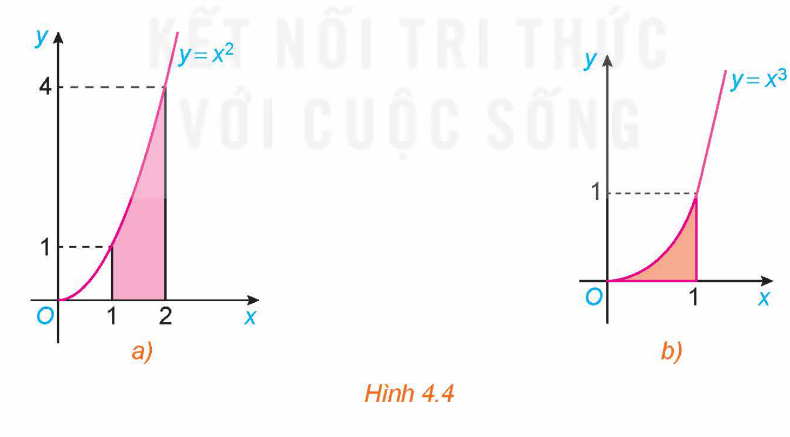
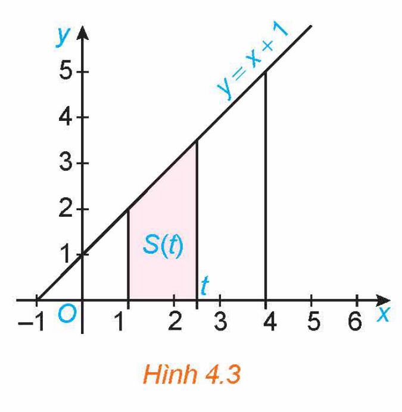
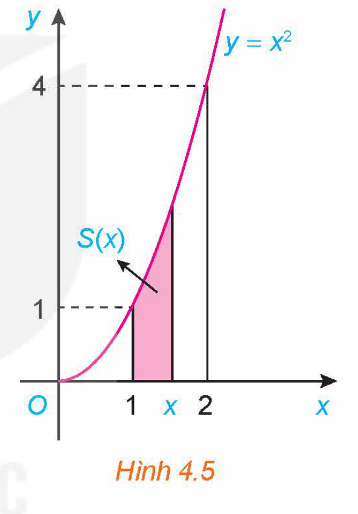
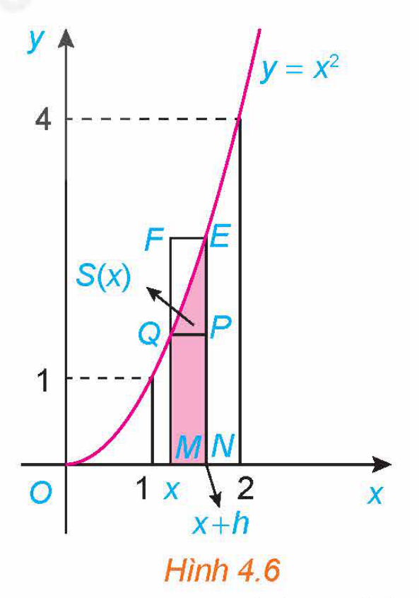
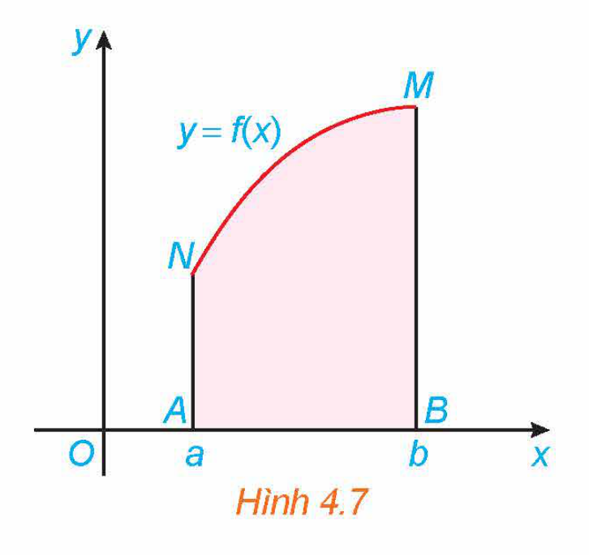
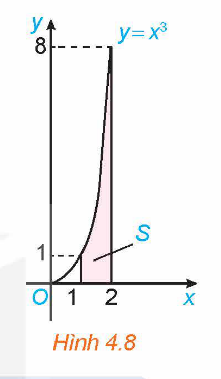
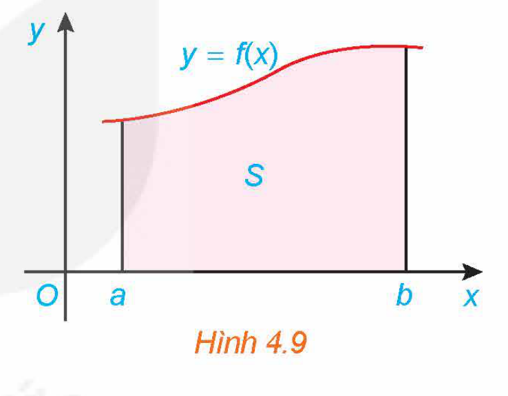
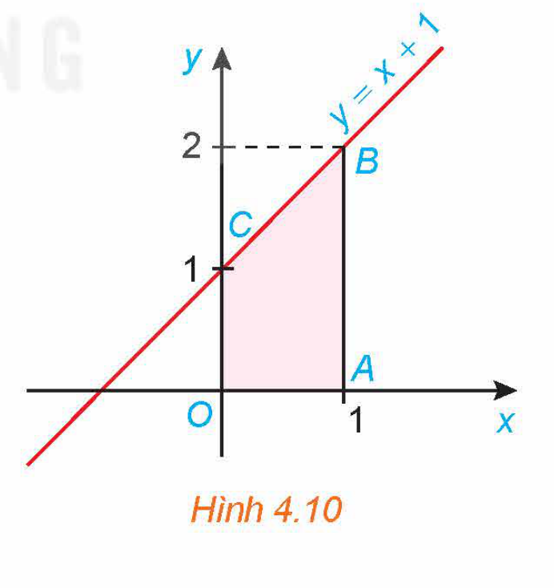
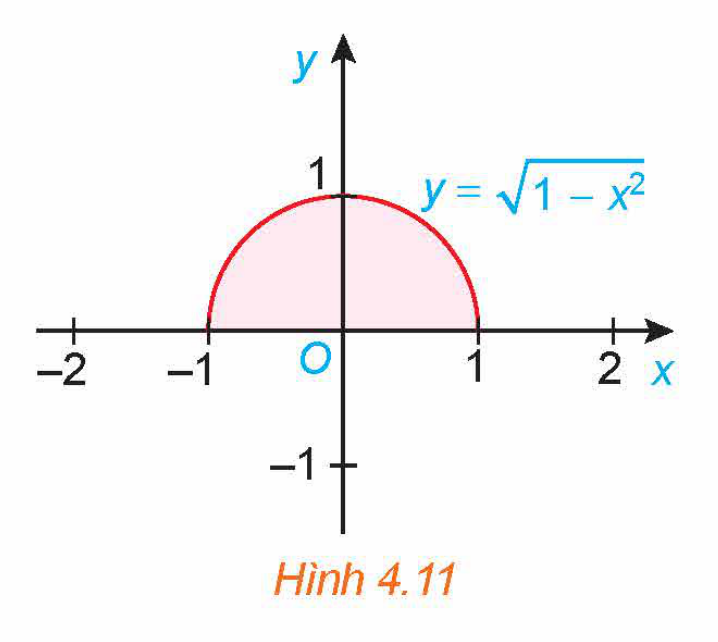

<!-- pdf:14 -->

# BÀI 12: TÍCH PHÂN

## 🔤 Thuật ngữ

- Tích phân
- Cận tích phân
- Hàm số dưới dấu tích phân
<!-- ocr-ok: đối chiếu ảnh p.14 -->

## 🎯 Mục tiêu

- Nhận biết định nghĩa và các tính chất của tích phân.
- Tính tích phân trong những trường hợp đơn giản.
- Vận dụng tích phân để giải một số bài toán liên quan đến thực tiễn.

## 🔴 Mở đầu

Một ô tô đang chạy với vận tốc $20\text{ m/s}$ thì người lái đạp phanh. Sau khi đạp phanh, ô tô chuyển động chậm dần đều với vận tốc $v(t) = -40t + 20\text{ (m/s)}$, trong đó $t$ là thời gian tính bằng giây kể từ lúc đạp phanh. Hỏi từ lúc đạp phanh đến khi dừng hẳn, ô tô còn di chuyển bao nhiêu mét?

## 1. KHÁI NIỆM TÍCH PHÂN

**a) Diện tích hình thang cong**

**Hình thang cong:**

Hình phẳng giới hạn bởi đồ thị $y = f(x)$, trục hoành và hai đường thẳng $x = a, x = b$ ($a < b$), trong đó $f(x)$ là hàm liên tục không âm trên đoạn $[a; b]$, gọi là một **hình thang cong**.

**Ví dụ 1:** Những hình phẳng được tô màu dưới đây có phải là hình thang cong không?

*Hình 4.4*

**Giải:**

Hình 4.4a là hình thang cong giới hạn bởi đồ thị $y = x^2$, trục hoành và hai đường thẳng $x = 1, x = 2$.

Hình 4.4b là hình thang cong giới hạn bởi đồ thị $y = x^3$, trục hoành và hai đường thẳng $x = 0, x = 1$.

<!-- pdf:15 -->

**HĐ1:** Diện tích của hình thang

Kí hiệu $T$ là hình thang vuông giới hạn bởi đường thẳng $y = x + 1$, trục hoành và hai đường thẳng $x = 1, x = t$ ($1 \le t \le 4$) (H.4.3).

a) Tính diện tích $S$ của $T$ khi $t = 4$.

b) Tính diện tích $S(t)$ của $T$ khi $t \in [1; 4]$.

c) Chứng minh rằng $S(t)$ là một nguyên hàm của hàm số $f(t) = t + 1, t \in [1; 4]$ và diện tích $S = S(4) - S(1)$.

*Hình 4.3*

**HĐ2:** Diện tích của hình thang cong

Xét hình thang cong giới hạn bởi đồ thị $y = x^2$, trục hoành và hai đường thẳng $x = 1, x = 2$. Ta muốn tính diện tích $S$ của hình thang cong này.

a) Với mỗi $x \in [1; 2]$, gọi $S(x)$ là diện tích phần hình thang cong đã cho nằm giữa hai đường thẳng vuông góc với trục $Ox$ tại điểm có hoành độ bằng $1$ và $x$ (H.4.5).

Cho $h > 0$ sao cho $x + h < 2$. So sánh hiệu $S(x + h) - S(x)$ với diện tích hai hình chữ nhật $MNPQ$ và $MNEF$ (H.4.6). Từ đó suy ra

$0 \le \frac{S(x + h) - S(x)}{h} - x^2 \le 2xh + h^2.$

*Hình 4.5*

b) Cho $h < 0$ sao cho $x + h > 1$. Tương tự phần a, đánh giá hiệu $S(x) - S(x + h)$ và từ đó suy ra

$2xh + h^2 \le \frac{S(x + h) - S(x)}{h} - x^2 \le 0.$

c) Từ kết quả phần a và phần b, suy ra với mọi $h \ne 0$, ta có

$\left|\frac{S(x + h) - S(x)}{h} - x^2\right| \le 2x|h| + h^2.$

Từ đó chứng minh $S'(x) = x^2, x \in (1; 2)$.

Người ta chứng minh được $S'(1) = 1, S'(2) = 4$, tức là $S(x)$ là một nguyên hàm của $x^2$ trên $[1; 2]$.

d) Từ kết quả của phần c, ta có $S(x) = \frac{x^3}{3} + C$. Sử dụng điều này với lưu ý $S(1) = 0$ và diện tích cần tính $S = S(2)$, hãy tính $S$.
<!-- ocr-ok: đối chiếu ảnh p.15 -->

*Hình 4.6*

Gọi $F(x)$ là một nguyên hàm tuỳ ý của $f(x) = x^2$ trên $[1; 2]$. Hãy so sánh $S$ và $F(2) - F(1)$.

Tổng quát, ta có:

<!-- pdf:16 -->

<!-- term: Định lí diện tích hình thang cong -->
> **Định lí 1:**
> Nếu hàm số $f(x)$ liên tục và không âm trên đoạn $[a; b]$, thì diện tích $S$ của hình thang cong giới hạn bởi đồ thị $y = f(x)$, trục hoành và hai đường thẳng $x = a, x = b$ là $S = F(b) - F(a)$, trong đó $F(x)$ là một nguyên hàm của hàm số $f(x)$ trên đoạn $[a; b]$.

*Hình 4.7*

**Ví dụ 2:** Tính diện tích $S$ của hình thang cong giới hạn bởi đồ thị hàm số $y = f(x) = x^3$, trục hoành và hai đường thẳng $x = 1, x = 2$.

*Hình 4.8*

**Giải:** (H.4.8)

Một nguyên hàm của hàm số $f(x) = x^3$ là $F(x) = \frac{x^4}{4}$.

Do đó, diện tích của hình thang cong cần tính là

$S = F(2) - F(1) = \frac{2^4}{4} - \frac{1^4}{4} = \frac{15}{4}.$

**b) Định nghĩa tích phân**

**HĐ3:** Nhận biết khái niệm tích phân
<!-- ocr-ok: đối chiếu ảnh p.16 -->

Giả sử $f(x)$ là hàm số liên tục trên đoạn $[a; b]$, $F(x)$ và $G(x)$ là hai nguyên hàm tuỳ ý của $f(x)$ trên đoạn $[a; b]$. Chứng minh rằng $F(b) - F(a) = G(b) - G(a)$.

> Chú ý $G(x) = F(x) + C$, $C$ là hằng số.
<!-- ocr-ok: đối chiếu ảnh p.16 -->

Từ đó, ta có định nghĩa sau:

> Cho $f(x)$ là hàm số liên tục trên đoạn $[a; b]$. Nếu $F(x)$ là một nguyên hàm của hàm số $f(x)$ trên đoạn $[a; b]$ thì hiệu số $F(b) - F(a)$ được gọi là **tích phân** từ $a$ đến $b$ của hàm số $f(x)$, kí hiệu là $\int_a^b f(x)\,\text{d}x$.

**Chú ý:**

a) Hiệu $F(b) - F(a)$ thường được kí hiệu là $F(x)\Big|_a^b$.

Như vậy

$\int_a^b f(x)\,\text{d}x = F(x)\Big|_a^b.$

b) Ta gọi $\int_a^b$ là **dấu tích phân**, $a$ là **cận dưới**, $b$ là **cận trên**, $f(x)\,\text{d}x$ là **biểu thức dưới dấu tích phân** và $f(x)$ là **hàm số dưới dấu tích phân**.

> Tích phân không phụ thuộc vào cách kí hiệu biến:
> $\int_a^b f(x)\,\text{d}x = \int_a^b f(t)\,\text{d}t = \int_a^b f(u)\,\text{d}u.$
<!-- ocr-ok: đối chiếu ảnh p.16 -->

c) Trong trường hợp $a = b$ hoặc $a > b$, ta quy ước:

$\int_a^a f(x)\,\text{d}x = 0; \quad \int_a^b f(x)\,\text{d}x = -\int_b^a f(x)\,\text{d}x.$

<!-- pdf:17 -->

**Ví dụ 3:** Tính:

a) $\int_{-1}^3 x^2\,\text{d}x$;

b) $\int_0^{\frac{\pi}{6}} \cos t\,\text{d}t$;

c) $\int_0^{\frac{\pi}{4}} \frac{\text{d}u}{\cos^2 u}$;

d) $\int_1^2 2^x\,\text{d}x$.

**Giải:**

a) $\int_{-1}^3 x^2\,\text{d}x = \frac{x^3}{3}\Big|_{-1}^3 = \frac{1}{3}\left[3^3 - (-1)^3\right] = \frac{28}{3}$.

b) $\int_0^{\frac{\pi}{6}} \cos t\,\text{d}t = \sin t\Big|_0^{\frac{\pi}{6}} = \sin \frac{\pi}{6} - \sin 0 = \frac{1}{2}$.

c) $\int_0^{\frac{\pi}{4}} \frac{\text{d}u}{\cos^2 u} = \tan u\Big|_0^{\frac{\pi}{4}} = \tan \frac{\pi}{4} - \tan 0 = 1 - 0 = 1$.

d) $\int_1^2 2^x\,\text{d}x = \frac{2^x}{\ln 2}\Big|_1^2 = \frac{2^2}{\ln 2} - \frac{2^1}{\ln 2} = \frac{2}{\ln 2}$.

**Luyện tập 1:** Tính:

a) $\int_0^1 e^x\,\text{d}x$;

b) $\int_1^e \frac{1}{x}\,\text{d}x$;

c) $\int_0^{\frac{\pi}{2}} \sin x\,\text{d}x$;

d) $\int_{\frac{\pi}{6}}^{\frac{\pi}{3}} \frac{\text{d}x}{\sin^2 x}$.

Từ Định lí 1 và định nghĩa tích phân, ta có

<!-- term: Ý nghĩa hình học của tích phân -->
**Ý nghĩa hình học của tích phân:**
Nếu hàm số $f(x)$ liên tục và không âm trên đoạn $[a; b]$, thì tích phân $\int_a^b f(x)\,\text{d}x$ là diện tích $S$ của hình thang cong giới hạn bởi đồ thị $y = f(x)$, trục hoành và hai đường thẳng $x = a, x = b$ (H.4.9). Vậy $S = \int_a^b f(x)\,\text{d}x$.

*Hình 4.9*

**Ví dụ 4:** Sử dụng ý nghĩa hình học của tích phân, tính:

a) $\int_0^1 (x + 1)\,\text{d}x$;

b) $\int_{-1}^1 \sqrt{1 - x^2}\,\text{d}x$.

*Hình 4.10*

**Giải:**

a) Tích phân cần tính là diện tích của hình thang vuông $OABC$, có đáy nhỏ $OC = 1$, đáy lớn $AB = 2$ và đường cao $OA = 1$ (H.4.10). Do đó:

$\int_0^1 (x + 1)\,\text{d}x = S_{OABC} = \frac{1}{2}(OC + AB)\cdot OA = \frac{1}{2}(1 + 2)\cdot 1 = \frac{3}{2}.$

<!-- pdf:18 -->

b) Ta có $y = \sqrt{1 - x^2}$ là phương trình nửa phía trên trục hoành của đường tròn tâm tại gốc toạ độ $O$ và bán kính $1$. Do đó, tích phân cần tính là diện tích nửa phía trên trục hoành của hình tròn tương ứng (H.4.11).

Vậy $\int_{-1}^1 \sqrt{1 - x^2}\,\text{d}x = \frac{\pi}{2}$.

*Hình 4.11*

**Luyện tập 2:** Sử dụng ý nghĩa hình học của tích phân, tính:

a) $\int_1^3 (2x + 1)\,\text{d}x$;

b) $\int_{-2}^2 \sqrt{4 - x^2}\,\text{d}x$.

**Vận dụng 1:** Giải quyết bài toán ở *tình huống mở đầu*.

> Lưu ý $v(t) = s'(t)$.

## 2. TÍNH CHẤT CỦA TÍCH PHÂN

**HĐ4:** Nhận biết tính chất của tích phân

Tính và so sánh:

a) $\int_0^1 2x\,\text{d}x$ và $2\int_0^1 x\,\text{d}x$;

b) $\int_0^1 (x^2 + x)\,\text{d}x$ và $\int_0^1 x^2\,\text{d}x + \int_0^1 x\,\text{d}x$;

c) $\int_0^3 x\,\text{d}x$ và $\int_0^1 x\,\text{d}x + \int_1^3 x\,\text{d}x$.

<!-- term: Tính chất của tích phân -->
**Tính chất của tích phân:**
Cho $f(x), g(x)$ là các hàm số liên tục trên đoạn $[a; b]$. Khi đó, ta có:
> 1) $\int_a^b kf(x)\,\text{d}x = k\int_a^b f(x)\,\text{d}x$ ($k$ là hằng số);
> 2) $\int_a^b [f(x) + g(x)]\,\text{d}x = \int_a^b f(x)\,\text{d}x + \int_a^b g(x)\,\text{d}x$;
> 3) $\int_a^b [f(x) - g(x)]\,\text{d}x = \int_a^b f(x)\,\text{d}x - \int_a^b g(x)\,\text{d}x$;
> 4) $\int_a^b f(x)\,\text{d}x = \int_a^c f(x)\,\text{d}x + \int_c^b f(x)\,\text{d}x$ ($a < c < b$).
<!-- ocr-ok: đối chiếu ảnh p.18 -->

<!-- pdf:19 -->

**Ví dụ 5:** Tính:

a) $\int_1^4 (x^3 + 3\sqrt{x})\,\text{d}x$;

b) $\int_0^{\frac{\pi}{2}} (e^x - 2\cos x)\,\text{d}x$;

c) $\int_1^4 \left(2^x - \frac{3}{x^2}\right)\text{d}x$.

**Giải:**

a) $\int_1^4 (x^3 + 3\sqrt{x})\,\text{d}x = \int_1^4 x^3\,\text{d}x + 3\int_1^4 \sqrt{x}\,\text{d}x = \frac{x^4}{4}\Big|_1^4 + 3\cdot\frac{x^{\frac{3}{2}}}{\frac{3}{2}}\Big|_1^4$

$= \frac{1}{4}(4^4 - 1) + 2\left(4^{\frac{3}{2}} - 1\right) = \frac{255}{4} + 14 = \frac{311}{4}.$

b) $\int_0^{\frac{\pi}{2}} (e^x - 2\cos x)\,\text{d}x = \int_0^{\frac{\pi}{2}} e^x\,\text{d}x - 2\int_0^{\frac{\pi}{2}} \cos x\,\text{d}x$

$= e^x\Big|_0^{\frac{\pi}{2}} - 2\sin x\Big|_0^{\frac{\pi}{2}} = \left(e^{\frac{\pi}{2}} - 1\right) - 2(1 - 0) = e^{\frac{\pi}{2}} - 3.$

c) $\int_1^4 \left(2^x - \frac{3}{x^2}\right)\text{d}x = \int_1^4 2^x\,\text{d}x - 3\int_1^4 x^{-2}\,\text{d}x = \frac{2^x}{\ln 2}\Big|_1^4 + 3\cdot\frac{1}{x}\Big|_1^4$

$= \frac{1}{\ln 2}(2^4 - 2^1) + 3\left(\frac{1}{4} - 1\right) = \frac{15}{\ln 2} - \frac{9}{4}.$

**Luyện tập 3:** Tính các tích phân sau:

a) $\int_0^{2\pi} (2x + \cos x)\,\text{d}x$;

b) $\int_1^2 \left(3^x - \frac{3}{x}\right)\text{d}x$;

c) $\int_{\frac{\pi}{6}}^{\frac{\pi}{3}} \left(\frac{1}{\cos^2 x} - \frac{1}{\sin^2 x}\right)\text{d}x$.

**Ví dụ 6:** Tính $\int_0^3 |x - 2|\,\text{d}x$.

**Giải:**

Ta có:

$\int_0^3 |x - 2|\,\text{d}x = \int_0^2 |x - 2|\,\text{d}x + \int_2^3 |x - 2|\,\text{d}x = \int_0^2 (2 - x)\,\text{d}x + \int_2^3 (x - 2)\,\text{d}x$

$= \left(2x - \frac{x^2}{2}\right)\Big|_0^2 + \left(\frac{x^2}{2} - 2x\right)\Big|_2^3 = [(4 - 2) - 0] + \left[\left(\frac{9}{2} - 6\right) - (2 - 4)\right] = \frac{5}{2}.$

**Luyện tập 4:** Tính $\int_0^3 |2x - 3|\,\text{d}x$.

**Vận dụng 2:** **Giá trị trung bình** của hàm số liên tục $f(x)$ trên đoạn $[a; b]$ được định nghĩa là

$\frac{1}{b - a}\int_a^b f(x)\,\text{d}x.$

Giả sử nhiệt độ (tính bằng $^\circ\text{C}$) tại thời điểm $t$ giờ trong khoảng thời gian từ $6$ giờ sáng đến $12$ giờ trưa ở một địa phương vào một ngày nào đó được mô hình hoá bởi hàm số

$T(t) = 20 + 1,5(t - 6), \ 6 \le t \le 12.$

Tìm nhiệt độ trung bình vào ngày đó trong khoảng thời gian từ $6$ giờ sáng đến $12$ giờ trưa.

<!-- pdf:20 -->

## ✏️ Bài tập

**4.8.** Sử dụng ý nghĩa hình học của tích phân, tính:

a) $\int_1^2 (2x + 1)\,\text{d}x$;

b) $\int_{-3}^3 \sqrt{9 - x^2}\,\text{d}x$.

**4.9.** Cho $\int_0^3 f(x)\,\text{d}x = 5$ và $\int_0^3 g(x)\,\text{d}x = 2$. Tính:
<!-- ocr-ok: đối chiếu ảnh p.20 -->

a) $\int_0^3 [f(x) + g(x)]\,\text{d}x$;

b) $\int_0^3 [f(x) - g(x)]\,\text{d}x$;

c) $\int_0^3 3f(x)\,\text{d}x$;

d) $\int_0^3 [2f(x) - 3g(x)]\,\text{d}x$.

**4.10.** Tính:

a) $\int_0^3 (3x - 1)^2\,\text{d}x$;

b) $\int_0^{\frac{\pi}{2}} (1 + \sin x)\,\text{d}x$;

c) $\int_0^1 (e^{2x} + 3x^2)\,\text{d}x$;

d) $\int_{-1}^2 |2x + 1|\,\text{d}x$.

**4.11.** Một vật chuyển động dọc theo một đường thẳng sao cho vận tốc của nó tại thời điểm $t$ (giây) là $v(t) = t^2 - t - 6\text{ (m/s)}$.

a) Tìm độ dịch chuyển của vật trong khoảng thời gian $1 \le t \le 4$, tức là tính $\int_1^4 v(t)\,\text{d}t$.

b) Tìm tổng quãng đường vật đi được trong khoảng thời gian này, tức là tính $\int_1^4 |v(t)|\,\text{d}t$.

**4.12.** Giả sử lợi nhuận biên (tính bằng triệu đồng) của một sản phẩm được mô hình hoá bằng công thức

$P'(x) = -0,0005x + 12,2.$

Ở đây $P(x)$ là lợi nhuận (tính bằng triệu đồng) khi bán được $x$ đơn vị sản phẩm.

a) Tìm sự thay đổi của lợi nhuận khi doanh số tăng từ $100$ lên $101$ đơn vị sản phẩm.

b) Tìm sự thay đổi của lợi nhuận khi doanh số tăng từ $100$ lên $110$ đơn vị sản phẩm.

**4.13.** Giả sử vận tốc $v$ của dòng máu ở khoảng cách $r$ từ tâm của động mạch bán kính $R$ không đổi, có thể được mô hình hoá bởi công thức

$v = k(R^2 - r^2),$

trong đó $k$ là một hằng số. Tìm vận tốc trung bình (đối với $r$) của động mạch trong khoảng $0 \le r \le R$. So sánh vận tốc trung bình với vận tốc lớn nhất.

## 📷 Danh sách hình trong bài

| Mã hình | Trang PDF | Vị trí trong bài | Chú thích gốc |
| --- | --- | --- | --- |
| H12-toan-b12-01 | 14 | Mở đầu | (sách không đánh số, hình minh hoạ ô tô đạp phanh ở mở đầu Bài 12) |
| H12-toan-b12-02 | 14 | Mục 1.a, Ví dụ 1 | Hình 4.4 |
| H12-toan-b12-03 | 15 | Mục 1.a, HĐ1 | Hình 4.3 |
| H12-toan-b12-04 | 15 | Mục 1.a, HĐ2 | Hình 4.5 |
| H12-toan-b12-05 | 15 | Mục 1.a, HĐ2 | Hình 4.6 |
| H12-toan-b12-06 | 16 | Mục 1.a, Định lí 1 | Hình 4.7 |
| H12-toan-b12-07 | 16 | Mục 1.a, Ví dụ 2 | Hình 4.8 |
| H12-toan-b12-08 | 17 | Mục 1.b, Ý nghĩa hình học | Hình 4.9 |
| H12-toan-b12-09 | 17 | Mục 1.b, Ví dụ 4a | Hình 4.10 |
| H12-toan-b12-10 | 18 | Mục 1.b, Ví dụ 4b | Hình 4.11 |
