<!-- pdf:21 -->

# BÀI 13: ỨNG DỤNG HÌNH HỌC CỦA TÍCH PHÂN

## 🔤 Thuật ngữ

- Hình phẳng
- Thể tích
- Khối tròn xoay

## 🎯 Mục tiêu

- Sử dụng tích phân để tính diện tích của một số hình phẳng.
- Sử dụng tích phân để tính thể tích của một số vật thể.

## 🔴 Mở đầu

Trong phần Hình học ở Trung học cơ sở và lớp 11, chúng ta đã được học công thức tính thể tích của nhiều vật thể trong không gian như khối lăng trụ, khối chóp, khối chóp cụt đều, khối trụ, khối nón, khối cầu. Tuy nhiên, ta thường phải thừa nhận các công thức này.

Bài học này sẽ cung cấp một phương pháp tổng quát giúp ta thiết lập một cách dễ dàng tất cả các công thức tính diện tích và thể tích đã được học trong Hình học, cũng như tính được diện tích của những hình phẳng và thể tích của những vật thể phức tạp hơn gặp trong thực tiễn.

## 1. ỨNG DỤNG TÍCH PHÂN ĐỂ TÍNH DIỆN TÍCH HÌNH PHẲNG

**a) Hình phẳng giới hạn bởi một đồ thị hàm số, trục hoành và hai đường thẳng $x = a, x = b$**

**HĐ1:** Nhận biết công thức tính diện tích

Xét hình phẳng giới hạn bởi đường thẳng $y = f(x) = x + 1$, trục hoành và hai đường thẳng $x = -2, x = 1$ (H.4.12).

a) Tính diện tích $S$ của hình phẳng này.

b) Tính $\int_{-2}^{1} |f(x)|\text{d}x$ và so sánh với $S$.

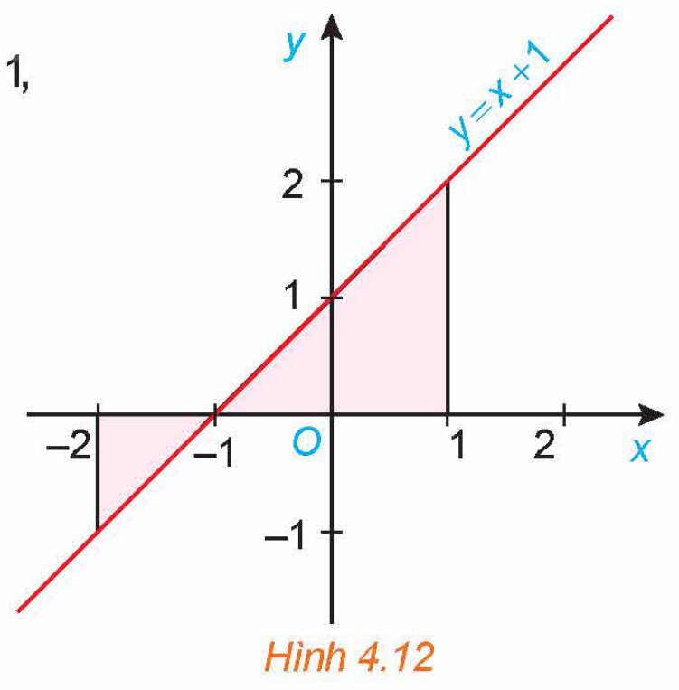
*Hình 4.12*

<!-- term: Diện tích hình phẳng -->
> Diện tích $S$ của hình phẳng giới hạn bởi đồ thị của hàm số $f(x)$ liên tục, trục hoành và hai đường thẳng $x = a, x = b$ ($a < b$), được tính bằng công thức
> $S = \int_{a}^{b} |f(x)|\text{d}x.$

<!-- pdf:22 -->

**Ví dụ 1:** Tính diện tích hình phẳng giới hạn bởi đồ thị của hàm số $y = x^3$, trục hoành và hai đường thẳng $x = 0, x = 2$ (H.4.13).

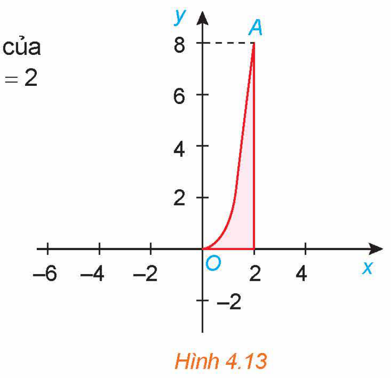
*Hình 4.13*

**Giải:**

Diện tích hình phẳng cần tính là

$S = \int_{0}^{2} |x^3|\text{d}x = \int_{0}^{2} x^3\text{d}x = \left.\frac{x^4}{4}\right|_{0}^{2} = 4 - 0 = 4.$

**Ví dụ 2:** Tính diện tích hình phẳng giới hạn bởi đồ thị hàm số $y = \sin x$, trục hoành và hai đường thẳng $x = 0, x = 2\pi$ (H.4.14).

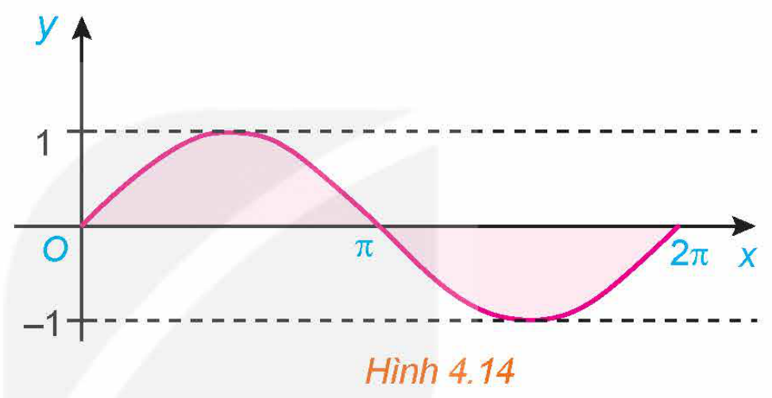
*Hình 4.14*

**Giải:**

Diện tích hình phẳng cần tính là

$S = \int_{0}^{2\pi} |\sin x|\text{d}x = \int_{0}^{\pi} |\sin x|\text{d}x + \int_{\pi}^{2\pi} |\sin x|\text{d}x = \int_{0}^{\pi} \sin x\text{d}x + \int_{\pi}^{2\pi} (-\sin x\text{d}x) = \left.-\cos x\right|_{0}^{\pi} + \left.\cos x\right|_{\pi}^{2\pi} = 4.$

**Luyện tập 1:** Tính diện tích hình phẳng giới hạn bởi parabol $y = x^2 - 4$, trục hoành và hai đường thẳng $x = 0, x = 3$ (H.4.15).

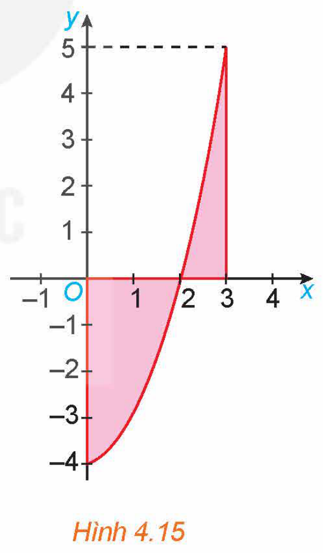
*Hình 4.15*

**b) Hình phẳng giới hạn bởi hai đồ thị hàm số và hai đường thẳng $x = a, x = b$**

**HĐ2:** Nhận biết công thức tính diện tích

Gọi $S$ là diện tích hình phẳng giới hạn bởi đồ thị của các hàm số $f(x) = -x^2 + 4x$, $g(x) = x$ và hai đường thẳng $x = 1, x = 3$ (H.4.16).

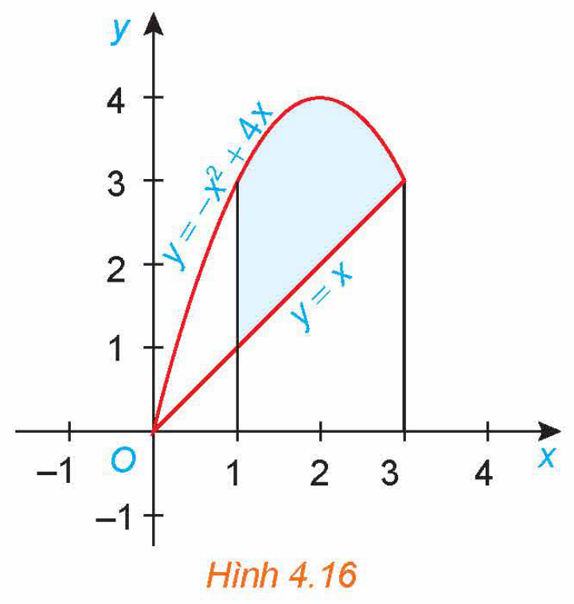
*Hình 4.16*

<!-- pdf:23 -->

a) Giả sử $S_1$ là diện tích hình phẳng giới hạn bởi parabol $y = -x^2 + 4x$, trục hoành và hai đường thẳng $x = 1, x = 3$; $S_2$ là diện tích hình phẳng giới hạn bởi đường thẳng $y = x$, trục hoành và hai đường thẳng $x = 1, x = 3$. Tính $S_1, S_2$ và từ đó suy ra $S$.

b) Tính $\int_{1}^{3} |f(x) - g(x)|\text{d}x$ và so sánh với $S$.

<!-- term: Diện tích giới hạn bởi hai đồ thị -->
> Diện tích $S$ của hình phẳng giới hạn bởi đồ thị của hai hàm số $f(x), g(x)$ liên tục trên đoạn $[a; b]$ và hai đường thẳng $x = a, x = b$, được tính bằng công thức
> $S = \int_{a}^{b} |f(x) - g(x)|\text{d}x.$

**Chú ý:** Nếu hiệu $f(x) - g(x)$ không đổi dấu trên đoạn $[a; b]$ thì
<!-- ocr-ok: đã đối chiếu ảnh trang PDF 23 -->

$\int_{a}^{b} |f(x) - g(x)|\text{d}x = \left|\int_{a}^{b} [f(x) - g(x)]\text{d}x\right|.$

**Ví dụ 3:** Tính diện tích hình phẳng giới hạn bởi hai parabol $y = 4 - x^2, y = x^2$ và hai đường thẳng $x = -1, x = 1$ (H.4.17).

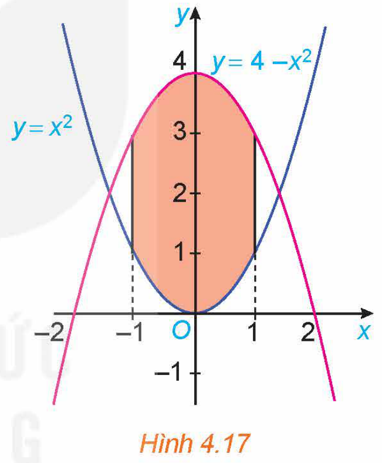
*Hình 4.17*

**Giải:**

Diện tích hình phẳng cần tính là

$S = \int_{-1}^{1} |(4 - x^2) - x^2|\text{d}x = \int_{-1}^{1} |4 - 2x^2|\text{d}x = \int_{-1}^{1} (4 - 2x^2)\text{d}x = \left.\left(4x - \frac{2}{3}x^3\right)\right|_{-1}^{1} = \frac{20}{3}.$

**Ví dụ 4:** Tính diện tích hình phẳng giới hạn bởi đồ thị hai hàm số $y = \sin x, y = \cos x$ và hai đường thẳng $x = 0, x = \frac{\pi}{4}$ (H.4.18).

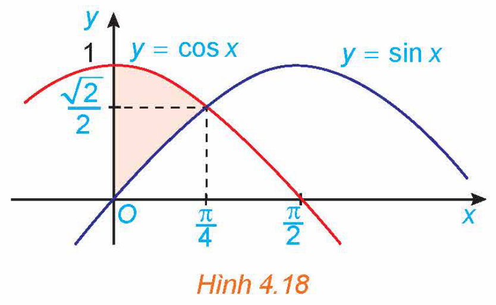
*Hình 4.18*

**Giải:**

Diện tích hình phẳng cần tính là

$S = \int_{0}^{\frac{\pi}{4}} |\sin x - \cos x|\text{d}x = \int_{0}^{\frac{\pi}{4}} (\cos x - \sin x)\text{d}x = \left.(\sin x + \cos x)\right|_{0}^{\frac{\pi}{4}} = \sqrt{2} - 1.$

**Luyện tập 2:** Tính diện tích hình phẳng giới hạn bởi đồ thị của các hàm số $y = \sqrt{x}, y = x - 2$ và hai đường thẳng $x = 1, x = 4$.

<!-- pdf:24 -->

**Vận dụng 1:** Ta biết rằng hàm cầu liên quan đến giá $p$ của một sản phẩm với nhu cầu của người tiêu dùng, hàm cung liên quan đến giá $p$ của sản phẩm với mức độ sẵn sàng cung cấp sản phẩm của nhà sản xuất. Điểm cắt nhau $(x_0; p_0)$ của đồ thị hàm cầu $p = D(x)$ và đồ thị hàm cung $p = S(x)$ được gọi là **điểm cân bằng**.

Các nhà kinh tế gọi diện tích của hình giới hạn bởi đồ thị hàm cầu, đường ngang $p = p_0$ và đường thẳng đứng $x = 0$ là **thặng dư tiêu dùng**. Tương tự, diện tích của hình giới hạn bởi đồ thị của hàm cung, đường nằm ngang $p = p_0$ và đường thẳng đứng $x = 0$ được gọi là **thặng dư sản xuất**, như trong Hình 4.19.

*(Theo R. Larson, Brief Calculus: An Applied Approach, 8th edition, Cengage Learning, 2009)*

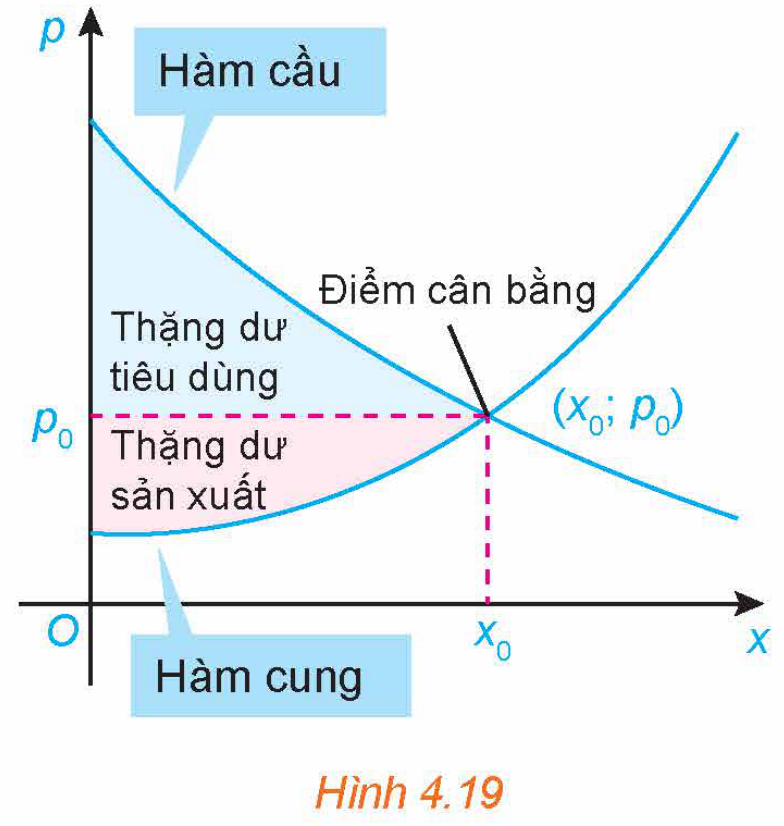
*Hình 4.19*

Giả sử hàm cung và hàm cầu của một loại sản phẩm được mô hình hoá bởi:

Hàm cầu: $p = -0,36x + 9$ và hàm cung: $p = 0,14x + 2$, trong đó $x$ là số đơn vị sản phẩm. Tìm thặng dư tiêu dùng và thặng dư sản xuất cho sản phẩm này.

## 2. ỨNG DỤNG TÍCH PHÂN ĐỂ TÍNH THỂ TÍCH VẬT THỂ

**a) Tính thể tích của vật thể**

**HĐ3:** Nhận biết công thức tính thể tích vật thể

Xét hình trụ có bán kính đáy $R$, có trục là trục hoành $Ox$, nằm giữa hai mặt phẳng $x = a$ và $x = b$ ($a < b$) (H.4.20).

a) Tính thể tích $V$ của hình trụ.

b) Tính diện tích mặt cắt $S(x)$ khi cắt hình trụ bởi mặt phẳng vuông góc với trục $Ox$ tại điểm có hoành độ là $x$ ($a \le x \le b$). Từ đó tính $\int_{a}^{b} S(x)\text{d}x$ và so sánh với $V$.

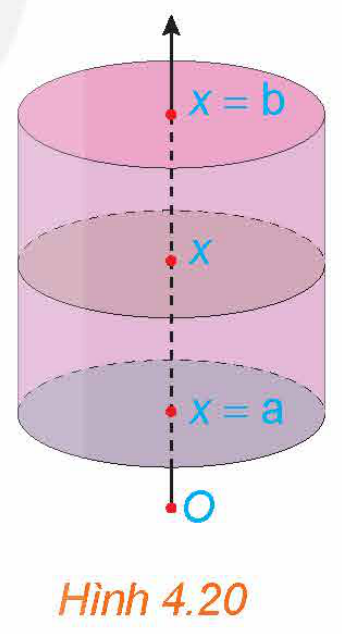
*Hình 4.20*

**Công thức tính thể tích vật thể**

<!-- term: Thể tích vật thể -->
> Cho một vật thể trong không gian $Oxyz$. Gọi $\mathcal{B}$ là phần vật thể giới hạn bởi hai mặt phẳng vuông góc với trục $Ox$ tại các điểm có hoành độ $x = a, x = b$. Một mặt phẳng vuông góc với trục $Ox$ tại điểm có hoành độ là $x$ cắt vật thể theo mặt cắt có diện tích là $S(x)$. Giả sử $S(x)$ là hàm số liên tục trên đoạn $[a; b]$. Khi đó thể tích $V$ của phần vật thể $\mathcal{B}$ được tính bởi công thức
> $V = \int_{a}^{b} S(x)\text{d}x.$

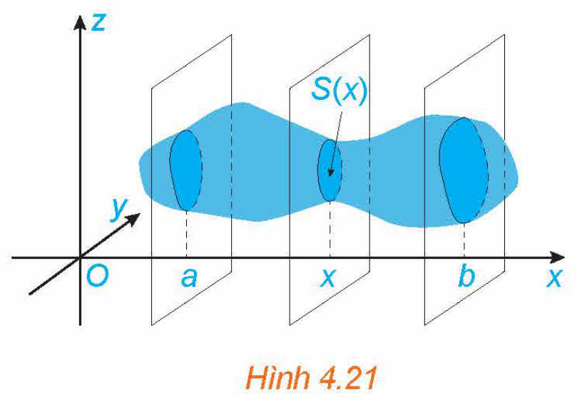
*Hình 4.21*

<!-- pdf:25 -->

**Ví dụ 5:** Tính thể tích của khối lăng trụ có diện tích đáy bằng $S$ và chiều cao bằng $h$.

**Giải:** (H.4.22)

Chọn trục $Ox$ song song với đường cao của khối lăng trụ và hai đáy nằm trên hai mặt phẳng vuông góc với $Ox$ tại $x = 0$ và $x = h$.

Mỗi mặt phẳng vuông góc với trục $Ox$ tại điểm có hoành độ bằng $x$ ($0 \le x \le h$) cắt khối lăng trụ theo mặt cắt có diện tích không đổi là $S(x) = S$.

Do đó, thể tích của khối lăng trụ là

$V = \int_{0}^{h} S(x)\text{d}x = \int_{0}^{h} S\text{d}x = \left.Sx\right|_{0}^{h} = Sh.$

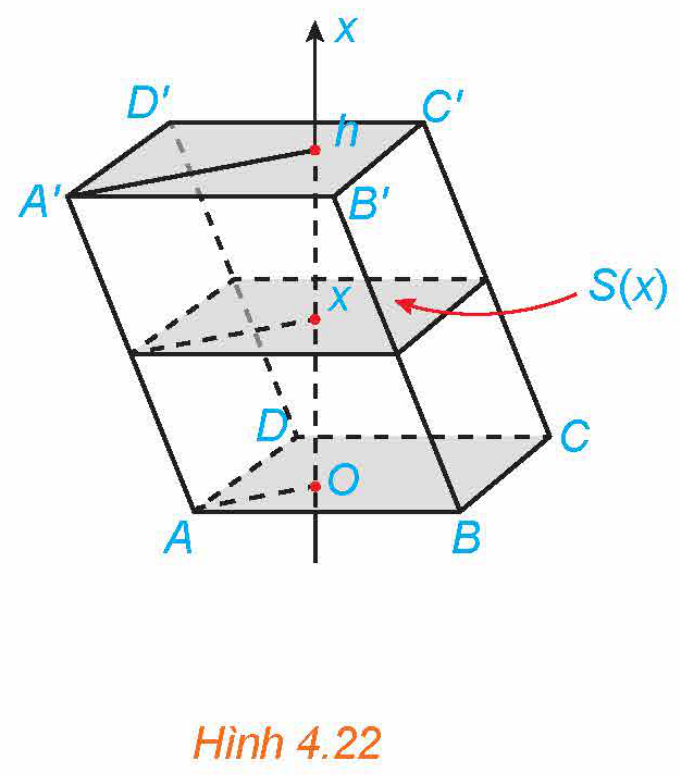
*Hình 4.22*

**Ví dụ 6:** Tính thể tích của khối chóp đều có đáy là hình vuông cạnh $L$ và chiều cao là $h$.

**Giải:** (H.4.23)

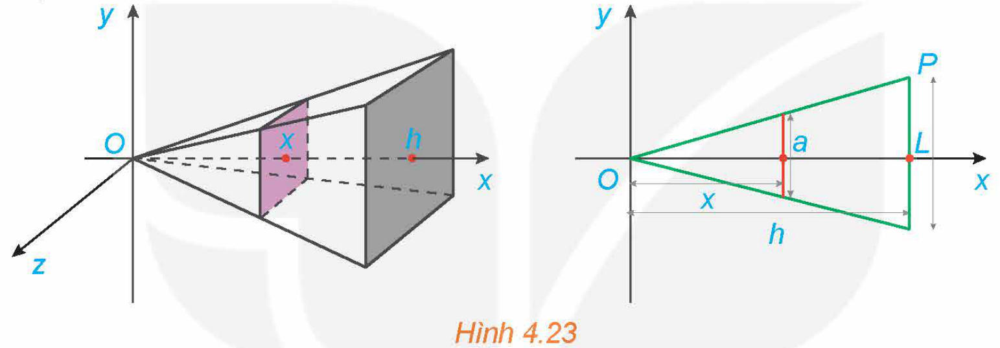
*Hình 4.23*

Chọn trục $Ox$ sao cho gốc $O$ trùng với đỉnh của khối chóp và trục đi qua tâm của đáy. Khi đó, đáy của khối chóp nằm trên mặt phẳng vuông góc với $Ox$ tại $x = h$.

Mỗi mặt phẳng vuông góc với trục $Ox$ tại điểm có hoành độ bằng $x$ ($0 \le x \le h$), cắt khối chóp theo mặt cắt là hình vuông có cạnh là $a$.

Theo định lí Thalès, ta có $\frac{x}{h} = \frac{\frac{a}{2}}{\frac{L}{2}}$, suy ra $a = \frac{L}{h}x$.

Do đó, diện tích của mặt cắt này là $S(x) = \frac{L^2}{h^2}x^2$.

Vậy thể tích của khối chóp này là $V = \int_{0}^{h} S(x)\text{d}x = \int_{0}^{h} \frac{L^2}{h^2}x^2\text{d}x = \left.\frac{L^2}{h^2}\frac{x^3}{3}\right|_{0}^{h} = \frac{1}{3}L^2h$.

**Chú ý:** Bằng ứng dụng của tích phân, người ta chứng minh được thể tích của khối chóp bất kì bằng $\frac{1}{3}$ diện tích mặt đáy nhân với chiều cao của nó.

**Vận dụng 2:** Tính thể tích của khối chóp cụt đều có diện tích hai đáy là $S_0, S_1$ và chiều cao bằng $h$ (H.4.24). Từ đó suy ra công thức tính thể tích khối chóp đều có diện tích đáy bằng $S$ và chiều cao bằng $h$.

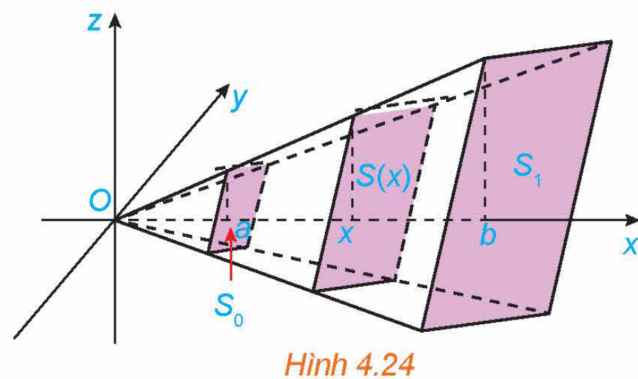
*Hình 4.24*

<!-- pdf:26 -->

**b) Tính thể tích khối tròn xoay**

**HĐ4:** Nhận biết công thức tính thể tích của khối tròn xoay

Xét hình phẳng giới hạn bởi đồ thị hàm số $f(x) = \frac{1}{2}x$, trục hoành và hai đường thẳng $x = 0, x = 4$. Khi quay hình phẳng này xung quanh trục hoành $Ox$ ta được khối nón có đỉnh là gốc $O$, trục là $Ox$ và đáy là hình tròn bán kính bằng $2$ (H.4.25).

a) Tính thể tích $V$ của khối nón.

b) Chứng minh rằng khi cắt khối nón bởi mặt phẳng vuông góc với trục hoành tại điểm có hoành độ bằng $x$ ($0 \le x \le 4$) thì mặt cắt thu được là một hình tròn có bán kính là $f(x)$, do đó diện tích mặt cắt là $S(x) = \pi f^2(x)$.

Tính $\pi \int_{0}^{4} f^2(x)\text{d}x$ và so sánh với $V$.

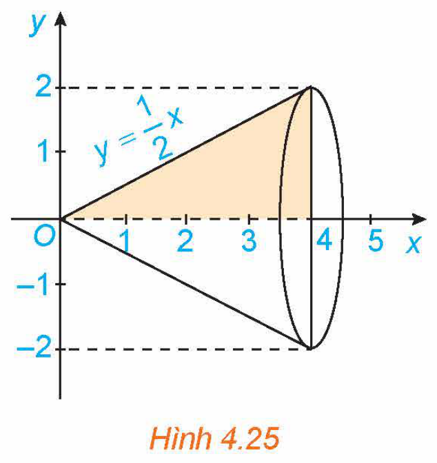
*Hình 4.25*

**Công thức tính thể tích của khối tròn xoay**

<!-- term: Thể tích của khối tròn xoay -->
> Cho hàm số $f(x)$ liên tục, không âm trên đoạn $[a; b]$.
>
> Khi quay hình phẳng giới hạn bởi đồ thị hàm số $y = f(x)$, trục hoành và hai đường thẳng $x = a, x = b$ xung quanh trục hoành, ta được hình khối gọi là một **khối tròn xoay**.
>
> Khi cắt khối tròn xoay đó bởi một mặt phẳng vuông góc với trục $Ox$ tại điểm $x \in [a; b]$ được một hình tròn có bán kính $f(x)$.
>
> Thể tích của khối tròn xoay này là
> $V = \pi \int_{a}^{b} f^2(x)\text{d}x.$

**Ví dụ 7:** Tính thể tích khối tròn xoay sinh ra khi quay quanh trục $Ox$ hình phẳng giới hạn bởi đồ thị hàm số $y = \sqrt{x}$, trục hoành và hai đường thẳng $x = 0, x = 1$ (H.4.26).

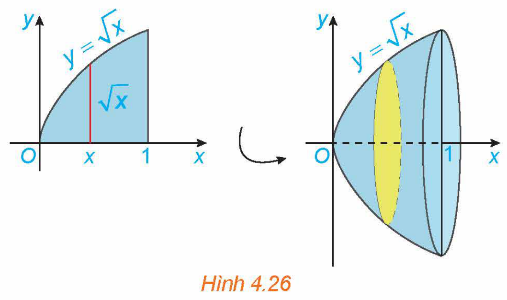
*Hình 4.26*

**Giải:**

Thể tích khối tròn xoay cần tính là

$V = \pi \int_{0}^{1} f^2(x)\text{d}x = \pi \int_{0}^{1} \left(\sqrt{x}\right)^2\text{d}x = \pi \int_{0}^{1} x\text{d}x = \left.\frac{\pi x^2}{2}\right|_{0}^{1} = \frac{\pi}{2}.$

<!-- pdf:27 -->

**Ví dụ 8:** Tính thể tích của khối cầu bán kính $R$.

**Giải:**

Khối cầu bán kính $R$ có thể xem là vật thể sinh ra khi quay quanh trục hoành nửa hình tròn giới hạn bởi đồ thị hàm số $y = \sqrt{R^2 - x^2}$ ($-R \le x \le R$), trục hoành và hai đường thẳng $x = -R, x = R$ (H.4.27).

Do đó, thể tích của khối cầu bán kính $R$ là

$V = \pi \int_{-R}^{R} \left(\sqrt{R^2 - x^2}\right)^2\text{d}x = \pi \int_{-R}^{R} (R^2 - x^2)\text{d}x = \left.\pi \left(R^2x - \frac{x^3}{3}\right)\right|_{-R}^{R} = \frac{4}{3}\pi R^3.$

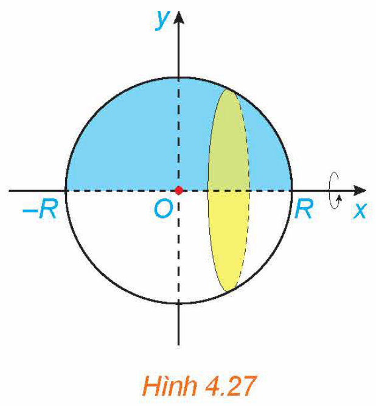
*Hình 4.27*

**Vận dụng 3:**

a) Tính thể tích của khối tròn xoay sinh ra khi quay hình thang vuông $OABC$ trong mặt phẳng $Oxy$ với $OA = h, AB = R$ và $OC = r$, quanh trục $Ox$ (H.4.28).

b) Từ công thức thu được ở phần a, hãy rút ra công thức tính thể tích của khối nón có bán kính đáy bằng $R$ và chiều cao $h$.

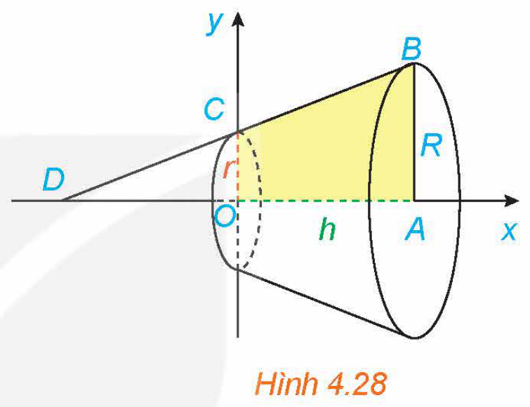
*Hình 4.28*

## ✏️ Bài tập

**4.14.** Tính diện tích của hình phẳng được tô màu trong Hình 4.29.

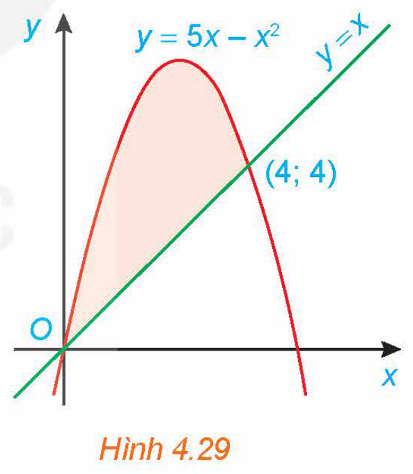
*Hình 4.29*

**4.15.** Tính diện tích của hình phẳng giới hạn bởi các đường:

a) $y = e^x, y = x^2 - 1, x = -1, x = 1$;

b) $y = \sin x, y = x, x = \frac{\pi}{2}, x = \pi$;

c) $y = 9 - x^2, y = 2x^2, x = -\sqrt{3}, x = \sqrt{3}$;

d) $y = \sqrt{x}, y = x^2, x = 0, x = 1$.

**4.16.** Các nhà kinh tế sử dụng đường cong Lorenz để minh hoạ sự phân phối thu nhập trong một quốc gia. Gọi $x$ là đại diện cho phần trăm số gia đình trong một quốc gia và $y$ là phần trăm tổng thu nhập, mô hình $y = x$ sẽ đại diện cho một quốc gia mà các gia đình có thu nhập như nhau. Đường cong Lorenz $y = f(x)$, biểu thị phân phối thu nhập thực tế. Diện tích giữa hai mô hình này, với $0 \le x \le 100$, biểu thị “sự bất bình đẳng về thu nhập” của một quốc gia. Năm 2005, đường cong Lorenz của Hoa Kỳ có thể được mô hình hoá bởi hàm số

$y = (0,00061x^2 + 0,0218x + 1,723)^2, \quad 0 \le x \le 100,$

trong đó $x$ được tính từ các gia đình nghèo nhất đến giàu có nhất *(Theo R. Larson, Brief Calculus: An Applied Approach, 8th edition, Cengage Learning, 2009)*.

Tìm sự bất bình đẳng thu nhập của Hoa Kỳ vào năm 2005.

<!-- pdf:28 -->

**4.17.** Tính thể tích của khối tròn xoay sinh ra khi quay hình phẳng giới hạn bởi các đường sau xung quanh trục $Ox$: $y = 2x - x^2, y = 0, x = 0, x = 2$.

**4.18.** Khối chỏm cầu có bán kính $R$ và chiều cao $h$ ($0 < h \le R$) sinh ra khi quay hình phẳng giới hạn bởi cung tròn có phương trình $y = \sqrt{R^2 - x^2}$, trục hoành và hai đường thẳng $x = R - h, x = R$ xung quanh trục $Ox$ (H.4.30). Tính thể tích của khối chỏm cầu này.

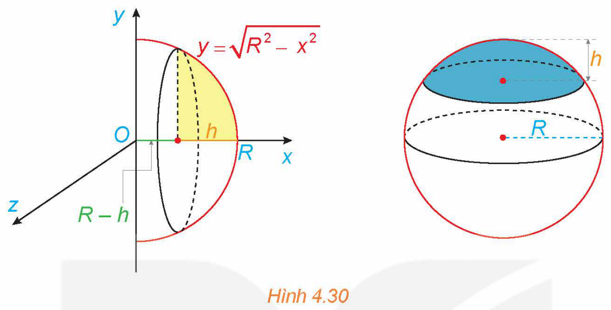
*Hình 4.30*

**4.19.** Cho tam giác vuông $OAB$ có cạnh $OA = a$ nằm trên trục $Ox$ và $\widehat{AOB} = \alpha$ $\left(0 < \alpha \le \frac{\pi}{4}\right)$. Gọi $\mathcal{B}$ là khối tròn xoay sinh ra khi quay miền tam giác $OAB$ xung quanh trục $Ox$ (H.4.31).

a) Tính thể tích $V$ của $\mathcal{B}$ theo $a$ và $\alpha$.

b) Tìm $\alpha$ sao cho thể tích $V$ lớn nhất.

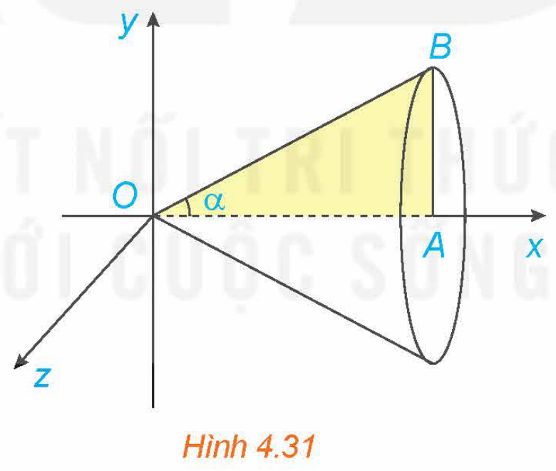
*Hình 4.31*

## 📷 Danh sách hình trong bài

| Mã hình | Trang PDF | Chú thích trong sách | Mô tả ngắn |
| :--- | :---: | :--- | :--- |
| H12-toan-b13-01 | 21 | Hình 4.12 | Hình phẳng giới hạn bởi đường thẳng $y = x + 1$, trục hoành và $x = -2, x = 1$ |
| H12-toan-b13-02 | 22 | Hình 4.13 | Hình phẳng giới hạn bởi đồ thị $y = x^3$, trục hoành và $x = 0, x = 2$ |
| H12-toan-b13-03 | 22 | Hình 4.14 | Hình phẳng giới hạn bởi đồ thị $y = \sin x$, trục hoành và $x = 0, x = 2\pi$ |
| H12-toan-b13-04 | 22 | Hình 4.15 | Hình phẳng giới hạn bởi parabol $y = x^2 - 4$, trục hoành và $x = 0, x = 3$ |
| H12-toan-b13-05 | 22 | Hình 4.16 | Hình phẳng giới hạn bởi parabol $y = -x^2 + 4x$, đường thẳng $y = x$ và $x = 1, x = 3$ |
| H12-toan-b13-06 | 23 | Hình 4.17 | Hình phẳng giới hạn bởi hai parabol $y = 4 - x^2, y = x^2$ và $x = -1, x = 1$ |
| H12-toan-b13-07 | 23 | Hình 4.18 | Hình phẳng giới hạn bởi $y = \sin x, y = \cos x$ và $x = 0, x = \frac{\pi}{4}$ |
| H12-toan-b13-08 | 24 | Hình 4.19 | Đồ thị hàm cung, hàm cầu, điểm cân bằng, thặng dư tiêu dùng và thặng dư sản xuất |
| H12-toan-b13-09 | 24 | Hình 4.20 | Hình trụ có trục là $Ox$ nằm giữa hai mặt phẳng $x = a$ và $x = b$ |
| H12-toan-b13-10 | 24 | Hình 4.21 | Vật thể giới hạn bởi hai mặt phẳng $x = a, x = b$ với thiết diện $S(x)$ vuông góc trục $Ox$ |
| H12-toan-b13-11 | 25 | Hình 4.22 | Khối lăng trụ có đường cao song song với trục $Ox$ và mặt cắt $S(x)$ |
| H12-toan-b13-12 | 25 | Hình 4.23 | Khối chóp đều có đỉnh trùng gốc $O$, trục $Ox$ đi qua tâm đáy và mặt cắt hình vuông cạnh $a$ |
| H12-toan-b13-13 | 25 | Hình 4.24 | Khối chóp cụt đều có diện tích hai đáy $S_0, S_1$ và mặt cắt $S(x)$ |
| H12-toan-b13-14 | 26 | Hình 4.25 | Khối nón tròn xoay tạo thành khi quay đồ thị $y = \frac{1}{2}x$ trên $[0; 4]$ quanh trục $Ox$ |
| H12-toan-b13-15 | 26 | Hình 4.26 | Khối tròn xoay tạo thành khi quay hình phẳng giới hạn bởi $y = \sqrt{x}$ trên $[0; 1]$ quanh trục $Ox$ |
| H12-toan-b13-16 | 27 | Hình 4.27 | Khối cầu bán kính $R$ tạo thành khi quay nửa hình tròn $y = \sqrt{R^2 - x^2}$ quanh trục $Ox$ |
| H12-toan-b13-17 | 27 | Hình 4.28 | Khối nón cụt tròn xoay sinh ra khi quay hình thang vuông $OABC$ quanh trục $Ox$ |
| H12-toan-b13-18 | 27 | Hình 4.29 | Hình phẳng tô màu giới hạn bởi parabol $y = 5x - x^2$ và đường thẳng $y = x$ |
| H12-toan-b13-19 | 28 | Hình 4.30 | Khối chỏm cầu bán kính $R$ và chiều cao $h$ |
| H12-toan-b13-20 | 28 | Hình 4.31 | Khối nón tròn xoay sinh ra khi quay tam giác vuông $OAB$ quanh trục $Ox$ |
