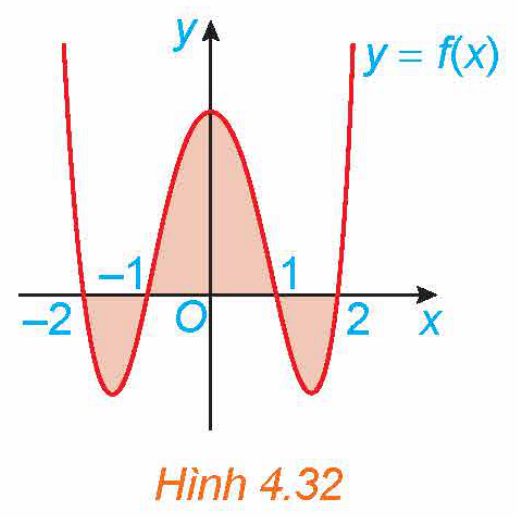

<!-- pdf:29 -->

# BÀI TẬP CUỐI CHƯƠNG IV

## ✏️ A – TRẮC NGHIỆM

**4.20.** Một nguyên hàm của hàm số $f(x) = \sin 2x$ là

A. $F(x) = 2\cos 2x$.

B. $F(x) = -\cos 2x$.

C. $F(x) = \frac{1}{2}\cos 2x$.

D. $F(x) = \frac{-1}{2}\cos 2x$.

**4.21.** Họ tất cả các nguyên hàm của hàm số $2e^x$ là

A. $2xe^x + C$.

B. $-2e^x + C$.

C. $2e^x$.

D. $2e^x + C$.

**4.22.** Nguyên hàm $F(x)$ của hàm số $f(x) = e^x - 3e^{-x}$ thoả mãn $F(0) = 4$ là

A. $F(x) = e^x - 3e^{-x}$.

B. $F(x) = e^x + 3e^{-2x}$.

C. $F(x) = e^x + 3e^{-x}$.

D. $F(x) = e^x + 3e^{-x} + 4$.

**4.23.** Cho hàm số $f(x)$ có đạo hàm $f'(x)$ liên tục trên $\mathbb{R}$, $f(1) = 16$ và $\int_{1}^{3} f'(x)\text{d}x = 4$. Khi đó giá trị của $f(3)$ bằng

A. $20$.

B. $16$.

C. $12$.

D. $10$.

**4.24.** Diện tích hình phẳng giới hạn bởi đồ thị hàm số $y = x^2 - 2x, y = -x^2 + 4x$ và hai đường thẳng $x = 0, x = 3$ là

A. $-9$.

B. $9$.

C. $\frac{16}{3}$.

D. $\frac{20}{3}$.

**4.25.** Cho đồ thị hàm số $y = f(x)$ trên đoạn $[-2; 2]$ như Hình 4.32.

*Hình 4.32*

Biết $\int_{-2}^{-1} f(x)\text{d}x = \int_{1}^{2} f(x)\text{d}x = \frac{-22}{15}$ và $\int_{-1}^{1} f(x)\text{d}x = \frac{76}{15}$. Khi đó, diện tích của hình phẳng được tô màu là

A. $8$.

B. $\frac{22}{15}$.

C. $\frac{32}{15}$.

D. $\frac{76}{15}$.

<!-- pdf:30 -->

**4.26.** Cho hình phẳng $(S)$ giới hạn bởi đồ thị hàm số $y = \sqrt{1 - x^2}$, trục hoành và hai đường thẳng $x = -1, x = 1$. Thể tích của khối tròn xoay khi quay $(S)$ quanh $Ox$ là

A. $\frac{3\pi}{4}$.

B. $\frac{3\pi}{2}$.

C. $\frac{2\pi}{3}$.

D. $\frac{4\pi}{3}$.

**4.27.** Một vật chuyển động có gia tốc là $a(t) = 3t^2 + t\text{ (m/s}^2\text{)}$. Biết rằng vận tốc ban đầu của vật là $2\text{ m/s}$. Vận tốc của vật đó sau $2$ giây là

A. $8\text{ m/s}$.

B. $10\text{ m/s}$.

C. $12\text{ m/s}$.

D. $16\text{ m/s}$.

## ✏️ B – TỰ LUẬN

**4.28.** Tìm họ tất cả các nguyên hàm của các hàm số sau:

a) $y = 2^x - \frac{1}{x}$;

b) $y = x\sqrt{x} + 3\cos x - \frac{2}{\sin^2 x}$.

**4.29.** Tìm một nguyên hàm $F(x)$ của hàm số $f(x) = 2\cos x + \frac{1}{\sin^2 x}$ thoả mãn điều kiện $F\left(\frac{\pi}{4}\right) = -1$.

**4.30.** Một viên đạn được bắn lên từ mặt đất theo phương thẳng đứng với vận tốc ban đầu là $30\text{ m/s}$. Gia tốc trọng trường là $9,8\text{ m/s}^2$. Tìm vận tốc của viên đạn ở thời điểm $2$ giây.

**4.31.** Cá hồi Thái Bình Dương đến mùa sinh sản thường bơi từ biển ngược dòng vào sông và đến thượng nguồn các dòng sông để đẻ trứng. Giả sử cá bơi ngược dòng sông với vận tốc là $v(t) = -\frac{2t}{5} + 4\text{ (km/h)}$. Nếu coi thời điểm ban đầu $t = 0$ là lúc cá bắt đầu bơi vào dòng sông thì khoảng cách xa nhất mà con cá có thể bơi được là bao nhiêu?

**4.32.** Tính các tích phân sau:

a) $\int_{1}^{4} \left(x^3 - 2\sqrt{x}\right)\text{d}x$;

b) $\int_{0}^{\frac{\pi}{2}} (\cos x - \sin x)\text{d}x$;

c) $\int_{\frac{\pi}{6}}^{\frac{\pi}{4}} \frac{\text{d}x}{\sin^2 x}$;

d) $\int_{1}^{16} \frac{x - 1}{\sqrt{x}}\text{d}x$.

**4.33.** Tính diện tích hình phẳng giới hạn bởi các đường $y = e^x, y = x, x = 0$ và $x = 1$.

**4.34.** Tính thể tích của khối tròn xoay tạo thành khi quay hình phẳng giới hạn bởi các đường sau xung quanh trục $Ox$:

a) $y = 1 - x^2, y = 0, x = -1, x = 1$;

b) $y = \sqrt{25 - x^2}, y = 0, x = 2, x = 4$.

**4.35.** Nghệ thuật làm gốm có lịch sử phát triển lâu đời và vẫn còn tồn tại cho đến ngày nay. Giả sử một bình gốm có mặt trong của bình là một mặt tròn xoay sinh ra khi cho phần đồ thị của hàm số $y = \frac{1}{175}x^2 + \frac{3}{35}x + 5$ ($0 \le x \le 30$) ($x, y$ tính theo $\text{cm}$) quay tròn quanh bệ gốm có trục trùng với trục hoành $Ox$. Hỏi để hoàn thành bình gốm đó ta cần sử dụng bao nhiêu $\text{cm}^3$ đất sét, biết rằng bình gốm đó có độ dày không đổi là $1\text{ cm}$.

## 📷 Danh sách hình trong bài

| Mã hình | Trang PDF | Chú thích trong sách | Mô tả ngắn |
| :--- | :---: | :--- | :--- |
| H12-toan-bt-c04-01 | 29 | Hình 4.32 | Đồ thị hàm số $y = f(x)$ trên đoạn $[-2; 2]$ với phần hình phẳng được tô màu |
