<!-- pdf:31 -->

<!-- Phần giới thiệu Chương V (in chung đầu trang PDF 31): CHƯƠNG V. PHƯƠNG PHÁP TOẠ ĐỘ TRONG KHÔNG GIAN -->

Nối tiếp ý tưởng phương pháp toạ độ trong mặt phẳng ở lớp 10, trong chương này, thông qua hệ trục toạ độ, ta sẽ thể hiện mặt phẳng, đường thẳng, mặt cầu theo ngôn ngữ của đại số.

# BÀI 14: PHƯƠNG TRÌNH MẶT PHẲNG

## 🔤 Thuật ngữ

- Vectơ pháp tuyến của mặt phẳng
- Cặp vectơ chỉ phương của mặt phẳng
- Phương trình tổng quát của mặt phẳng
- Khoảng cách từ một điểm đến một mặt phẳng

## 🎯 Mục tiêu

- Nhận biết phương trình mặt phẳng.
- Viết phương trình mặt phẳng trong các trường hợp: qua một điểm và biết vectơ pháp tuyến, qua một điểm và biết cặp vectơ chỉ phương, qua ba điểm không thẳng hàng.
- Nhận biết hai mặt phẳng song song, hai mặt phẳng vuông góc.
- Tính khoảng cách từ một điểm đến một mặt phẳng.
- Vận dụng kiến thức về phương trình mặt phẳng, công thức tính khoảng cách từ một điểm đến một mặt phẳng vào một số bài toán liên quan đến thực tiễn.

## 🔴 Mở đầu

Một vật thể chuyển động trong không gian $Oxyz$. Tại mỗi thời điểm $t$, vật thể ở vị trí $M(\cos t - \sin t; \cos t + \sin t; \cos t)$. Hỏi vật thể có chuyển động trong một mặt phẳng cố định hay không?

## 1. VECTƠ PHÁP TUYẾN VÀ CẶP VECTƠ CHỈ PHƯƠNG CỦA MẶT PHẲNG

**HĐ1:** Hình thành khái niệm vectơ pháp tuyến

Trên mặt bàn phẳng, đặt một vật. Khi đó, mặt bàn tác động lên vật phản lực pháp tuyến $\vec{n}$, giá của vectơ $\vec{n}$ vuông góc với mặt bàn. Nếu mặt bàn thuộc mặt phẳng nằm ngang thì $\vec{n}$ có phương gì? (H.5.1)

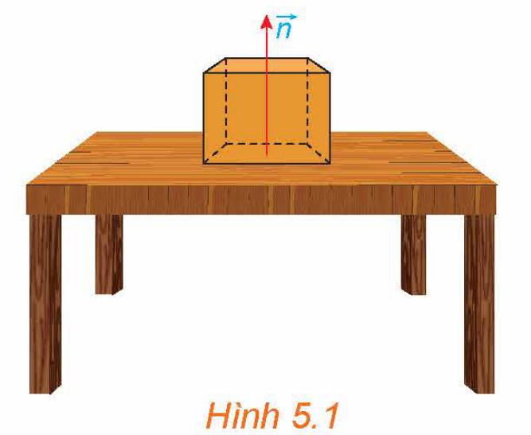
*Hình 5.1*

<!-- pdf:32 -->

> Vectơ $\vec{n} \ne \vec{0}$ được gọi là **vectơ pháp tuyến** của mặt phẳng $(\alpha)$ nếu giá của $\vec{n}$ vuông góc với $(\alpha)$.

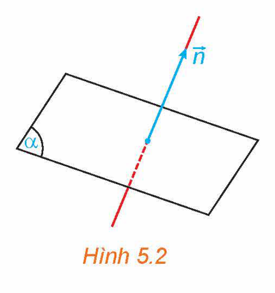
*Hình 5.2*

> **Chú ý:**
> - Mặt phẳng hoàn toàn xác định khi biết một điểm và một vectơ pháp tuyến của nó.
> - Nếu $\vec{n}$ là một vectơ pháp tuyến của mặt phẳng $(\alpha)$ thì $k\vec{n}$ (với $k$ là một số khác $0$) cũng là một vectơ pháp tuyến của $(\alpha)$.

**Ví dụ 1:** Cho hình lập phương $ABCD.A'B'C'D'$ (H.5.3). Trong các khẳng định sau, những khẳng định nào là đúng?

a) $\overrightarrow{AA'}$ và $2\overrightarrow{BB'}$ đều là vectơ pháp tuyến của mặt phẳng $(ABCD)$.

b) $\overrightarrow{BD}$ là một vectơ pháp tuyến của mặt phẳng $(ACC'A')$.

c) $\overrightarrow{A'C'}$ là một vectơ pháp tuyến của mặt phẳng $(ABCD)$.

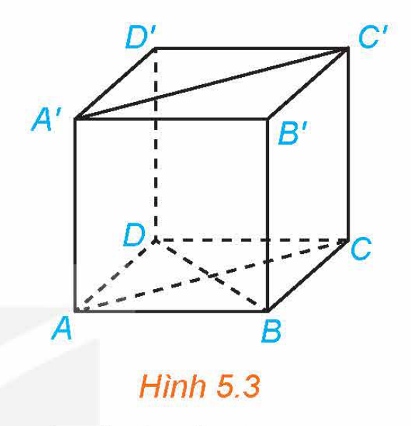
*Hình 5.3*

**Giải:**

Vì các đường thẳng $AA', BB'$ vuông góc với mặt phẳng $(ABCD)$ nên $\overrightarrow{AA'}, 2\overrightarrow{BB'}$ đều là vectơ pháp tuyến của mặt phẳng $(ABCD)$.

Đường thẳng $BD$ vuông góc với hai đường thẳng $AC$ và $AA'$ nên vuông góc với mặt phẳng $(ACC'A')$. Vậy $\overrightarrow{BD}$ là một vectơ pháp tuyến của mặt phẳng $(ACC'A')$.

Đường thẳng $A'C'$ không vuông góc với mặt phẳng $(ABCD)$ nên vectơ $\overrightarrow{A'C'}$ không phải là vectơ pháp tuyến của mặt phẳng đó.

Vậy các khẳng định a và b là đúng, khẳng định c là sai.

**Luyện tập 1:** Trong không gian $Oxyz$, cho các điểm $A(1; -2; 3), B(-3; 0; 1)$. Gọi $(\alpha)$ là mặt phẳng trung trực của đoạn thẳng $AB$. Hãy chỉ ra một vectơ pháp tuyến của $(\alpha)$.

**HĐ2:** Tìm một vectơ vuông góc với hai vectơ cho trước

Trong không gian $Oxyz$, cho hai vectơ $\vec{u} = (a; b; c)$ và $\vec{v} = (a'; b'; c')$.

a) Vectơ $\vec{n} = (bc' - b'c; ca' - c'a; ab' - a'b)$ có vuông góc với cả hai vectơ $\vec{u}$ và $\vec{v}$ hay không?

b) $\vec{n} = \vec{0}$ khi và chỉ khi $\vec{u}$ và $\vec{v}$ có mối quan hệ gì?

> Trong không gian $Oxyz$, cho hai vectơ $\vec{u} = (a; b; c)$ và $\vec{v} = (a'; b'; c')$. Khi đó vectơ $\vec{n} = (bc' - b'c; ca' - c'a; ab' - a'b)$ vuông góc với cả hai vectơ $\vec{u}$ và $\vec{v}$, được gọi là **tích có hướng** của $\vec{u}$ và $\vec{v}$, kí hiệu là $[\vec{u}, \vec{v}]$.

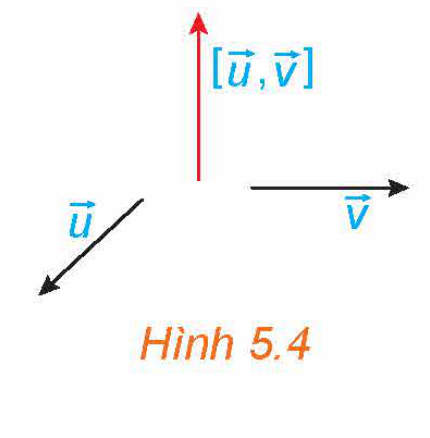
*Hình 5.4*

> **Chú ý:**
> - $[\vec{u}, \vec{v}] = \vec{0}$ khi và chỉ khi $\vec{u}, \vec{v}$ cùng phương.
> - Với bốn số $x, y, x', y'$, ta kí hiệu $\begin{vmatrix} x & y \\ x' & y' \end{vmatrix} = xy' - x'y$. Khi đó tích có hướng của $\vec{u} = (a; b; c)$ và $\vec{v} = (a'; b'; c')$ là
>
>   $[\vec{u}, \vec{v}] = \left(\begin{vmatrix} b & c \\ b' & c' \end{vmatrix}; \begin{vmatrix} c & a \\ c' & a' \end{vmatrix}; \begin{vmatrix} a & b \\ a' & b' \end{vmatrix}\right).$
<!-- ocr-ok: đã đối chiếu ảnh trang PDF 32 -->

<!-- pdf:33 -->

**Ví dụ 2:** Trong không gian $Oxyz$, cho $\vec{u} = (1; -2; 0)$ và $\vec{v} = (3; 1; -4)$. Tính $[\vec{u}, \vec{v}]$.
<!-- ocr-ok: đã đối chiếu ảnh trang PDF 33 -->

**Giải:**

Ta có $[\vec{u}, \vec{v}] = \left(\begin{vmatrix} -2 & 0 \\ 1 & -4 \end{vmatrix}; \begin{vmatrix} 0 & 1 \\ -4 & 3 \end{vmatrix}; \begin{vmatrix} 1 & -2 \\ 3 & 1 \end{vmatrix}\right) = (8; 4; 7)$.

**Luyện tập 2:** Trong không gian $Oxyz$, cho $\vec{u} = (2; 3; 1)$ và $\vec{v} = (4; 6; 2)$. Tính $[\vec{u}, \vec{v}]$.
<!-- ocr-ok: đã đối chiếu ảnh trang PDF 33 -->

**HĐ3:** Hình thành khái niệm cặp vectơ chỉ phương của mặt phẳng

Trong không gian $Oxyz$, cho hai vectơ $\vec{u}, \vec{v}$ không cùng phương và có giá nằm trong hoặc song song với mặt phẳng $(P)$.

a) Vectơ $[\vec{u}, \vec{v}]$ có khác vectơ-không và giá của nó có vuông góc với cả hai giá của $\vec{u}, \vec{v}$ hay không?

b) Mặt phẳng $(P)$ có nhận $[\vec{u}, \vec{v}]$ làm một vectơ pháp tuyến hay không?

> - Trong không gian $Oxyz$, hai vectơ $\vec{u}, \vec{v}$ được gọi là **cặp vectơ chỉ phương** của mặt phẳng $(P)$ nếu chúng không cùng phương và có giá nằm trong hoặc song song với mặt phẳng $(P)$.
> - Nếu $\vec{u}, \vec{v}$ là cặp vectơ chỉ phương của $(P)$ thì $[\vec{u}, \vec{v}]$ là một vectơ pháp tuyến của $(P)$.

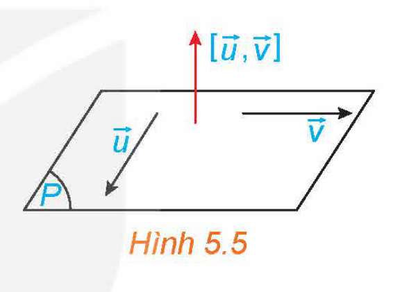
*Hình 5.5*

**Ví dụ 3:** Trong không gian $Oxyz$, cho các vectơ $\vec{u} = (2; -1; 0), \vec{v} = (1; -1; 2)$. Gọi $(\alpha)$ là một mặt phẳng song song với các giá của $\vec{u}, \vec{v}$. Hãy tìm một vectơ pháp tuyến của $(\alpha)$.

**Giải:**

Ta có $\vec{n} = [\vec{u}, \vec{v}] = \left(\begin{vmatrix} -1 & 0 \\ -1 & 2 \end{vmatrix}; \begin{vmatrix} 0 & 2 \\ 2 & 1 \end{vmatrix}; \begin{vmatrix} 2 & -1 \\ 1 & -1 \end{vmatrix}\right) = (-2; -4; -1) \ne \vec{0}$. Do đó $\vec{u}, \vec{v}$ là cặp vectơ chỉ phương và $\vec{n}$ là một vectơ pháp tuyến của $(\alpha)$.

**Luyện tập 3:** Trong không gian $Oxyz$, cho ba điểm không thẳng hàng $A(1; -2; 1), B(-2; 1; 0), C(-2; 3; 2)$. Hãy chỉ ra một vectơ pháp tuyến của mặt phẳng $(ABC)$.

**Vận dụng 1:** Moment lực là một đại lượng Vật lí, thể hiện tác động gây ra sự quay quanh một điểm hoặc một trục của một vật thể. Trong không gian $Oxyz$, với đơn vị đo là mét, nếu tác động vào cán mỏ lết tại vị trí $P$ một lực $\vec{F}$ để vặn con ốc ở vị trí $O$ (H.5.6) thì moment lực $\vec{M}$ được tính bởi công thức $\vec{M} = [\overrightarrow{OP}, \vec{F}]$.

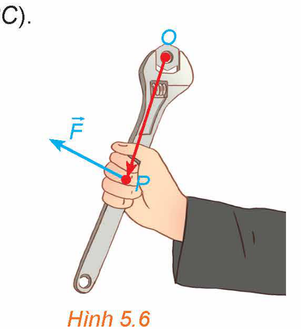
*Hình 5.6*

a) Cho $\overrightarrow{OP} = (x; y; z), \vec{F} = (a; b; c)$. Tính $\vec{M}$.

b) Giải thích vì sao, nếu giữ nguyên lực tác động $\vec{F}$ trong khi thay vị trí đặt lực từ $P$ sang $P'$ sao cho $\overrightarrow{OP'} = 2\overrightarrow{OP}$ thì moment lực sẽ tăng lên gấp đôi. Từ đó, ta có thể rút ra điều gì để đỡ tốn sức khi dùng mỏ lết vặn ốc?

<!-- pdf:34 -->

## 2. PHƯƠNG TRÌNH TỔNG QUÁT CỦA MẶT PHẲNG

**HĐ4:** Hình thành khái niệm phương trình tổng quát của mặt phẳng

Trong không gian $Oxyz$, cho mặt phẳng $(\alpha)$. Gọi $\vec{n} = (A; B; C)$ là một vectơ pháp tuyến của $(\alpha)$ và $M_0(x_0; y_0; z_0)$ là một điểm thuộc $(\alpha)$.

a) Một điểm $M(x; y; z)$ thuộc $(\alpha)$ khi và chỉ khi hai vectơ $\vec{n}$ và $\overrightarrow{M_0 M}$ có mối quan hệ gì?

b) Điểm $M(x; y; z)$ thuộc $(\alpha)$ khi và chỉ khi toạ độ của nó thoả mãn hệ thức nào?

> Trong không gian $Oxyz$, mỗi mặt phẳng đều có phương trình dạng $Ax + By + Cz + D = 0$, trong đó $A, B, C$ không đồng thời bằng $0$, được gọi là **phương trình tổng quát** của mặt phẳng đó.

> **Chú ý:** Trong không gian $Oxyz$, mỗi phương trình $Ax + By + Cz + D = 0$ (các hệ số $A, B, C$ không đồng thời bằng $0$) xác định một mặt phẳng nhận $\vec{n} = (A; B; C)$ làm một vectơ pháp tuyến.

**Ví dụ 4:** Trong không gian $Oxyz$, phương trình nào trong các phương trình sau là phương trình tổng quát của một mặt phẳng?

a) $x + 2y - 3z^2 + 1 = 0$;

b) $\frac{1}{x} + \frac{2}{y} + \frac{3}{z} + 2 = 0$;

c) $y + 1 = 0$.

**Giải:**

Trong các phương trình trên, chỉ có phương trình $y + 1 = 0$ có dạng $Ax + By + Cz + D = 0$ và thoả mãn $A, B, C$ không đồng thời bằng $0$ ($A = 0, B = 1, C = 0$). Vì vậy, trong các phương trình trên, chỉ có phương trình $y + 1 = 0$ là phương trình mặt phẳng.

**Luyện tập 4:** Trong không gian $Oxyz$, phương trình nào trong các phương trình sau là phương trình tổng quát của một mặt phẳng?

a) $x^2 + 2y^2 + 3z^2 - 1 = 0$;

b) $\frac{x}{2} - y + \frac{z}{3} + 5 = 0$;

c) $xy + 5 = 0$.

**Ví dụ 5:** Trong không gian $Oxyz$, cho mặt phẳng $(\alpha): x + 2y - z + 1 = 0$.

a) Hãy chỉ ra một vectơ pháp tuyến của $(\alpha)$.

b) Vectơ $\vec{m} = (2; 4; -2)$ có là vectơ pháp tuyến của $(\alpha)$ hay không?

c) Trong hai điểm $A(1; 3; 2), B(1; 1; 4)$, điểm nào thuộc mặt phẳng $(\alpha)$?

**Giải:**

a) Mặt phẳng $(\alpha)$ nhận $\vec{n} = (1; 2; -1)$ làm một vectơ pháp tuyến.

b) Do $\vec{m} = 2\vec{n}$ mà $\vec{n}$ là vectơ pháp tuyến của $(\alpha)$ nên $\vec{m}$ cũng là vectơ pháp tuyến của $(\alpha)$.

c) Ta cần kiểm tra xem trong hai điểm $A(1; 3; 2), B(1; 1; 4)$, điểm nào có toạ độ thoả mãn phương trình mặt phẳng $(\alpha)$.

Do $1 + 2 \cdot 3 - 2 + 1 \ne 0$ và $1 + 2 \cdot 1 - 4 + 1 = 0$ nên trong hai điểm $A, B$ chỉ có toạ độ điểm $B$ thoả mãn phương trình mặt phẳng $(\alpha)$. Vậy điểm $B$ thuộc mặt phẳng $(\alpha)$, điểm $A$ không thuộc mặt phẳng $(\alpha)$.

<!-- pdf:35 -->

**Luyện tập 5:** Trong không gian $Oxyz$, cho mặt phẳng $(\alpha): x + 2 = 0$.

a) Điểm $A(-2; 1; 0)$ có thuộc $(\alpha)$ hay không?
<!-- ocr-ok: đã đối chiếu ảnh trang PDF 35 -->

b) Hãy chỉ ra một vectơ pháp tuyến của $(\alpha)$.

## 3. LẬP PHƯƠNG TRÌNH TỔNG QUÁT CỦA MẶT PHẲNG

**HĐ5:** Lập phương trình mặt phẳng đi qua một điểm và biết vectơ pháp tuyến

Trong không gian $Oxyz$, cho mặt phẳng $(\alpha)$ đi qua điểm $M_0(x_0; y_0; z_0)$ và có vectơ pháp tuyến $\vec{n} = (A; B; C)$.

Dựa vào HĐ4, hãy nêu phương trình của $(\alpha)$.

> Trong không gian $Oxyz$, nếu mặt phẳng $(\alpha)$ đi qua điểm $M_0(x_0; y_0; z_0)$ và có vectơ pháp tuyến $\vec{n} = (A; B; C)$ thì có phương trình là:
>
> $A(x - x_0) + B(y - y_0) + C(z - z_0) = 0 \Leftrightarrow Ax + By + Cz + D = 0, \text{ với } D = -(Ax_0 + By_0 + Cz_0).$

**Ví dụ 6:** Trong không gian $Oxyz$, viết phương trình mặt phẳng $(\alpha)$ đi qua điểm $M(2; -1; 0)$ và có vectơ pháp tuyến $\vec{n} = (3; -4; 6)$.

**Giải:**

Mặt phẳng $(\alpha)$ có phương trình là:

$3(x - 2) - 4[y - (-1)] + 6(z - 0) = 0 \Leftrightarrow 3x - 4y + 6z - 10 = 0.$

**Luyện tập 6:** Trong không gian $Oxyz$, viết phương trình mặt phẳng $(\alpha)$ đi qua điểm $M(1; 2; -4)$ và vuông góc với trục $Oz$.

**HĐ6:** Lập phương trình mặt phẳng đi qua một điểm và biết cặp vectơ chỉ phương

Trong không gian $Oxyz$, cho mặt phẳng $(\alpha)$ đi qua điểm $M(x_0; y_0; z_0)$ và biết cặp vectơ chỉ phương $\vec{u} = (a; b; c), \vec{v} = (a'; b'; c')$.

a) Hãy chỉ ra một vectơ pháp tuyến của mặt phẳng $(\alpha)$.

b) Viết phương trình mặt phẳng $(\alpha)$.

> Trong không gian $Oxyz$, bài toán viết phương trình mặt phẳng đi qua điểm $M$ và biết cặp vectơ chỉ phương $\vec{u}, \vec{v}$ có thể thực hiện theo các bước sau:
> - Tìm vectơ pháp tuyến $\vec{n} = [\vec{u}, \vec{v}]$.
> - Lập phương trình tổng quát của mặt phẳng đi qua $M$ và biết vectơ pháp tuyến $\vec{n}$.

**Ví dụ 7:** Trong không gian $Oxyz$, cho hình lăng trụ $ABC.A'B'C'$ với $A(1; 2; 3), B(4; 3; 5), C(2; 3; 2), A'(1; 1; 1)$. Viết phương trình mặt phẳng $(A'B'C')$.

<!-- pdf:36 -->

**Giải:** (H.5.7)

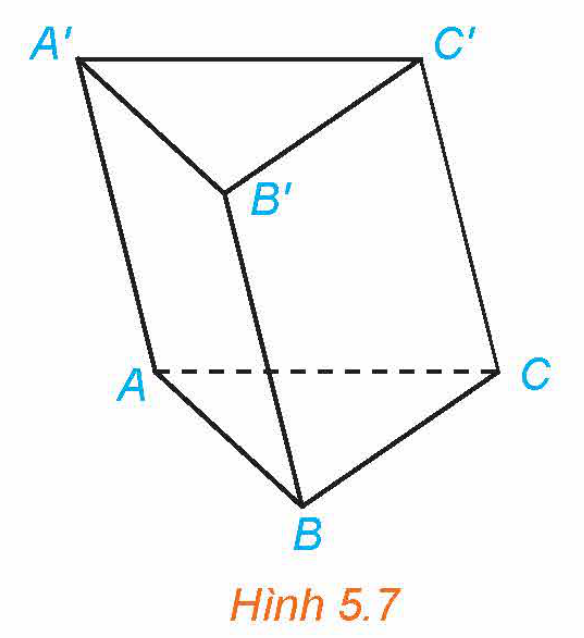
*Hình 5.7*

Mặt phẳng $(A'B'C')$ nhận $\overrightarrow{AB} = (3; 1; 2), \overrightarrow{AC} = (1; 1; -1)$ làm cặp vectơ chỉ phương nên có vectơ pháp tuyến là

$\vec{n} = [\overrightarrow{AB}, \overrightarrow{AC}] = (-3; 5; 2).$

Mặt phẳng $(A'B'C')$ đi qua $A'(1; 1; 1)$ và nhận $\vec{n} = (-3; 5; 2)$ làm một vectơ pháp tuyến nên có phương trình:

$-3(x - 1) + 5(y - 1) + 2(z - 1) = 0 \Leftrightarrow 3x - 5y - 2z + 4 = 0.$

**Luyện tập 7:** Trong không gian $Oxyz$, cho các điểm $A(1; -2; -1), B(4; 1; 2), C(2; 3; 1)$. Viết phương trình mặt phẳng $(\alpha)$ đi qua điểm $A(1; -2; -1)$ đồng thời song song với trục $Oy$ và đường thẳng $BC$.

**HĐ7:** Lập phương trình mặt phẳng đi qua ba điểm không thẳng hàng

Trong không gian $Oxyz$, cho ba điểm không thẳng hàng:

$A(1; 2; 3), B(-1; 3; 4), C(2; -1; 2).$

a) Hãy chỉ ra một cặp vectơ chỉ phương của mặt phẳng $(ABC)$.

b) Viết phương trình mặt phẳng $(ABC)$.

> Trong không gian $Oxyz$, bài toán viết phương trình mặt phẳng đi qua ba điểm không thẳng hàng $A, B, C$ có thể thực hiện theo các bước sau:
> - Tìm cặp vectơ chỉ phương $\overrightarrow{AB}, \overrightarrow{AC}$.
> - Tìm vectơ pháp tuyến $\vec{n} = [\overrightarrow{AB}, \overrightarrow{AC}]$.
> - Lập phương trình tổng quát của mặt phẳng đi qua $A$ và biết vectơ pháp tuyến $\vec{n}$.

**Ví dụ 8:** Trong không gian $Oxyz$, cho ba điểm $A(2; 1; -1), B(3; 2; 1), C(3; 1; 4)$.

a) Chứng minh rằng ba điểm $A, B, C$ không thẳng hàng.

b) Viết phương trình mặt phẳng $(ABC)$.

**Giải:**

a) Hai vectơ $\overrightarrow{AB} = (1; 1; 2), \overrightarrow{AC} = (1; 0; 5)$ không cùng phương nên ba điểm $A, B, C$ không thẳng hàng.

b) Mặt phẳng $(ABC)$ có cặp vectơ chỉ phương $\overrightarrow{AB} = (1; 1; 2), \overrightarrow{AC} = (1; 0; 5)$ nên có vectơ pháp tuyến $\vec{n} = [\overrightarrow{AB}, \overrightarrow{AC}] = (5; -3; -1)$.

Mặt phẳng $(ABC)$ đi qua $A(2; 1; -1)$ và có vectơ pháp tuyến $\vec{n} = (5; -3; -1)$ nên có phương trình:

$5(x - 2) - 3(y - 1) - 1(z + 1) = 0 \Leftrightarrow 5x - 3y - z - 8 = 0.$

<!-- pdf:37 -->

**Luyện tập 8:** (H.5.8) Trong không gian $Oxyz$, cho mặt phẳng $(\alpha)$ không đi qua gốc toạ độ và cắt ba trục $Ox, Oy, Oz$ tương ứng tại các điểm $A(a; 0; 0), B(0; b; 0), C(0; 0; c)$ ($a, b, c \ne 0$).

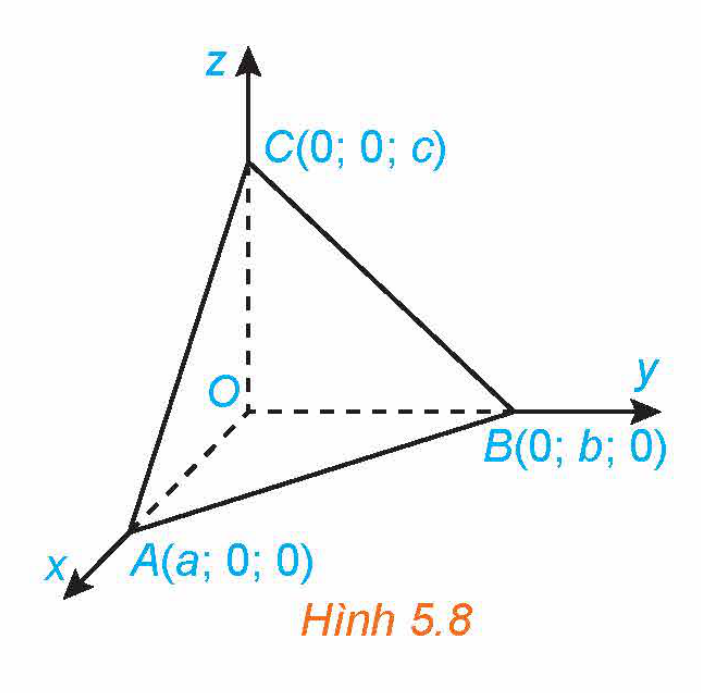
*Hình 5.8*

Chứng minh rằng mặt phẳng $(\alpha)$ có phương trình: $\frac{x}{a} + \frac{y}{b} + \frac{z}{c} = 1.$ (Phương trình trên được gọi là **phương trình mặt phẳng theo đoạn chắn**).

**Vận dụng 2:** Trong *tình huống mở đầu*, hãy thực hiện các bước sau và trả lời câu hỏi đã được nêu ra.

a) Xác định toạ độ của vị trí $M_1, M_2, M_3$ của vật tương ứng với các thời điểm $t = 0, t = \frac{\pi}{2}, t = \pi$.

b) Chứng minh rằng $M_1, M_2, M_3$ không thẳng hàng và viết phương trình mặt phẳng $(M_1 M_2 M_3)$.

c) Vị trí $M(\cos t - \sin t; \cos t + \sin t; \cos t)$ có luôn thuộc mặt phẳng $(M_1 M_2 M_3)$ hay không?

## 4. ĐIỀU KIỆN ĐỂ HAI MẶT PHẲNG VUÔNG GÓC VỚI NHAU

**HĐ8:** Tìm điều kiện để hai mặt phẳng vuông góc

Trong không gian $Oxyz$, cho hai mặt phẳng:

$(\alpha): Ax + By + Cz + D = 0, \ (\beta): A'x + B'y + C'z + D' = 0,$

với hai vectơ pháp tuyến $\vec{n} = (A; B; C), \vec{n'} = (A'; B'; C')$ tương ứng.

a) Góc giữa hai mặt phẳng $(\alpha), (\beta)$ và góc giữa hai giá của $\vec{n}, \vec{n'}$ có mối quan hệ gì?

b) Hai mặt phẳng $(\alpha)$ và $(\beta)$ vuông góc với nhau khi và chỉ khi hai vectơ pháp tuyến tương ứng $\vec{n}, \vec{n'}$ có mối quan hệ gì?

> **Góc giữa hai mặt phẳng** bằng góc giữa hai đường thẳng bất kì tương ứng vuông góc với hai mặt phẳng đó.

<!-- pdf:38 -->

<!-- term: Hai mặt phẳng vuông góc -->
> Trong không gian $Oxyz$, cho hai mặt phẳng:
>
> $(\alpha): Ax + By + Cz + D = 0, \ (\beta): A'x + B'y + C'z + D' = 0,$
>
> với hai vectơ pháp tuyến $\vec{n} = (A; B; C), \vec{n'} = (A'; B'; C')$ tương ứng.
>
> Khi đó:
>
> $(\alpha) \perp (\beta) \Leftrightarrow \vec{n} \perp \vec{n'} \Leftrightarrow AA' + BB' + CC' = 0.$

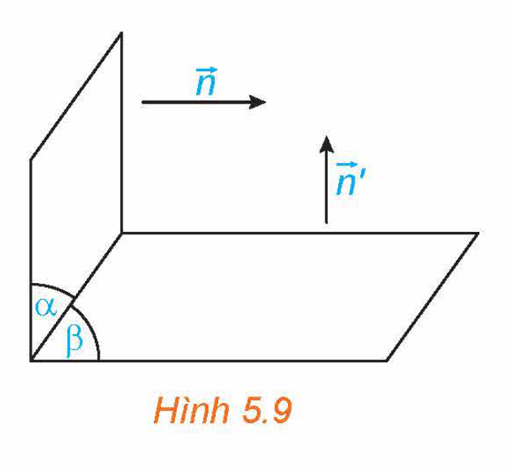
*Hình 5.9*

> **Chú ý:** Nếu hai mặt phẳng vuông góc với nhau thì vectơ pháp tuyến của mặt phẳng này có giá song song hoặc nằm trong mặt phẳng kia.

**Ví dụ 9:** Trong không gian $Oxyz$, chứng minh rằng hai mặt phẳng sau vuông góc với nhau:

$(\alpha): x - 3y + 2z + 1 = 0, \ (\beta): 5x + y - z + 2 = 0.$

**Giải:**

Hai mặt phẳng $(\alpha), (\beta)$ có vectơ pháp tuyến tương ứng là $\vec{n} = (1; -3; 2), \vec{n'} = (5; 1; -1)$.

Ta có $\vec{n} \cdot \vec{n'} = 1 \cdot 5 + (-3) \cdot 1 + 2 \cdot (-1) = 0$ nên $\vec{n} \perp \vec{n'}$. Do đó $(\alpha)$ vuông góc với $(\beta)$.
<!-- ocr-ok: đã đối chiếu ảnh trang PDF 38 -->

**Luyện tập 9:** Trong không gian $Oxyz$, hai mặt phẳng sau đây có vuông góc với nhau hay không?

$(\alpha): 3x + y - z + 1 = 0, \ (\beta): 9x + 3y - 3z + 3 = 0.$

**Ví dụ 10:** Trong không gian $Oxyz$, viết phương trình mặt phẳng $(P)$ đi qua hai điểm $A(1; 2; -2), B(2; 4; 1)$ và vuông góc với mặt phẳng $(Q): x + 3y + z - 1 = 0$.

**Giải:**

Mặt phẳng $(Q)$ có vectơ pháp tuyến $\vec{n}_Q = (1; 3; 1)$. Mặt phẳng $(P)$ đi qua $A, B$ và vuông góc với $(Q)$ nên có cặp vectơ chỉ phương là $\overrightarrow{AB} = (1; 2; 3)$ và $\vec{n}_Q = (1; 3; 1)$. Do đó $(P)$ có vectơ pháp tuyến là: $\vec{n}_P = [\overrightarrow{AB}, \vec{n}_Q] = (-7; 2; 1)$.

Mặt phẳng $(P)$ đi qua $A(1; 2; -2)$ và có vectơ pháp tuyến $\vec{n}_P = (-7; 2; 1)$ nên có phương trình:

$-7x + 2y + z - ((-7) \cdot 1 + 2 \cdot 2 + 1 \cdot (-2)) = 0 \Leftrightarrow 7x - 2y - z - 5 = 0.$

**Vận dụng 3:** (H.5.10) Trong không gian $Oxyz$, sàn của một căn phòng có dạng hình tứ giác với bốn đỉnh $O(0; 0; 0), A(2; 0; 0), B(2; 3; 0), C(0; 2\sqrt{2}; 0)$. Bốn bức tường của căn phòng đều vuông góc với sàn.

a) Viết phương trình bốn mặt phẳng tương ứng chứa bốn bức tường đó.

b) Trong bốn mặt phẳng tương ứng chứa bốn bức tường đó, hãy chỉ ra những cặp mặt phẳng vuông góc với nhau.

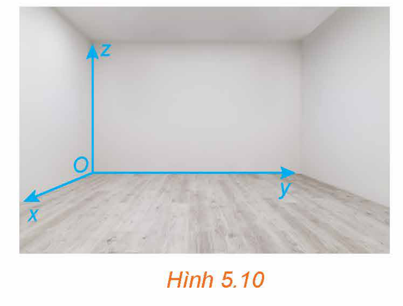
*Hình 5.10*

<!-- pdf:39 -->

## 5. ĐIỀU KIỆN ĐỂ HAI MẶT PHẲNG SONG SONG VỚI NHAU

**HĐ9:** Tìm điều kiện để hai mặt phẳng song song hoặc trùng nhau

Trong không gian $Oxyz$, cho hai mặt phẳng

$(\alpha): Ax + By + Cz + D = 0,$

$(\beta): A'x + B'y + C'z + D' = 0,$

với các vectơ pháp tuyến $\vec{n} = (A; B; C), \vec{n'} = (A'; B'; C')$ tương ứng.

Nếu hai mặt phẳng $(\alpha)$ và $(\beta)$ song song hoặc trùng nhau thì các vectơ pháp tuyến $\vec{n}, \vec{n'}$ có mối quan hệ gì?

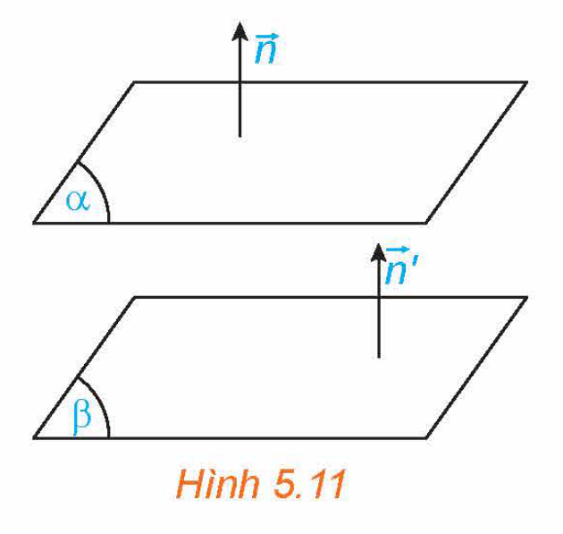
*Hình 5.11*

<!-- term: Hai mặt phẳng song song -->
> Trong không gian $Oxyz$, cho hai mặt phẳng
>
> $(\alpha): Ax + By + Cz + D = 0, \ (\beta): A'x + B'y + C'z + D' = 0,$
>
> với các vectơ pháp tuyến $\vec{n} = (A; B; C), \vec{n'} = (A'; B'; C')$ tương ứng. Khi đó:
>
> $(\alpha) \parallel (\beta) \Leftrightarrow \begin{cases} \vec{n'} = k\vec{n} \\ D' \ne kD \end{cases}$ với $k$ nào đó.

<!-- term: Hai mặt phẳng trùng nhau -->
> **Chú ý:**
> - Nếu hai mặt phẳng song song với nhau thì vectơ pháp tuyến của mặt phẳng này cũng là vectơ pháp tuyến của mặt phẳng kia.
> - Hai mặt phẳng $(\alpha)$ và $(\beta)$ trùng nhau khi và chỉ khi tồn tại số $k$ khác $0$ sao cho
>
>   $A' = kA, \ B' = kB, \ C' = kC, \ D' = kD.$

**Ví dụ 11:** Trong không gian $Oxyz$, cho hai mặt phẳng:

$(\alpha): 3x - y + z + \sqrt{2} = 0$ và $(\beta): 3\sqrt{2}x - \sqrt{2}y + \sqrt{2}z + 1 = 0$.

Hỏi $(\alpha)$ và $(\beta)$ có song song với nhau hay không?

**Giải:**

Các mặt phẳng trên có vectơ pháp tuyến tương ứng là $\vec{n}_\alpha = (3; -1; 1), \vec{n}_\beta = (3\sqrt{2}; -\sqrt{2}; \sqrt{2})$.

Do $\vec{n}_\beta = \sqrt{2} \cdot \vec{n}_\alpha$ và $1 \ne \sqrt{2} \cdot \sqrt{2}$ nên hai mặt phẳng $(\alpha)$ và $(\beta)$ song song với nhau.

**Luyện tập 10:** Trong không gian $Oxyz$, cho hai mặt phẳng:

$(\alpha): 5x + 2y - 4z + 6 = 0$ và $(\beta): 10x + 4y - 2z + 12 = 0$.

a) Hỏi $(\alpha)$ và $(\beta)$ có song song với nhau hay không?

b) Chứng minh rằng điểm $M(1; -3; 5)$ không thuộc mặt phẳng $(\alpha)$ nhưng thuộc mặt phẳng $(\beta)$.

c) Viết phương trình mặt phẳng $(P)$ đi qua $M(1; -3; 5)$ và song song với $(\alpha)$.

**Vận dụng 4:** Trong một kì thi tuyển sinh có ba môn thi Toán, Văn, Tiếng Anh. Trong không gian $Oxyz$, người ta biểu diễn kết quả thi của mỗi thí sinh bởi điểm có hoành độ, tung độ, cao độ tương ứng là điểm Toán, Văn, Tiếng Anh của thí sinh đó.

<!-- pdf:40 -->

a) Chứng minh rằng các điểm biểu diễn tương ứng với các thí sinh có tổng số điểm ba môn thi bằng $27$ (nếu có) cùng thuộc mặt phẳng có phương trình $x + y + z - 27 = 0$.

b) Chứng minh rằng tồn tại một số mặt phẳng đôi một song song với nhau sao cho hai điểm biểu diễn ứng với hai thí sinh có tổng số điểm thi bằng nhau thì cùng thuộc một mặt phẳng trong số các mặt phẳng đó.

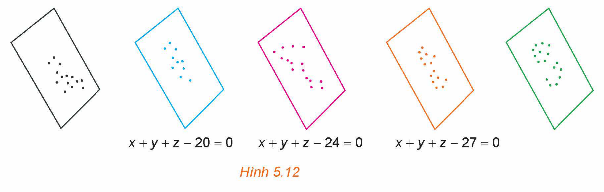
*Hình 5.12*

## 6. KHOẢNG CÁCH TỪ MỘT ĐIỂM ĐẾN MỘT MẶT PHẲNG

**HĐ10:** Thiết lập công thức tính khoảng cách từ một điểm đến một mặt phẳng

Trong không gian $Oxyz$, cho điểm $M(x_0; y_0; z_0)$ và mặt phẳng $(P): Ax + By + Cz + D = 0$ có vectơ pháp tuyến $\vec{n} = (A; B; C)$. Gọi $N$ là hình chiếu vuông góc của $M$ trên $(P)$ (H.5.13).
<!-- ocr-ok: đã đối chiếu ảnh trang PDF 40 -->

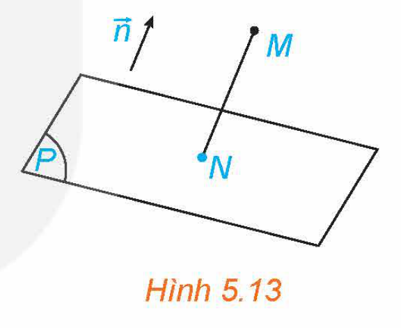
*Hình 5.13*

a) Giải thích vì sao tồn tại số $k$ để $\overrightarrow{MN} = k\vec{n}$. Tính toạ độ của $N$ theo $k$, toạ độ của $M$ và các hệ số $A, B, C, D$.

b) Thay toạ độ của $N$ vào phương trình mặt phẳng $(P)$ để từ đó tính $k$ theo toạ độ của $M$ và các hệ số $A, B, C, D$.

c) Từ $|\overrightarrow{MN}| = |k||\vec{n}|$, hãy tính độ dài của đoạn thẳng $MN$ theo toạ độ của $M$ và các hệ số $A, B, C, D$. Từ đó suy ra công thức tính khoảng cách từ điểm $M$ đến mặt phẳng $(P)$.

<!-- term: Khoảng cách từ điểm đến mặt phẳng -->
> Trong không gian $Oxyz$, khoảng cách từ điểm $M(x_0; y_0; z_0)$ đến mặt phẳng $(P): Ax + By + Cz + D = 0$ là:
>
> $d(M, (P)) = \frac{|Ax_0 + By_0 + Cz_0 + D|}{\sqrt{A^2 + B^2 + C^2}}.$

**Ví dụ 12:** Trong không gian $Oxyz$, tính khoảng cách từ điểm $M(1; 2; -1)$ đến mặt phẳng $(P): x + 2y - 2z + 5 = 0$.

**Giải:**

Khoảng cách từ điểm $M(1; 2; -1)$ đến mặt phẳng $(P): x + 2y - 2z + 5 = 0$ là:

$d(M, (P)) = \frac{|1 + 2 \cdot 2 - 2 \cdot (-1) + 5|}{\sqrt{1^2 + 2^2 + (-2)^2}} = 4.$

<!-- pdf:41 -->

**Luyện tập 11:** Trong không gian $Oxyz$, cho hai mặt phẳng $(P): x + 3y + z + 2 = 0$ và $(Q): x + 3y + z + 5 = 0$.

a) Chứng minh rằng $(P)$ và $(Q)$ song song với nhau.

b) Lấy một điểm thuộc $(P)$, tính khoảng cách từ điểm đó đến $(Q)$. Từ đó tính khoảng cách giữa hai mặt phẳng $(P)$ và $(Q)$.

**Vận dụng 5:** (H.5.14) Góc quan sát ngang của một camera là $115^\circ$. Trong không gian $Oxyz$, camera được đặt tại điểm $C(1; 2; 4)$ và chiếu thẳng về phía mặt phẳng $(P): x + 2y + 2z + 3 = 0$. Hỏi vùng quan sát được trên mặt phẳng $(P)$ của camera là hình tròn có bán kính bằng bao nhiêu? (Làm tròn kết quả đến chữ số thập phân thứ nhất.)

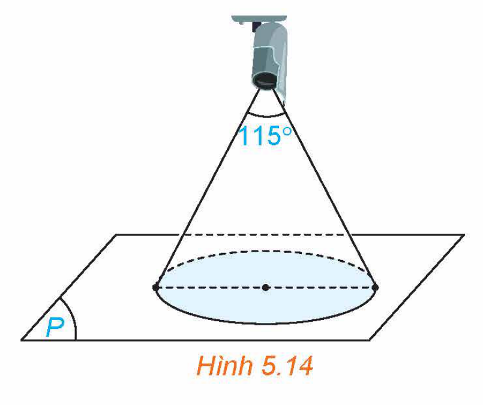
*Hình 5.14*

## ✏️ Bài tập

**5.1.** Trong không gian $Oxyz$, viết phương trình mặt phẳng đi qua điểm $M(1; 2; -1)$ và vuông góc với trục $Ox$.

**5.2.** Trong không gian $Oxyz$, cho hình hộp $ABCD.A'B'C'D'$, với $A(1; -1; 3), B(0; 2; 4), D(2; -1; 1), A'(0; 1; 2)$.
<!-- ocr-ok: đã đối chiếu ảnh trang PDF 41 -->

a) Tính toạ độ các điểm $C, B', D'$.

b) Viết phương trình mặt phẳng $(CB'D')$.

**5.3.** Trong không gian $Oxyz$, viết phương trình mặt phẳng $(P)$ đi qua điểm $M(1; -1; 5)$ và vuông góc với hai mặt phẳng $(Q): 3x + 2y - z = 0, (R): x + y - z = 0$.

**5.4.** Trong không gian $Oxyz$, viết phương trình mặt phẳng đi qua $M(2; 3; -1)$, song song với trục $Ox$ và vuông góc với mặt phẳng $(Q): x + 2y - 3z + 1 = 0$.

**5.5.** Trong không gian $Oxyz$, tính khoảng cách từ gốc toạ độ đến mặt phẳng $(P): 2x + 2y - z + 1 = 0$.
<!-- ocr-ok: đã đối chiếu ảnh trang PDF 41 -->

**5.6.** Trong không gian $Oxyz$, cho hai mặt phẳng $(P): x + y + z + 2 = 0, (Q): x + y + z + 6 = 0$. Chứng minh rằng hai mặt phẳng đã cho song song với nhau và tính khoảng cách giữa hai mặt phẳng đó.

**5.7.** Trong không gian $Oxyz$, cho hai mặt phẳng $(P): x + 3y - z = 0, (Q): x - y - 2z + 1 = 0$.
<!-- ocr-ok: đã đối chiếu ảnh trang PDF 41 -->

a) Chứng minh rằng hai mặt phẳng $(P)$ và $(Q)$ vuông góc với nhau.

b) Tìm điểm $M$ thuộc trục $Ox$ và cách đều hai mặt phẳng $(P)$ và $(Q)$.

**5.8.** Bác An dự định làm bốn mái của ngôi nhà sao cho chúng là bốn mặt bên của một hình chóp đều và các mái nhà kề nhau thì vuông góc với nhau. Hỏi ý tưởng trên có thực hiện được không?

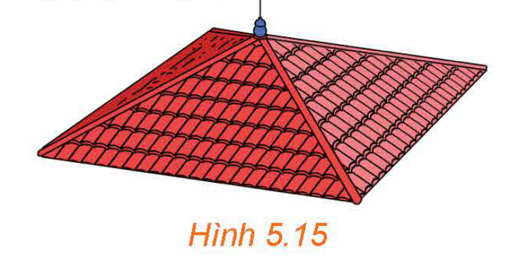
*Hình 5.15*

**5.9.** Trong không gian $Oxyz$, một ngôi nhà có sàn nhà thuộc mặt phẳng $Oxy$, trần nhà tầng 1 thuộc mặt phẳng $z - 1 = 0$, mái nhà tầng 2 thuộc mặt phẳng $x + y + 50z - 100 = 0$. Hỏi trong ba mặt phẳng tương ứng chứa sàn nhà, trần tầng 1, mái tầng 2, hai mặt phẳng nào song song với nhau?

<!-- pdf:42 -->

**5.10.** Xét một cối xay lúa trong không gian $Oxyz$, với đơn vị đo là mét. Nếu tác động vào tai cối xay lúa (ở vị trí $P$) một lực $\vec{F}$ thì moment lực $\vec{M}$ được tính bởi công thức $\vec{M} = [\overrightarrow{OP}, \vec{F}]$ (H.5.16). Trong quá trình xay, các thanh gỗ $AB$ và $PQ$ luôn có phương nằm ngang. Vectơ lực $\vec{F}$ có giá song song với $AB$. Giải thích vì sao giá của vectơ moment lực $\vec{M}$ có phương thẳng đứng?

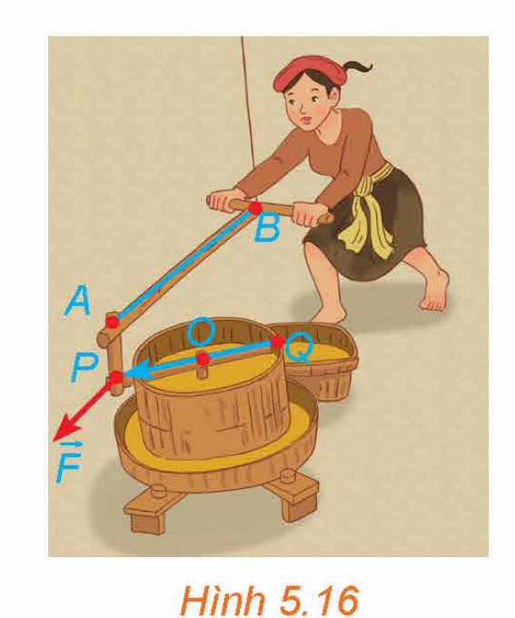
*Hình 5.16*

## 💡 Em có biết?

**Hình học giải tích** hay còn gọi là **hình học toạ độ** là lĩnh vực toán học dùng ngôn ngữ và phương pháp đại số để nghiên cứu hình học. Trong hình học giải tích, mỗi đối tượng hình học được cho tương ứng với một đối tượng đại số: điểm cho tương ứng với toạ độ của điểm, đường cho tương ứng với phương trình của đường, mặt cho tương ứng với phương trình của mặt. Ngoài phương trình mặt phẳng đã được trình bày ở bài học trên và phương trình mặt cầu sẽ được học trong Bài 17, sau đây là phương trình của một số mặt xuất hiện nhiều trong cuộc sống:

- **Mặt ellipsoid** hay còn gọi là **mặt trái xoan** (H.5.17) có phương trình:

  $\frac{x^2}{a^2} + \frac{y^2}{b^2} + \frac{z^2}{c^2} = 1.$

  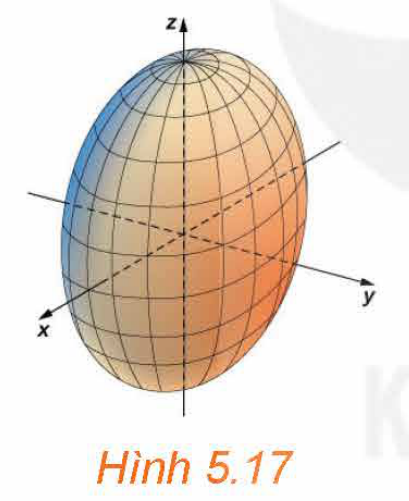
  *Hình 5.17*

- **Mặt hyperboloid một tầng** (H.5.18) có phương trình:

  $\frac{x^2}{a^2} + \frac{y^2}{b^2} - \frac{z^2}{c^2} = 1.$

  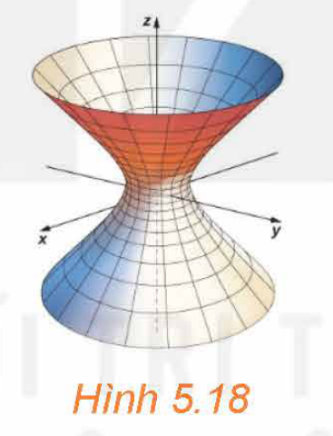
  *Hình 5.18*

- **Mặt hyperboloid hai tầng** (H.5.19) có phương trình:

  $\frac{x^2}{a^2} + \frac{y^2}{b^2} - \frac{z^2}{c^2} = -1.$

  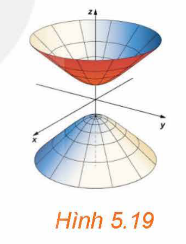
  *Hình 5.19*

- **Mặt nón elliptic** (H.5.20) có phương trình:

  $\frac{x^2}{a^2} + \frac{y^2}{b^2} - \frac{z^2}{c^2} = 0.$

  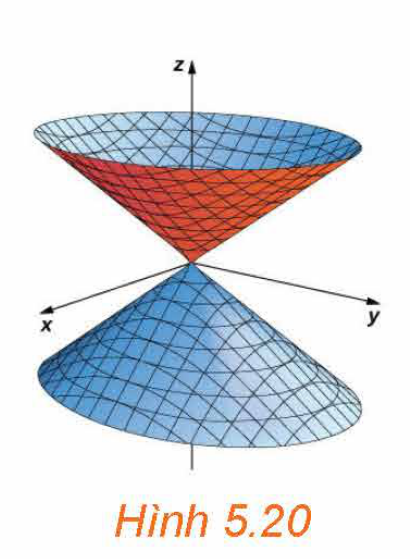
  *Hình 5.20*

- **Mặt paraboloid elliptic** (H.5.21) có phương trình:

  $z = \frac{x^2}{a^2} + \frac{y^2}{b^2}.$

  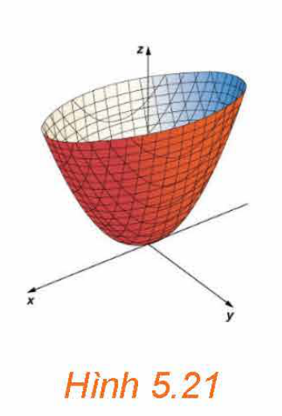
  *Hình 5.21*

- **Mặt paraboloid hyperbolic** hay còn gọi là **mặt yên ngựa** (H.5.22) có phương trình:

  $z = \frac{x^2}{a^2} - \frac{y^2}{b^2}.$

  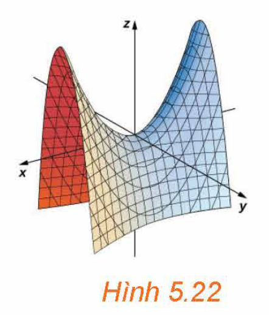
  *Hình 5.22*

($a, b, c > 0$ và không bằng nhau.)

## 📷 Danh sách hình trong bài

| Mã hình | Trang PDF | Vị trí trong bài | Chú thích gốc |
| --- | --- | --- | --- |
| H12-toan-b14-01 | 31 | Mục 1, HĐ1 | Hình 5.1 |
| H12-toan-b14-02 | 32 | Mục 1, Định nghĩa vectơ pháp tuyến | Hình 5.2 |
| H12-toan-b14-03 | 32 | Mục 1, Ví dụ 1 | Hình 5.3 |
| H12-toan-b14-04 | 32 | Mục 1, Định nghĩa tích có hướng | Hình 5.4 |
| H12-toan-b14-05 | 33 | Mục 1, Định nghĩa cặp vectơ chỉ phương | Hình 5.5 |
| H12-toan-b14-06 | 33 | Mục 1, Vận dụng 1 | Hình 5.6 |
| H12-toan-b14-07 | 36 | Mục 3, Ví dụ 7 | Hình 5.7 |
| H12-toan-b14-08 | 37 | Mục 3, Luyện tập 8 | Hình 5.8 |
| H12-toan-b14-09 | 38 | Mục 4, Điều kiện hai mặt phẳng vuông góc | Hình 5.9 |
| H12-toan-b14-10 | 38 | Mục 4, Vận dụng 3 | Hình 5.10 |
| H12-toan-b14-11 | 39 | Mục 5, HĐ9 | Hình 5.11 |
| H12-toan-b14-12 | 40 | Mục 5, Vận dụng 4 | Hình 5.12 |
| H12-toan-b14-13 | 40 | Mục 6, HĐ10 | Hình 5.13 |
| H12-toan-b14-14 | 41 | Mục 6, Vận dụng 5 | Hình 5.14 |
| H12-toan-b14-15 | 41 | Bài tập 5.8 | Hình 5.15 |
| H12-toan-b14-16 | 42 | Bài tập 5.10 | Hình 5.16 |
| H12-toan-b14-17 | 42 | Em có biết? | Hình 5.17 |
| H12-toan-b14-18 | 42 | Em có biết? | Hình 5.18 |
| H12-toan-b14-19 | 42 | Em có biết? | Hình 5.19 |
| H12-toan-b14-20 | 42 | Em có biết? | Hình 5.20 |
| H12-toan-b14-21 | 42 | Em có biết? | Hình 5.21 |
| H12-toan-b14-22 | 42 | Em có biết? | Hình 5.22 |
