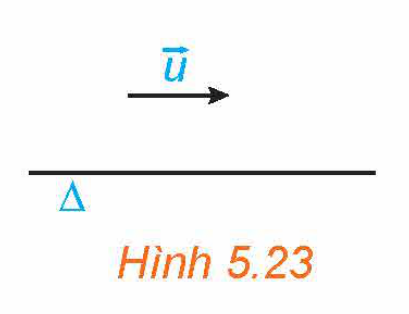
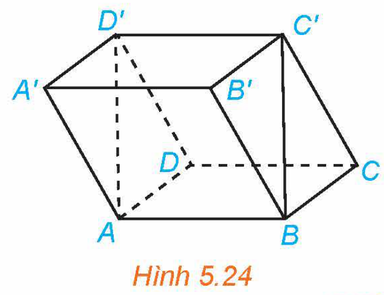
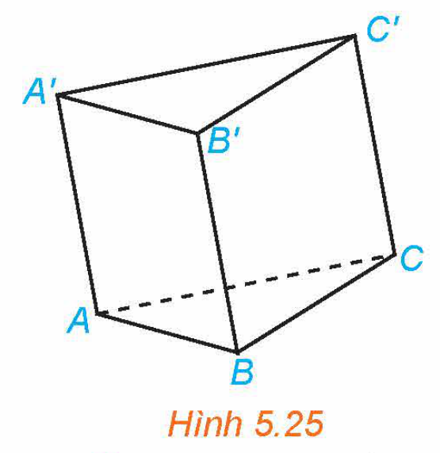
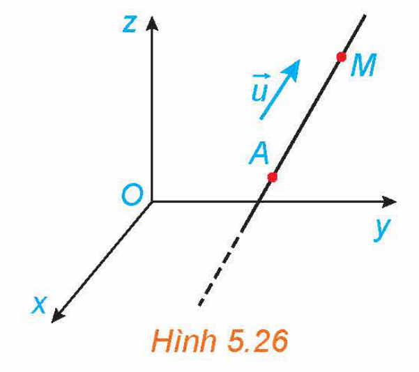
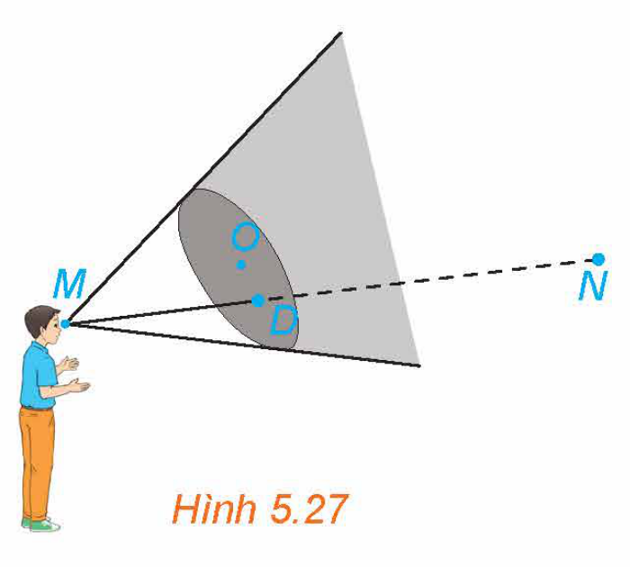
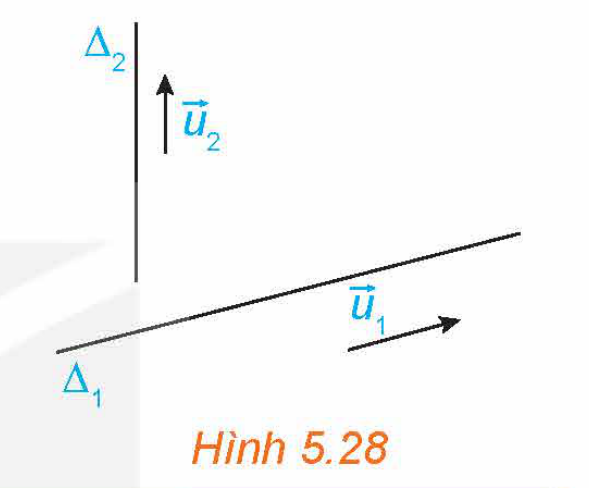
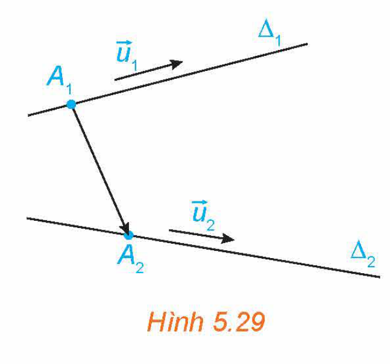
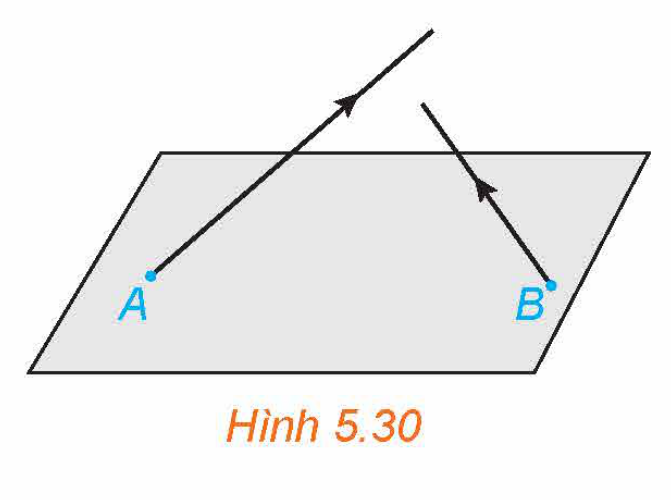
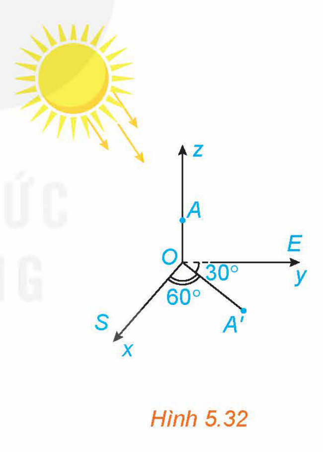

<!-- pdf:43 -->
# BÀI 15: PHƯƠNG TRÌNH ĐƯỜNG THẲNG TRONG KHÔNG GIAN

## 🔤 Thuật ngữ
- Vectơ chỉ phương của đường thẳng
- Phương trình tham số của đường thẳng
- Phương trình chính tắc của đường thẳng
- Hai đường thẳng vuông góc với nhau
- Hai đường thẳng song song với nhau
- Hai đường thẳng trùng nhau
- Hai đường thẳng chéo nhau
- Hai đường thẳng cắt nhau

## 🎯 Mục tiêu
- Nhận biết các phương trình tham số, chính tắc của đường thẳng.
- Viết phương trình đường thẳng đi qua một điểm và biết vectơ chỉ phương.
- Viết phương trình đường thẳng đi qua hai điểm.
- Nhận biết vị trí tương đối của hai đường thẳng.
- Vận dụng kiến thức về phương trình đường thẳng, vị trí tương đối giữa hai đường thẳng vào một số bài toán liên quan đến thực tiễn.

## 🔴 Mở đầu

Trong không gian $Oxyz$, mắt một người quan sát đặt ở điểm $M(2; 3; -4)$ và vật cần quan sát đặt tại điểm $N(-1; 0; 8)$. Một tấm bìa chắn đường truyền của ánh sáng có dạng hình tròn với tâm $O(0; 0; 0)$, bán kính bằng $3$ và đặt trong mặt phẳng $Oxy$. Hỏi tấm bìa có che khuất tầm nhìn của người quan sát đối với vật đặt ở điểm $N$ hay không?

## 1. PHƯƠNG TRÌNH ĐƯỜNG THẲNG

**a) Vectơ chỉ phương của đường thẳng**

**HĐ1: Hình thành khái niệm vectơ chỉ phương của đường thẳng**

Trong không gian, cho điểm $M$ và vectơ $\vec{u}$ khác vectơ-không. Khẳng định nào trong hai khẳng định sau là đúng?

a) Có duy nhất đường thẳng đi qua $M$ và vuông góc với giá của $\vec{u}$.

b) Có duy nhất đường thẳng đi qua $M$ và song song hoặc trùng với giá của $\vec{u}$.

Vectơ $\vec{u} \neq \vec{0}$ được gọi là **vectơ chỉ phương** của đường thẳng $\Delta$ nếu giá của $\vec{u}$ song song hoặc trùng với $\Delta$.

*Hình 5.23*

**Chú ý:**

- Đường thẳng hoàn toàn xác định khi biết một điểm mà nó đi qua và một vectơ chỉ phương.
- Nếu $\vec{u}$ là một vectơ chỉ phương của $\Delta$ thì $k\vec{u}$ (với $k$ là một số khác $0$) cũng là một vectơ chỉ phương của $\Delta$.

**Ví dụ 1:** Cho hình hộp $ABCD.A'B'C'D'$. Hãy chỉ ra các vectơ chỉ phương của đường thẳng $BC'$ mà điểm đầu và điểm cuối của vectơ đó đều là các đỉnh của hình hộp $ABCD.A'B'C'D'$.

**Giải:** (H.5.24)

Đường thẳng $BC'$ nhận các vectơ $\overrightarrow{BC'}$, $\overrightarrow{C'B}$, $\overrightarrow{AD'}$, $\overrightarrow{D'A}$ là các vectơ chỉ phương.

*Hình 5.24*

<!-- pdf:44 -->
**Luyện tập 1:** Cho hình lăng trụ $ABC.A'B'C'$ (H.5.25). Trong các vectơ có điểm đầu và điểm cuối đều là đỉnh của hình lăng trụ, những vectơ nào là vectơ chỉ phương của đường thẳng $AB$?

*Hình 5.25*

**b) Phương trình tham số của đường thẳng**

**HĐ2: Hình thành khái niệm phương trình tham số của đường thẳng**

Trong không gian $Oxyz$, một vật thể chuyển động với vectơ vận tốc không đổi $\vec{u} = (a; b; c) \neq \vec{0}$ và xuất phát từ điểm $A(x_0; y_0; z_0)$ (H.5.26).

a) Hỏi vật thể chuyển động trên đường thẳng nào (chỉ ra điểm mà nó đi qua và vectơ chỉ phương của đường thẳng đó)?

b) Giả sử tại thời điểm $t$ ($t > 0$) tính từ khi xuất phát, vật thể ở vị trí $M(x; y; z)$. Tính $x, y, z$ theo $a, b, c, x_0, y_0, z_0$ và $t$.

*Hình 5.26*

> Trong không gian $Oxyz$, cho đường thẳng $\Delta$ đi qua điểm $A(x_0; y_0; z_0)$ và có vectơ chỉ phương $\vec{u} = (a; b; c)$. Hệ phương trình:
>
> $\begin{cases} x = x_0 + at \\ y = y_0 + bt \\ z = z_0 + ct \end{cases}$
>
> được gọi là **phương trình tham số** của đường thẳng $\Delta$ ($t$ là tham số, $t \in \mathbb{R}$).

**Chú ý:**

- Với các số $a, b, c$ không đồng thời bằng $0$, hệ phương trình $\begin{cases} x = x_0 + at \\ y = y_0 + bt \\ z = z_0 + ct \end{cases}$ ($t \in \mathbb{R}$) xác định một đường thẳng đi qua $M(x_0; y_0; z_0)$ và có vectơ chỉ phương $\vec{u} = (a; b; c)$.
- Từ phương trình tham số của đường thẳng, mỗi giá trị của tham số tương ứng với một điểm thuộc đường thẳng đó và ngược lại.

**Ví dụ 2:** Trong không gian $Oxyz$, cho đường thẳng $\Delta: \begin{cases} x = -1 + 3t \\ y = 1 \\ z = 2t. \end{cases}$

a) Hãy chỉ ra một điểm thuộc $\Delta$ và một vectơ chỉ phương của $\Delta$.

b) Viết phương trình tham số của đường thẳng $\Delta'$ đi qua $A(2; 1; 0)$ và có vectơ chỉ phương $\vec{v} = (3; 0; 2)$.

**Giải:**

a) Do $\Delta$ có phương trình $\begin{cases} x = -1 + 3t \\ y = 1 + 0t \\ z = 0 + 2t \end{cases}$ nên điểm $M(-1; 1; 0)$ thuộc $\Delta$ và $\vec{u}(3; 0; 2)$ là một vectơ chỉ phương của $\Delta$.

b) Đường thẳng $\Delta'$ có phương trình tham số là $\begin{cases} x = 2 + 3s \\ y = 1 \\ z = 2s. \end{cases}$

<!-- pdf:45 -->
**Luyện tập 2:** Trong không gian $Oxyz$, cho đường thẳng $\Delta: \begin{cases} x = 2 + t \\ y = 3t \\ z = 1 + t. \end{cases}$

a) Hãy chỉ ra hai điểm thuộc $\Delta$ và một vectơ chỉ phương của $\Delta$.

b) Viết phương trình tham số của đường thẳng đi qua gốc toạ độ $O(0; 0; 0)$ và có vectơ chỉ phương $\vec{v} = (1; 3; 1)$.

**c) Phương trình chính tắc của đường thẳng**

**HĐ3: Hình thành khái niệm phương trình chính tắc của đường thẳng**

Trong không gian $Oxyz$, cho đường thẳng $\Delta$ đi qua điểm $A(x_0; y_0; z_0)$ và có vectơ chỉ phương $\vec{u} = (a; b; c)$ ($a, b, c$ là các số khác $0$).

a) Điểm $M(x; y; z)$ thuộc $\Delta$ khi và chỉ khi hai vectơ $\overrightarrow{AM} = (x - x_0; y - y_0; z - z_0)$ và $\vec{u} = (a; b; c)$ có mối quan hệ gì?

b) Điểm $M(x; y; z)$ thuộc $\Delta$ khi và chỉ khi các phân số $\frac{x - x_0}{a}, \frac{y - y_0}{b}, \frac{z - z_0}{c}$ có mối quan hệ gì?

> Trong không gian $Oxyz$, cho đường thẳng $\Delta$ đi qua điểm $A(x_0; y_0; z_0)$ và có vectơ chỉ phương $\vec{u} = (a; b; c)$ với $a, b, c$ là các số khác $0$.
>
> Hệ phương trình $\frac{x - x_0}{a} = \frac{y - y_0}{b} = \frac{z - z_0}{c}$ được gọi là **phương trình chính tắc** của đường thẳng $\Delta$.

**Ví dụ 3:** Trong không gian $Oxyz$, cho đường thẳng $\Delta: \frac{x - 1}{2} = \frac{y}{3} = \frac{z + 2}{1}$.

Hãy chỉ ra một điểm thuộc $\Delta$ và một vectơ chỉ phương của $\Delta$.

**Giải:**

Đường thẳng $\Delta$ có phương trình $\frac{x - 1}{2} = \frac{y - 0}{3} = \frac{z - (-2)}{1}$ nên điểm $A(1; 0; -2)$ thuộc $\Delta$ và $\vec{u} = (2; 3; 1)$ là một vectơ chỉ phương của $\Delta$.

**Luyện tập 3:** Trong không gian $Oxyz$, cho đường thẳng $\Delta: \frac{x + 1}{3} = \frac{y - 1}{1} = \frac{z - 2}{5}$. Hãy chỉ ra một vectơ chỉ phương của $\Delta$ và hai điểm thuộc $\Delta$.

**Ví dụ 4:** Trong không gian $Oxyz$, viết phương trình tham số và phương trình chính tắc của đường thẳng $\Delta$ đi qua điểm $M(1; -2; 4)$ và có vectơ chỉ phương $\vec{u} = (3; -5; 1)$.

**Giải:**

Đường thẳng $\Delta$ có phương trình tham số là: $\begin{cases} x = 1 + 3t \\ y = -2 - 5t \\ z = 4 + t \end{cases}$ và có phương trình chính tắc là: $\frac{x - 1}{3} = \frac{y + 2}{-5} = \frac{z - 4}{1}$.

<!-- pdf:46 -->
**Luyện tập 4:** Trong không gian $Oxyz$, viết phương trình tham số và phương trình chính tắc của đường thẳng $\Delta$ đi qua điểm $A(2; -1; 0)$ và có vectơ chỉ phương $\vec{u} = (-1; 2; 3)$.

**Ví dụ 5:** Trong không gian $Oxyz$, viết phương trình tham số của đường thẳng $\Delta$ đi qua điểm $M(-1; 4; 5)$ và vuông góc với mặt phẳng $(\alpha): 3x + 2y = 0$.

**Giải:**

Mặt phẳng $(\alpha)$ có vectơ pháp tuyến $\vec{n} = (3; 2; 0)$. Giá của $\vec{n} = (3; 2; 0)$ và $\Delta$ cùng vuông góc với $(\alpha)$ nên chúng trùng nhau hoặc song song với nhau. Do đó $\Delta$ nhận $\vec{n} = (3; 2; 0)$ làm một vectơ chỉ phương.

Vậy $\Delta$ có phương trình tham số là: $\begin{cases} x = -1 + 3t \\ y = 4 + 2t \\ z = 5. \end{cases}$

**Nhận xét:** Đường thẳng $\Delta$ trong Ví dụ 5 không có phương trình chính tắc.

**Luyện tập 5:** Trong không gian $Oxyz$, viết phương trình tham số của đường thẳng $\Delta$ đi qua điểm $M(2; -1; 3)$ và vuông góc với mặt phẳng $Oyz$.

**d) Lập phương trình đường thẳng đi qua hai điểm**

**HĐ4: Lập phương trình đường thẳng đi qua hai điểm**

Trong không gian $Oxyz$, cho hai điểm phân biệt $A_1(x_1; y_1; z_1)$, $A_2(x_2; y_2; z_2)$.

a) Hãy chỉ ra một vectơ chỉ phương của đường thẳng $A_1A_2$.

b) Viết phương trình đường thẳng $A_1A_2$.

<!-- term: Phương trình đường thẳng qua hai điểm -->
> Trong không gian $Oxyz$, cho hai điểm phân biệt $A_1(x_1; y_1; z_1)$ và $A_2(x_2; y_2; z_2)$. Đường thẳng $A_1A_2$ có vectơ chỉ phương $\overrightarrow{A_1A_2} = (x_2 - x_1; y_2 - y_1; z_2 - z_1)$.
> - Đường thẳng $A_1A_2$ có phương trình tham số là $\begin{cases} x = x_1 + (x_2 - x_1)t \\ y = y_1 + (y_2 - y_1)t \\ z = z_1 + (z_2 - z_1)t \end{cases}$ ($t \in \mathbb{R}$).
> - Trong trường hợp $x_1 \neq x_2, y_1 \neq y_2, z_1 \neq z_2$ thì đường thẳng $A_1A_2$ có phương trình chính tắc là: $\frac{x - x_1}{x_2 - x_1} = \frac{y - y_1}{y_2 - y_1} = \frac{z - z_1}{z_2 - z_1}$.

**Ví dụ 6:** Trong không gian $Oxyz$, viết phương trình tham số và phương trình chính tắc của đường thẳng đi qua hai điểm $A(1; 2; -1)$ và $B(2; 4; 0)$.

**Giải:**

Đường thẳng $AB$ đi qua $A(1; 2; -1)$ và có vectơ chỉ phương $\overrightarrow{AB} = (1; 2; 1)$. Do đó $AB$ có phương trình chính tắc là $\frac{x - 1}{1} = \frac{y - 2}{2} = \frac{z + 1}{1}$ và có phương trình tham số là $\begin{cases} x = 1 + t \\ y = 2 + 2t \\ z = -1 + t. \end{cases}$

**Luyện tập 6:** Trong không gian $Oxyz$, viết phương trình đường thẳng đi qua hai điểm $A(2; 1; 3)$ và $B(2; 4; 6)$.

<!-- pdf:47 -->
**Vận dụng 1:** (H.5.27) Trong *tình huống mở đầu* hãy thực hiện các bước sau và trả lời câu hỏi đã được nêu ra.

a) Viết phương trình tham số của đường thẳng $MN$.

b) Tính toạ độ giao điểm $D$ của đường thẳng $MN$ với mặt phẳng $Oxy$.

c) Hỏi điểm $D$ có nằm giữa hai điểm $M$ và $N$ hay không?

*Hình 5.27*

## 2. HAI ĐƯỜNG THẲNG VUÔNG GÓC

**HĐ5: Tìm điều kiện để hai đường thẳng vuông góc với nhau**

Trong không gian $Oxyz$, cho hai đường thẳng $\Delta_1, \Delta_2$ tương ứng có vectơ chỉ phương $\vec{u}_1 = (a_1; b_1; c_1), \vec{u}_2 = (a_2; b_2; c_2)$.

a) Hai đường thẳng $\Delta_1$ và $\Delta_2$ vuông góc với nhau khi và chỉ khi hai giá của $\vec{u}_1, \vec{u}_2$ có mối quan hệ gì?

b) Tìm điều kiện đối với $\vec{u}_1, \vec{u}_2$ để $\Delta_1$ và $\Delta_2$ vuông góc với nhau.

*Hình 5.28*

<!-- term: Hai đường thẳng vuông góc -->
> Trong không gian $Oxyz$, cho hai đường thẳng $\Delta_1, \Delta_2$ tương ứng có vectơ chỉ phương $\vec{u}_1 = (a_1; b_1; c_1), \vec{u}_2 = (a_2; b_2; c_2)$. Khi đó:
>
> $\Delta_1 \perp \Delta_2 \Leftrightarrow \vec{u}_1 \cdot \vec{u}_2 = 0 \Leftrightarrow a_1a_2 + b_1b_2 + c_1c_2 = 0$.

**Ví dụ 7:** Trong không gian $Oxyz$, chứng minh rằng hai đường thẳng sau vuông góc với nhau:

$\Delta_1: \begin{cases} x = 1 + 2t \\ y = -1 - 3t, \\ z = 2 - t \end{cases}$ $\Delta_2: \begin{cases} x = 2 + s \\ y = 1 - 2s \\ z = 3 + 8s. \end{cases}$

**Giải:**

Các đường thẳng $\Delta_1, \Delta_2$ tương ứng có vectơ chỉ phương $\vec{u}_1 = (2; -3; -1), \vec{u}_2 = (1; -2; 8)$.

Do $\vec{u}_1 \cdot \vec{u}_2 = 2 \cdot 1 + (-3) \cdot (-2) + (-1) \cdot 8 = 0$ nên $\Delta_1 \perp \Delta_2$.

**Luyện tập 7:** Trong không gian $Oxyz$, cho đường thẳng $\Delta: \frac{x - 1}{2} = \frac{y}{1} = \frac{z - 1}{-1}$. Hỏi đường thẳng $\Delta$ có vuông góc với trục $Oz$ hay không?

**Vận dụng 2:** Tại một nút giao thông có hai con đường. Trên thiết kế, trong không gian $Oxyz$, hai con đường đó tương ứng thuộc hai đường thẳng:

$\Delta_1: \begin{cases} x = 2 + t \\ y = 1 + t, \\ z = 0 \end{cases}$ $\Delta_2: \begin{cases} x = 1 - 2s \\ y = 2s \\ z = 1. \end{cases}$

Hỏi hai con đường trên có vuông góc với nhau hay không?

<!-- pdf:48 -->
## 3. VỊ TRÍ TƯƠNG ĐỐI GIỮA HAI ĐƯỜNG THẲNG

**HĐ6: Xác định vị trí tương đối giữa hai đường thẳng**

Trong không gian $Oxyz$, cho hai đường thẳng $\Delta_1, \Delta_2$ lần lượt đi qua các điểm $A_1(x_1; y_1; z_1), A_2(x_2; y_2; z_2)$ và tương ứng có vectơ chỉ phương $\vec{u}_1 = (a_1; b_1; c_1), \vec{u}_2 = (a_2; b_2; c_2)$ (H.5.29).

a) Tìm điều kiện đối với $\vec{u}_1$ và $\vec{u}_2$ để $\Delta_1$ và $\Delta_2$ song song hoặc trùng nhau.

b) Giả sử $[\vec{u}_1, \vec{u}_2] \neq \vec{0}$ và $\overrightarrow{A_1A_2} \cdot [\vec{u}_1, \vec{u}_2] = 0$ thì $\Delta_1$ và $\Delta_2$ có cắt nhau hay không?

c) Giả sử $\overrightarrow{A_1A_2} \cdot [\vec{u}_1, \vec{u}_2] \neq 0$ thì $\Delta_1$ và $\Delta_2$ có chéo nhau hay không?

*Hình 5.29*

Trong không gian $Oxyz$, cho hai đường thẳng $\Delta_1, \Delta_2$ lần lượt đi qua các điểm $A_1(x_1; y_1; z_1)$, $A_2(x_2; y_2; z_2)$ và tương ứng có vectơ chỉ phương $\vec{u}_1 = (a_1; b_1; c_1), \vec{u}_2 = (a_2; b_2; c_2)$. Khi đó:

<!-- term: Hai đường thẳng song song -->
- $\Delta_1 // \Delta_2 \Leftrightarrow \vec{u}_1$ cùng phương với $\vec{u}_2$ và $A_1 \notin \Delta_2$.

<!-- term: Hai đường thẳng trùng nhau -->
- $\Delta_1 \equiv \Delta_2 \Leftrightarrow \vec{u}_1$ cùng phương với $\vec{u}_2$ và $A_1 \in \Delta_2$.

<!-- term: Hai đường thẳng cắt nhau -->
- $\Delta_1$ và $\Delta_2$ cắt nhau $\Leftrightarrow \begin{cases} [\vec{u}_1, \vec{u}_2] \neq \vec{0} \\ \overrightarrow{A_1A_2} \perp [\vec{u}_1, \vec{u}_2] \end{cases} \Leftrightarrow \begin{cases} [\vec{u}_1, \vec{u}_2] \neq \vec{0} \\ \overrightarrow{A_1A_2} \cdot [\vec{u}_1, \vec{u}_2] = 0. \end{cases}$

<!-- term: Hai đường thẳng chéo nhau -->
- $\Delta_1$ và $\Delta_2$ chéo nhau $\Leftrightarrow \overrightarrow{A_1A_2} \cdot [\vec{u}_1, \vec{u}_2] \neq 0$.

**Ví dụ 8:** Trong không gian $Oxyz$, chứng minh rằng hai đường thẳng sau vuông góc với nhau và chéo nhau:

$\Delta_1: \begin{cases} x = 1 + t \\ y = 2 - t \\ z = -1 + 2t \end{cases}$ và $\Delta_2: \frac{x - 4}{3} = \frac{y + 1}{1} = \frac{z}{-1}$.

**Giải:**

Đường thẳng $\Delta_1$ đi qua điểm $A_1(1; 2; -1)$ và có vectơ chỉ phương $\vec{u}_1 = (1; -1; 2)$.

Đường thẳng $\Delta_2$ đi qua điểm $A_2(4; -1; 0)$ và có vectơ chỉ phương $\vec{u}_2 = (3; 1; -1)$.

Vì $\vec{u}_1 \cdot \vec{u}_2 = 1 \cdot 3 + (-1) \cdot 1 + 2 \cdot (-1) = 0$ nên $\vec{u}_1$ vuông góc với $\vec{u}_2$. Do đó $\Delta_1$ vuông góc với $\Delta_2$.
<!-- ocr-ok: đã đối chiếu ảnh trang PDF 48 -->

Ta có $\overrightarrow{A_1A_2} = (3; -3; 1)$ và $[\vec{u}_1, \vec{u}_2] = (-1; 7; 4)$.

Do $\overrightarrow{A_1A_2} \cdot [\vec{u}_1, \vec{u}_2] = 3 \cdot (-1) + (-3) \cdot 7 + 1 \cdot 4 = -20 \neq 0$ nên $\Delta_1$ và $\Delta_2$ chéo nhau.
<!-- ocr-ok: đã đối chiếu ảnh trang PDF 48 -->

**Luyện tập 8:** Trong không gian $Oxyz$, chứng minh rằng hai đường thẳng sau song song với nhau:

$\Delta_1: \frac{x - 3}{1} = \frac{y}{-2} = \frac{z - 1}{3}$ và $\Delta_2: \frac{x - 1}{1} = \frac{y - 2}{-2} = \frac{z}{3}$.

<!-- pdf:49 -->
**Ví dụ 9:** Trong không gian $Oxyz$, chứng minh rằng hai đường thẳng sau cắt nhau:

$\Delta_1: \begin{cases} x = 1 - t \\ y = 2 + t \\ z = -1 + 2t \end{cases}$ và $\Delta_2: \begin{cases} x = -6 + s \\ y = 5 + s \\ z = 5 + 2s. \end{cases}$

**Giải:**

Đường thẳng $\Delta_1$ đi qua $A_1(1; 2; -1)$ và có vectơ chỉ phương $\vec{u}_1 = (-1; 1; 2)$. Đường thẳng $\Delta_2$ đi qua $A_2(-6; 5; 5)$ và có vectơ chỉ phương $\vec{u}_2 = (1; 1; 2)$. Ta có $\overrightarrow{A_1A_2} = (-7; 3; 6)$ và $[\vec{u}_1, \vec{u}_2] = (0; 4; -2)$.
<!-- ocr-ok: đã đối chiếu ảnh trang PDF 49 -->

Do $\overrightarrow{A_1A_2} \cdot [\vec{u}_1, \vec{u}_2] = (-7) \cdot 0 + 3 \cdot 4 + 6 \cdot (-2) = 0$ và $[\vec{u}_1, \vec{u}_2] \neq \vec{0}$ nên hai đường thẳng $\Delta_1$ và $\Delta_2$ cắt nhau.
<!-- ocr-ok: đã đối chiếu ảnh trang PDF 49 -->

**Luyện tập 9:** Trong không gian $Oxyz$, cho hai đường thẳng $\Delta_1: \frac{x - 1}{1} = \frac{y + 2}{1} = \frac{z - 3}{4}$ và $\Delta_2: \frac{x + 1}{1} = \frac{y + 1}{1} = \frac{z}{4}$. Chứng minh rằng:

a) Hai đường thẳng $\Delta_1$ và $\Delta_2$ song song với nhau;

b) Đường thẳng $\Delta_1$ và trục $Ox$ chéo nhau;

c) Đường thẳng $\Delta_2$ trùng với đường thẳng $\Delta_3: \frac{x + 2}{1} = \frac{y + 2}{1} = \frac{z + 4}{4}$;

d) Đường thẳng $\Delta_2$ cắt trục $Oz$.

**Chú ý:** Để xét vị trí tương đối giữa hai đường thẳng, ta cũng có thể dựa vào các vectơ chỉ phương và phương trình của hai đường thẳng đó theo tiêu chuẩn sau đây.

Trong không gian $Oxyz$, cho hai đường thẳng $\Delta_1, \Delta_2$ tương ứng có vectơ chỉ phương $\vec{u}_1 = (a_1; b_1; c_1), \vec{u}_2 = (a_2; b_2; c_2)$ và có phương trình tham số:

$\Delta_1: \begin{cases} x = x_1 + a_1t \\ y = y_1 + b_1t \\ z = z_1 + c_1t, \end{cases}$ $\Delta_2: \begin{cases} x = x_2 + a_2s \\ y = y_2 + b_2s \\ z = z_2 + c_2s. \end{cases}$

Xét hệ phương trình hai ẩn $t, s$: $\begin{cases} x_1 + a_1t = x_2 + a_2s \\ y_1 + b_1t = y_2 + b_2s \\ z_1 + c_1t = z_2 + c_2s \end{cases}$ $(*)$.
<!-- ocr-ok: đã đối chiếu ảnh trang PDF 49 -->

Khi đó:

- $\Delta_1 // \Delta_2 \Leftrightarrow \vec{u}_1$ cùng phương với $\vec{u}_2$ và hệ $(*)$ vô nghiệm.
- $\Delta_1 \equiv \Delta_2 \Leftrightarrow$ Hệ $(*)$ có vô số nghiệm.
- $\Delta_1$ cắt $\Delta_2 \Leftrightarrow$ Hệ $(*)$ có nghiệm duy nhất.
- $\Delta_1$ và $\Delta_2$ chéo nhau $\Leftrightarrow \vec{u}_1$ và $\vec{u}_2$ không cùng phương và hệ $(*)$ vô nghiệm.

<!-- pdf:50 -->
**Luyện tập 10:** Trong không gian $Oxyz$, xét vị trí tương đối giữa hai đường thẳng

$\Delta_1: \begin{cases} x = 1 + 2t \\ y = 3 + t \\ z = 1 - t \end{cases}$ và $\Delta_2: \begin{cases} x = s \\ y = 1 + 2s \\ z = 3s. \end{cases}$

**Vận dụng 3:** (H.5.30) Trong không gian $Oxyz$, có hai vật thể lần lượt xuất phát từ $A(1; 2; 0)$ và $B(3; 5; 0)$ với vận tốc không đổi tương ứng là $\vec{v}_1 = (2; 1; 3), \vec{v}_2 = (1; 2; 1)$. Hỏi trong quá trình chuyển động, hai vật thể trên có va chạm vào nhau hay không?

*Hình 5.30*

## ✏️ Bài tập

**5.11.** Trong không gian $Oxyz$, viết các phương trình tham số và chính tắc của đường thẳng $\Delta$ đi qua $A(1; 1; 2)$ và song song với đường thẳng $d: \frac{x - 3}{2} = \frac{y - 1}{1} = \frac{z + 5}{3}$.

**5.12.** Trong không gian $Oxyz$, viết các phương trình tham số và chính tắc của đường thẳng $\Delta$ đi qua $A(2; -1; 4)$ và vuông góc với mặt phẳng $(P): x + 3y - z - 1 = 0$.

**5.13.** Trong không gian $Oxyz$, viết các phương trình tham số và chính tắc của đường thẳng $\Delta$ đi qua hai điểm $A(2; 3; -1)$ và $B(1; -2; 4)$.

**5.14.** Trong không gian $Oxyz$, cho hai đường thẳng:

$\Delta_1: \begin{cases} x = 1 + 2t \\ y = 3 - t \\ z = 2 + 3t \end{cases}$ và $\Delta_2: \frac{x - 8}{-1} = \frac{y + 2}{1} = \frac{z - 2}{2}$.

a) Chứng minh rằng $\Delta_1$ và $\Delta_2$ cắt nhau.

b) Viết phương trình mặt phẳng $(P)$ chứa $\Delta_1$ và $\Delta_2$.

**5.15.** Trong không gian $Oxyz$, cho hai đường thẳng:
<!-- ocr-ok: đã đối chiếu ảnh trang PDF 50 -->

$\Delta_1: \frac{x - 1}{3} = \frac{y - 3}{1} = \frac{z - 2}{2}$ và $\Delta_2: \frac{x - 1}{3} = \frac{x + 1}{1} = \frac{z}{2}$.

a) Chứng minh rằng $\Delta_1$ và $\Delta_2$ song song với nhau.

b) Viết phương trình mặt phẳng $(P)$ chứa $\Delta_1$ và $\Delta_2$.

**5.16.** Trong không gian $Oxyz$, xác định vị trí tương đối giữa hai đường thẳng:
<!-- ocr-ok: đã đối chiếu ảnh trang PDF 50 -->

$\Delta_1: \begin{cases} x = -1 + t \\ y = 1 \\ z = 3 + 2t \end{cases}$ và $\Delta_2: \begin{cases} x = -1 + 2s \\ y = 2 + s \\ z = 1 + 3s. \end{cases}$

<!-- pdf:51 -->
**5.17.** Tại một nút giao thông có hai con đường. Trên thiết kế, trong không gian $Oxyz$, hai con đường đó thuộc hai đường thẳng lần lượt có phương trình:

$\Delta_1: \frac{x - 1}{2} = \frac{y}{-1} = \frac{z + 1}{3}$ và $\Delta_2: \frac{x - 3}{-1} = \frac{y + 1}{1} = \frac{z}{1}$.

a) Hai con đường trên có vuông góc với nhau hay không?

b) Nút giao thông trên có phải là nút giao thông khác mức hay không?

*Hình 5.31. Hình ảnh một nút giao thông khác mức*

**5.18.** Trong không gian $Oxyz$, một viên đạn được bắn ra từ điểm $A(1; 3; 4)$ và trong $3$ giây, đầu đạn đi với vận tốc không đổi; vectơ vận tốc (trên giây) là $\vec{v} = (2; 1; 6)$. Hỏi viên đạn trên có bắn trúng mục tiêu trong mỗi tình huống sau hay không?

a) Mục tiêu đặt tại điểm $M\left(7; \frac{7}{2}; 21\right)$.

b) Mục tiêu đặt tại điểm $N(-3; 1; -8)$.

**5.19.** Trên mặt đất phẳng, người ta dựng một cây cột thẳng cao $6\text{ m}$ vuông góc với mặt đất, có chân cột đặt tại vị trí $O$ trên mặt đất. Tại một thời điểm, dưới ánh nắng mặt trời, bóng của đỉnh cột dưới mặt đất cách chân cột $3\text{ m}$ về hướng $S60^\circ E$ (hướng tạo với hướng nam góc $60^\circ$ và tạo với hướng đông góc $30^\circ$) (H.5.32). Chọn hệ trục $Oxyz$ có gốc toạ độ là $O$, tia $Ox$ chỉ hướng nam, tia $Oy$ chỉ hướng đông, tia $Oz$ chứa cây cột, đơn vị đo là mét. Hãy viết phương trình đường thẳng chứa tia nắng mặt trời đi qua đỉnh cột tại thời điểm đang xét.

*Hình 5.32*

## 📷 Danh sách hình trong bài

| Mã hình | Trang PDF | Chú thích trong SGK | Vị trí trong bài |
| --- | --- | --- | --- |
| H12-toan-b15-01 | 43 | Hình 5.23 | Mục 1.a (Định nghĩa vectơ chỉ phương) |
| H12-toan-b15-02 | 43 | Hình 5.24 | Mục 1.a (Ví dụ 1) |
| H12-toan-b15-03 | 44 | Hình 5.25 | Mục 1.a (Luyện tập 1) |
| H12-toan-b15-04 | 44 | Hình 5.26 | Mục 1.b (HĐ2) |
| H12-toan-b15-05 | 47 | Hình 5.27 | Mục 1.d (Vận dụng 1) |
| H12-toan-b15-06 | 47 | Hình 5.28 | Mục 2 (HĐ5) |
| H12-toan-b15-07 | 48 | Hình 5.29 | Mục 3 (HĐ6) |
| H12-toan-b15-08 | 50 | Hình 5.30 | Mục 3 (Vận dụng 3) |
| H12-toan-b15-09 | 51 | Hình 5.31. Hình ảnh một nút giao thông khác mức | Bài tập 5.17 |
| H12-toan-b15-10 | 51 | Hình 5.32 | Bài tập 5.19 |
