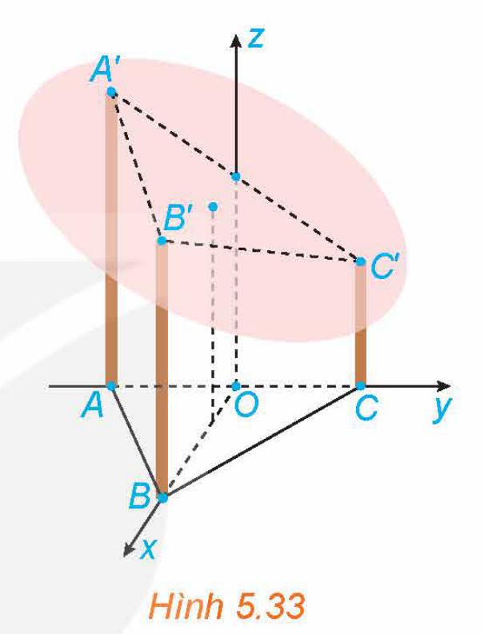
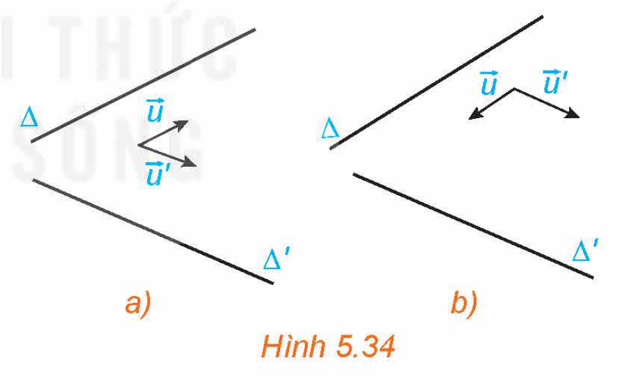
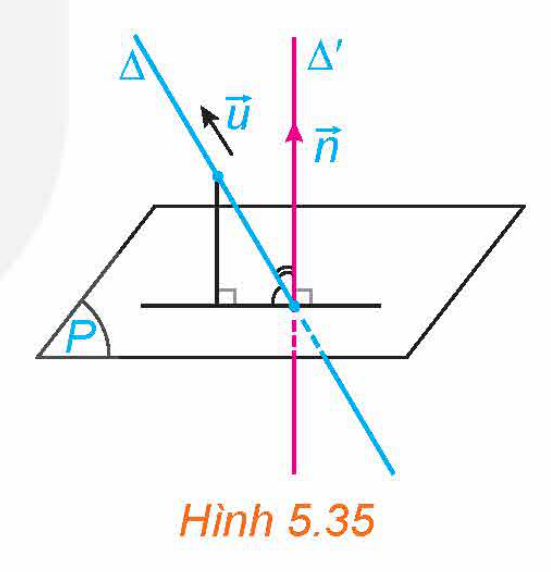
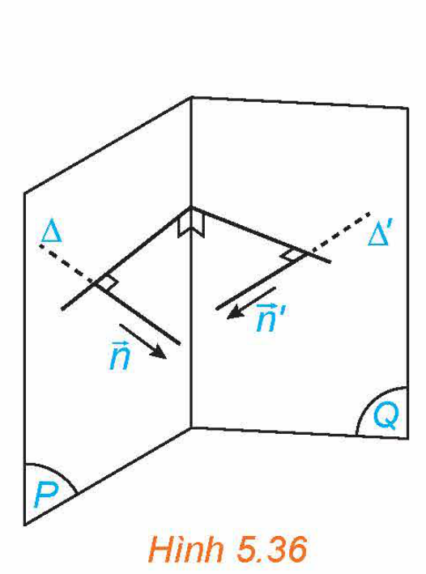
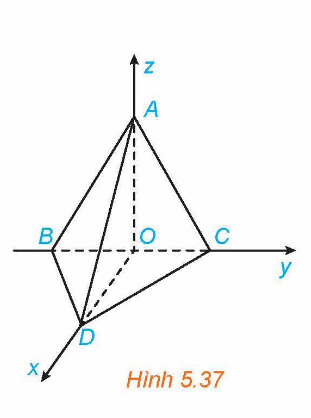
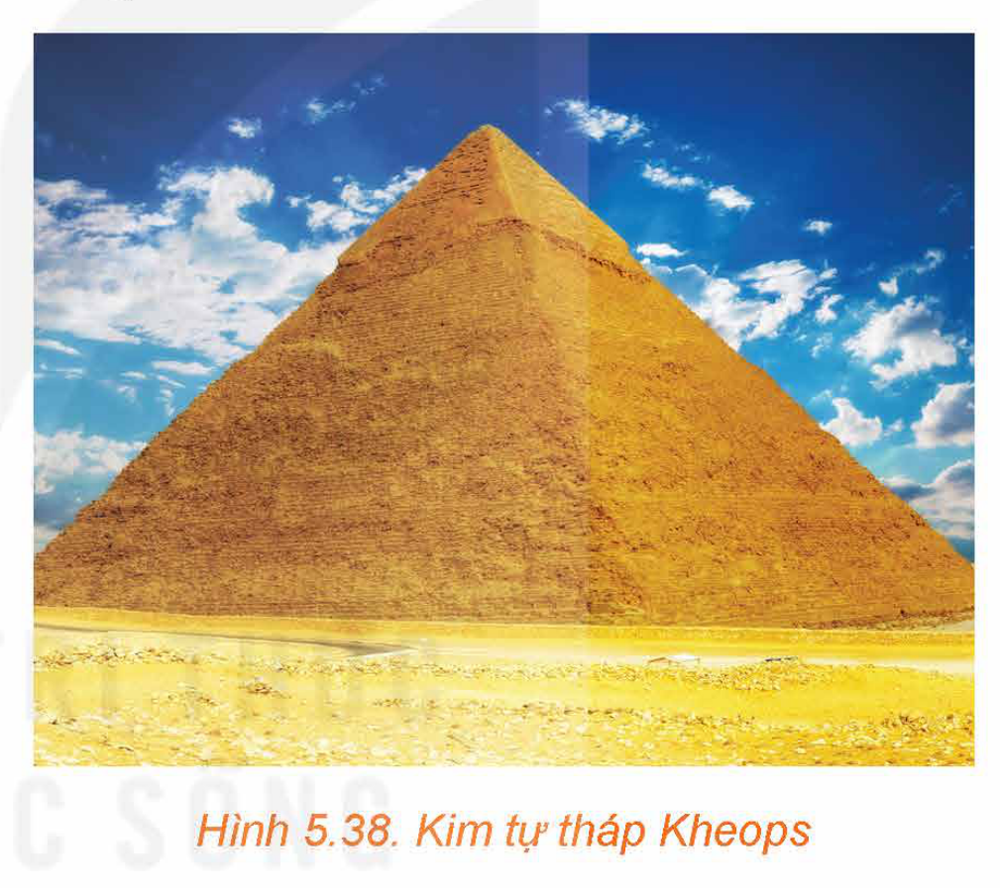
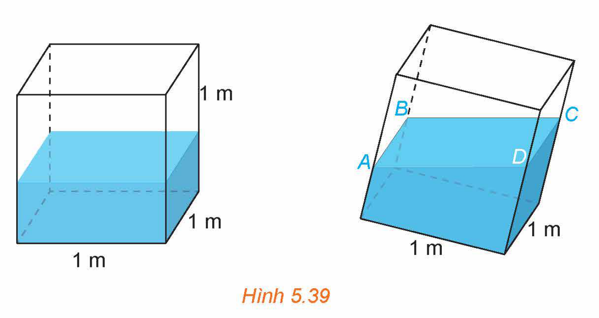

<!-- pdf:52 -->

# BÀI 16: CÔNG THỨC TÍNH GÓC TRONG KHÔNG GIAN

## 🔤 Thuật ngữ

- Góc giữa hai đường thẳng
- Góc giữa đường thẳng và mặt phẳng
- Góc giữa hai mặt phẳng

## 🎯 Mục tiêu

- Tính góc giữa hai đường thẳng, góc giữa đường thẳng và mặt phẳng, góc giữa hai mặt phẳng.
- Vận dụng kiến thức về góc vào một số bài toán liên quan đến thực tiễn.

## 🔴 Mở đầu

Một mái nhà hình tròn được đặt trên ba cây cột trụ (H.5.33). Các cây cột vuông góc với mặt sàn nhà phẳng và có độ cao lần lượt là $7\text{ m}, 6\text{ m}, 5\text{ m}$. Ba chân cột là ba đỉnh của một tam giác đều trên mặt sàn nhà với cạnh dài $4\text{ m}$. Hỏi mái nhà nghiêng với mặt sàn nhà một góc bao nhiêu độ?

*Hình 5.33*

## 1. CÔNG THỨC TÍNH GÓC GIỮA HAI ĐƯỜNG THẲNG

**HĐ1:** Tìm mối quan hệ của góc giữa hai đường thẳng và góc giữa hai vectơ chỉ phương

Trong không gian $Oxyz$, cho hai đường thẳng $\Delta$ và $\Delta'$ tương ứng có các vectơ chỉ phương $\vec{u} = (a; b; c), \vec{u}' = (a'; b'; c')$ (H.5.34).

a) Hãy tìm mối quan hệ giữa các góc $(\Delta, \Delta')$ và $(\vec{u}, \vec{u}')$.

b) Có nhận xét gì về mối quan hệ giữa $\cos(\Delta, \Delta')$ và $|\cos(\vec{u}, \vec{u}')|$?

*Hình 5.34*

<!-- term: Góc giữa hai đường thẳng -->
> Trong không gian $Oxyz$, cho hai đường thẳng $\Delta$ và $\Delta'$ tương ứng có vectơ chỉ phương $\vec{u} = (a; b; c), \vec{u}' = (a'; b'; c')$. Khi đó:
>
> $\cos(\Delta, \Delta') = |\cos(\vec{u}, \vec{u}')| = \frac{|aa' + bb' + cc'|}{\sqrt{a^2 + b^2 + c^2} \cdot \sqrt{a'^2 + b'^2 + c'^2}}.$

<!-- pdf:53 -->

**Ví dụ 1:** Trong không gian $Oxyz$, tính góc giữa hai đường thẳng:

$\Delta: \begin{cases} x = 1 + t \\ y = -1 + t \\ z = 3 \end{cases}$ và $\Delta': \begin{cases} x = 1 + 2s \\ y = -2 + 2s \\ z = 4 + s. \end{cases}$

> Trong bài học này, nếu không nói gì thêm, ta quy ước tính góc theo đơn vị độ và làm tròn đến chữ số thập phân thứ nhất.

**Giải:**

Hai đường thẳng $\Delta$ và $\Delta'$ tương ứng có các vectơ chỉ phương $\vec{u} = (1; 1; 0), \vec{u}' = (2; 2; 1)$. Khi đó:

$\cos(\Delta, \Delta') = |\cos(\vec{u}, \vec{u}')| = \frac{|1\cdot 2 + 1\cdot 2 + 0\cdot 1|}{\sqrt{1^2 + 1^2 + 0^2} \cdot \sqrt{2^2 + 2^2 + 1^2}} = \frac{2\sqrt{2}}{3}.$

Vậy $(\Delta, \Delta') \approx 19,5^\circ$.

**Luyện tập 1:** Trong không gian $Oxyz$, tính góc giữa trục $Oz$ và đường thẳng

$\Delta: \frac{x - 3}{1} = \frac{y + 1}{2} = \frac{z - 1}{-2}.$

## 2. CÔNG THỨC TÍNH GÓC GIỮA ĐƯỜNG THẲNG VÀ MẶT PHẲNG

**HĐ2:** Tìm mối quan hệ của góc giữa đường thẳng và mặt phẳng với góc giữa vectơ chỉ phương và vectơ pháp tuyến tương ứng

Trong không gian $Oxyz$, cho đường thẳng $\Delta$ và mặt phẳng $(P)$. Xét $\vec{u} = (a; b; c)$ là một vectơ chỉ phương của $\Delta$ và $\vec{n} = (A; B; C)$ (với giá $\Delta'$) là một vectơ pháp tuyến của $(P)$. (H.5.35)

a) Hãy tìm mối quan hệ giữa các góc $(\Delta, (P))$ và $(\Delta, \Delta')$.

b) Có nhận xét gì về mối quan hệ giữa $\sin(\Delta, \Delta')$ và $|\cos(\vec{u}, \vec{n})|$?

*Hình 5.35*

<!-- term: Góc giữa đường thẳng và mặt phẳng -->
> Trong không gian $Oxyz$, cho đường thẳng $\Delta$ có vectơ chỉ phương $\vec{u} = (a; b; c)$ và mặt phẳng $(P)$ có vectơ pháp tuyến $\vec{n} = (A; B; C)$. Khi đó:
>
> $\sin(\Delta, (P)) = |\cos(\vec{u}, \vec{n})| = \frac{|aA + bB + cC|}{\sqrt{a^2 + b^2 + c^2} \cdot \sqrt{A^2 + B^2 + C^2}}.$

**Ví dụ 2:** Trong không gian $Oxyz$, tính góc tạo bởi trục $Ox$ và mặt phẳng $(P): \sqrt{2}x - y + z + 2 = 0$.

**Giải:**

Trục $Ox$ có vectơ chỉ phương $\vec{i} = (1; 0; 0)$, mặt phẳng $(P)$ có vectơ pháp tuyến $\vec{n} = (\sqrt{2}; -1; 1)$. Ta có:

$\sin(Ox, (P)) = \frac{|1\cdot\sqrt{2} + 0\cdot(-1) + 0\cdot 1|}{\sqrt{1^2 + 0^2 + 0^2} \cdot \sqrt{\left(\sqrt{2}\right)^2 + (-1)^2 + 1^2}} = \frac{\sqrt{2}}{2}.$

Vậy $Ox$ tạo với $(P)$ góc $45^\circ$.

**Luyện tập 2:** Trong không gian $Oxyz$, tính góc giữa đường thẳng $\Delta$ và mặt phẳng $(P)$, với:

$\Delta: \frac{x + 2}{-1} = \frac{y - 4}{2} = \frac{z + 1}{1}, \ (P): x - y + z - 1 = 0.$

<!-- pdf:54 -->

## 3. CÔNG THỨC TÍNH GÓC GIỮA HAI MẶT PHẲNG

**HĐ3:** Tìm mối quan hệ của góc giữa hai mặt phẳng và góc giữa hai vectơ pháp tuyến

Trong không gian $Oxyz$, cho hai mặt phẳng $(P), (Q)$ tương ứng có các vectơ pháp tuyến là $\vec{n} = (A; B; C), \vec{n}' = (A'; B'; C')$. Lấy các đường thẳng $\Delta, \Delta'$ tương ứng có vectơ chỉ phương $\vec{n}, \vec{n}'$. (H.5.36)

a) Góc giữa hai mặt phẳng $(P)$ và $(Q)$ và góc giữa hai đường thẳng $\Delta$ và $\Delta'$ có mối quan hệ gì?

b) Tính côsin của góc giữa hai mặt phẳng $(P)$ và $(Q)$.

*Hình 5.36*

<!-- term: Góc giữa hai mặt phẳng -->
<!-- term: Công thức góc giữa hai mặt phẳng -->
> Trong không gian $Oxyz$, cho hai mặt phẳng $(P), (Q)$ tương ứng có các vectơ pháp tuyến là $\vec{n} = (A; B; C), \vec{n}' = (A'; B'; C')$. Khi đó, góc giữa $(P)$ và $(Q)$, kí hiệu là $((P), (Q))$, được tính theo công thức:
>
> $\cos((P), (Q)) = |\cos(\vec{n}, \vec{n}')| = \frac{|AA' + BB' + CC'|}{\sqrt{A^2 + B^2 + C^2} \cdot \sqrt{A'^2 + B'^2 + C'^2}}.$

**Ví dụ 3:** Trong không gian $Oxyz$, tính góc giữa hai mặt phẳng $(P): x + 2y + 2z - 1 = 0$ và $(Q): x + y - z + 1 = 0$.

**Giải:**

Các mặt phẳng $(P), (Q)$ tương ứng có các vectơ pháp tuyến là $\vec{n} = (1; 2; 2), \vec{n}' = (1; 1; -1)$.

Ta có: $\cos((P), (Q)) = \frac{|1\cdot 1 + 2\cdot 1 + 2\cdot(-1)|}{\sqrt{1^2 + 2^2 + 2^2} \cdot \sqrt{1^2 + 1^2 + (-1)^2}} = \frac{\sqrt{3}}{9}$.

Do đó $((P), (Q)) \approx 78,9^\circ$.

**Luyện tập 3:** Trong không gian $Oxyz$, tính góc giữa hai mặt phẳng $(P): x - \sqrt{2}y + z - 2 = 0$ và $(Oxz): y = 0$.

**Ví dụ 4:** Trong không gian $Oxyz$, cho $A(0; 0; 4), B(0; -3; 0), C(0; 3; 0), D(3; 0; 0)$. Tính góc giữa hai mặt phẳng $(ABD)$ và $(ACD)$.

*Hình 5.37*

**Giải:** (H.5.37)

Mặt phẳng $(ABD)$ có cặp vectơ chỉ phương là $\overrightarrow{BD} = (3; 3; 0)$ và $\overrightarrow{AD} = (3; 0; -4)$.

Suy ra $(ABD)$ có vectơ pháp tuyến $\left[\overrightarrow{BD}, \overrightarrow{AD}\right] = (-12; 12; -9)$. Do đó $\vec{n} = (-4; 4; -3)$ cũng là vectơ pháp tuyến của $(ABD)$.

Mặt phẳng $(ACD)$ có cặp vectơ chỉ phương là $\overrightarrow{AC} = (0; 3; -4)$ và $\overrightarrow{AD} = (3; 0; -4)$. Suy ra $(ACD)$ có vectơ pháp tuyến là $\left[\overrightarrow{AC}, \overrightarrow{AD}\right] = (-12; -12; -9)$. Do đó $\vec{m} = (4; 4; 3)$ cũng là vectơ pháp tuyến của $(ACD)$.

<!-- pdf:55 -->

Gọi $\varphi$ là góc giữa hai mặt phẳng $(ABD)$ và $(ACD)$. Khi đó:

$\cos\varphi = |\cos(\vec{n}, \vec{m})| = \frac{|-4\cdot 4 + 4\cdot 4 + (-3)\cdot 3|}{\sqrt{(-4)^2 + 4^2 + (-3)^2} \cdot \sqrt{4^2 + 4^2 + 3^2}} = \frac{9}{41}.$

Vậy $\varphi \approx 77,3^\circ$.

**Vận dụng:** Hãy trả lời câu hỏi đã được nêu ra trong *tình huống mở đầu*.

## ✏️ Bài tập

**5.20.** Trong không gian $Oxyz$, tính góc giữa hai đường thẳng:

$\Delta_1: \begin{cases} x = 1 + 2t \\ y = 1 - t \\ z = 2 + 3t \end{cases}$ và $\Delta_2: \frac{x - 2}{-1} = \frac{x + 1}{1} = \frac{z - 2}{2}$.

**5.21.** Trong không gian $Oxyz$, tính góc giữa trục $Oz$ và mặt phẳng $(P): x + 2y - z - 1 = 0$.

**5.22.** Tính góc giữa đường thẳng $\Delta: \frac{x + 1}{-1} = \frac{y - 3}{2} = \frac{z + 2}{3}$ và mặt phẳng $(P): x + y + z + 3 = 0$.

**5.23.** Kim tự tháp Kheops ở Ai Cập có dạng hình chóp $S.ABCD$, có đáy là hình vuông với cạnh dài $230\text{ m}$, các cạnh bên bằng nhau và dài $219\text{ m}$ (theo *britannica.com*) (H.5.38). Tính góc giữa hai mặt phẳng $(SAB)$ và $(SBC)$.

*Hình 5.38. Kim tự tháp Kheops*

**5.24.** (H.5.39) Trong một bể hình lập phương cạnh $1\text{ m}$ có chứa một ít nước. Người ta đặt đáy bể nghiêng so với mặt phẳng nằm ngang. Biết rằng, lúc đó mặt nước có dạng hình bình hành $ABCD$ và khoảng cách từ các điểm $A, B, C$ đến đáy bể tương ứng là $40\text{ cm}, 44\text{ cm}, 48\text{ cm}$.

a) Khoảng cách từ điểm $D$ đến đáy bể bằng bao nhiêu centimét? (Tính gần đúng, lấy giá trị nguyên.)

b) Đáy bể nghiêng so với mặt phẳng nằm ngang một góc bao nhiêu độ?

*Hình 5.39*

## 📷 Danh sách hình trong bài

| Mã hình | Trang PDF | Vị trí trong bài | Chú thích gốc |
| --- | --- | --- | --- |
| H12-toan-b16-01 | 52 | Mở đầu | Hình 5.33 |
| H12-toan-b16-02 | 52 | Mục 1, HĐ1 | Hình 5.34 |
| H12-toan-b16-03 | 53 | Mục 2, HĐ2 | Hình 5.35 |
| H12-toan-b16-04 | 54 | Mục 3, HĐ3 | Hình 5.36 |
| H12-toan-b16-05 | 54 | Mục 3, Ví dụ 4 | Hình 5.37 |
| H12-toan-b16-06 | 55 | Bài tập 5.23 | Hình 5.38. Kim tự tháp Kheops |
| H12-toan-b16-07 | 55 | Bài tập 5.24 | Hình 5.39 |
