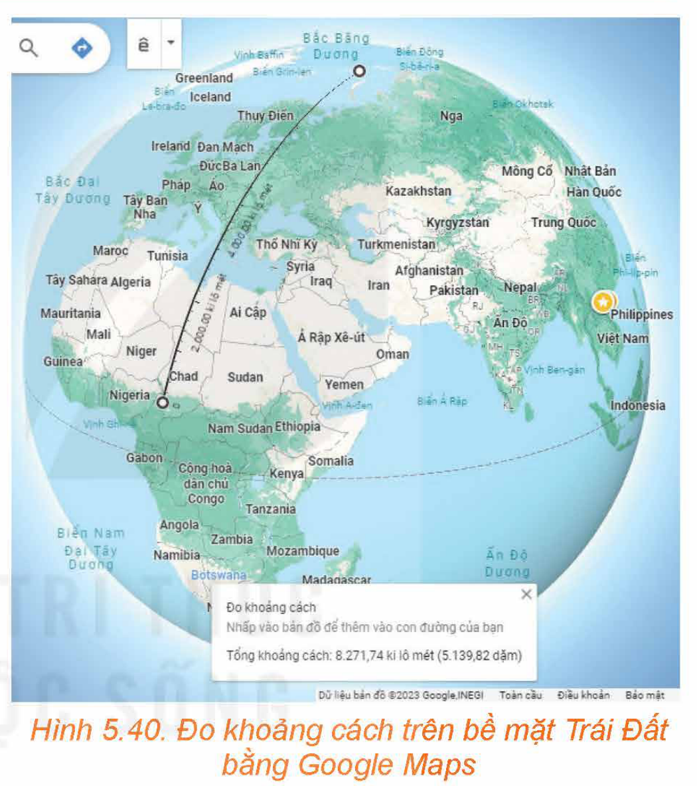
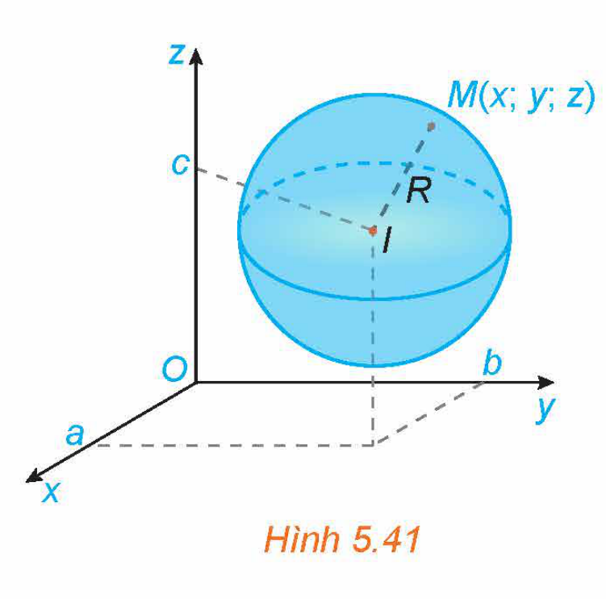
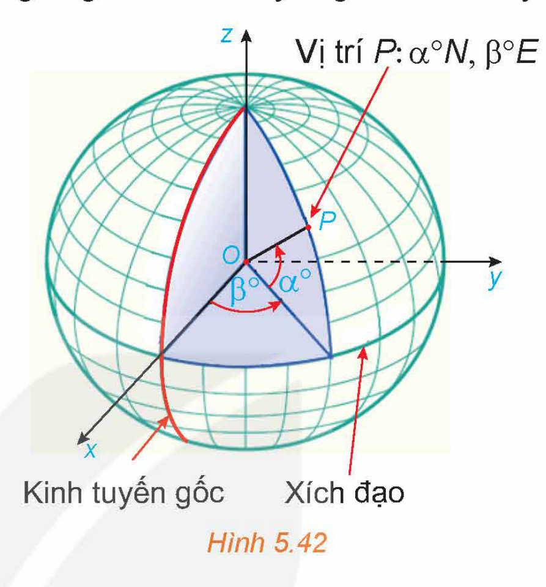
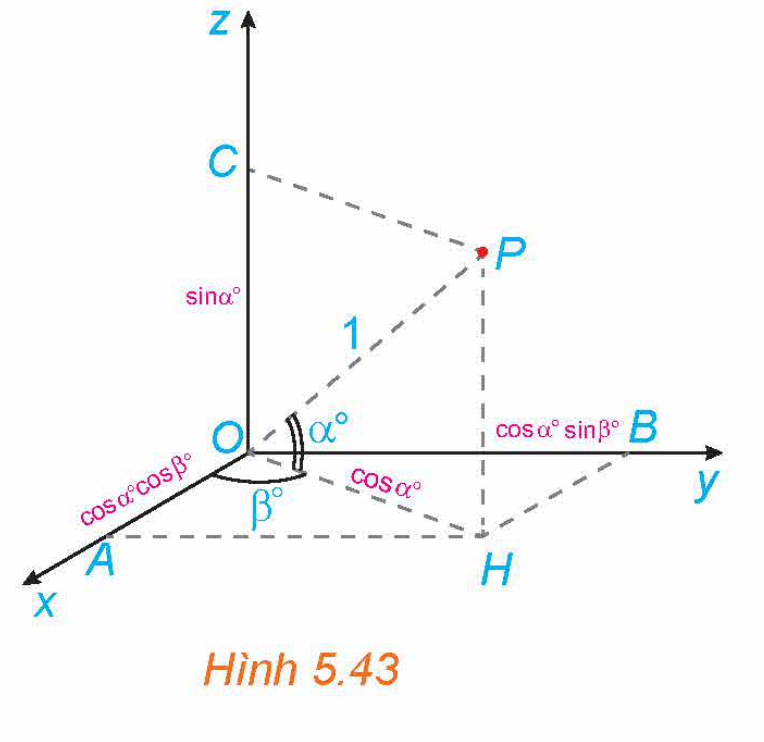
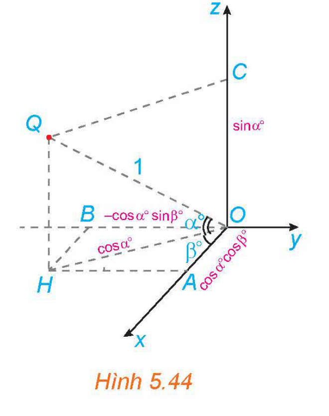

<!-- pdf:56 -->

# BÀI 17: PHƯƠNG TRÌNH MẶT CẦU

## 🔤 Thuật ngữ

- Phương trình mặt cầu
- Tâm và bán kính của mặt cầu

## 🎯 Mục tiêu

- Nhận biết phương trình mặt cầu.
- Xác định tâm và bán kính mặt cầu khi biết phương trình.
- Lập phương trình mặt cầu khi biết tâm và bán kính.
- Vận dụng kiến thức về phương trình mặt cầu để giải quyết một số bài toán liên quan đến thực tiễn.

## 🔴 Mở đầu

Bằng ứng dụng Google Maps, thực hiện phép đo khoảng cách trên bề mặt Trái Đất từ vị trí $10^\circ N, 15^\circ E$ đến vị trí $80^\circ N, 70^\circ E$ ta sẽ được khoảng cách $8\,271,74\text{ km}$ (H.5.40). Cơ sở toán học cho việc thiết lập phần mềm tính công thức khoảng cách trên bề mặt Trái Đất là gì?

*Hình 5.40. Đo khoảng cách trên bề mặt Trái Đất bằng Google Maps*

## 1. PHƯƠNG TRÌNH MẶT CẦU

**Mặt cầu** tâm $I$ bán kính $R$ ($R > 0$) là tập các điểm trong không gian cách $I$ một khoảng bằng $R$.

Một điểm $M$ được gọi là *nằm trong* mặt cầu tâm $I$ bán kính $R$ nếu $IM < R$ và được gọi là *nằm ngoài* mặt cầu đó nếu $IM > R$. Mỗi đường thẳng đi qua tâm mặt cầu đều cắt mặt cầu tại hai điểm phân biệt, đoạn thẳng nối hai điểm đó được gọi là một **đường kính của mặt cầu**. Mỗi đường kính của mặt cầu đều có trung điểm là tâm mặt cầu và có độ dài bằng hai lần bán kính mặt cầu.

**HĐ1:** Tìm phương trình mặt cầu biết tâm và bán kính

Trong không gian $Oxyz$, cho mặt cầu $(S)$ tâm $I(a; b; c)$ bán kính $R$ (H.5.41). Khi đó, một điểm $M(x; y; z)$ thuộc mặt cầu $(S)$ khi và chỉ khi toạ độ của nó thoả mãn điều kiện gì?

*Hình 5.41*

<!-- term: Phương trình mặt cầu -->
<!-- term: Tâm và bán kính của mặt cầu -->
> Trong không gian $Oxyz$, mặt cầu $(S)$ tâm $I(a; b; c)$ bán kính $R$ có phương trình
>
> $(x - a)^2 + (y - b)^2 + (z - c)^2 = R^2.$

<!-- pdf:57 -->

**Chú ý:**

- Điểm $M(x; y; z)$ nằm trong mặt cầu $(S)$ nếu
<!-- ocr-ok: đối chiếu ảnh p.57 -->

$(x - a)^2 + (y - b)^2 + (z - c)^2 < R^2.$

- Điểm $M(x; y; z)$ nằm ngoài mặt cầu $(S)$ nếu
<!-- ocr-ok: đối chiếu ảnh p.57 -->

$(x - a)^2 + (y - b)^2 + (z - c)^2 > R^2.$

**Ví dụ 1:** Trong không gian $Oxyz$, cho mặt cầu $(S)$ có phương trình $(x - 1)^2 + (y + 3)^2 + z^2 = 5$.

a) Xác định tâm và bán kính của $(S)$.

b) Hỏi gốc toạ độ $O(0; 0; 0)$ nằm trong, nằm ngoài hay thuộc mặt cầu $(S)$?

**Giải:**

a) Ta viết lại phương trình của mặt cầu $(S)$ dưới dạng: $(x - 1)^2 + [y - (-3)]^2 + (z - 0)^2 = \left(\sqrt{5}\right)^2$.

Vậy mặt cầu $(S)$ có tâm $I(1; -3; 0)$ và bán kính $R = \sqrt{5}$.

b) Ta có $OI^2 = (0 - 1)^2 + (0 + 3)^2 + (0 - 0)^2 = 10 > 5 = R^2$. Do đó, gốc toạ độ $O(0; 0; 0)$ nằm ngoài mặt cầu $(S)$.

**Luyện tập 1:** Trong không gian $Oxyz$, cho mặt cầu $(S)$ có phương trình

$(x + 2)^2 + y^2 + \left(z + \frac{1}{2}\right)^2 = \frac{9}{4}.$

a) Xác định tâm và bán kính của $(S)$.

b) Hỏi điểm $M(2; 0; 1)$ nằm trong, nằm ngoài hay thuộc mặt cầu $(S)$?

**Ví dụ 2:** Trong không gian $Oxyz$, viết phương trình mặt cầu $(S)$ trong các trường hợp sau:

a) Tâm $I\left(\frac{3}{2}; 0; -3\right)$, bán kính $R = \frac{9}{4}$.

b) Đường kính $AB$, với $A(1; 2; 1)$ và $B(3; 1; 5)$.
<!-- ocr-ok: đối chiếu ảnh p.57 -->

**Giải:**

a) Mặt cầu $(S)$ có tâm $I\left(\frac{3}{2}; 0; -3\right)$ và có bán kính $R = \frac{9}{4}$ nên có phương trình:

$\left(x - \frac{3}{2}\right)^2 + (y - 0)^2 + (z + 3)^2 = \left(\frac{9}{4}\right)^2$ hay $(S): \left(x - \frac{3}{2}\right)^2 + y^2 + (z + 3)^2 = \frac{81}{16}$.

b) Đoạn thẳng $AB$ có trung điểm là $J\left(2; \frac{3}{2}; 3\right)$.

Mặt cầu $(S)$ có tâm $J$ và bán kính $R = \frac{1}{2}AB = \frac{1}{2}\sqrt{(3 - 1)^2 + (1 - 2)^2 + (5 - 1)^2} = \frac{\sqrt{21}}{2}$.

Do đó $(S): (x - 2)^2 + \left(y - \frac{3}{2}\right)^2 + (z - 3)^2 = \frac{21}{4}$.

**Luyện tập 2:** Trong không gian $Oxyz$, viết phương trình mặt cầu $(S)$ trong các trường hợp sau:

a) Tâm là gốc toạ độ, bán kính $R = 1$.

b) Đường kính $AB$, với $A(1; -1; 2), B(2; -3; -1)$.

<!-- pdf:58 -->

**Ví dụ 3:** Trong không gian $Oxyz$, cho $(S)$ là tập hợp các điểm $M(x; y; z)$ có toạ độ thoả mãn phương trình:

$x^2 + y^2 + z^2 - 2x + 4y - 6z - 2 = 0.$

Chứng minh rằng $(S)$ là một mặt cầu. Xác định tâm và tính bán kính của mặt cầu đó.

**Giải:**

Ta viết lại phương trình đã cho dưới dạng:

$(S): (x^2 - 2x + 1) + (y^2 + 4y + 4) + (z^2 - 6z + 9) = 16$

hay

$(S): (x - 1)^2 + (y + 2)^2 + (z - 3)^2 = 4^2.$

Vậy $(S)$ là mặt cầu có tâm $I(1; -2; 3)$ và bán kính $R = 4$.

**Luyện tập 3:** Trong không gian $Oxyz$, cho $(S)$ là tập hợp các điểm $M(x; y; z)$ có toạ độ thoả mãn phương trình:

$(S): x^2 + y^2 + z^2 - 4x + 6y - 12 = 0.$

Chứng minh rằng $(S)$ là một mặt cầu. Xác định tâm và tính bán kính của mặt cầu đó.

**Nhận xét:** Với $a, b, c, d$ là các hằng số, phương trình $x^2 + y^2 + z^2 - 2ax - 2by - 2cz + d = 0$ có thể viết lại thành $(x - a)^2 + (y - b)^2 + (z - c)^2 = a^2 + b^2 + c^2 - d$ và là phương trình của một mặt cầu $(S)$ khi và chỉ khi $a^2 + b^2 + c^2 - d > 0$. Khi đó, $(S)$ có tâm $I(a; b; c)$ và bán kính $R = \sqrt{a^2 + b^2 + c^2 - d}$.

**Ví dụ 4:** Trong không gian $Oxyz$, phương trình nào trong các phương trình sau là phương trình của một mặt cầu? Xác định tâm và tính bán kính của mặt cầu đó.

a) $x^2 + y^2 + z^2 - 2x + 3y - 8z + 100 = 0$.

b) $x^2 + y^2 + z^2 - 4x + 5y - 2z - \frac{3}{4} = 0$.

c) $x^2 + y^2 + z^2 - 2xy + 6y - 9z + 10 = 0$.

**Giải:**

a) Phương trình đã cho tương ứng với $a = 1, b = -\frac{3}{2}, c = 4, d = 100$. Trong trường hợp này, $a^2 + b^2 + c^2 - d = 1 + \frac{9}{4} + 16 - 100 < 0$. Do đó phương trình đã cho không phải là phương trình của một mặt cầu.

b) Phương trình đã cho tương ứng với $a = 2, b = -\frac{5}{2}, c = 1, d = -\frac{3}{4}$. Trong trường hợp này, $a^2 + b^2 + c^2 - d = 4 + \frac{25}{4} + 1 + \frac{3}{4} = 12 > 0$. Do đó phương trình đã cho là phương trình của mặt cầu có tâm $I\left(2; -\frac{5}{2}; 1\right)$ và bán kính $R = \sqrt{12} = 2\sqrt{3}$.

c) Phương trình đã cho không phải là phương trình của một mặt cầu vì xuất hiện $-2xy$ trong phương trình.

**Luyện tập 4:** Trong không gian $Oxyz$, cho mặt cầu $(S)$ có phương trình:

$x^2 + y^2 + z^2 + 4x - 5y + 6z + \frac{25}{4} = 0.$

Xác định tâm, tính bán kính của $(S)$.

<!-- pdf:59 -->

## 2. MỘT SỐ ỨNG DỤNG CỦA PHƯƠNG TRÌNH MẶT CẦU TRONG THỰC TIỄN

Trong mô hình toán học, bề mặt Trái Đất là mặt cầu với bán kính $6\,371\text{ km}$ (theo: *science.nasa.gov/earth/facts/*). Mỗi kinh tuyến là một nửa đường tròn có đường kính là trục của Trái Đất (đoạn thẳng nối cực Bắc $N$ và cực Nam $S$). Kinh tuyến gốc là kinh tuyến đi qua Đài Thiên văn Greenwich ở London. Mặt phẳng chứa kinh tuyến gốc chia Trái Đất làm hai nửa là bán cầu Đông và bán cầu Tây, nước ta nằm ở bán cầu Đông. Kinh độ của một điểm $P$ trên bề mặt Trái Đất là số đo của góc nhị diện có hai mặt tương ứng chứa kinh tuyến gốc và kinh tuyến đi qua $P$ (cạnh của góc nhị diện này là đường thẳng chứa trục Trái Đất). Kinh độ nhận giá trị trong đoạn từ $0^\circ$ đến $180^\circ$. Vĩ độ của điểm $P$ là số đo của góc giữa mặt phẳng chứa đường xích đạo và đường thẳng đi qua $P$ và tâm $O$ của Trái Đất. Vĩ độ nhận giá trị trong đoạn từ $0^\circ$ đến $90^\circ$. Mỗi điểm trên bề mặt Trái Đất thuộc một trong hai bán cầu Bắc hoặc Nam và thuộc một trong hai bán cầu Đông hoặc Tây. Vì vậy, đi kèm với vĩ độ, còn có chữ $E$ hoặc $W$ nếu vị trí đó tương ứng thuộc bán cầu Đông hay bán cầu Tây và có chữ $N, S$ nếu vị trí đó tương ứng ở bán cầu Bắc hay bán cầu Nam (Hình 5.42). Chẳng hạn, hồ Hoàn Kiếm (Hà Nội) ở vị trí: $21^\circ 01'51''N, 105^\circ 51'09''E$ (theo: *maps.google.com*). Vị trí trên mặt đất hoàn toàn xác định khi biết vĩ độ và kinh độ (bao gồm cả các kí hiệu $N, S, E, W$).

*Hình 5.42*

Trong bài học này, ta xét Trái Đất trong không gian $Oxyz$, với $O$ là tâm Trái Đất, tia $Ox$ chứa giao điểm của kinh tuyến gốc và xích đạo, tia $Oz$ chứa điểm cực Bắc $N$, tia $Oy$ giao xích đạo tại điểm thuộc bán cầu Đông, $1$ đơn vị dài trong không gian $Oxyz$ tương ứng với $6\,371\text{ km}$ trên thực tế. Như vậy, trong không gian $Oxyz$, bề mặt Trái Đất có phương trình: $x^2 + y^2 + z^2 = 1$.

Nếu biết vĩ độ và kinh độ của một vị trí trên mặt đất thì toạ độ của nó trong không gian cũng dễ dàng được xác định và ngược lại. Chẳng hạn, vị trí $P$ có vĩ độ, kinh độ tương ứng là $\alpha^\circ N, \beta^\circ E$ ($0 < \alpha < 90, 0 < \beta < 180$) có toạ độ $P(\cos\alpha^\circ \cos\beta^\circ; \cos\alpha^\circ \sin\beta^\circ; \sin\alpha^\circ)$ (H.5.43), vị trí $Q$ có vĩ độ, kinh độ tương ứng là $\alpha^\circ N, \beta^\circ W$ ($0 < \alpha < 90, 0 < \beta < 180$) thì có toạ độ $Q(\cos\alpha^\circ \cos\beta^\circ; -\cos\alpha^\circ \sin\beta^\circ; \sin\alpha^\circ)$ (H.5.44).

*Hình 5.43*

*Hình 5.44*

<!-- pdf:60 -->

Ứng dụng Google Maps cho phép xác định khoảng cách giữa hai vị trí trên bề mặt Trái Đất khi biết vĩ độ và kinh độ của chúng. Khoảng cách giữa hai vị trí $P$ và $Q$ trên bề mặt Trái Đất là độ dài cung nhỏ $PQ$ của đường tròn có tâm $O$ và đi qua hai điểm $P, Q$. Cung tròn nói trên là đường đi ngắn nhất trên bề mặt Trái Đất từ $P$ đến $Q$. Trong ví dụ sau đây, ta sẽ tính khoảng cách giữa hai vị trí đã được nêu ra trong mở đầu bài học.

> Quy ước: Trong phần này, kết quả phép tính được làm tròn đến chữ số thập phân thứ tư sau dấu phẩy.

**Ví dụ 5:** Biết rằng nếu vị trí $M$ có vĩ độ và kinh độ tương ứng là $\alpha^\circ N, \beta^\circ E$ ($0 < \alpha < 90, 0 < \beta < 90$) thì có toạ độ $M(\cos\alpha^\circ \cos\beta^\circ; \cos\alpha^\circ \sin\beta^\circ; \sin\alpha^\circ)$. Tính khoảng cách trên mặt đất từ vị trí $P: 10^\circ N, 15^\circ E$ đến vị trí $Q: 80^\circ N, 70^\circ E$.

**Giải:**

Ta có

$P(\cos 10^\circ \cos 15^\circ; \cos 10^\circ \sin 15^\circ; \sin 10^\circ), \ Q(\cos 80^\circ \cos 70^\circ; \cos 80^\circ \sin 70^\circ; \sin 80^\circ).$

Suy ra

$\overrightarrow{OP} = (\cos 10^\circ \cos 15^\circ; \cos 10^\circ \sin 15^\circ; \sin 10^\circ), \ \overrightarrow{OQ} = (\cos 80^\circ \cos 70^\circ; \cos 80^\circ \sin 70^\circ; \sin 80^\circ).$

Do đó

$\overrightarrow{OP} \cdot \overrightarrow{OQ} = \cos 10^\circ \cos 15^\circ \cos 80^\circ \cos 70^\circ + \cos 10^\circ \sin 15^\circ \cos 80^\circ \sin 70^\circ + \sin 10^\circ \sin 80^\circ \approx 0,2691.$

Vì $P, Q$ thuộc mặt đất nên $|\overrightarrow{OP}| = |\overrightarrow{OQ}| = 1$.

Do đó $\cos\widehat{POQ} = \frac{\overrightarrow{OP} \cdot \overrightarrow{OQ}}{|\overrightarrow{OP}| \cdot |\overrightarrow{OQ}|} \approx 0,2691$. Suy ra $\widehat{POQ} \approx 74,3893^\circ$.

Mặt khác, đường tròn tâm $O$, đi qua $P, Q$ có bán kính $1$ và chu vi là $2\pi \approx 6,2832$, nên cung nhỏ $\overset{\frown}{PQ}$ của đường tròn đó có độ dài xấp xỉ bằng $\frac{74,3893}{360}\cdot 6,2832 \approx 1,2983$.

Do $1$ đơn vị dài trong không gian $Oxyz$ tương ứng với $6\,371\text{ km}$ trên thực tế, nên khoảng cách trên mặt đất giữa hai vị trí $P, Q$ xấp xỉ bằng $1,2983\cdot 6\,371 = 8\,271,4693\text{ (km)}$.

**Luyện tập 5:** Tính khoảng cách trên mặt đất từ vị trí $A$ là giao giữa kinh tuyến gốc với xích đạo đến vị trí $B: 45^\circ N, 30^\circ E$.

**Trải nghiệm:** Trên Google Maps, thực hiện phép đo khoảng cách từ vị trí $0^\circ N, 0^\circ E$ đến vị trí $45^\circ N, 30^\circ E$ và so sánh với kết quả tính được ở Luyện tập 5.

<!-- pdf:61 -->

## ✏️ Bài tập

**5.25.** Trong không gian $Oxyz$, cho mặt cầu $(S)$ có phương trình $\left(x - \frac{1}{2}\right)^2 + (y + 1)^2 + z^2 = 9$. Xác định tâm và bán kính của $(S)$.

**5.26.** Trong không gian $Oxyz$, viết phương trình của mặt cầu $(S)$ có tâm $I(-2; 0; 5)$ và bán kính $R = 2$.

**5.27.** Trong không gian $Oxyz$, viết phương trình của mặt cầu $(S)$ có tâm $I(0; 3; -1)$ và có bán kính bằng khoảng cách từ $I$ đến mặt phẳng $(P): 3x + 2y - z = 0$.

**5.28.** Trong không gian $Oxyz$, cho mặt cầu $(S): x^2 + y^2 + z^2 + 2x - 2y + 8z - 18 = 0$. Xác định tâm, tính bán kính của $(S)$.

**5.29.** Trong không gian $Oxyz$, phương trình nào trong các phương trình sau là phương trình mặt cầu? Xác định tâm và tính bán kính của mặt cầu đó.

a) $x^2 + y^2 + z^2 - 2x - 5z + 30 = 0$;

b) $x^2 + y^2 + z^2 - 4x + 2y - 2z = 0$;

c) $x^3 + y^3 + z^3 - 2x + 6y - 9z - 10 = 0$;

d) $x^2 + y^2 + z^2 + 5 = 0$.

**5.30.** Trong không gian $Oxyz$, một thiết bị phát sóng đặt tại vị trí $A(2; 0; 0)$. Vùng phủ sóng của thiết bị có bán kính bằng $1$. Hỏi vị trí $M(2; 1; 1)$ có thuộc vùng phủ sóng của thiết bị nói trên hay không?

## 💡 Em có biết?

Hệ thống định vị toàn cầu GPS (Global Positioning System) được vận hành bởi chính phủ Hoa Kỳ, bất kì ai có thiết bị thu GPS đều có thể truy cập để sử dụng miễn phí.

GPS hoạt động bằng cách truyền tín hiệu từ mạng lưới các vệ tinh quay quanh Trái Đất đến thiết bị thu GPS trên mặt đất. Bộ thu GPS sử dụng tín hiệu nhận được để xác định khoảng cách từ thiết bị đó đến các vệ tinh. Khoảng cách được xác định thông qua thời gian truyền tin và vận tốc tín hiệu. Vận tốc tín hiệu bằng vận tốc ánh sáng, do đó, vấn đề quan trọng nhất còn lại là xác định được chính xác thời gian truyền tín hiệu. Mỗi vệ tinh GPS có một đồng hồ nguyên tử (loại đồng hồ đo thời gian chính xác nhất hiện nay) được sử dụng để đo thời gian cần thiết để tín hiệu GPS truyền từ vệ tinh đến máy thu. Bộ thu GPS cũng có đồng hồ đo thời gian. Việc đồng bộ hoá đồng hồ giữa nơi phát và nơi thu có ảnh hưởng tới tính chính xác của phép đo.

Các vệ tinh GPS bay theo các quỹ đạo xác định, quanh Trái Đất, hai vòng mỗi ngày và ở độ cao khoảng $20\,200\text{ km}$ so với mặt đất. Do vậy, tại mỗi thời điểm, người ta luôn biết được vị trí của mỗi vệ tinh.

Tính đến năm 2023, có $31$ vệ tinh trong hệ thống GPS và có hơn $20$ vệ tinh trong số đó đang hoạt động. Nhìn chung, để xác định vị trí của thiết bị trên mặt đất, cần tới thông tin khoảng cách từ thiết bị đó đến $3$ vệ tinh. Tại những thời điểm mà các vệ tinh ở vị trí đặc biệt thì số vệ tinh cần thiết có thể ít hơn hoặc nhiều hơn $3$. Tuy vậy, càng đo được nhiều khoảng cách đến các vệ tinh, vị trí của thiết bị thu càng được xác định chính xác. Quỹ đạo của các vệ tinh được sắp xếp sao cho tại mỗi thời điểm, mỗi vị trí trên mặt đất đều có thể nhìn thấy ít nhất $4$ vệ tinh trong số các vệ tinh đang hoạt động (và vì vậy, thiết bị có thể nhận được tín hiệu từ các vệ tinh đó).

*(Theo: nist.gov và globalgpssystems.com)*

<!-- pdf:62 -->

Toán học cho phép thiết lập công thức xác định vị trí của thiết bị theo vị trí của các vệ tinh và khoảng cách tương ứng, nhờ đó có thể lập trình tính toán xác định vị trí của thiết bị. Ta hãy xét một trường hợp cụ thể sau đây:

Trong không gian $Oxyz$, giả sử tại một thời điểm, một thiết bị GPS xác định được khoảng cách từ nó tới ba vệ tinh $A, B, C$ tương ứng là $\sqrt{5}, \sqrt{2}, 2$. Tại thời điểm đó, các vệ tinh trên ở vị trí có toạ độ là $A(2; 0; 0), B(0; 2; 0), C\left(0; \frac{11}{4}; \frac{\sqrt{7}}{4}\right)$. Từ thông tin trên, ta hoàn toàn có thể xác định toạ độ cũng như vĩ độ và kinh độ của vị trí thiết bị GPS.

- Giả sử tại thời điểm đã cho, thiết bị GPS ở vị trí $P(x; y; z)$.

  Do thiết bị thuộc mặt đất và $PA = \sqrt{5}$ nên

  $x^2 + y^2 + z^2 = 1 \ (1)$ và $(x - 2)^2 + y^2 + z^2 = 5 \ (2).$

  Trừ vế theo vế của $(1)$ và $(2)$, ta được $4x - 4 = -4$. Vậy $x = 0$.
<!-- ocr-ok: đối chiếu ảnh p.62 -->

  Do $PB = \sqrt{2}$ nên $x^2 + (y - 2)^2 + z^2 = 2 \ (3)$.

  Trừ vế theo vế của $(1)$ và $(3)$, ta được $4y - 4 = -1$. Vậy $y = \frac{3}{4}$.
<!-- ocr-ok: đối chiếu ảnh p.62 -->

  Thay $x = 0, y = \frac{3}{4}$ vào phương trình $(1)$, ta được $0^2 + \frac{9}{16} + z^2 = 1$.
<!-- ocr-ok: đối chiếu ảnh p.62 -->

  Suy ra $z = \frac{\sqrt{7}}{4}$ hoặc $z = \frac{-\sqrt{7}}{4}$. Kiểm tra điều kiện $PC = 2$, ta thấy chỉ có điểm $P\left(0; \frac{3}{4}; \frac{\sqrt{7}}{4}\right)$ thoả mãn.

- Vị trí $P$ của GPS có tung độ dương nên thuộc bán cầu Đông và có cao độ dương nên thuộc bán cầu Bắc. Gọi vĩ độ, kinh độ của $P$ tương ứng là $\alpha^\circ N, \beta^\circ E$ ($0 < \alpha < 90, 0 < \beta < 180$). Khi đó $P(\cos\alpha^\circ \cos\beta^\circ; \cos\alpha^\circ \sin\beta^\circ; \sin\alpha^\circ)$.

  Mặt khác, ta có $P\left(0; \frac{3}{4}; \frac{\sqrt{7}}{4}\right)$ nên $\sin\alpha^\circ = \frac{\sqrt{7}}{4}$. Do đó $\alpha \approx 41,4096$.

  Ta có $\cos\alpha^\circ \ne 0$ và $\cos\alpha^\circ \cos\beta^\circ = 0$ nên $\cos\beta^\circ = 0$.

  Vậy $\beta = 90$ và do đó vị trí của GPS (xấp xỉ) là $41,4096^\circ N, 90^\circ E$.

## 📷 Danh sách hình trong bài

| Mã hình | Trang PDF | Vị trí trong bài | Chú thích gốc |
| --- | --- | --- | --- |
| H12-toan-b17-01 | 56 | Mở đầu | Hình 5.40. Đo khoảng cách trên bề mặt Trái Đất bằng Google Maps |
| H12-toan-b17-02 | 56 | Mục 1, HĐ1 | Hình 5.41 |
| H12-toan-b17-03 | 59 | Mục 2 | Hình 5.42 |
| H12-toan-b17-04 | 59 | Mục 2 | Hình 5.43 |
| H12-toan-b17-05 | 59 | Mục 2 | Hình 5.44 |
| H12-toan-b17-06 | 61 | Em có biết? | (sách không đánh số, hình minh hoạ hệ thống vệ tinh GPS quay quanh Trái Đất) |
