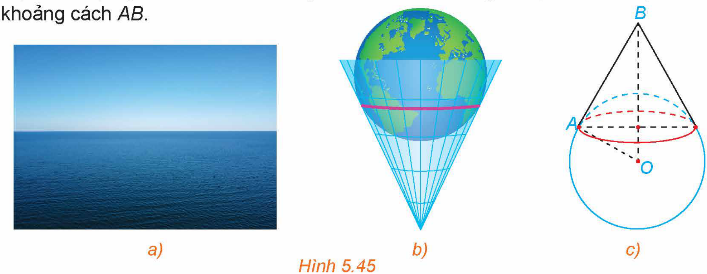

<!-- pdf:63 -->

# BÀI TẬP CUỐI CHƯƠNG V

## ✏️ A – TRẮC NGHIỆM

**5.31.** Trong không gian $Oxyz$, cho mặt phẳng $(P): x - 2y - 3z + 1 = 0$. Một vectơ pháp tuyến của mặt phẳng $(P)$ có toạ độ là

A. $(1; 2; 3)$.

B. $(1; -2; 3)$.

C. $(1; 2; -3)$.

D. $(1; -2; -3)$.

**5.32.** Trong không gian $Oxyz$, phương trình mặt phẳng $(P)$ đi qua điểm $I(1; -1; 2)$ và nhận vectơ $\vec{n} = (2; 1; -1)$ làm một vectơ pháp tuyến là

A. $x - y + 2z + 1 = 0$.

B. $x - y + 2z - 6 = 0$.

C. $2x + y - z - 1 = 0$.

D. $2x + y - z + 1 = 0$.

**5.33.** Trong không gian $Oxyz$, cho đường thẳng $d: \frac{x - 1}{2} = \frac{y + 2}{1} = \frac{z - 3}{-2}$. Một vectơ chỉ phương của đường thẳng $d$ có toạ độ là

A. $(1; -2; 3)$.

B. $(2; 1; -2)$.

C. $(2; 1; 2)$.

D. $(1; 2; 3)$.

**5.34.** Trong không gian $Oxyz$, cho đường thẳng $d: \begin{cases} x = 1 + 2t \\ y = -2 + t \\ z = 3 - t. \end{cases}$ Một vectơ chỉ phương của đường thẳng $d$ có toạ độ là

A. $(1; -2; 3)$.

B. $(2; 0; 0)$.

C. $(2; 1; -1)$.

D. $(2; 1; 1)$.

**5.35.** Trong không gian $Oxyz$, phương trình đường thẳng $d$ đi qua $I(2; -1; 1)$ và nhận vectơ $\vec{u} = (1; 2; -3)$ làm một vectơ chỉ phương là

A. $\frac{x - 1}{2} = \frac{y - 2}{-1} = \frac{z + 3}{1}$.

B. $\frac{x - 2}{1} = \frac{y - 1}{2} = \frac{z - 1}{-3}$.

C. $\frac{x - 2}{1} = \frac{y + 1}{2} = \frac{z - 1}{-3}$.

D. $\frac{x - 1}{2} = \frac{y - 2}{1} = \frac{z + 3}{1}$.

**5.36.** Trong không gian $Oxyz$, cho hai điểm $A(-1; 0; -1), B(2; 1; 1)$. Phương trình đường thẳng $AB$ là
<!-- ocr-ok: đối chiếu ảnh p.63 -->

A. $\begin{cases} x = 1 + 3t \\ y = t \\ z = 1 + 2t. \end{cases}$

B. $\begin{cases} x = -1 + t \\ y = t \\ z = -1 + 2t. \end{cases}$

C. $\begin{cases} x = 2 + t \\ y = 1 + t \\ z = 1 + 2t. \end{cases}$

D. $\begin{cases} x = -1 + 3t \\ y = t \\ z = -1 + 2t. \end{cases}$

**5.37.** Trong không gian $Oxyz$, phương trình đường thẳng $d$ đi qua $I(2; 1; -3)$ và vuông góc với mặt phẳng $(P): x - 2y + z - 3 = 0$ là

A. $\frac{x - 2}{1} = \frac{y - 1}{-2} = \frac{z + 3}{1}$.

B. $\frac{x - 2}{1} = \frac{y - 1}{2} = \frac{z - 3}{1}$.

C. $\frac{x - 2}{1} = \frac{y - 1}{-2} = \frac{z - 3}{1}$.

D. $\frac{x - 2}{1} = \frac{y - 1}{2} = \frac{z + 3}{1}$.

<!-- pdf:64 -->

**5.38.** Trong không gian $Oxyz$, cho mặt cầu $(S): (x + 1)^2 + y^2 + (z - 3)^2 = 4$. Toạ độ tâm $I$ và bán kính $R$ của $(S)$ lần lượt là
<!-- ocr-ok: đối chiếu ảnh p.64 -->

A. $I(1; 0; 3), R = 4$.

B. $I(1; 0; 3), R = 2$.

C. $I(-1; 0; 3), R = 2$.

D. $I(-1; 0; 3), R = 4$.

**5.39.** Trong không gian $Oxyz$, cho mặt cầu $(S): x^2 + y^2 + z^2 - 2x + 4y + 2z - 3 = 0$. Toạ độ tâm $I$ và bán kính $R$ của mặt cầu $(S)$ lần lượt là

A. $I(1; -2; -1), R = 3$.

B. $I(1; 2; 1), R = 9$.

C. $I(1; 2; 1), R = 3$.

D. $I(1; -2; -1), R = 9$.

## ✏️ B – TỰ LUẬN

**5.40.** Trong không gian $Oxyz$, cho ba điểm $A(1; 0; -1), B(0; 1; 2), C(-1; -2; 3)$.

a) Viết phương trình mặt phẳng $(ABC)$.

b) Viết phương trình đường thẳng $AC$.

c) Viết phương trình mặt cầu đường kính $AC$.

d) Viết phương trình mặt cầu có tâm $A$ và đi qua $B$.

**5.41.** Trong không gian $Oxyz$, cho đường thẳng $d: \begin{cases} x = 1 + t \\ y = -2 + t \\ z = 4 - 2t. \end{cases}$
<!-- ocr-ok: đối chiếu ảnh p.64 -->

Viết phương trình mặt phẳng $(P)$ chứa đường thẳng $d$ và gốc toạ độ $O$.

**5.42.** Trong không gian $Oxyz$, cho mặt phẳng $(P): x - 2y + 2z - 1 = 0$ và hai điểm $A(1; -1; 2), B(-1; 1; 0)$.
<!-- ocr-ok: đối chiếu ảnh p.64 -->

a) Tính khoảng cách từ $A$ đến mặt phẳng $(P)$.

b) Viết phương trình mặt phẳng $(Q)$ đi qua $A$ và song song với mặt phẳng $(P)$.

c) Viết phương trình mặt phẳng $(R)$ chứa $A, B$ và vuông góc với mặt phẳng $(P)$.

**5.43.** Trong không gian $Oxyz$, cho điểm $A(1; 0; 2)$ và hai đường thẳng $d: \frac{x}{1} = \frac{y - 1}{2} = \frac{z}{2}$, $d': \frac{x + 1}{2} = \frac{y + 2}{2} = \frac{z - 3}{-1}$.
<!-- ocr-ok: đối chiếu ảnh p.64 -->

a) Xét vị trí tương đối của hai đường thẳng $d$ và $d'$.

b) Viết phương trình đường thẳng $\Delta$ đi qua $A$ và song song với đường thẳng $d$.

c) Viết phương trình mặt phẳng $(P)$ chứa $A$ và $d$.

d) Tìm giao điểm của đường thẳng $d$ với mặt phẳng $(Oxz)$.

**5.44.** Trong không gian $Oxyz$, cho mặt phẳng $(P): x - 2y - 2z - 3 = 0$ và đường thẳng $d: \frac{x - 1}{2} = \frac{y + 1}{1} = \frac{z}{-1}$. Viết phương trình mặt phẳng $(Q)$ chứa $d$ và vuông góc với mặt phẳng $(P)$.

<!-- pdf:65 -->

**5.45.** Trong không gian $Oxyz$, cho hai đường thẳng:

$d: \frac{x + 1}{1} = \frac{y - 1}{2} = \frac{z}{-1}$ và $d': \frac{x - 1}{1} = \frac{y - 2}{1} = \frac{z + 1}{2}$.

Viết phương trình mặt phẳng $(P)$ chứa đường thẳng $d$ và song song với đường thẳng $d'$.

**5.46.** Trong không gian $Oxyz$, cho hai mặt phẳng $(P): x - y - z - 1 = 0, (Q): 2x + y - z - 2 = 0$ và điểm $A(-1; 2; 0)$. Viết phương trình mặt phẳng $(R)$ đi qua điểm $A$ đồng thời vuông góc với cả hai mặt phẳng $(P)$ và $(Q)$.

**5.47.** Trong không gian $Oxyz$, cho hai đường thẳng $d: \frac{x + 2}{1} = \frac{y + 3}{2} = \frac{z - 3}{-2}$ và $d': \begin{cases} x = 1 - t \\ y = -2 + t \\ z = 2t. \end{cases}$

a) Xác định vị trí tương đối của hai đường thẳng $d$ và $d'$.

b) Tính góc giữa $d$ và $d'$.

**5.48.** Trong không gian $Oxyz$, tính góc tạo bởi đường thẳng $d: \frac{x + 3}{2} = \frac{y - 2}{-2} = \frac{z + 1}{1}$ và mặt phẳng $(P): x + y - 2z + 3 = 0$.

**5.49.** Trong không gian $Oxyz$, tính góc giữa mặt phẳng $(P): x + y + z - 1 = 0$ và mặt phẳng $(Oxy)$.

**5.50.** Từ mặt nước trong một bể nước, tại ba vị trí đôi một cách nhau $2\text{ m}$, người ta lần lượt thả dây dọi để quả dọi chạm đáy bể. Phần dây dọi (thẳng) nằm trong nước tại ba vị trí đó lần lượt có độ dài $4\text{ m}; 4,4\text{ m}; 4,8\text{ m}$. Biết đáy bể là phẳng. Hỏi đáy bể nghiêng so với mặt phẳng nằm ngang một góc bao nhiêu độ?

**5.51.** Bản vẽ thiết kế của một công trình được vẽ trong một hệ trục toạ độ $Oxyz$. Sàn nhà của công trình thuộc mặt phẳng $(Oxy)$, đường ống thoát nước thẳng và đi qua hai điểm $A(1; 2; -1)$ và $B(5; 6; -2)$. Tính góc tạo bởi đường ống thoát nước và mặt sàn.

**5.52.** Nếu đứng trước biển và nhìn ra xa, người ta sẽ thấy một đường giao giữa mặt biển và bầu trời, đó là đường chân trời đối với người quan sát (H.5.45a). Về mặt Vật lí, đường chân trời là đường giới hạn phần Trái Đất mà người quan sát có thể nhìn thấy được (phần còn lại bị chính Trái Đất che khuất). Ta có thể hình dung rằng, nếu người quan sát ở tại đỉnh của một chiếc nón và Trái Đất được “thả” vào trong chiếc nón đó, thì đường chân trời trong trường hợp này là đường chạm giữa Trái Đất và chiếc nón (H.5.45b). Trong mô hình toán học, đường chân trời đối với người quan sát tại vị trí $B$ là tập hợp những điểm $A$ nằm trên bề mặt Trái Đất sao cho $\widehat{BAO} = 90^\circ$, với $O$ là tâm Trái Đất (H.5.45c). Trong không gian $Oxyz$, giả sử bề mặt Trái Đất $(S)$ có phương trình $x^2 + y^2 + z^2 = 1$ và người quan sát ở vị trí $B(1; 1; -1)$.

Gọi $A$ là một vị trí bất kì trên đường chân trời đối với người quan sát ở vị trí $B$. Tính khoảng cách $AB$.

*Hình 5.45*

## 📷 Danh sách hình trong bài

| Mã hình | Trang PDF | Vị trí trong bài | Chú thích gốc |
| --- | --- | --- | --- |
| H12-toan-bt-c05-01 | 65 | Bài tập 5.52 | Hình 5.45 |
