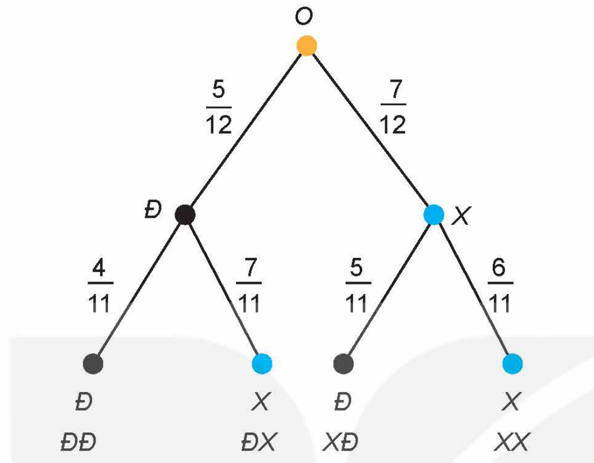

<!-- pdf:66 -->

Nội dung của chương bao gồm khái niệm xác suất có điều kiện và một số công thức có liên quan (công thức nhân xác suất, công thức xác suất toàn phần và công thức Bayes). Xác suất có điều kiện là một chủ đề có rất nhiều ứng dụng trong thực tiễn.

# BÀI 18: XÁC SUẤT CÓ ĐIỀU KIỆN

## 🔤 Thuật ngữ

- Xác suất có điều kiện
- Công thức nhân xác suất
- Bảng dữ liệu thống kê $2 \times 2$

## 🎯 Mục tiêu

- Nhận biết khái niệm về xác suất có điều kiện.
- Nhận biết mối liên hệ giữa xác suất có điều kiện và xác suất.
- Vận dụng công thức nhân xác suất cho hai biến cố bất kì.
- Giải thích ý nghĩa của xác suất có điều kiện trong một số tình huống thực tế.

## 🔴 Mở đầu

*Ô cửa bí mật* (Let's Make a Deal) là một trò chơi trên truyền hình nổi tiếng ở Mỹ, đã được mua bản quyền và phát sóng ở nhiều nước trên thế giới. Nội dung trò chơi như sau:

- Người chơi được mời lên sân khấu và đứng trước ba cánh cửa đóng kín. Sau một cánh cửa có chiếc ô tô, sau mỗi cánh cửa còn lại là một con lừa. Người chơi được yêu cầu chọn ngẫu nhiên một cánh cửa, nhưng không được mở ra.
- Tiếp đó người quản trò tuyên bố sẽ mở ngẫu nhiên một trong hai cánh cửa người chơi không chọn mà sau cửa đó là con lừa. Người quản trò hỏi người chơi muốn giữ nguyên sự lựa chọn ban đầu của mình hay muốn chuyển sang cửa chưa mở còn lại.

Các kiến thức trong bài học này sẽ giúp ta cho người chơi lời khuyên.

<!-- pdf:67 -->

## 1. XÁC SUẤT CÓ ĐIỀU KIỆN

Trong thực tế, ta thường cập nhật xác suất của một biến cố khi biết thêm một thông tin nào đó. Chẳng hạn:

- Tính xác suất để ngày mai mưa nếu hôm nay không mưa;
- Tính xác suất để bạn An là học sinh giỏi môn Toán nếu biết rằng An là một học sinh giỏi môn Tin;
- Tính xác suất để một người thọ 80 tuổi nếu người đó đã sống đến 60 tuổi. (Các công ty bảo hiểm rất quan tâm đến xác suất này).

**HĐ1:** Hình thành khái niệm xác suất có điều kiện

Trong một hộp kín có 7 chiếc bút bi xanh và 5 chiếc bút bi đen, các chiếc bút có cùng kích thước và khối lượng. Bạn Sơn lấy ngẫu nhiên một chiếc bút bi trong hộp, không trả lại. Sau đó Tùng lấy ngẫu nhiên một trong 11 chiếc bút còn lại. Tính xác suất để Tùng lấy được bút bi xanh nếu biết rằng Sơn đã lấy được bút bi đen.

Ta có định nghĩa sau:

> Cho hai biến cố $A$ và $B$. Xác suất của biến cố $A$, tính trong điều kiện biết rằng biến cố $B$ đã xảy ra, được gọi là **xác suất của $A$ với điều kiện $B$** và kí hiệu là $P(A \mid B)$.

Xác suất có điều kiện có thể được tính theo công thức sau:

<!-- term: Công thức tính xác suất có điều kiện -->
> Cho hai biến cố $A$ và $B$ bất kì, với $P(B) > 0$. Khi đó
> $P(A \mid B) = \frac{P(AB)}{P(B)}.$
<!-- ocr-ok: đã đối chiếu ảnh trang PDF 67 -->

**Ví dụ 1:** Một hộp có 20 viên bi trắng và 10 viên bi đen, các viên bi có cùng kích thước và khối lượng. Bạn Bình lấy ngẫu nhiên một viên bi trong hộp, không trả lại. Sau đó bạn An lấy ngẫu nhiên một viên bi trong hộp đó. Gọi $A$ là biến cố: “An lấy được viên bi trắng”; $B$ là biến cố: “Bình lấy được viên bi trắng”. Tính $P(A \mid B)$ bằng định nghĩa và bằng công thức tính $P(A \mid B)$ ở trên.

**Giải:**

*Cách 1: Bằng định nghĩa*

Nếu $B$ xảy ra tức là Bình lấy được viên bi trắng. Khi đó, trong hộp còn lại 29 viên bi với 19 viên bi trắng và 10 viên bi đen. Vậy $P(A \mid B) = \frac{19}{29}$.

*Cách 2: Bằng công thức*

Bình có 30 cách chọn, An có 29 cách chọn một viên bi trong hộp. Do đó $n(\Omega) = 30 \cdot 29$.

Bình có 20 cách chọn một viên bi trắng, An có 29 cách chọn từ 29 viên bi còn lại. Do đó $n(B) = 20 \cdot 29$ và $P(B) = \frac{n(B)}{n(\Omega)}$.

Bình có 20 cách chọn một viên bi trắng, An có 19 cách chọn một viên bi trắng trong 19 viên bi trắng còn lại. Do đó $n(AB) = 20 \cdot 19$ và $P(AB) = \frac{n(AB)}{n(\Omega)}$.

Vậy $P(A \mid B) = \frac{P(AB)}{P(B)} = \frac{n(AB)}{n(B)} = \frac{20 \cdot 19}{20 \cdot 29} = \frac{19}{29}$.

<!-- pdf:68 -->

**Luyện tập 1:** Trở lại Ví dụ 1. Tính $P(A \mid \overline{B})$ bằng định nghĩa và bằng công thức.

**Ví dụ 2:**

a) Từ công thức tính $P(A \mid B)$ ở trên, chứng minh rằng nếu $A$ và $B$ là hai biến cố độc lập với $P(A) > 0, P(B) > 0$ thì $P(A \mid B) = P(A)$ và $P(B \mid A) = P(B)$.

b) Từ định nghĩa xác suất có điều kiện và định nghĩa về tính độc lập của hai biến cố, hãy chứng tỏ rằng nếu $A$ và $B$ là hai biến cố độc lập thì $P(A \mid B) = P(A)$ và $P(B \mid A) = P(B)$.

**Giải:**

a) Nếu $A$ và $B$ là hai biến cố độc lập thì $P(AB) = P(A) \cdot P(B)$.

Vậy với $P(A) > 0, P(B) > 0$ ta có:

$P(A \mid B) = \frac{P(AB)}{P(B)} = \frac{P(A) \cdot P(B)}{P(B)} = P(A);$

$P(B \mid A) = \frac{P(BA)}{P(A)} = \frac{P(B) \cdot P(A)}{P(A)} = P(B).$

b) Theo định nghĩa, $P(A \mid B)$ là xác suất của $A$, tính trong điều kiện biết rằng biến cố $B$ đã xảy ra. Vì $A, B$ độc lập nên việc xảy ra $B$ không ảnh hưởng tới xác suất xuất hiện của $A$. Do đó: $P(A \mid B) = P(A)$.

Tương tự $P(B \mid A)$ là xác suất của $B$, tính trong điều kiện biết rằng biến cố $A$ đã xảy ra. Vì $A, B$ độc lập nên việc xảy ra $A$ không ảnh hưởng tới xác suất xuất hiện của $B$. Do đó: $P(B \mid A) = P(B)$.

**Luyện tập 2:** Chứng tỏ rằng nếu $A$ và $B$ là hai biến cố độc lập thì:
<!-- ocr-ok: đã đối chiếu ảnh trang PDF 68 -->

$P(\overline{A} \mid B) = P(\overline{A})$ và $P(A \mid \overline{B}) = P(A).$

*(Sử dụng tính chất đã học ở lớp 11: Nếu cặp biến cố $A$ và $B$ độc lập thì các cặp biến cố $\overline{A}$ và $B$; $A$ và $\overline{B}$ cũng độc lập.)*

**Ví dụ 3:** *(Bảng dữ liệu thống kê $2 \times 2$)* Một viện nghiên cứu về an toàn giao thông muốn tìm hiểu về mối quan hệ giữa việc thắt dây an toàn khi lái xe và nguy cơ tử vong của người lái xe khi xảy ra tai nạn giao thông. Giả sử viện đã xem xét $577\,006$ vụ tai nạn giao thông ô tô và việc thắt dây an toàn của người lái xe khi xảy ra tai nạn giao thông. Kết quả cho thấy:

- Trong số những người lái xe có thắt dây an toàn, có $510$ người tử vong và $412\,368$ người sống sót;
- Trong số những người lái xe không thắt dây an toàn, có $1\,601$ người tử vong và $162\,527$ người sống sót.

Kết quả trên được trình bày dưới dạng bảng gồm 2 dòng và 2 cột như dưới đây, được gọi là **bảng dữ liệu thống kê $2 \times 2$**:

| Thắt dây an toàn \ Kết quả | Tử vong | Sống sót |
| :---: | :---: | :---: |
| Không | $1\,601$ | $162\,527$ |
| Có | $510$ | $412\,368$ |
<!-- ocr-ok: đã đối chiếu ảnh trang PDF 68 -->

<!-- pdf:69 -->

Chọn ngẫu nhiên một người lái xe trong số $577\,006$ người bị tai nạn giao thông.

a) Tính xác suất để người lái xe đó tử vong khi xảy ra tai nạn giao thông trong trường hợp không thắt dây an toàn.

b) Tính xác suất để người lái xe đó tử vong khi xảy ra tai nạn giao thông trong trường hợp có thắt dây an toàn.

c) So sánh hai xác suất ở câu a và câu b rồi rút ra kết luận.

**Giải:**

a) Không gian mẫu $\Omega$ là tập hợp gồm $577\,006$ người lái xe xảy ra tai nạn giao thông $\Rightarrow n(\Omega) = 577\,006$.

Gọi $A$ là biến cố: “Người lái xe đó tử vong khi xảy ra tai nạn giao thông”; $B$ là biến cố: “Người lái xe đó không thắt dây an toàn khi xảy ra tai nạn giao thông”.

Khi đó $AB$ là biến cố: “Người lái xe đó tử vong và không thắt dây an toàn khi xảy ra tai nạn giao thông”. Ta cần tính $P(A \mid B)$.

Ta có $162\,527 + 1\,601 = 164\,128$ người không thắt dây an toàn $\Rightarrow n(B) = 164\,128$. Vậy $P(B) = \frac{n(B)}{n(\Omega)} = \frac{164\,128}{577\,006}$.

Trong số những người không thắt dây an toàn, có $1\,601$ người tử vong khi xảy ra tai nạn giao thông $\Rightarrow n(AB) = 1\,601$. Vậy $P(AB) = \frac{n(AB)}{n(\Omega)} = \frac{1\,601}{577\,006}$.

Do đó $P(A \mid B) = \frac{P(AB)}{P(B)} = \frac{1\,601}{164\,128} \approx 9,755 \cdot 10^{-3} = 0,009755$.

b) Ta cần tính $P(A \mid \overline{B})$.

$\overline{B}$ là biến cố: “Người lái xe đó có thắt dây an toàn khi xảy ra tai nạn giao thông”.

$A\overline{B}$ là biến cố: “Người lái xe đó tử vong và có thắt dây an toàn khi xảy ra tai nạn giao thông”.

Ta có $412\,368 + 510 = 412\,878$ người lái xe có thắt dây an toàn $\Rightarrow n(\overline{B}) = 412\,878$.

Trong số những người có thắt dây an toàn, có $510$ người tử vong khi xảy ra tai nạn giao thông $\Rightarrow n(A\overline{B}) = 510$.

Tương tự như trên, ta có:

$P(A \mid \overline{B}) = \frac{P(A\overline{B})}{P(\overline{B})} = \frac{n(A\overline{B})}{n(\overline{B})} = \frac{510}{412\,878} \approx 1,235 \cdot 10^{-3} = 0,001235.$

c) Ta có: $\frac{P(A \mid B)}{P(A \mid \overline{B})} \approx \frac{9,755 \cdot 10^{-3}}{1,235 \cdot 10^{-3}} \approx 7,9 \Rightarrow P(A \mid B) \approx 7,9 \cdot P(A \mid \overline{B})$.

Như vậy, xác suất để một người lái xe không thắt dây an toàn bị tử vong khi xảy ra tai nạn giao thông cao gấp khoảng $7,9$ lần xác suất để một người lái xe thắt dây an toàn bị tử vong khi xảy ra tai nạn giao thông. Tức là, không thắt dây an toàn làm tăng nguy cơ bị tử vong khi xảy ra tai nạn giao thông của người lái xe lên gấp khoảng $7,9$ lần.

<!-- pdf:70 -->

**Luyện tập 3:** Một công ty dược phẩm muốn so sánh tác dụng điều trị bệnh X của hai loại thuốc M và N. Công ty đã tiến hành thử nghiệm với $4\,000$ bệnh nhân mắc bệnh X trong đó $2\,400$ bệnh nhân dùng thuốc M, $1\,600$ bệnh nhân còn lại dùng thuốc N. Kết quả được cho trong bảng dữ liệu thống kê $2 \times 2$ như sau:

| Kết quả \ Uống thuốc | M | N |
| :---: | :---: | :---: |
| Khỏi bệnh | $1\,600$ | $1\,200$ |
| Không khỏi bệnh | $800$ | $400$ |

Chọn ngẫu nhiên một bệnh nhân trong số $4\,000$ bệnh nhân thử nghiệm sau khi uống thuốc. Tính xác suất để bệnh nhân đó

a) uống thuốc M, biết rằng bệnh nhân đó khỏi bệnh;

b) uống thuốc N, biết rằng bệnh nhân đó không khỏi bệnh.

## 2. CÔNG THỨC NHÂN XÁC SUẤT

**HĐ2:** Hình thành công thức nhân xác suất

Chứng minh rằng, với hai biến cố $A$ và $B$, $P(B) > 0$, ta có:

$P(AB) = P(B) \cdot P(A \mid B).$

*(Nếu $A$ và $B$ là hai biến cố độc lập thì $P(AB) = P(A) \cdot P(B)$.)*

**Chú ý:** Nếu $P(B) = 0$ thì $P(AB) = 0$ nên công thức tính $P(AB)$ ở trên đúng với mọi biến cố $A, B$.

> Vậy với hai biến cố $A$ và $B$ bất kì, ta có:
> $P(AB) = P(B) \cdot P(A \mid B).$
> Công thức trên được gọi là **công thức nhân xác suất**.

**Nhận xét:** Vì $AB = BA$ nên với hai biến cố $A$ và $B$ bất kì, ta cũng có:
<!-- ocr-ok: đã đối chiếu ảnh trang PDF 70 -->

$P(AB) = P(A) \cdot P(B \mid A).$

**Ví dụ 4:** Trong một hộp kín có 7 chiếc bút bi xanh và 5 chiếc bút bi đen, các chiếc bút có cùng kích thước và khối lượng. Bạn Sơn lấy ngẫu nhiên một chiếc bút bi từ trong hộp, không trả lại. Sau đó bạn Tùng lấy ngẫu nhiên một trong 11 chiếc bút còn lại. Tính xác suất để Sơn lấy được bút bi đen và Tùng lấy được bút bi xanh.

**Giải:**

Gọi $A$ là biến cố: “Bạn Sơn lấy được bút bi đen”; $B$ là biến cố: “Bạn Tùng lấy được bút bi xanh”. Ta cần tính $P(AB)$. Vì $n(A) = 5$ nên $P(A) = \frac{5}{12}$.

<!-- pdf:71 -->

Nếu $A$ xảy ra tức là bạn Sơn lấy được bút bi đen thì trong hộp có 11 bút bi với 7 bút bi xanh. Vậy $P(B \mid A) = \frac{7}{11}$.

Theo công thức nhân xác suất: $P(AB) = P(A) \cdot P(B \mid A) = \frac{5}{12} \cdot \frac{7}{11} = \frac{35}{132}$.

Một phương pháp mô tả trực quan lời giải trên là dùng *sơ đồ hình cây*.

*Sơ đồ hình cây*

Trên nhánh $OĐ$ và $OX$ tương ứng ghi xác suất lấy được bút đen và bút xanh.

Trên nhánh $ĐĐ, ĐX$ tương ứng ghi xác suất lấy được bút đen, bút xanh với điều kiện đã lấy được bút đen.

Trên nhánh $XĐ, XX$ tương ứng ghi xác suất lấy được bút đen, bút xanh với điều kiện đã lấy được bút xanh.

Vậy xác suất cần tính là: $\frac{5}{12} \cdot \frac{7}{11} = \frac{35}{132}$.

**Luyện tập 4:** Trở lại Ví dụ 4. Tính xác suất để:

a) Sơn lấy được bút bi xanh và Tùng lấy được bút bi đen;

b) Hai chiếc bút lấy ra có cùng màu.

**Vận dụng:** Trở lại trò chơi “Ô cửa bí mật” trong *tình huống mở đầu*. Giả sử người chơi chọn cửa số 1 và người quản trò mở cửa số 3.

Kí hiệu $E_1; E_2; E_3$ tương ứng là các biến cố: “Sau ô cửa số 1 có ô tô”; “Sau ô cửa số 2 có ô tô”; “Sau ô cửa số 3 có ô tô” và $H$ là biến cố: “Người quản trò mở ô cửa số 3 thấy con lừa”.

Sau khi người quản trò mở cánh cửa số 3 thấy con lừa, tức là khi $H$ xảy ra. Để quyết định thay đổi lựa chọn hay không, người chơi cần so sánh hai xác suất có điều kiện: $P(E_1 \mid H)$ và $P(E_2 \mid H)$.

a) Chứng minh rằng:

- $P(E_1) = P(E_2) = P(E_3) = \frac{1}{3}$;
- $P(H \mid E_1) = \frac{1}{2}$ và $P(H \mid E_2) = 1$.

<!-- pdf:72 -->

b) Sử dụng công thức tính xác suất có điều kiện và công thức nhân xác suất, chứng minh rằng:

- $P(E_1 \mid H) = \frac{P(E_1) \cdot P(H \mid E_1)}{P(H)}$;
- $P(E_2 \mid H) = \frac{P(E_2) \cdot P(H \mid E_2)}{P(H)}$.

c) Từ các kết quả trên hãy suy ra:

$P(E_2 \mid H) = 2P(E_1 \mid H).$

Từ đó hãy đưa ra lời khuyên cho người chơi: Nên giữ nguyên sự lựa chọn ban đầu hay chuyển sang cửa chưa mở còn lại?

*Hướng dẫn:* Nếu $E_1$ xảy ra, tức là sau cửa số 1 có ô tô. Khi đó, sau cửa số 2 và 3 là con lừa. Người quản trò chọn ngẫu nhiên một trong hai cửa số 2 và 3 để mở ra. Do đó, việc chọn cửa số 2 hay cửa số 3 có khả năng như nhau. Vậy $P(H \mid E_1) = \frac{1}{2}$.

Nếu $E_2$ xảy ra, tức là cửa số 2 có ô tô. Khi đó, người quản trò chắc chắn phải mở cửa số 3. Do đó $P(H \mid E_2) = 1$.

## ✏️ BÀI TẬP

**6.1.** Một hộp kín đựng 20 tấm thẻ giống hệt nhau đánh số từ 1 đến 20. Một người rút ngẫu nhiên ra một tấm thẻ từ trong hộp. Người đó được thông báo rằng thẻ rút ra mang số chẵn. Tính xác suất để người đó rút được thẻ số 10.

**6.2.** Cho $P(A) = 0,2$; $P(B) = 0,51$; $P(B \mid A) = 0,8$. Tính $P(A \mid B)$.

**6.3.** Gieo hai con xúc xắc cân đối, đồng chất. Tính xác suất để:

a) Tổng số chấm xuất hiện trên hai con xúc xắc bằng 7 nếu biết rằng ít nhất có một con xúc xắc xuất hiện mặt 5 chấm;

b) Có ít nhất có một con xúc xắc xuất hiện mặt 5 chấm nếu biết rằng tổng số chấm xuất hiện trên hai con xúc xắc bằng 7.

**6.4.** Gieo hai con xúc xắc cân đối, đồng chất. Tính xác suất để tổng số chấm xuất hiện trên hai con xúc xắc đó không nhỏ hơn 10 nếu biết rằng có ít nhất một con xúc xắc xuất hiện mặt 5 chấm.

**6.5.** Bạn An phải thực hiện hai thí nghiệm liên tiếp. Thí nghiệm thứ nhất có xác suất thành công là $0,7$. Nếu thí nghiệm thứ nhất thành công thì xác suất thành công của thí nghiệm thứ hai là $0,9$. Nếu thí nghiệm thứ nhất không thành công thì xác suất thành công của thí nghiệm thứ hai chỉ là $0,4$. Tính xác suất để:

a) Cả hai thí nghiệm đều thành công;

b) Cả hai thí nghiệm đều không thành công;

c) Thí nghiệm thứ nhất thành công và thí nghiệm thứ hai không thành công.

**6.6.** Trong một túi có một số chiếc kẹo cùng loại, chỉ khác màu, trong đó có 6 cái kẹo màu cam, còn lại là kẹo màu vàng. Hà lấy ngẫu nhiên một cái kẹo từ trong túi, không trả lại. Sau đó Hà lại lấy ngẫu nhiên thêm một cái kẹo khác từ trong túi. Biết rằng xác suất Hà lấy được cả hai cái kẹo màu cam là $\frac{1}{3}$. Hỏi ban đầu trong túi có bao nhiêu cái kẹo?

<!-- pdf:73 -->

> **💡 Em có biết?**
>
> **Công nghệ cập nhật Bayesian (Bayesian updating)**
>
> Giả sử khi nghiên cứu một vấn đề $A$, ban đầu ta đưa ra các kịch bản $E_1, E_2, \dots, E_n$ về $A$ với các xác suất xảy ra $A$ là $P(E_1), \dots, P(E_n)$. Các xác suất này thể hiện sự hiểu biết ban đầu của ta về $A$. Khi có thông tin mới $H$, ta cập nhật hiểu biết về $A$ bằng cách tính các xác suất có điều kiện xảy ra $A$ với điều kiện $H$: $P(E_1 \mid H), \dots, P(E_n \mid H)$. Khi lại có thêm thông tin mới $G$, ta lại tiếp tục cập nhật hiểu biết của ta về $A$ bằng cách tính các xác suất có điều kiện xảy ra $A$ với điều kiện $H, G$: $P(E_1 \mid H, G), \dots, P(E_n \mid H, G)$. Cứ như thế, sử dụng các thông tin mới, ta liên tục cập nhật các hiểu biết về $A$. Quy trình này được gọi là **công nghệ cập nhật Bayesian** (công nghệ Bayesian updating). Công nghệ Bayesian updating đã và đang được áp dụng rộng rãi trong nhiều lĩnh vực của khoa học, kĩ thuật, y học, triết học,...
>
> Một minh hoạ ấn tượng cho ứng dụng của công nghệ Bayesian updating là câu chuyện đội tìm kiếm cứu nạn của Mỹ tìm kiếm một người đánh cá bị mất tích khi rơi xuống biển (F.D. Flam, The Odds, Continually Updated, *The New York Times*, September, 29, 2014). Thông tin đầu tiên mà đội tìm kiếm nhận được là ông Aldridge bị rơi xuống biển trong khoảng từ 9 giờ tối ngày 27-7-2014 đến 6 giờ sáng ngày hôm sau. Những giờ sau đó, các thông tin mới do các trực thăng và tàu cứu hộ thu thập được tiếp tục được nạp vào máy tính. Sử dụng công nghệ Bayesian updating thông qua một phần mềm gọi là Sarops, máy tính đã liên tục cập nhật và định vị ngày càng chính xác khu vực mà người mất tích có khả năng đang ở đó. Sau 12 giờ đội tìm kiếm đã phát hiện được người đánh cá đang ôm phao trôi trên biển, gần kiệt sức nhưng vẫn còn sống.
>
> 
> *Lực lượng bảo vệ bờ biển, được hướng dẫn bởi phương pháp thống kê của Thomas Bayes, đã có thể tìm thấy ngư dân mất tích John Aldridge. Nguồn ảnh: Daniel Shea, nytimes.com.*

## 📷 Danh sách hình trong bài

| Mã hình | Trang PDF | Chú thích trong sách | Mô tả ngắn |
| :--- | :---: | :--- | :--- |
| H12-toan-b18-01 | 71 | Sơ đồ hình cây | Sơ đồ hình cây mô tả xác suất lấy bút bi đen và bút bi xanh của Sơn và Tùng |
| H12-toan-b18-02 | 73 | Lực lượng bảo vệ bờ biển | Ảnh ngư dân John Aldridge được tìm thấy nhờ phương pháp thống kê của Thomas Bayes |
