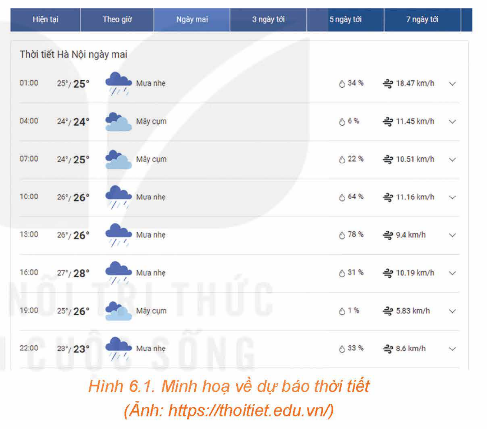
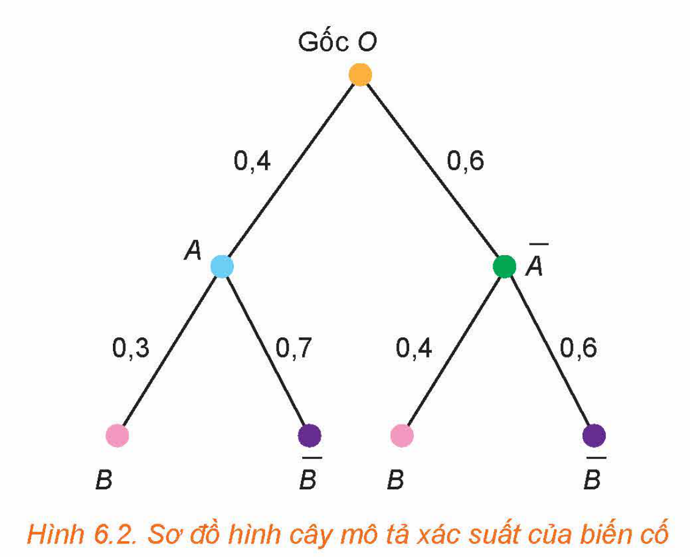
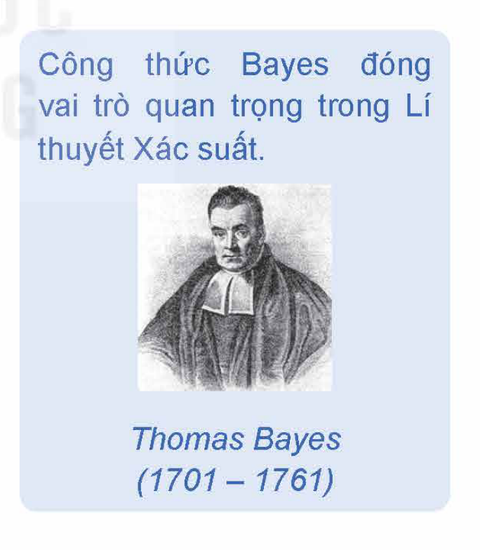

<!-- pdf:74 -->

# BÀI 19: CÔNG THỨC XÁC SUẤT TOÀN PHẦN VÀ CÔNG THỨC BAYES

## 🔤 Thuật ngữ

- Công thức xác suất toàn phần
- Sơ đồ hình cây
- Công thức Bayes

## 🎯 Mục tiêu

- Mô tả và biết vận dụng công thức xác suất toàn phần vào các tình huống có nội dung thực tiễn.
- Nắm được và biết vận dụng công thức Bayes vào các tình huống có nội dung thực tiễn.

## 1. CÔNG THỨC XÁC SUẤT TOÀN PHẦN

Số khán giả đến xem buổi biểu diễn ca nhạc ngoài trời phụ thuộc vào thời tiết. Giả sử, nếu trời không mưa thì xác suất để bán hết vé là $0,9$; còn nếu trời mưa thì xác suất để bán hết vé chỉ là $0,4$. Dự báo thời tiết cho thấy xác suất để trời mưa vào buổi biểu diễn là $0,75$. Nhà tổ chức sự kiện quan tâm đến xác suất để bán được hết vé là bao nhiêu.

Công thức xác suất trong Mục 1 sẽ trả lời cho ta câu hỏi đó.

*Hình 6.1. Minh hoạ về dự báo thời tiết (Ảnh: https://thoitiet.edu.vn/)*

**HĐ1:** Hình thành công thức xác suất toàn phần

Gọi $A$ là biến cố “Trời mưa” và $B$ là biến cố “Bán hết vé” trong *tình huống mở đầu*.

a) Tính $P(A), P(\overline{A}), P(B \mid A), P(B \mid \overline{A})$.

b) Trong hai xác suất $P(A)$ và $P(B)$, nhà tổ chức sự kiện quan tâm đến xác suất nào nhất?

Dựa trên các dữ kiện đã biết, có thể tính được $P(B)$ hay không? Công thức sau đây giúp ta trả lời cho câu hỏi này.

> Cho hai biến cố $A$ và $B$. Khi đó, ta có công thức sau:
> $P(B) = P(A) \cdot P(B \mid A) + P(\overline{A}) \cdot P(B \mid \overline{A}).$
> Công thức trên được gọi là **công thức xác suất toàn phần**.

<!-- pdf:75 -->

**Ví dụ 1:** Ông An hằng ngày đi làm bằng xe máy hoặc xe buýt. Nếu hôm nay ông đi làm bằng xe buýt thì xác suất để hôm sau ông đi làm bằng xe máy là $0,4$. Nếu hôm nay ông đi làm bằng xe máy thì xác suất để hôm sau ông đi làm bằng xe buýt là $0,7$. Xét một tuần mà thứ Hai ông An đi làm bằng xe buýt. Tính xác suất để thứ Tư trong tuần đó, ông An đi làm bằng xe máy.

**Giải:**

Gọi $A$ là biến cố: “Thứ Ba, ông An đi làm bằng xe máy”; $B$ là biến cố: “Thứ Tư, ông An đi làm bằng xe máy”. Ta cần tính $P(B)$. Theo công thức xác suất toàn phần, ta có:

$P(B) = P(A) \cdot P(B \mid A) + P(\overline{A}) \cdot P(B \mid \overline{A}).$

- Tính $P(A)$: Vì thứ Hai, ông An đi làm bằng xe buýt nên xác suất để thứ Ba (hôm sau), ông đi làm bằng xe máy là $0,4$. Vậy $P(A) = 0,4$.
- Tính $P(\overline{A})$: Ta có $P(\overline{A}) = 1 - 0,4 = 0,6$.
- Tính $P(B \mid A)$: Đây là xác suất để thứ Tư, ông An đi làm bằng xe máy nếu thứ Ba, ông An đi làm bằng xe máy.
- Theo giả thiết, nếu hôm nay ông đi làm bằng xe máy thì xác suất để hôm sau ông đi làm bằng xe buýt là $0,7$ và đi làm bằng xe máy là $1 - 0,7 = 0,3$. Do đó, nếu thứ Ba, ông An đi làm bằng xe máy thì xác suất để thứ Tư, ông đi làm bằng xe máy là $0,3$. Vậy $P(B \mid A) = 0,3$.
- Tính $P(B \mid \overline{A})$: Đây là xác suất để thứ Tư, ông An đi làm bằng xe máy nếu thứ Ba ông An đi làm bằng xe buýt. Theo giả thiết, nếu hôm nay ông đi làm bằng xe buýt thì xác suất để hôm sau ông đi làm bằng xe máy là $0,4$. Do đó nếu thứ Ba, ông An đi làm bằng xe buýt thì xác suất để thứ Tư, ông đi làm bằng xe máy là $0,4$. Suy ra $P(B \mid \overline{A}) = 0,4$. Vậy:

$P(B) = P(A) \cdot P(B \mid A) + P(\overline{A}) \cdot P(B \mid \overline{A}) = 0,4 \cdot 0,3 + 0,6 \cdot 0,4 = 0,36.$

**Luyện tập 1:** Trở lại *tình huống mở đầu* Mục 1. Tính xác suất để nhà tổ chức sự kiện bán hết vé.

<!-- term: Sơ đồ hình cây -->
**Chú ý:** Một phương pháp mô tả trực quan công thức xác suất toàn phần là dùng sơ đồ hình cây.

Trở lại Ví dụ 1. Kí hiệu $A$ là biến cố: “Thứ Ba, ông An đi làm bằng xe máy”; $B$ là biến cố: “Thứ Tư, ông An đi làm bằng xe máy”.

Ta vẽ sơ đồ hình cây như sau:

*Hình 6.2. Sơ đồ hình cây mô tả xác suất của biến cố*

<!-- pdf:76 -->

Trên nhánh cây $OA$ và $O\overline{A}$ tương ứng ghi $P(A)$ và $P(\overline{A})$;
<!-- ocr-ok: đã đối chiếu ảnh trang PDF 76 -->

Trên nhánh cây $AB$ và $A\overline{B}$ tương ứng ghi $P(B \mid A)$ và $P(\overline{B} \mid A)$;
<!-- ocr-ok: đã đối chiếu ảnh trang PDF 76 -->

Trên nhánh cây $\overline{A}B$ và $\overline{A}\overline{B}$ tương ứng ghi $P(B \mid \overline{A})$ và $P(\overline{B} \mid \overline{A})$.
<!-- ocr-ok: đã đối chiếu ảnh trang PDF 76 -->

Có hai nhánh cây đi tới $B$ là $OAB$ và $O\overline{A}B$. Vậy:
<!-- ocr-ok: đã đối chiếu ảnh trang PDF 76 -->

$P(B) = 0,4 \cdot 0,3 + 0,6 \cdot 0,4 = 0,36.$

**Luyện tập 2:** Trở lại Ví dụ 1. Sử dụng sơ đồ hình cây, hãy mô tả cách tính xác suất để thứ Tư, ông An đi làm bằng xe buýt.

**Vận dụng:** Hình dạng hạt của đậu Hà Lan có hai kiểu hình: hạt trơn và hạt nhăn, có hai gene ứng với hai kiểu hình này là gene trội B và gene lặn b.

Khi cho lai hai cây đậu Hà Lan, cây con lấy ngẫu nhiên một cách độc lập một gene từ cây bố và một gene từ cây mẹ để hình thành một cặp gene. Giả sử cây bố và cây mẹ được chọn ngẫu nhiên từ một quần thể các cây đậu Hà Lan, ở đó tỉ lệ cây mang kiểu gene bb, Bb tương ứng là $40\%$ và $60\%$. Tính xác suất để cây con có kiểu gene bb.

*Hướng dẫn:*

Gọi $A$ là biến cố: “Cây bố có kiểu gene bb”;

$M$ là biến cố: “Cây con lấy gene b từ cây bố”;

$N$ là biến cố: “Cây con lấy gene b từ cây mẹ”;

$E$ là biến cố: “Cây con có kiểu gene bb”.

Theo giả thiết, $M$ và $N$ độc lập nên $P(E) = P(M) \cdot P(N)$.

Tính $P(M)$: Ta áp dụng công thức xác suất toàn phần:

$P(M) = P(A) \cdot P(M \mid A) + P(\overline{A}) \cdot P(M \mid \overline{A}). \quad (*)$

Ta có $P(A) = 0,4$; $P(\overline{A}) = 0,6$.

$P(M \mid A)$ là xác suất để cây con lấy gene b từ cây bố với điều kiện cây bố có kiểu gene bb. Do đó $P(M \mid A) = 1$.

$P(M \mid \overline{A})$ là xác suất để cây con lấy gene b từ cây bố với điều kiện cây bố có kiểu gene Bb. Do đó $P(M \mid \overline{A}) = \frac{1}{2}$.

Thay vào $(*)$ ta được: $P(M) = 0,4 + 0,3 = 0,7$.

Tương tự tính được $P(N) = 0,7$.

Vậy $P(E) = P(M) \cdot P(N) = 0,7 \cdot 0,7 = 0,49$.

Từ kết quả trên suy ra trong một quần thể các cây đậu Hà Lan, mà ở đó tỉ lệ cây bố và cây mẹ mang kiểu gene bb, Bb tương ứng là $40\%$ và $60\%$, thì tỉ lệ cây con có kiểu gene bb là khoảng $49\%$.

**Luyện tập 3:** Với giả thiết như vận dụng trên.

a) Hãy ước lượng tỉ lệ cây con có kiểu gene BB.

b) Sử dụng kết quả của vận dụng trên và câu a, hãy ước lượng tỉ lệ cây con có kiểu gene Bb.

<!-- pdf:77 -->

## 2. CÔNG THỨC BAYES

Trong Y học, để chẩn đoán bệnh X nào đó, người ta thường dùng một xét nghiệm. Xét nghiệm dương tính, tức là xét nghiệm đó kết luận một người mắc bệnh X. Xét nghiệm âm tính, tức là xét nghiệm đó kết luận một người không mắc bệnh X. Vì không có một xét nghiệm nào tuyệt đối đúng nên trên thực tế có thể xảy ra hai sai lầm sau:

- Xét nghiệm dương tính nhưng thực tế người xét nghiệm không mắc bệnh. Ta gọi đây là dương tính giả.
- Xét nghiệm âm tính nhưng thực tế người xét nghiệm lại mắc bệnh. Ta gọi đây là âm tính giả.

*Ảnh: https://thuocdantoc.vn/*

Ông M đi xét nghiệm bệnh hiểm nghèo X. Biết rằng, nếu một người mắc bệnh X thì với xác suất $0,95$ xét nghiệm cho dương tính; nếu một người không bị bệnh X thì với xác suất $0,01$ xét nghiệm cho dương tính.

Xét nghiệm của ông M cho kết quả dương tính. Ông M hoảng hốt khi nghĩ rằng mình có xác suất $0,95$ mắc bệnh hiểm nghèo X. Mục 2 giúp chúng ta hiểu đúng xác suất đó.

**HĐ2:** Phân biệt $P(A \mid B)$ và $P(B \mid A)$

Trong *tình huống mở đầu Mục 2*, gọi $A$ là biến cố: “Ông M mắc bệnh hiểm nghèo X”; $B$ là biến cố: “Xét nghiệm cho kết quả dương tính”.

a) Nêu các nội dung còn thiếu tương ứng với “(?)” để hoàn thành các câu sau đây:

- $P(A \mid B)$ là xác suất để (?) với điều kiện (?);
- $P(B \mid A)$ là xác suất để (?) với điều kiện (?).

b) $0,95$ là $P(A \mid B)$ hay $P(B \mid A)$? Có phải ông M có xác suất $0,95$ mắc bệnh hiểm nghèo X không?

Công thức sau đây cho ta tính $P(A \mid B)$ khi biết $P(B \mid A)$ và $P(A)$.

> Cho $A$ và $B$ là hai biến cố, với $P(B) > 0$. Khi đó, ta có công thức sau:
> $P(A \mid B) = \frac{P(A) \cdot P(B \mid A)}{P(A) \cdot P(B \mid A) + P(\overline{A}) \cdot P(B \mid \overline{A})}.$
> Công thức trên có tên là **công thức Bayes**.

*Công thức Bayes đóng vai trò quan trọng trong Lí thuyết Xác suất. Thomas Bayes (1701 – 1761)*
<!-- ocr-ok: đã đối chiếu ảnh trang PDF 77 -->

**Chú ý:** Theo công thức xác suất toàn phần, ta có:

$P(B) = P(A) \cdot P(B \mid A) + P(\overline{A}) \cdot P(B \mid \overline{A}).$

Do đó, công thức Bayes còn có thể viết dưới dạng:

$P(A \mid B) = \frac{P(A) \cdot P(B \mid A)}{P(B)}.$

<!-- term: Ý nghĩa của công thức Bayes -->
*Ý nghĩa của công thức Bayes:* Một nhà nghiên cứu quan tâm đến xác suất xảy ra của biến cố $A$. Theo tính toán ban đầu $A$ có xác suất là $P(A) = p$. Sau đó, nhà nghiên cứu có được thông tin rằng: “Biến cố $B$ đã xảy ra”. Với thông tin mới này, nhà nghiên cứu sẽ cập nhật lại hiểu biết của mình về khả năng xảy ra biến cố $A$, bằng cách tính $P(A \mid B)$, xác suất của $A$ khi biết $B$ đã xảy ra. Công thức Bayes cho ta tính $P(A \mid B)$.

<!-- pdf:78 -->

**Ví dụ 2:** Trong một kì thi tốt nghiệp trung học phổ thông, một tỉnh X có $80\%$ học sinh lựa chọn tổ hợp A00 (gồm các môn Toán, Vật lí, Hoá học). Biết rằng, nếu một học sinh chọn tổ hợp A00 thì xác suất để học sinh đó đỗ đại học là $0,6$; còn nếu một học sinh không chọn tổ hợp A00 thì xác suất để học sinh đó đỗ đại học là $0,7$. Chọn ngẫu nhiên một học sinh của tỉnh X đã tốt nghiệp trung học phổ thông trong kì thi trên. Biết rằng học sinh này đã đỗ đại học. Tính xác suất để học sinh đó chọn tổ hợp A00.

**Giải:**

Gọi $A$ là biến cố: “Học sinh đó chọn tổ hợp A00”; $B$ là biến cố: “Học sinh đó đỗ đại học”.

Ta cần tính $P(A \mid B)$. Theo công thức Bayes, ta cần biết: $P(A), P(\overline{A}), P(B \mid A)$ và $P(B \mid \overline{A})$.

Ta có: $P(A) = 0,8$; $P(\overline{A}) = 1 - P(A) = 1 - 0,8 = 0,2$.

$P(B \mid A)$ là xác suất để một học sinh đỗ đại học với điều kiện học sinh đó chọn tổ hợp A00 $\Rightarrow P(B \mid A) = 0,6$.

$P(B \mid \overline{A})$ là xác suất để một học sinh đỗ đại học với điều kiện học sinh đó không chọn tổ hợp A00 $\Rightarrow P(B \mid \overline{A}) = 0,7$.

Thay vào công thức Bayes ta được:

$P(A \mid B) = \frac{P(A) \cdot P(B \mid A)}{P(A) \cdot P(B \mid A) + P(\overline{A}) \cdot P(B \mid \overline{A})} = \frac{0,8 \cdot 0,6}{0,8 \cdot 0,6 + 0,2 \cdot 0,7} \approx 0,7742.$

**Luyện tập 4:** Trong một kho rượu có $30\%$ là rượu loại I. Chọn ngẫu nhiên một chai rượu đưa cho ông Tùng, một người sành rượu, để nếm thử. Biết rằng, một chai rượu loại I có xác suất $0,9$ để ông Tùng xác nhận là loại I; một chai rượu không phải loại I có xác suất $0,95$ để ông Tùng xác nhận đây không phải là loại I. Sau khi nếm, ông Tùng xác nhận đây là rượu loại I. Tính xác suất để chai rượu đúng là rượu loại I.

**Ví dụ 3:** Trở lại *tình huống mở đầu Mục 2*. Tính xác suất để ông M mắc bệnh hiểm nghèo X nếu kết quả xét nghiệm cho kết quả dương tính.

**Giải:**

Gọi $A$ là biến cố: “Ông M mắc bệnh hiểm nghèo X”; $B$ là biến cố: “Xét nghiệm cho kết quả dương tính”.

Ta cần tính $P(A \mid B)$.

Theo công thức Bayes để tính $P(A \mid B)$, ta cần biết: $P(A), P(\overline{A}), P(B \mid A)$ và $P(B \mid \overline{A})$.

Gọi $p$ là tỉ lệ dân số mắc bệnh hiểm nghèo X.

Khi đó $P(A) = p$. Suy ra $P(\overline{A}) = 1 - p$.

$P(B \mid A)$ là xác suất để ông M có xét nghiệm là dương tính nếu ông M mắc bệnh hiểm nghèo X $\Rightarrow P(B \mid A) = 0,95$.

$P(B \mid \overline{A})$ là xác suất để ông M có xét nghiệm là dương tính nếu ông M không mắc bệnh hiểm nghèo X $\Rightarrow P(B \mid \overline{A}) = 0,01$.

Thay vào công thức Bayes ta có:

$P(A \mid B) = \frac{P(A) \cdot P(B \mid A)}{P(A) \cdot P(B \mid A) + P(\overline{A}) \cdot P(B \mid \overline{A})} = \frac{p \cdot 0,95}{p \cdot 0,95 + (1 - p) \cdot 0,01}.$

<!-- pdf:79 -->

**Luyện tập 5:** Trở lại *tình huống mở đầu Mục 2*. Thống kê cho thấy tỉ lệ dân số mắc bệnh hiểm nghèo X là $0,2\%$.

a) Trước khi tiến hành xét nghiệm, xác suất mắc bệnh hiểm nghèo X của ông M là bao nhiêu?

b) Sau khi xét nghiệm cho kết quả dương tính, xác suất mắc bệnh hiểm nghèo X của ông M là bao nhiêu?

**Ví dụ 4:** Một thống kê cho thấy tỉ lệ dân số mắc bệnh hiểm nghèo Y là $0,5\%$. Bà N đi xét nghiệm bệnh hiểm nghèo Y và nhận được kết quả là âm tính. Biết rằng, nếu mắc bệnh hiểm nghèo Y thì với xác suất $0,94$ xét nghiệm là dương tính; nếu không bị bệnh hiểm nghèo Y thì với xác suất $0,97$ xét nghiệm là âm tính.

a) Trước khi tiến hành xét nghiệm, xác suất không mắc bệnh hiểm nghèo Y của bà N là bao nhiêu?

b) Sau khi xét nghiệm cho kết quả âm tính, xác suất không mắc bệnh hiểm nghèo Y của bà N là bao nhiêu?

**Giải:**

Gọi $A$ là biến cố: “Bà N bị bệnh hiểm nghèo Y”; $B$ là biến cố: “Xét nghiệm cho kết quả dương tính”.

a) Trước khi tiến hành xét nghiệm, xác suất không mắc bệnh hiểm nghèo Y của bà N là

$P(\overline{A}) = 1 - P(A) = 1 - 0,005 = 0,995.$

b) Ta cần tính $P(\overline{A} \mid \overline{B})$.

Theo công thức Bayes ta có

$P(\overline{A} \mid \overline{B}) = \frac{P(\overline{A}) \cdot P(\overline{B} \mid \overline{A})}{P(\overline{A}) \cdot P(\overline{B} \mid \overline{A}) + P(A) \cdot P(\overline{B} \mid A)}.$

$P(\overline{B} \mid \overline{A})$ là xác suất để bà N có xét nghiệm là âm tính nếu bà N không bị bệnh Y.

Theo bài ra ta có:

$P(\overline{B} \mid \overline{A}) = 0,97;$

$P(\overline{B} \mid A)$ là xác suất để bà N có xét nghiệm là âm tính nếu bà N bị bệnh Y;

$P(\overline{B} \mid A) = 1 - 0,94 = 0,06.$

Thay vào công thức Bayes ta có

$P(\overline{A} \mid \overline{B}) = \frac{0,995 \cdot 0,97}{0,995 \cdot 0,97 + 0,005 \cdot 0,06} \approx 0,9997.$

Như vậy, với xét nghiệm cho kết quả âm tính, xác suất không mắc bệnh Y của bà N tăng lên thành $99,97\%$ (trước xét nghiệm là $99,5\%$).

## ✏️ BÀI TẬP

**6.7.** Trong quân sự, một máy bay chiến đấu của đối phương có thể xuất hiện ở vị trí X với xác suất $0,55$. Nếu máy bay đó không xuất hiện ở vị trí X thì nó xuất hiện ở vị trí Y. Để phòng thủ, các bệ phóng tên lửa được bố trí tại các vị trí X và Y. Khi máy bay đối phương xuất hiện ở vị trí X hoặc Y thì tên lửa sẽ được phóng để hạ máy bay đó.

Xét phương án tác chiến sau: Nếu máy bay xuất hiện tại X thì bắn 2 quả tên lửa và nếu máy bay xuất hiện tại Y thì bắn 1 quả tên lửa.

<!-- pdf:80 -->

Biết rằng, xác suất bắn trúng máy bay của mỗi quả tên lửa là $0,8$ và các bệ phóng tên lửa hoạt động độc lập. Máy bay bị bắn hạ nếu nó trúng ít nhất 1 quả tên lửa. Tính xác suất bắn hạ máy bay đối phương trong phương án tác chiến nêu trên.

**6.8.** Có hai chuồng thỏ. Chuồng I có 5 con thỏ đen và 10 con thỏ trắng. Chuồng II có 7 con thỏ đen và 3 con thỏ trắng. Trước tiên, từ chuồng II lấy ra ngẫu nhiên 1 con thỏ rồi cho vào chuồng I. Sau đó, từ chuồng I lấy ra ngẫu nhiên 1 con thỏ. Tính xác suất để con thỏ được lấy ra là con thỏ trắng.

**6.9.** Tại nhà máy X sản xuất linh kiện điện tử tỉ lệ sản phẩm đạt tiêu chuẩn là $80\%$. Trước khi xuất xưởng ra thị trường, các linh kiện điện tử đều phải qua khâu kiểm tra chất lượng để đóng dấu OTK. Vì sự kiểm tra không tuyệt đối hoàn hảo nên nếu một linh kiện điện tử đạt tiêu chuẩn thì nó có xác suất $0,99$ được đóng dấu OTK; nếu một linh kiện điện tử không đạt tiêu chuẩn thì nó có xác suất $0,95$ không được đóng dấu OTK. Chọn ngẫu nhiên một linh kiện điện tử của nhà máy X trên thị trường.

a) Tính xác suất để linh kiện điện tử đó được đóng dấu OTK.

b) Dùng sơ đồ hình cây, hãy mô tả cách tính xác suất để linh kiện điện tử được chọn không được đóng dấu OTK.

**6.10.** Có hai đội thi đấu môn Bắn súng. Đội I có 5 vận động viên, đội II có 7 vận động viên. Xác suất đạt huy chương vàng của mỗi vận động viên đội I và đội II tương ứng là $0,65$ và $0,55$. Chọn ngẫu nhiên một vận động viên.

a) Tính xác suất để vận động viên này đạt huy chương vàng;

b) Giả sử vận động viên được chọn đạt huy chương vàng. Tính xác suất để vận động viên này thuộc đội I.

**6.11.** Một bộ lọc được sử dụng để chặn thư rác trong các tài khoản thư điện tử. Tuy nhiên, vì bộ lọc không tuyệt đối hoàn hảo nên một thư rác bị chặn với xác suất $0,95$ và một thư đúng (không phải là thư rác) bị chặn với xác suất $0,01$. Thống kê cho thấy tỉ lệ thư rác là $3\%$.

a) Chọn ngẫu nhiên một thư bị chặn. Tính xác suất để đó là thư rác.

b) Chọn ngẫu nhiên một thư không bị chặn. Tính xác suất để đó là thư đúng.

c) Trong số các thư bị chặn, có bao nhiêu phần trăm là thư đúng? Trong số các thư không bị chặn, có bao nhiêu phần trăm là thư rác?

## 📷 Danh sách hình trong bài

| Mã hình | Trang PDF | Chú thích trong sách | Mô tả ngắn |
| :--- | :---: | :--- | :--- |
| H12-toan-b19-01 | 74 | Hình 6.1 | Minh hoạ bảng dự báo thời tiết Hà Nội theo giờ |
| H12-toan-b19-02 | 75 | Hình 6.2 | Sơ đồ hình cây mô tả xác suất của biến cố trong Ví dụ 1 |
| H12-toan-b19-03 | 77 | Ảnh: https://thuocdantoc.vn/ | Ảnh minh hoạ bác sĩ tư vấn kết quả xét nghiệm cho bệnh nhân |
| H12-toan-b19-04 | 77 | Thomas Bayes (1701 – 1761) | Chân dung nhà toán học Thomas Bayes và ghi chú về vai trò của công thức Bayes |
