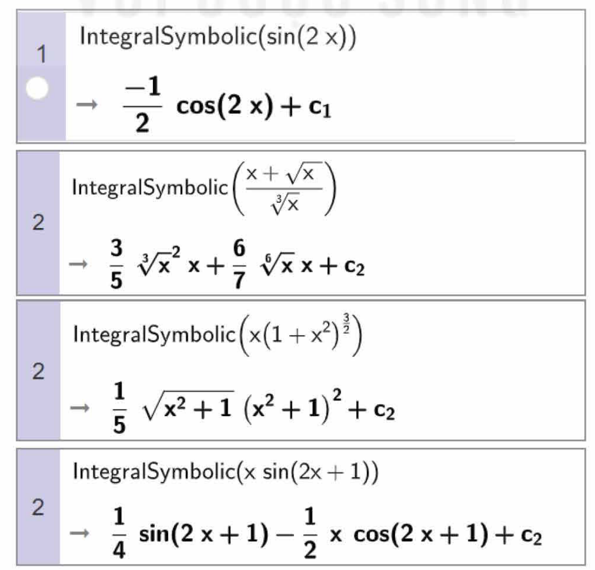
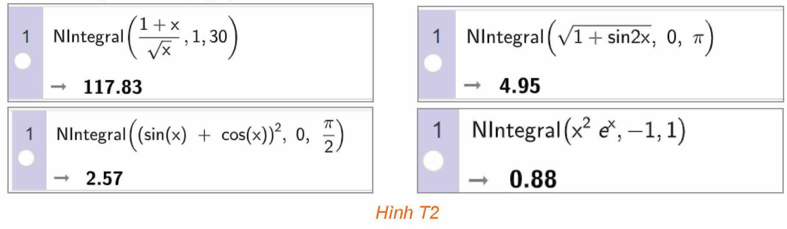
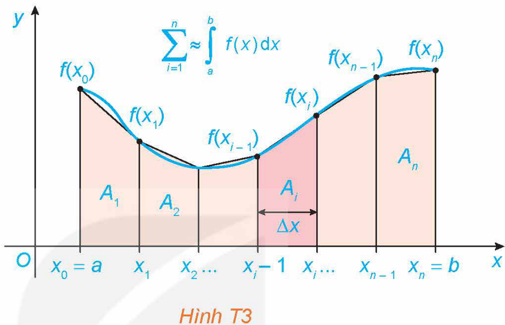

<!-- pdf:83 -->

<!-- Phần tiêu đề chung: HOẠT ĐỘNG THỰC HÀNH TRẢI NGHIỆM -->

# TÍNH NGUYÊN HÀM VÀ TÍCH PHÂN VỚI PHẦN MỀM GEOGEBRA. TÍNH GẦN ĐÚNG TÍCH PHÂN BẰNG PHƯƠNG PHÁP HÌNH THANG

## 🎯 Mục tiêu

- Thực hành tính nguyên hàm và tính gần đúng tích phân với phần mềm GeoGebra. Tính gần đúng tích phân bằng phương pháp hình thang trong trường hợp hàm dưới dấu tích phân cho dạng bảng (tại một số mốc) hoặc cho bởi một đồ thị (mà ta không biết phương trình của nó) hoặc không có nguyên hàm dưới dạng hàm sơ cấp.

## 1. TÍNH NGUYÊN HÀM VÀ TÍCH PHÂN VỚI PHẦN MỀM GEOGEBRA

Khởi động phần mềm GeoGebra, chọn Complex Adaptive System (CAS) để thực hiện tính toán nguyên hàm và tích phân.

**a) Tính nguyên hàm của hàm số**

Để tính nguyên hàm của hàm số, ta dùng lệnh `IntegralSymbolic (<hàm số>)`, kết quả sẽ được hiển thị ngay bên dưới.

```text
1  IntegralSymbolic(sin(2 x))
   -> -1/2 cos(2 x) + c_1
2  IntegralSymbolic((x + sqrt(x)) / cbrt(x))
   -> 3/5 cbrt(x^2) x + 6/7 root(6, x) x + c_2
2  IntegralSymbolic(x (1 + x^2)^(3/2))
   -> 1/5 sqrt(x^2 + 1) (x^2 + 1)^2 + c_2
2  IntegralSymbolic(x sin(2x + 1))
   -> 1/4 sin(2 x + 1) - 1/2 x cos(2 x + 1) + c_2
```


*Hình T1*

<!-- pdf:84 -->

**b) Tính tích phân**

Để tính gần đúng tích phân, ta dùng lệnh `NIntegral (<hàm số, giá trị đầu, giá trị cuối>)`, kết quả sẽ được hiển thị ngay bên dưới.

```text
1  NIntegral((1 + x) / sqrt(x), 1, 30)
   -> 117.83
1  NIntegral(sqrt(1 + sin2x), 0, pi)
   -> 4.95
1  NIntegral((sin(x) + cos(x))^2, 0, pi/2)
   -> 2.57
1  NIntegral(x^2 e^x, -1, 1)
   -> 0.88
```


*Hình T2*

**Chú ý:** Nếu muốn sử dụng giao diện tiếng Việt, sau khi khởi động GeoGebra, chọn Options $\to$ Language $\to$ Vietnamese/Tiếng Việt. Khi đó, thay vì cú pháp lệnh tiếng Anh như trình bày ở trên, ta dùng cú pháp lệnh tiếng Việt tương ứng như trong bảng sau:

| Lệnh | Cú pháp lệnh tiếng Anh | Cú pháp lệnh tiếng Việt |
| :--- | :--- | :--- |
| Tính nguyên hàm | `IntegralSymbolic (<hàm số>)` | `TíchPhân (<hàm số>)` |
| Tính tích phân | `NIntegral (<hàm số, giá trị đầu, giá trị cuối>)` | `TíchPhânXácĐịnh (<hàm số, giá trị đầu, giá trị cuối>)` |

**Thực hành 1:** Sử dụng phần mềm GeoGebra, tính:
<!-- ocr-ok: đối chiếu ảnh p.84 -->

a) $\int \frac{x^2 - 2x + 2}{x + 1}\,\text{d}x$;

b) $\int_0^{\frac{\pi}{2}} e^x \cos 2x\,\text{d}x$.

## 2. TÍNH GẦN ĐÚNG TÍCH PHÂN BẰNG PHƯƠNG PHÁP HÌNH THANG

Để tính tích phân $\int_a^b f(x)\,\text{d}x$ bằng định nghĩa, ta cần biết một nguyên hàm $F(x)$ của $f(x)$ trên đoạn $[a; b]$. Khi đó:

$\int_a^b f(x)\,\text{d}x = F(b) - F(a).$

Tuy nhiên, nếu hàm số $f(x)$ không có nguyên hàm dưới dạng hàm sơ cấp, chẳng hạn, người ta biết rằng

$\int e^{x^2}\,\text{d}x;\ \int e^{-x^2}\,\text{d}x;\ \int \frac{\sin x}{x}\,\text{d}x;\ \int \frac{\cos x}{x}\,\text{d}x;\ \int \frac{e^x}{x}\,\text{d}x;\ \int \frac{1}{\sqrt{1 - x^3}}\,\text{d}x;\ \dots$

không phải là những hàm số sơ cấp, thì không thể dùng định nghĩa trên được. Tình huống tương tự xuất hiện khi $f(x)$ cho bởi một đồ thị mà ta không biết phương trình của nó. Khi đó, ta cần tính xấp xỉ $\int_a^b f(x)\,\text{d}x$ bằng các phương pháp số.

<!-- pdf:85 -->

Phương pháp đơn giản nhất là **phương pháp hình thang**, có nội dung như sau:

Giả sử $f(x)$ là hàm số liên tục trên đoạn $[a; b]$. Khi đó:
<!-- ocr-ok: đối chiếu ảnh p.85 -->

$\int_a^b f(x)\,\text{d}x \approx \frac{b - a}{2n}[f(x_0) + 2f(x_1) + 2f(x_2) + \dots + 2f(x_{n-1}) + f(x_n)],$

ở đó đoạn $[a; b]$ được chia thành $n$ đoạn con $[x_0; x_1], [x_1; x_2], \dots, [x_{n-1}; x_n]$, mỗi đoạn có độ dài là $\Delta x = \frac{b - a}{n}$.

Khi $f(x)$ là hàm liên tục và không âm trên đoạn $[a; b]$, ta có:

**Ý nghĩa hình học:** Diện tích của hình phẳng giới hạn bởi đồ thị $y = f(x)$, trục hoành và hai đường thẳng $x = a, x = b$ xấp xỉ với tổng diện tích của các hình thang con $A_1, A_2, \dots, A_n$ (H.T3).


*Hình T3*

**Đánh giá sai số:** Người ta chứng minh được rằng nếu $f''(x)$ liên tục trên đoạn $[a; b]$ thì sai số $|E|$ của phương pháp hình thang được đánh giá như sau:

$|E| \le \frac{(b - a)^3 M}{12n^2}$, trong đó $M = \max_{x \in [a; b]} |f''(x)|$.

**Thuật toán:** Để tính xấp xỉ $\int_a^b f(x)\,\text{d}x$ với độ chính xác không vượt quá số $\varepsilon$ cho trước, ta thực hiện lần lượt các bước sau:

*Bước 1.* Tính $f''(x)$ và tìm $M = \max_{x \in [a; b]} |f''(x)|$ (hoặc đánh giá $\max_{x \in [a; b]} |f''(x)| \le M$, nếu việc tìm chính xác là khó).

*Bước 2.* Với sai số $\varepsilon$ cho trước, tìm số tự nhiên $n$ (nhỏ nhất) sao cho

$|E| \le \frac{(b - a)^3 M}{12n^2} < \varepsilon.$

*Bước 3.* Chia đoạn $[a; b]$ thành $n$ đoạn con có độ dài bằng nhau và áp dụng công thức hình thang.

**Ví dụ:** Tính gần đúng $\int_0^1 e^{-x^2}\,\text{d}x$ với độ chính xác nhỏ hơn $0,01$.

**Giải:**

a) Ta có: $f(x) = e^{-x^2};\ f'(x) = -2xe^{-x^2}$;

$f''(x) = 4x^2 e^{-x^2} - 2e^{-x^2};\ f'''(x) = 4x(3 - 2x^2)e^{-x^2};\ f'''(x) = 0 \Leftrightarrow x = 0$ hoặc $x = \pm\sqrt{\frac{3}{2}}$.

Ta có: $f''(0) = -2;\ f''\left(\pm\sqrt{\frac{3}{2}}\right) = \frac{4}{e\sqrt{e}};\ f''(1) = \frac{2}{e}$.

Do đó $M = \max_{x \in [0; 1]} |f''(x)| = |f''(0)| = 2$.

<!-- pdf:86 -->

b) Ta cần tìm $n$ sao cho

$\frac{(1 - 0)^3 \cdot 2}{12n^2} < 0,01 \Leftrightarrow \frac{1}{6n^2} < 0,01 \Leftrightarrow n > 4.$

Do đó, ta chọn $n = 5$.

c) Chia đoạn $[0; 1]$ thành $5$ đoạn có độ dài bằng nhau là $[0; 0,2], [0,2; 0,4], [0,4; 0,6], [0,6; 0,8], [0,8; 1]$.

Áp dụng công thức hình thang, ta có:

$\int_0^1 e^{-x^2}\,\text{d}x \approx \frac{1 - 0}{10}\left[\frac{1}{e^0} + \frac{2}{e^{0,04}} + \frac{2}{e^{0,16}} + \frac{2}{e^{0,36}} + \frac{2}{e^{0,64}} + \frac{1}{e}\right] \approx 0,744.$

**Thực hành 2:** Sử dụng phương pháp hình thang, tính gần đúng $\int_1^2 \frac{e^x}{x}\,\text{d}x$ với độ chính xác $0,01$.

**Vận dụng:** Một thân cây dài $4,8\text{ m}$ được cắt thành các khúc gỗ dài $60\text{ cm}$. Người ta đo đường kính của mỗi mặt cắt ngang và diện tích $S$ của nó được ghi lại trong bảng dưới đây, ở đây $x\text{ (cm)}$ là khoảng cách tính từ đỉnh thân cây đến vết cắt.

| $x\text{ (cm)}$ | $0$ | $60$ | $120$ | $180$ | $240$ | $300$ | $360$ | $420$ | $480$ |
| :--- | :---: | :---: | :---: | :---: | :---: | :---: | :---: | :---: | :---: |
| $S\text{ (cm}^2\text{)}$ | $240$ | $248$ | $256$ | $260$ | $264$ | $272$ | $298$ | $316$ | $320$ |

Tìm thể tích gần đúng của thân cây này.

*Hướng dẫn:*

Thể tích cần tính là $V = \int_0^{480} S(x)\,\text{d}x$, trong đó $S(x)$ là diện tích mặt cắt ngang tại vị trí cách đỉnh thân cây một khoảng $x\text{ (cm)}$. Sử dụng phương pháp hình thang để tính gần đúng tích phân này.

## 📷 Danh sách hình trong bài

| Mã hình | Trang PDF | Chú thích trong sách | Mô tả ngắn |
| :--- | :---: | :--- | :--- |
| H12-toan-hd-thtn-04-01 | 83 | Hình T1 | Các ví dụ tính nguyên hàm bằng lệnh `IntegralSymbolic` trong cửa sổ CAS của GeoGebra |
| H12-toan-hd-thtn-04-02 | 84 | Hình T2 | Các ví dụ tính gần đúng tích phân bằng lệnh `NIntegral` trong cửa sổ CAS của GeoGebra |
| H12-toan-hd-thtn-04-03 | 85 | Hình T3 | Minh hoạ ý nghĩa hình học của phương pháp hình thang xấp xỉ diện tích hình phẳng bởi các hình thang con $A_1, A_2, \dots, A_n$ |
