<!-- pdf:87 -->

# VẼ ĐỒ HOẠ 3D VỚI PHẦN MỀM GEOGEBRA

AutoCAD và GeoGebra là các phần mềm hỗ trợ vẽ hình 2D, 3D trên máy tính. AutoCAD được sử dụng nhiều trong vẽ thiết kế kiến trúc, kĩ thuật, GeoGebra được dùng nhiều trong giáo dục. Nền tảng toán học cho các phần mềm này là hình học trong mặt phẳng toạ độ (hình 2D) và hình học trong không gian toạ độ (hình 3D). Em hãy trải nghiệm với việc dùng phần mềm GeoGebra cho một số thiết kế 3D.

## 1. VẼ TAM GIÁC PENROSE

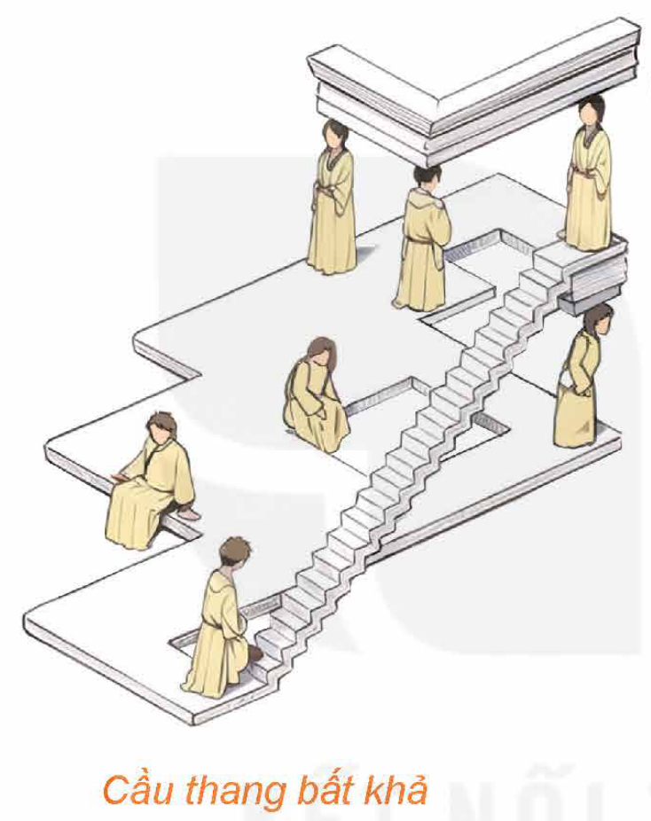
*Cầu thang bất khả*

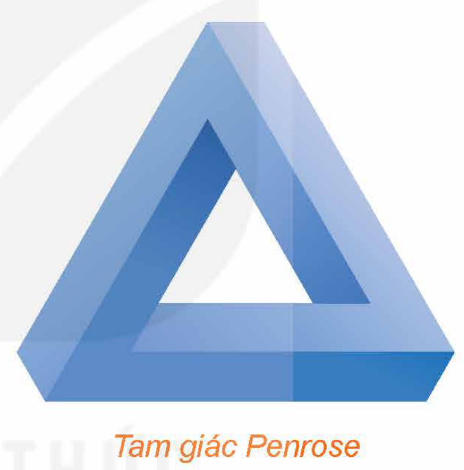
*Tam giác Penrose*

Tranh “Cầu thang bất khả” cho ta cảm giác rằng có mô hình cầu thang mà từng bước đưa ta lên cao, nhưng cuối cùng thì ta vẫn ở sàn nằm ngang đồng mức nơi xuất phát, đó là một điều không thể.

Hình ảnh “Tam giác Penrose” thể hiện một mô hình trong không gian mà có thể nhìn nó như được ghép từ ba hình hộp chữ nhật cùng kích thước (ứng với ba cạnh) đôi một vuông góc với nhau. Đó cũng là một mô hình không thể thực hiện được trong thực tế.

Nếu tìm trên mạng Internet từ khoá “impossible models”, ta có thể bắt gặp nhiều hình ảnh cho các mô hình mà cũng như Cầu thang bất khả và Tam giác Penrose, chúng khả dĩ, hợp lí ở từng bộ phận, phạm vi hẹp, nhưng tổng thể thì không.

Cấu trúc Cầu thang bất khả (Impossible Straircse) là sáng tạo nghệ thuật của hoạ sĩ Thuỵ Điển Oscar Reutersvard từ nửa đầu thế kỉ XX. Sau này, nhà Vật lí – Toán học lớn Sir Roger Penrose cũng đưa ra ý tưởng này mà điển hình là “Tam giác Penrose” để nói lên nguyên lí bất khả trong nhận thức cái toàn bộ, rằng nhận thức, mặc dù mỗi ngày một tiến hoá, nhưng không bao giờ đạt đến chỗ biết hết, biết đầy đủ, biết tận cùng. *(Theo: F. David Peat (2002), From Certainty to Uncertainty: The Story of Science and Ideas in the Twentieth Century, Joseph Henry Press)*

<!-- pdf:88 -->

Trong hoạt động trải nghiệm này, em hãy theo hướng dẫn sau, để vẽ tam giác Penrose bằng cách dựng các hình hộp chữ nhật và lựa chọn một góc nhìn thích hợp.

**Chú ý:** Sử dụng giao diện GeoGebra bằng Tiếng Việt: Vào mục *Thiết lập*, chọn *Ngôn ngữ*, chọn *Tiếng Việt*. Các hướng dẫn được đưa ra trong bài học này ứng với phiên bản GeoGebra Classic.

- *Bước 1.* Mở phần mềm GeoGebra, vào mục Hiển thị và lần lượt lựa chọn các mục sau: Hiển thị danh sách đối tượng, Vùng làm việc, Hiển thị dạng 3D, Khung nhập lệnh.

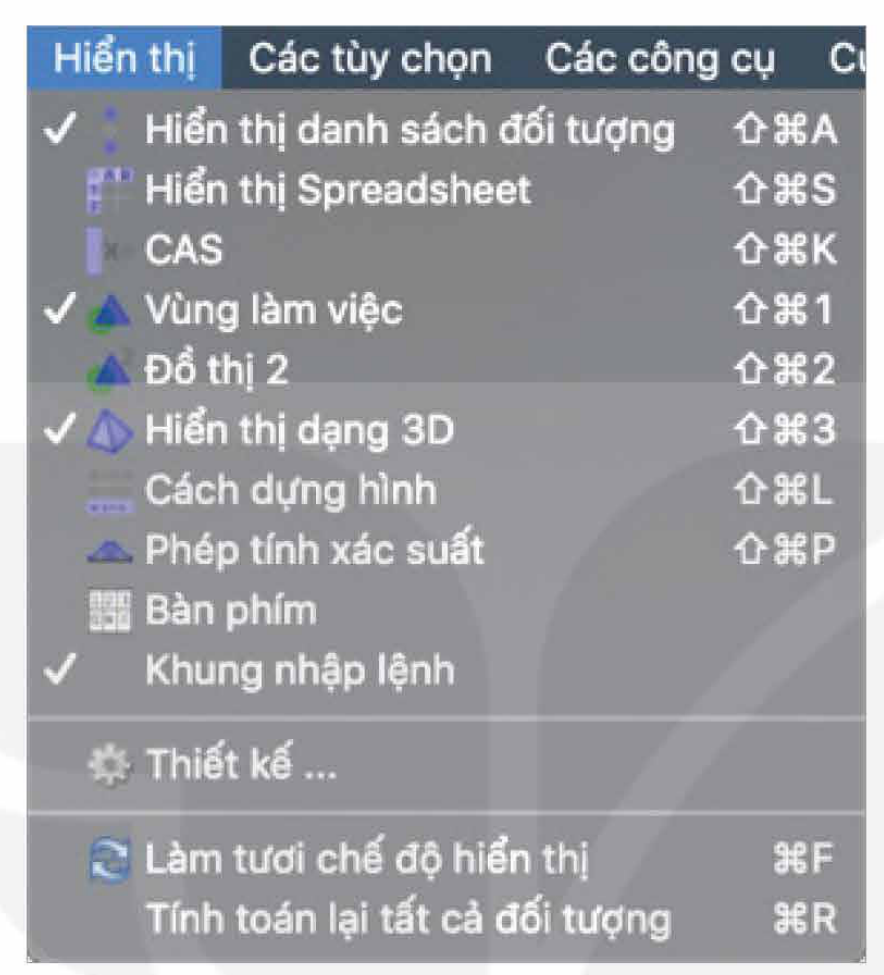

- *Bước 2.* Trong Khung nhập lệnh, lần lượt sử dụng các đoạn lệnh sau:

| Đoạn lệnh | Ý nghĩa |
| :--- | :--- |
| `DaGiac((0, 0, 0), (-1, 0, 0), 4, TrucTung)` | Hình vuông có toạ độ $2$ đỉnh là $(0, 0, 0), (-1, 0, 0)$ và nằm trong mặt phẳng $(Oxz)$. |
| `DaGiac((0, 9, 0), (0, 10, 0), 4, TrucZ)` | Hình vuông có toạ độ $2$ đỉnh là $(0, 9, 0), (0, 10, 0)$ và nằm trong mặt phẳng $(Oxy)$. |
| `DaGiac((-1, 0, 0), (-1, 1, 0), 4, TrucHoanh)` | Hình vuông có toạ độ $2$ đỉnh là $(-1, 0, 0), (-1, 1, 0)$ và nằm trong mặt phẳng $(Oyz)$. |
| `HìnhLăngTrụ(TenDaGiac1, 9)` | Hình lăng trụ có đáy là `TenDagiac1` và chiều cao bằng $9$ nằm ở phần dương của trục $Oy$. |
| `HìnhLăngTrụ(TenDaGiac2, 9)` | Hình lăng trụ có đáy là `TenDagiac2` và chiều cao bằng $9$ nằm ở phần dương của trục $Oz$. |
| `HìnhLăngTrụ(TenDaGiac3, -9)` | Hình lăng trụ có đáy là `TenDagiac3` và chiều cao bằng $9$ nằm ở phần âm của trục $Ox$. |
| `DaGiac((0, 9, 0), (0, 10, 0), (0, 10, 9), (0, 9, 8))` | Đa giác có toạ độ $4$ đỉnh là $(0, 9, 0), (0, 10, 0), (0, 10, 9), (0, 9, 8)$. |

<!-- pdf:89 -->

- *Bước 3.* Di chuyển con trỏ vào khoảng trắng trong khung Hiển thị danh sách đối tượng, sau đó nháy chuột phải, lựa chọn mục Các đối tượng phụ.

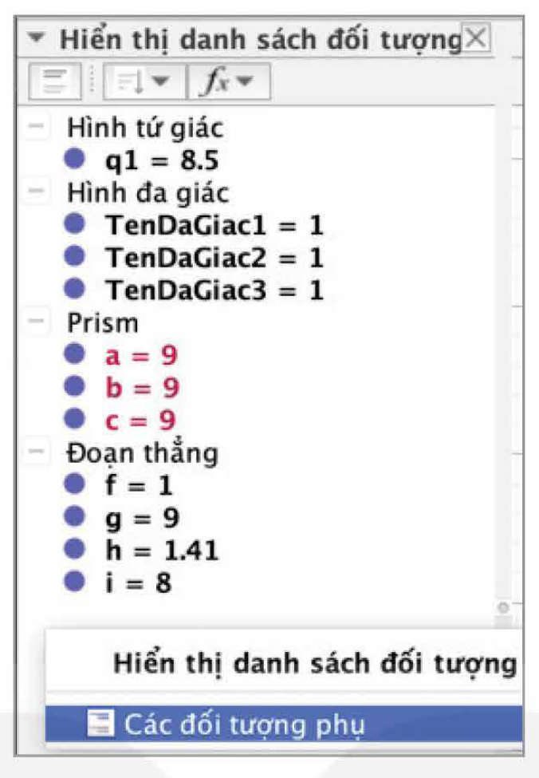

- *Bước 4.* Di chuyển con trỏ vào mục Hình đa giác trong khung Hiển thị danh sách đối tượng, sau đó nháy chuột phải và lựa chọn mục Hiển thị đối tượng để ẩn $3$ hình vuông đã dựng.

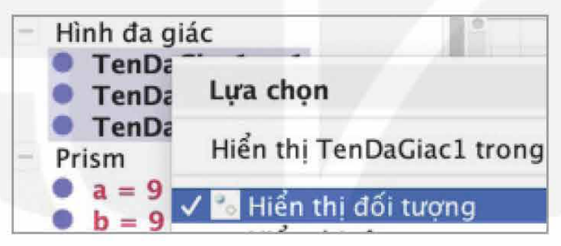

Làm tương tự Bước 4 cho đối tượng Đoạn thẳng và đối tượng Hình tứ giác để ẩn tất cả các đoạn thẳng và tứ giác.

- *Bước 5.* Trong khung Hiển thị danh sách đối tượng, di chuyển con trỏ đến ô tròn màu trắng của mục `Mat4`, sau đó nháy chuột để hiển thị `Mat4`.

Tiếp tục nháy chuột chọn `Mat4`, di chuyển con trỏ đến biểu tượng Thiết lập màu và sự trong suốt để tô màu cho tứ giác (ở đây ta tô màu đỏ và kéo thanh trượt để ở độ đậm lớn nhất).

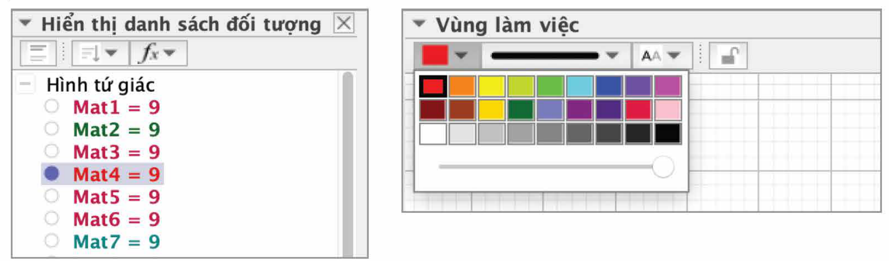

Làm tương tự Bước 5 cho các đối tượng:

`Mat12` (ở đây ta tô màu đỏ);

`Mat7`, `Mat11` (ở đây ta tô hai mặt này màu xanh da trời);

`Mat2`, `q1` (ở đây ta tô hai mặt này màu xanh lá cây).

<!-- pdf:90 -->

- *Bước 6.* Di chuyển con trỏ vào khoảng trắng trong khung Vùng làm việc, chọn công cụ `OK` để chèn nút tạo góc nhìn thích hợp.

Sau đó nháy chuột vào khoảng trắng trong khung Vùng làm việc, cửa sổ mới được bật ra, điền tên tiêu đề, chẳng hạn “TamgiacPenrose” và GeoGebra Scrip, chẳng hạn “setview diretion [(-1, -1, -1)]”.

Sau khi tạo nút xong, nháy chuột vào nút Tam giác Penrose vừa tạo sẽ thu được hình vẽ sau.

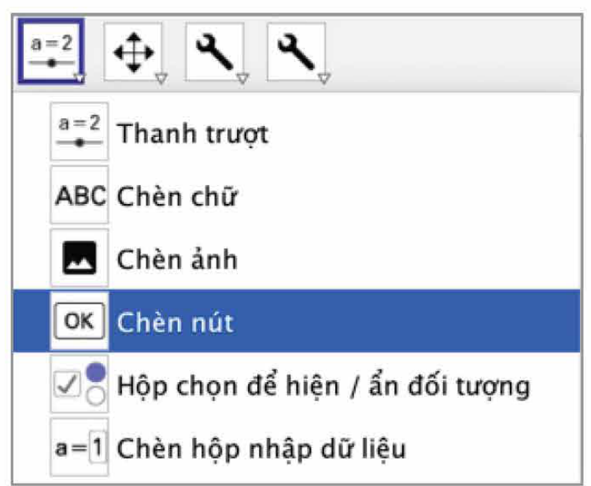

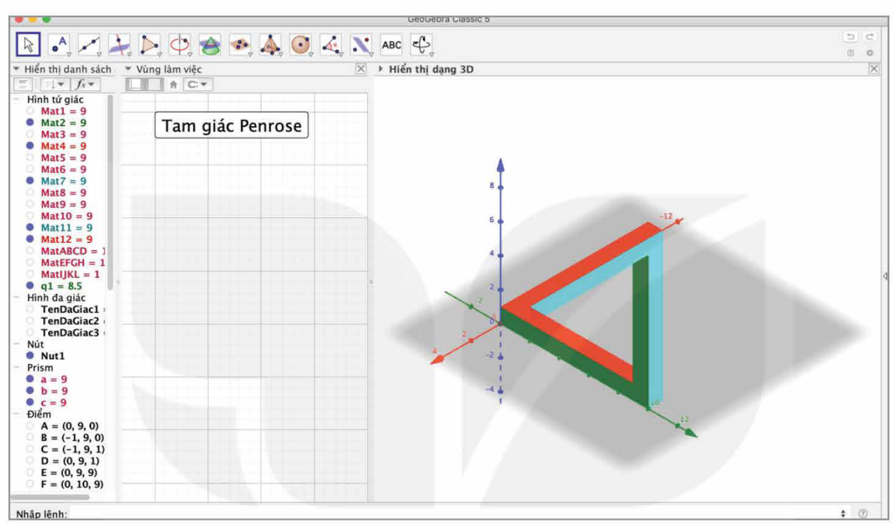

## 2. VẼ MẶT MOBIUS

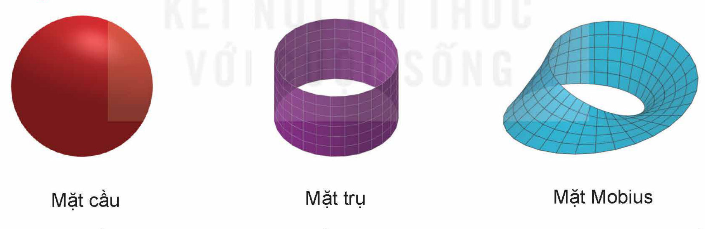
*Mặt cầu — Mặt trụ — Mặt Mobius*

Từ một mảnh giấy hình chữ nhật $ABCD$, nếu dán hai mép $AB$ và $DC$ trùng nhau mà điểm $A$ trùng điểm $D$, điểm $B$ trùng điểm $C$ thì ta được một hình có dạng mặt trụ, nhưng nếu dán hai mép $AB$ và $CD$ trùng nhau mà điểm $A$ trùng điểm $C$, điểm $B$ trùng điểm $D$ thì ta sẽ được một hình có dạng gọi là **mặt Mobius**. Đối với mỗi mô hình có dạng mặt cầu, mặt trụ (hay nhiều mặt khác), ta có thể hình dung rõ rằng mỗi chúng có hai phía: trong và ngoài. Nhưng mô hình có dạng mặt Mobius không phân thành hai phía trong, ngoài như vậy.

Giả sử mảnh giấy hình chữ nhật nói trên có một mặt màu xanh và một mặt màu đỏ. Mặt trụ được tạo từ mảnh giấy đó có hai phía ứng với hai màu. Giả sử một con kiến đang bám ở phía này của mặt trụ, nếu không được phép leo qua mép mặt trụ, thì nó không thể bò sang phía còn lại của mặt trụ. Trong khi đó, đối với mặt Mobius tạo từ mảnh giấy đó, con kiến có thể

<!-- pdf:91 -->

bò từ một vị trí ở phần giấy được tô màu đỏ sang bất kì vị trí nào ở phần giấy được tô màu xanh mà không cần leo qua mép của mặt Mobius.

Trong không gian toạ độ $Oxyz$, tập những điểm có toạ độ $(x; y; z)$ được xác định bởi

$\begin{cases} x = \left(1 + \frac{v}{2}\cdot\cos\left(\frac{u}{2}\right)\right)\cdot\cos(u) \\ y = \left(1 + \frac{v}{2}\cdot\cos\left(\frac{u}{2}\right)\right)\cdot\sin(u) \\ z = \frac{v}{2}\cdot\sin\left(\frac{u}{2}\right) \end{cases}$

(với $u, v$ là các tham số thay đổi, thoả mãn $0 \le u < 2\pi$ và $-1 \le v \le 1$), là một mặt Mobius.

Ta có thể sử dụng phần mềm GeoGebra để vẽ mặt Mobius trên theo các bước sau:

- *Bước 1.* Mở phần mềm GeoGebra, vào mục Phối cảnh\Vẽ đồ hoạ 3D, chọn hiển thị hệ trục toạ độ, Show Plane.
- *Bước 2.* Trong ô Nhập lệnh, nhập phương trình của mặt Mobius như sau:

```text
a = BeMat((1 + v/2 cos(u/2)) cos(u), (1 + v/2 cos(u/2)) sin(u), v/2 sin(u/2), u, 0, 2 pi, v, -1, 1)
```

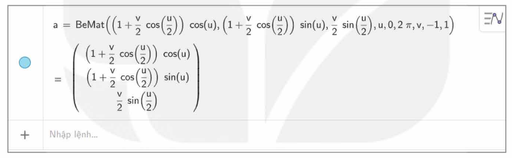

Trên màn hình hiển thị hình vẽ:

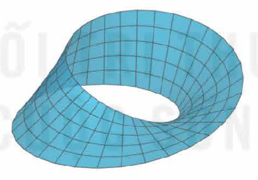

- *Bước 3.* Để đổi màu cho hình vẽ, chọn mặt cần đổi màu trong ô Nhập lệnh, nháy chuột phải và chọn Thiết lập. Trong mục Thiết lập, chọn mục Màu sắc:

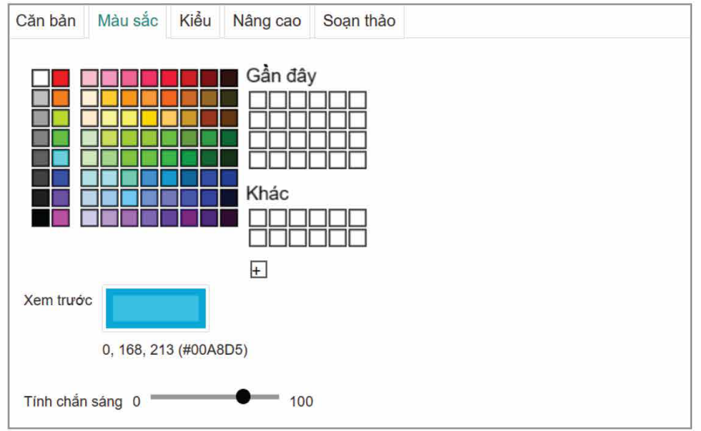

## 📷 Danh sách hình trong bài

| Mã hình | Trang PDF | Chú thích trong sách | Mô tả ngắn |
| :--- | :---: | :--- | :--- |
| H12-toan-hd-thtn-05-01 | 87 | Cầu thang bất khả | Tranh minh hoạ cấu trúc Cầu thang bất khả (Impossible Staircase) |
| H12-toan-hd-thtn-05-02 | 87 | Tam giác Penrose | Hình minh hoạ mô hình Tam giác Penrose |
| H12-toan-hd-thtn-05-03 | 88 | (không có) | Menu Hiển thị trong GeoGebra Classic (Bước 1) |
| H12-toan-hd-thtn-05-04 | 89 | (không có) | Khung Hiển thị danh sách đối tượng chọn Các đối tượng phụ (Bước 3) |
| H12-toan-hd-thtn-05-05 | 89 | (không có) | Khung Hiển thị danh sách đối tượng ẩn Hình đa giác (Bước 4) |
| H12-toan-hd-thtn-05-06 | 89 | (không có) | Khung Hiển thị danh sách đối tượng và bảng chọn màu cho tứ giác `Mat4` (Bước 5) |
| H12-toan-hd-thtn-05-07 | 90 | (không có) | Menu chọn công cụ Chèn nút trong GeoGebra (Bước 6) |
| H12-toan-hd-thtn-05-08 | 90 | (không có) | Giao diện GeoGebra hiển thị kết quả vẽ Tam giác Penrose sau khi bấm nút góc nhìn (Bước 6) |
| H12-toan-hd-thtn-05-09 | 90 | Mặt cầu — Mặt trụ — Mặt Mobius | Ba hình minh hoạ trực quan so sánh Mặt cầu, Mặt trụ và Mặt Mobius |
| H12-toan-hd-thtn-05-10 | 91 | (không có) | Ô Nhập lệnh phương trình tham số của mặt Mobius bằng lệnh `BeMat` (Bước 2) |
| H12-toan-hd-thtn-05-11 | 91 | (không có) | Hình vẽ mặt Mobius hiển thị trên vùng đồ hoạ 3D của GeoGebra (Bước 2) |
| H12-toan-hd-thtn-05-12 | 91 | (không có) | Hộp thoại Thiết lập $\to$ Màu sắc để đổi màu cho mặt Mobius (Bước 3) |
