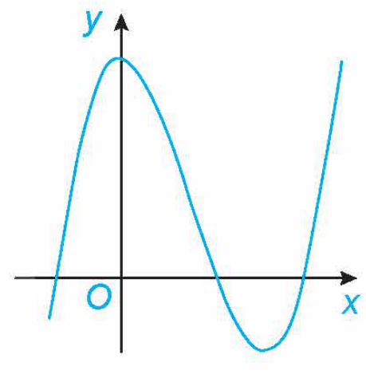
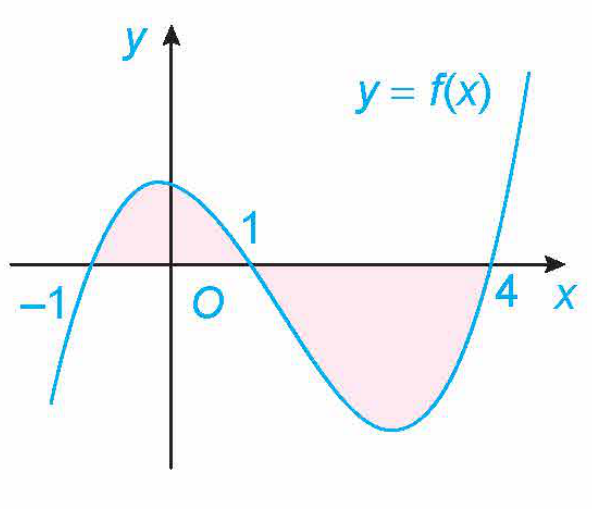

<!-- pdf:92 -->

# BÀI TẬP ÔN TẬP CUỐI NĂM

## ✏️ A – TRẮC NGHIỆM

**1.** Khoảng nghịch biến của hàm số $y = x^3 - 6x^2 + 9x + 1$ là

A. $(-\infty; 1)$.

B. $(3; +\infty)$.

C. $(1; 3)$.

D. $(-\infty; +\infty)$.

**2.** Giá trị lớn nhất $M$ của hàm số $y = \frac{x^2 + 3}{x - 1}$ trên đoạn $[2; 4]$ là

A. $M = 6$.

B. $M = 7$.

C. $M = \frac{19}{3}$.

D. $M = \frac{20}{3}$.

**3.** Tổng số các đường tiệm cận của đồ thị hàm số $y = \frac{\sqrt{x^2 - 1}}{x}$ là

A. $0$.

B. $1$.

C. $2$.

D. $3$.

**4.** Đường cong trong hình bên là đồ thị của một trong bốn hàm số dưới đây. Hàm số đó là hàm số nào?

A. $y = -x^3 + 3x^2 + 1$.

B. $y = x^3 - 3x^2 + 3$.

C. $y = -x^2 + 2x + 1$.

D. $y = \frac{x + 1}{x - 1}$.

**5.** Cho hàm số $f(x) = x^2 + 3$. Khẳng định nào dưới đây là đúng?

A. $\int f(x)\,\text{d}x = 2x + C$.

B. $\int f(x)\,\text{d}x = x^2 + 3x + C$.

C. $\int f(x)\,\text{d}x = x^3 + 3x + C$.

D. $\int f(x)\,\text{d}x = \frac{x^3}{3} + 3x + C$.

**6.** Cho hàm số $f(x)$ thoả mãn $f(0) = 1$ và $f'(x) = 2\sin x + 1$. Khi đó $\int_0^{\frac{\pi}{2}} f(x)\,\text{d}x$ bằng
<!-- ocr-ok: đối chiếu ảnh p.92 -->

A. $\frac{\pi^2 + 12\pi - 16}{8}$.

B. $\frac{\pi^2 - 4\pi + 16}{8}$.

C. $\frac{\pi^2 + 6\pi - 8}{4}$.

D. $\frac{\pi^2 - 2\pi + 8}{4}$.

**7.** Cho hàm số $f(x)$ liên tục trên $\mathbb{R}$. Gọi $S$ là diện tích hình phẳng giới hạn bởi các đường $y = f(x), y = 0, x = -1$ và $x = 4$ như hình bên.

<!-- pdf:93 -->

Khẳng định nào dưới đây là đúng?

A. $S = \int_{-1}^1 f(x)\,\text{d}x + \int_1^4 f(x)\,\text{d}x$.

B. $S = \int_{-1}^1 f(x)\,\text{d}x - \int_1^4 f(x)\,\text{d}x$.

C. $S = -\int_{-1}^1 f(x)\,\text{d}x + \int_1^4 f(x)\,\text{d}x$.

D. $S = -\int_{-1}^1 f(x)\,\text{d}x - \int_1^4 f(x)\,\text{d}x$.

**8.** Gọi $(H)$ là hình phẳng giới hạn bởi các đường $y = 2\sqrt{x}, y = 0, x = 0$ và $x = 4$. Thể tích $V$ của khối tròn xoay sinh ra khi quay hình phẳng $(H)$ quanh trục $Ox$ là

A. $V = 32$.

B. $V = 32\pi$.

C. $V = \frac{32}{3}$.

D. $V = \frac{32\pi}{3}$.

**9.** Cho tứ diện $ABCD$, gọi $G$ là trọng tâm của tam giác $BCD$ và $M$ là trung điểm của đoạn thẳng $AG$. Khi đó $\overrightarrow{MA} + \overrightarrow{MB} + \overrightarrow{MC} + \overrightarrow{MD}$ bằng

A. $\overrightarrow{MG}$.

B. $2\overrightarrow{MG}$.

C. $3\overrightarrow{MG}$.

D. $4\overrightarrow{MG}$.

**10.** Cho hình hộp $ABCD.A'B'C'D'$ có tâm $O$ và gọi $G$ là trọng tâm của tam giác $BDA'$. Tỉ số $\frac{AG}{AO}$ bằng
<!-- ocr-ok: đối chiếu ảnh p.93 -->

A. $\frac{1}{3}$.

B. $\frac{1}{2}$.

C. $\frac{2}{3}$.

D. $\frac{3}{4}$.

**11.** Trong không gian $Oxyz$, cho đường thẳng $d: \begin{cases} x = 2 - t \\ y = 3 \\ z = -1 + 2t \end{cases}$ và mặt phẳng $(P): 2x - y - 2z + 1 = 0$. Côsin của góc giữa đường thẳng $d$ và mặt phẳng $(P)$ là

A. $\frac{2\sqrt{5}}{5}$.

B. $\frac{\sqrt{5}}{5}$.

C. $\frac{2\sqrt{3}}{5}$.

D. $\frac{\sqrt{3}}{5}$.

**12.** Trong không gian $Oxyz$, cho điểm $M(2; -1; 3)$. Gọi $A, B, C$ lần lượt là hình chiếu vuông góc của $M$ trên trục $Ox, Oy, Oz$. Phương trình mặt phẳng $(ABC)$ là
<!-- ocr-ok: đối chiếu ảnh p.93 -->

A. $3x - 6y + 2z + 6 = 0$.

B. $3x - 6y + 2z + 6 = 0$.

C. $3x - 2y + 2z - 1 = 0$.

D. $3x - 6y + 2z - 1 = 0$.

**13.** Thống kê thời gian trong tuần dành cho đọc sách của một số nhân viên trong một công ty được cho trong bảng sau:

| Thời gian (giờ) | $[0; 2)$ | $[2; 4)$ | $[4; 6)$ | $[6; 8)$ | $[8; 10)$ |
| :--- | :---: | :---: | :---: | :---: | :---: |
| Số nhân viên | $3$ | $8$ | $15$ | $7$ | $2$ |

a) Khoảng biến thiên của mẫu số liệu ghép nhóm này là

A. $13$.

B. $10$.

C. $8$.

D. $6$.

b) Độ lệch chuẩn của mẫu số liệu ghép nhóm này là (làm tròn kết quả đến hàng phần trăm)

A. $1,99$.

B. $2,02$.

C. $3,97$.

D. $4,09$.

<!-- pdf:94 -->

**14.** Trong một nhóm $25$ người, có $15$ người thích uống trà, $17$ người thích uống cà phê, $9$ người thích uống cả cà phê và trà. Chọn ngẫu nhiên một người trong nhóm. Biết rằng người đó thích uống cà phê. Xác suất để người đó thích uống trà là

A. $\frac{9}{17}$.

B. $\frac{8}{17}$.

C. $\frac{9}{19}$.

D. $\frac{10}{19}$.

**15.** Trong số $40$ học sinh lớp 12A, có $22$ em đăng kí thi ngành Kinh tế, $25$ em đăng kí thi ngành Luật, $3$ em không đăng kí thi cả hai ngành này. Chọn ngẫu nhiên một học sinh, biết rằng em đó đăng kí thi ngành luật. Xác suất để em đó đăng kí thi ngành kinh tế là

A. $\frac{3}{5}$.

B. $\frac{2}{5}$.

C. $\frac{3}{7}$.

D. $\frac{4}{7}$.

## ✏️ B – TỰ LUẬN

**16.** Khảo sát sự biến thiên và vẽ đồ thị của các hàm số sau:

a) $y = x^3 - 3x^2$;

b) $y = \frac{2x + 1}{x + 2}$;

c) $y = \frac{2x^2 + x - 2}{x - 1}$.

**17.** Tìm giá trị lớn nhất và giá trị nhỏ nhất của các hàm số sau:

a) $y = \frac{x + 1}{\sqrt{x^2 + 1}}$ trên đoạn $[-1; 2]$;

b) $y = x + \sqrt{1 - x^2}$.

**18.** Khi đạp phanh thì một ô tô chuyển động chậm dần đều với gia tốc $10\text{ m/s}^2$.

a) Nếu khi bắt đầu đạp phanh ô tô đang chạy với vận tốc $54\text{ km/h}$ thì sau bao lâu kể từ khi đạp phanh, ô tô sẽ dừng lại?

b) Nếu ô tô dừng lại trong vòng $20\text{ m}$ sau khi đạp phanh thì vận tốc lớn nhất của ô tô ngay trước lúc đạp phanh (tính bằng $\text{km/h}$) có thể là bao nhiêu?

**19.** Tìm hàm số $f(x)$ biết rằng $f'(x) = x - \frac{1}{x^2} + 2$ và $f(1) = 2$.
<!-- ocr-ok: đối chiếu ảnh p.94 -->

**20.** Tính các tích phân sau:

a) $I = \int_0^2 |x^2 - x|\,\text{d}x$;

b) $I = \int_0^1 (2x - 1)^3\,\text{d}x$;

c) $I = \int_0^{\frac{\pi}{4}} \left(3\sin x - \frac{2}{\cos^2 x}\right)\,\text{d}x$;

d) $I = \int_1^2 \left(2e^x - \frac{1}{x}\right)\,\text{d}x$.

**21.** Tính diện tích hình phẳng giới hạn bởi các đường

$y = x^2 - 1,\ y = x + 5,\ x = -2,\ x = 3.$

**22.** Gọi $(H)$ là hình phẳng giới hạn bởi các đường $y = -x^2 + 2x, y = 0, x = 0$ và $x = 2$. Tính thể tích của khối tròn xoay thu được khi quay hình phẳng $(H)$ xung quanh trục $Ox$.

**23.** Cho tứ diện $ABCD$, chứng minh rằng:

a) $\overrightarrow{AB} \cdot \overrightarrow{CD} + \overrightarrow{AC} \cdot \overrightarrow{DB} + \overrightarrow{AD} \cdot \overrightarrow{BC} = 0$;

b) Nếu $AB \perp CD$ và $AC \perp BD$ thì $AD \perp BC$.

<!-- pdf:95 -->

**24.** Cho hình lập phương $ABCD.A'B'C'D'$ có cạnh bằng $a$. Gọi $G$ là trọng tâm của tam giác $BC'D'$.

a) Chứng minh rằng $\overrightarrow{AG} = \frac{2}{3}\left(\overrightarrow{AB} + \overrightarrow{AD} + \overrightarrow{AA'}\right)$.

b) Tính theo $a$ độ dài đoạn thẳng $AG$.

**25.** Trong không gian $Oxyz$, cho điểm $I(-1; 2; 1)$ và mặt phẳng $(P): 2x - 2y - z - 5 = 0$. Viết phương trình đường thẳng $d$ đi qua $I$ và vuông góc với mặt phẳng $(P)$.

**26.** Trong không gian $Oxyz$, cho điểm $A(-1; 1; 2)$ và đường thẳng $d: \begin{cases} x = 2 + t \\ y = 3 - 2t \\ z = -1 + 2t. \end{cases}$
<!-- ocr-ok: đối chiếu ảnh p.95 -->

a) Viết phương trình đường thẳng $d'$ đi qua $A$ và song song với đường thẳng $d$.

b) Viết phương trình mặt phẳng $(P)$ chứa điểm $A$ và đường thẳng $d$.

**27.** Trong không gian $Oxyz$, cho hai điểm $A(1; -2; 3), B(3; 0; -1)$.

a) Viết phương trình mặt phẳng $(OAB)$.

b) Tìm toạ độ trung điểm $I$ của đoạn thẳng $AB$.

c) Tìm điểm $M$ thuộc mặt phẳng $(Oxy)$ sao cho $|\overrightarrow{MA} + \overrightarrow{MB}|$ nhỏ nhất.

**28.** Trong không gian $Oxyz$, có một nguồn sáng phát ra từ điểm $S(2; 3; 5)$ và một đoạn dây thẳng nối từ điểm $A(1; 2; 1)$ đến điểm $B(3; 1; 2)$. Dưới nguồn sáng, đoạn dây trên có bóng trên mặt phẳng $(xOy)$ là một đoạn thẳng. Tính độ dài đoạn thẳng đó.

**29.** Thu nhập của người lao động trong một công ty được cho trong bảng sau:

| Mức thu nhập (triệu đồng) | $[8; 10)$ | $[10; 12)$ | $[12; 14)$ | $[14; 16)$ | $[16; 18)$ |
| :--- | :---: | :---: | :---: | :---: | :---: |
| Số người | $2$ | $60$ | $90$ | $50$ | $1$ |

Tính khoảng tứ phân vị cho mẫu số liệu này.

**30.** Có hai chuồng nuôi gà. Chuồng I có $8$ con gà trống và $13$ con gà mái. Chuồng II có $10$ con gà trống và $6$ con gà mái. An bắt ngẫu nhiên một con gà từ chuồng II đem thả vào chuồng I. Sau đó, Bình bắt ngẫu nhiên một con gà từ chuồng I.

Giả sử Bình bắt được con gà mái. Tính xác suất để Bình bắt được con gà mái của chuồng I.

**31.** Trong một tuần, Sơn chọn ngẫu nhiên ba ngày chạy bộ buổi sáng. Nếu chạy bộ thì xác suất Sơn ăn thêm một quả trứng vào bữa sáng hôm đó là $0,7$. Nếu không chạy bộ thì xác suất Sơn ăn thêm một quả trứng vào bữa sáng hôm đó là $0,25$. Chọn ngẫu nhiên một ngày trong tuần của Sơn. Tính xác suất để hôm đó Sơn chạy bộ nếu biết rằng bữa sáng hôm đó Sơn có ăn thêm một quả trứng.

## 📷 Danh sách hình trong bài

| Mã hình | Trang PDF | Chú thích trong sách | Mô tả ngắn |
| :--- | :---: | :--- | :--- |
| H12-toan-on-tap-cuoi-nam-01 | 92 | (không có) | Đồ thị hàm số bậc ba của câu 4 phần Trắc nghiệm |
| H12-toan-on-tap-cuoi-nam-02 | 92 | (không có) | Hình phẳng giới hạn bởi đồ thị $y = f(x)$, trục hoành và hai đường thẳng $x = -1, x = 4$ của câu 7 phần Trắc nghiệm |
