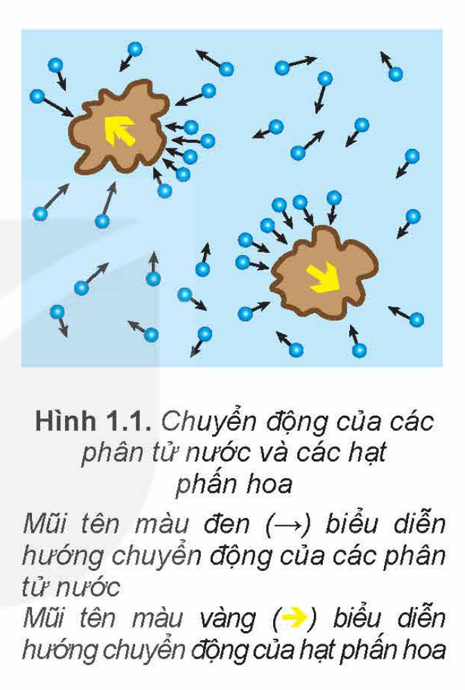
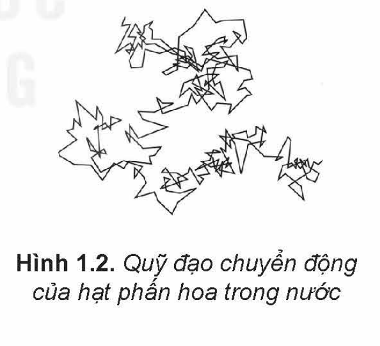
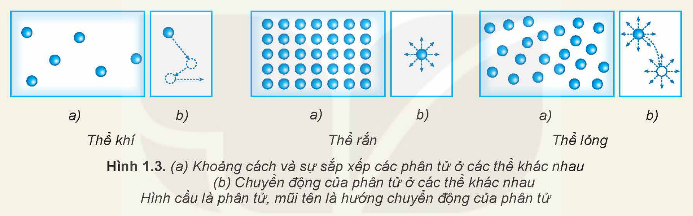
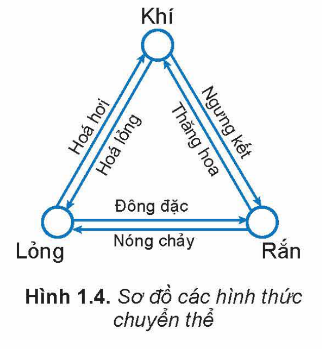
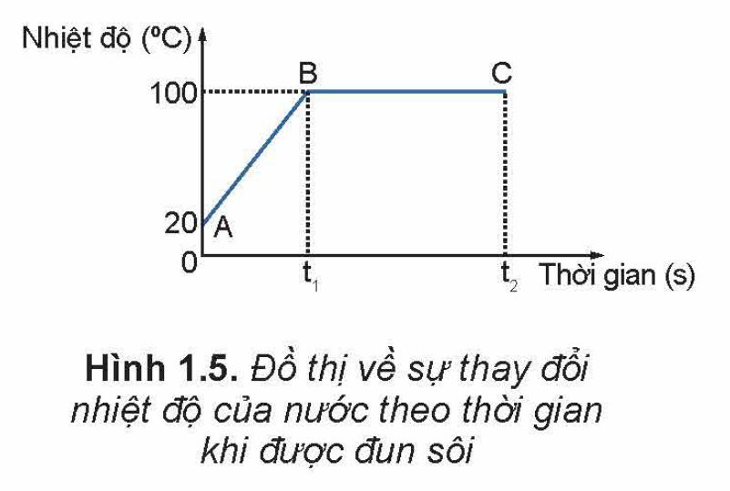
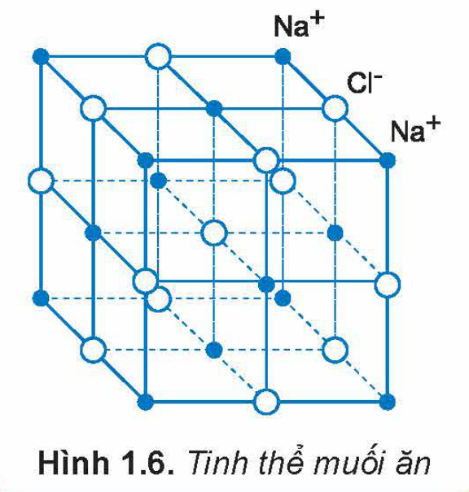
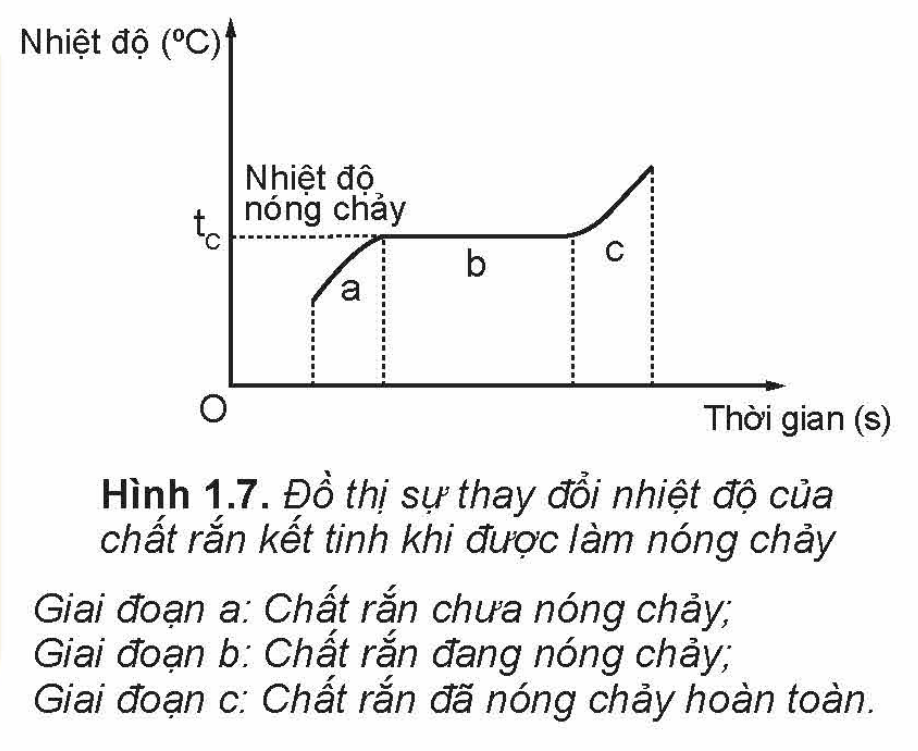
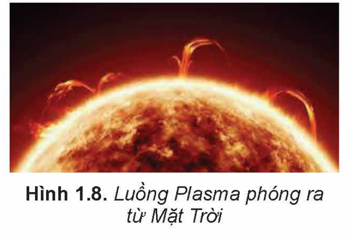

<!-- pdf:8 -->

# BÀI 1: CẤU TRÚC CỦA CHẤT. SỰ CHUYỂN THỂ

## 🔴 Mở đầu

> Hãy dựa trên những kiến thức đã học về cấu tạo chất để giải thích tại sao cùng một chất lại có thể tồn tại ở các thể khác nhau là rắn, lỏng, khí.
<!-- ocr-ok: đối chiếu ảnh trang PDF 8 khớp nguyên văn (OCR bỏ sót hộp mở đầu) -->

## I. MÔ HÌNH ĐỘNG HỌC PHÂN TỬ VỀ CẤU TẠO CHẤT

Mô hình động học phân tử về cấu tạo chất có những nội dung cơ bản sau đây:
<!-- term: Mô hình động học phân tử về cấu tạo chất -->

1. Các chất được cấu tạo từ các hạt riêng biệt là **phân tử**.
2. Các phân tử chuyển động không ngừng. Nhiệt độ của vật càng cao thì tốc độ chuyển động của các phân tử cấu tạo nên vật càng lớn.
3. Giữa các phân tử có lực hút và đẩy gọi chung là **lực liên kết phân tử**.
<!-- term: Mô hình động học phân tử về cấu tạo chất -->

*Dùng mô hình này có thể giải thích được cấu trúc của các chất rắn, chất lỏng, chất khí và sự chuyển thể.*

> **Lưu ý:** Thuật ngữ **phân tử** trong mô hình trên được dùng để chỉ chung các hạt cấu tạo chất: phân tử, nguyên tử, ion.

> **Hoạt động:**
>
> 1. Trong lịch sử phát triển của khoa học, có hai quan điểm khác nhau về cấu tạo chất là quan điểm chất có cấu tạo liên tục và chất có cấu tạo gián đoạn. Mô hình động học phân tử được xây dựng trên quan điểm nào?
> 2. Năm 1827, khi làm thí nghiệm quan sát các hạt phấn hoa rất nhỏ trong nước bằng kính hiển vi, Brown thấy chúng chuyển động hỗn loạn, không ngừng (Hình 1.1 và Hình 1.2). Chuyển động này được gọi là **chuyển động Brown**.
>    a) Tại sao thí nghiệm của Brown được coi là một trong những thí nghiệm chứng tỏ các phân tử chuyển động hỗn loạn, không ngừng?
>    b) Làm thế nào để với thí nghiệm của Brown có thể chứng tỏ được khi nhiệt độ của nước càng cao thì các phân tử nước chuyển động càng nhanh?
> 3. Hãy tìm các hiện tượng thực tế chứng tỏ giữa các phân tử có lực đẩy, lực hút.

> **Lưu ý:** Người ta thường gọi chuyển động hỗn loạn, không ngừng của các hạt rất nhỏ dưới tác dụng của các phân tử chất lỏng hoặc chất khí là **chuyển động Brown**.

<!-- pdf:9 -->

## II. CẤU TRÚC CỦA CHẤT RẮN, CHẤT LỎNG VÀ CHẤT KHÍ

Dựa vào các đặc điểm sau đây của phân tử có thể nêu được sơ lược cấu trúc của hầu hết các chất rắn, chất lỏng, chất khí:

- Khoảng cách giữa các phân tử càng lớn thì lực liên kết giữa chúng càng yếu.
- Các phân tử sắp xếp có trật tự thì lực liên kết giữa chúng mạnh.

> **Hoạt động:**
>
> 1. Hãy dựa vào Hình 1.3 để mô tả, so sánh khoảng cách và sự sắp xếp (a), chuyển động (b) của phân tử ở các thể khác nhau. Từ đó mô tả một cách sơ lược về cấu trúc của chất rắn, chất lỏng, chất khí.
>
> 
>
> 2. Hãy giải thích các đặc điểm sau đây của thể khí, thể rắn, thể lỏng.
>    a) Chất khí không có hình dạng và thể tích riêng, luôn chiếm toàn bộ thể tích bình chứa và có thể nén được dễ dàng.
>    b) Vật ở thể rắn có thể tích và hình dạng riêng, rất khó nén.
>    c) Vật ở thể lỏng có thể tích riêng nhưng không có hình dạng riêng.
<!-- term: Thể rắn -->
<!-- term: Thể lỏng -->
<!-- term: Thể khí -->

## III. SỰ CHUYỂN THỂ

### 1. Sự chuyển thể

Các chất có thể chuyển từ thể này sang thể khác. Đa số các chất ở thể rắn khi nóng lên có thể chuyển sang thể lỏng, rồi từ thể lỏng sang thể khí. Ngược lại, đa số chất khí khi lạnh đi có thể chuyển sang thể lỏng, rồi từ thể lỏng sang thể rắn. Một số chất có thể chuyển trực tiếp từ thể rắn sang thể khí và ngược lại (Hình 1.4).
<!-- term: Sự chuyển thể -->

<!-- pdf:10 -->

### 2. Dùng mô hình động học phân tử giải thích sự chuyển thể

Dựa vào đặc điểm của mô hình động học phân tử có thể giải thích sơ lược các hiện tượng liên quan đến sự chuyển thể như sự hoá hơi, sự nóng chảy:

Trong khi chuyển động hỗn loạn, các phân tử có thể va chạm vào nhau, truyền năng lượng cho nhau. Càng nhận được nhiều năng lượng thì các phân tử chuyển động hỗn loạn càng nhanh, khoảng cách trung bình giữa chúng càng tăng, lực liên kết giữa chúng càng yếu.

**a) Giải thích sự hoá hơi**

Sự hoá hơi có thể xảy ra dưới hai hình thức là bay hơi và sôi.
<!-- term: Sự hoá hơi -->

- **Sự bay hơi** là sự hoá hơi xảy ra ở mặt thoáng của chất lỏng. Nước đựng trong một cốc không đậy kín cạn dần là một ví dụ về sự bay hơi.
  Do các phân tử chuyển động hỗn loạn có thể va chạm vào nhau, truyền năng lượng cho nhau nên có một số phân tử ở gần mặt thoáng của chất lỏng có thể có động năng đủ lớn để thắng lực liên kết của các phân tử chất lỏng khác, thoát được ra khỏi mặt thoáng của chất lỏng trở thành các phân tử ở thể hơi.
- **Sự sôi**: Hình 1.5 là đồ thị biểu diễn sự thay đổi nhiệt độ của nước theo thời gian khi được đun nóng. Khi nhiệt độ của nước tăng tới khoảng $100\text{ }^\circ\text{C}$ dưới áp suất tiêu chuẩn ($1,01 \cdot 10^5\text{ Pa}$) thì nước bắt đầu sôi. Khi đó các bọt chứa không khí và hơi nước nổi lên trong lòng nước càng ngày càng nhiều, càng nổi lên trên thể tích các bọt khí này càng tăng, tới mặt thoáng thì vỡ, không khí và hơi nước thoát ra ngoài khí quyển. Do đó **sự sôi** là sự hoá hơi xảy ra đồng thời ở bên trong và trên mặt thoáng của chất lỏng.

> **Câu hỏi:** Tại sao khi bay hơi nhiệt độ của chất lỏng giảm?

> **Hoạt động:**
>
> 1. Hãy dựa vào đồ thị ở Hình 1.5 để mô tả sự thay đổi nhiệt độ của nước khi được đun từ $20\text{ }^\circ\text{C}$ tới khi sôi.
> 2. Khi nước đang sôi thì năng lượng mà nước nhận được từ nguồn nhiệt có được chuyển hoá thành động năng của các phân tử nước không? Tại sao?

> **Em có biết:**
>
> **Chất rắn kết tinh và chất rắn vô định hình**
>
> **Chất rắn kết tinh** là chất mà các hạt (phân tử, nguyên tử, ion) cấu tạo nên nó ở thể rắn, liên kết với nhau một cách chặt chẽ, sắp xếp theo một trật tự hình học tuần hoàn tạo thành các **mạng tinh thể** (Hình 1.6). **Chất rắn vô định hình** là chất ở thể rắn mà các hạt tạo nên nó không tạo thành mạng tinh thể.
>
> Hầu hết các kim loại là các chất kết tinh; thuỷ tinh, nhựa đường, các chất dẻo,... là các chất vô định hình.
>
> Mỗi chất rắn kết tinh có nhiệt độ nóng chảy (hoặc đông đặc) riêng xác định.
>
> 

<!-- pdf:11 -->

**b) Giải thích sự nóng chảy của chất rắn kết tinh**

> **Hoạt động:**
>
> 1. Tại sao chất rắn kết tinh khi được đun nóng có thể chuyển thành chất lỏng?
> 2. a) Hãy dựa vào Hình 1.7 để mô tả quá trình nóng chảy của chất kết tinh.
>    b) Giải thích tại sao khi đang nóng chảy, nhiệt độ của chất rắn kết tinh không tăng dù vẫn nhận được nhiệt năng. Năng lượng mà chất rắn kết tinh nhận được lúc này dùng để làm gì?

## 📌 Em đã học

- Mô hình động học phân tử về cấu tạo chất:
  - Các chất được cấu tạo từ các hạt riêng biệt là phân tử.
  - Các phân tử chuyển động không ngừng. Nhiệt độ của vật càng cao thì tốc độ trung bình của các phân tử càng lớn.
  - Giữa các phân tử có lực liên kết phân tử.
- Các chất có thể chuyển từ thể này sang thể khác.

## ✏️ Em có thể

- Giải thích được sự khác nhau giữa các thể của chất và cơ chế của sự chuyển thể.
- Tìm hiểu và trình bày được vai trò của sự chuyển thể đối với cuộc sống con người như vòng tuần hoàn nước, công nghệ đúc,...

> **Em có biết:**
>
> Ở nhiệt độ hàng triệu độ, chất không tồn tại ở các thể rắn, lỏng, khí mà ở một thể đặc biệt gọi là **Plasma**. Ở thể này, chất không tồn tại dưới dạng các nguyên tử, phân tử mà dưới dạng các ion. Plasma rất ít gặp trên Trái Đất nhưng trong vũ trụ có tới trên $99\%$ các chất tồn tại ở thể Plasma (Hình 1.8).
>
> 

## 📷 Danh sách hình trong bài

| Mã hình | Số hình SGK | Trang PDF | Chú thích |
| --- | --- | --- | --- |
| H12-vat_ly-b01-01 | Hình 1.1 | 8 | Chuyển động của các phân tử nước và các hạt phấn hoa |
| H12-vat_ly-b01-02 | Hình 1.2 | 8 | Quỹ đạo chuyển động của hạt phấn hoa trong nước |
| H12-vat_ly-b01-03 | Hình 1.3 | 9 | (a) Khoảng cách và sự sắp xếp các phân tử ở các thể khác nhau; (b) Chuyển động của phân tử ở các thể khác nhau |
| H12-vat_ly-b01-04 | Hình 1.4 | 9 | Sơ đồ các hình thức chuyển thể |
| H12-vat_ly-b01-05 | Hình 1.5 | 10 | Đồ thị về sự thay đổi nhiệt độ của nước theo thời gian khi được đun sôi |
| H12-vat_ly-b01-06 | Hình 1.6 | 10 | Tinh thể muối ăn |
| H12-vat_ly-b01-07 | Hình 1.7 | 11 | Đồ thị sự thay đổi nhiệt độ của chất rắn kết tinh khi được làm nóng chảy |
| H12-vat_ly-b01-08 | Hình 1.8 | 11 | Luồng Plasma phóng ra từ Mặt Trời |
