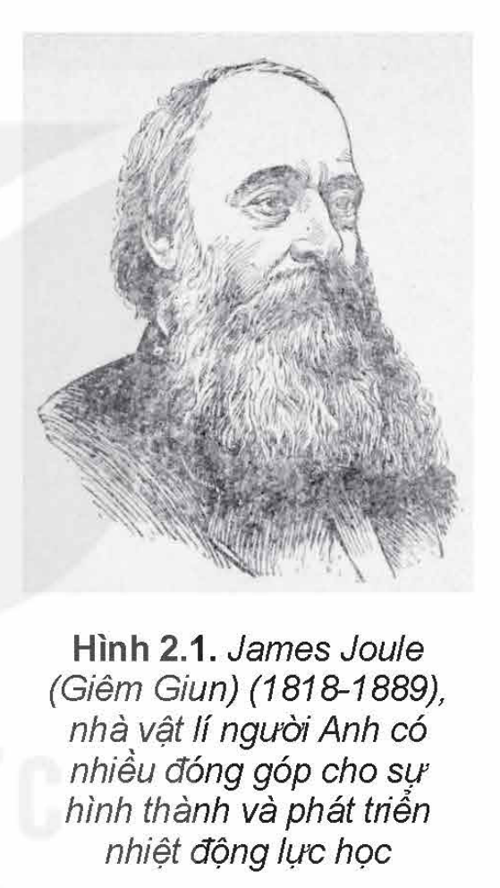
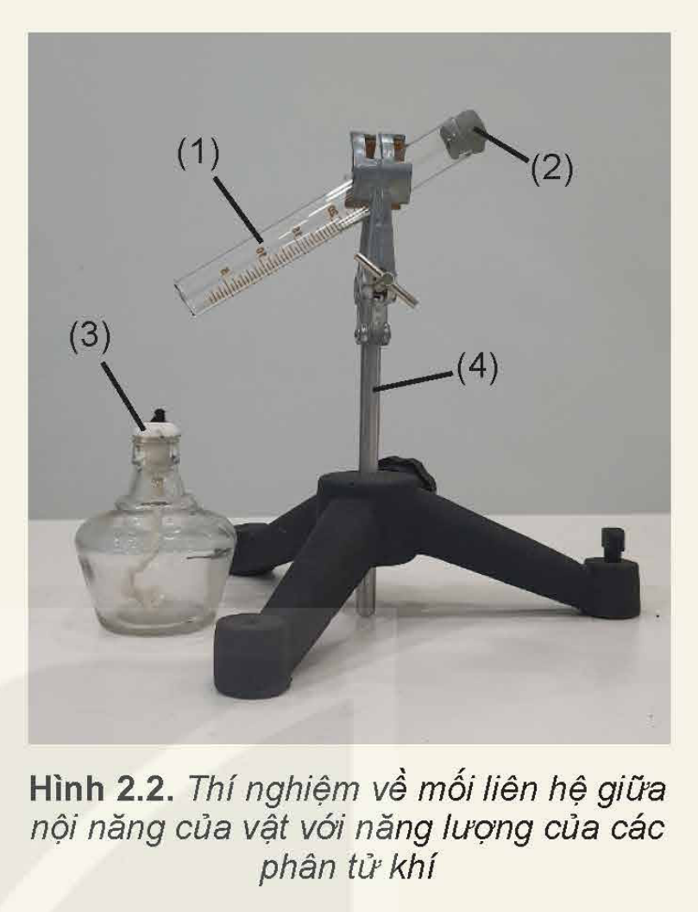
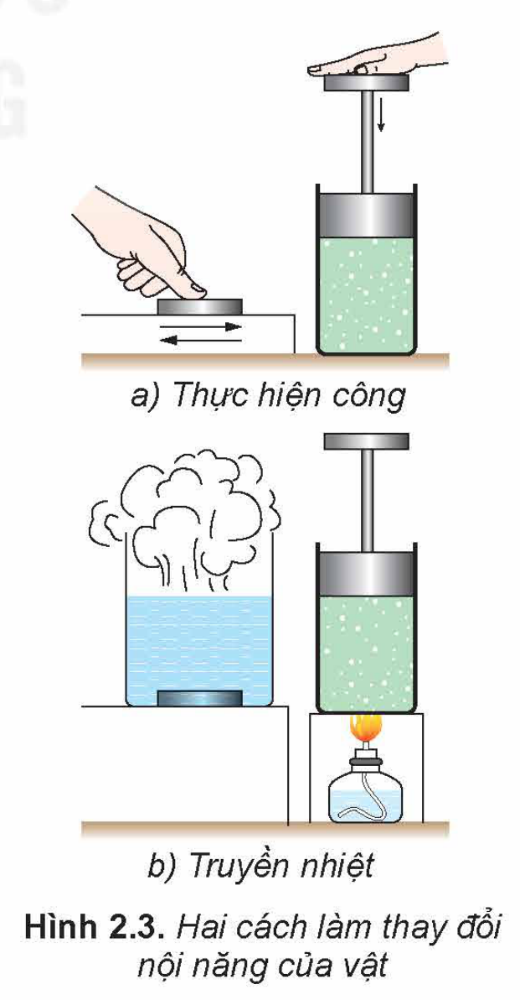
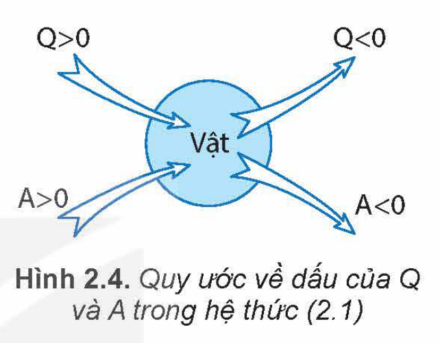
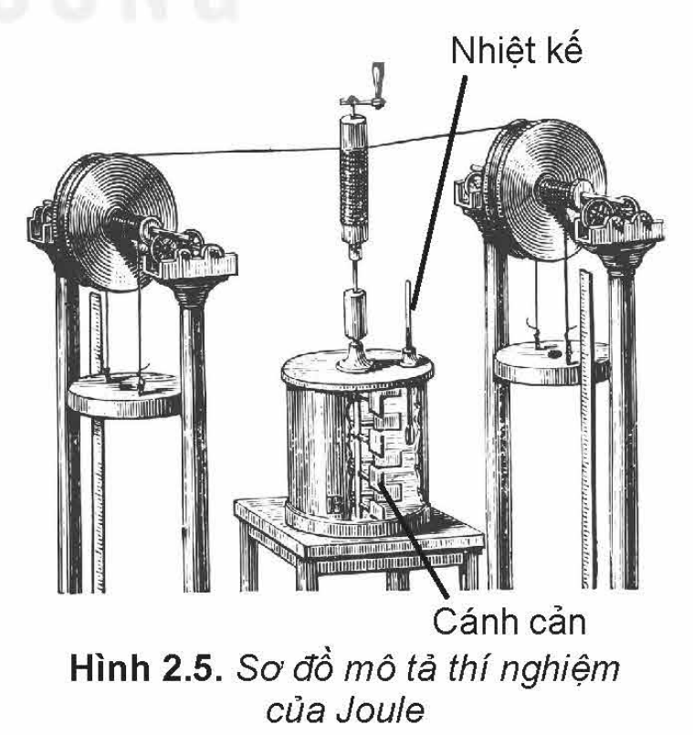
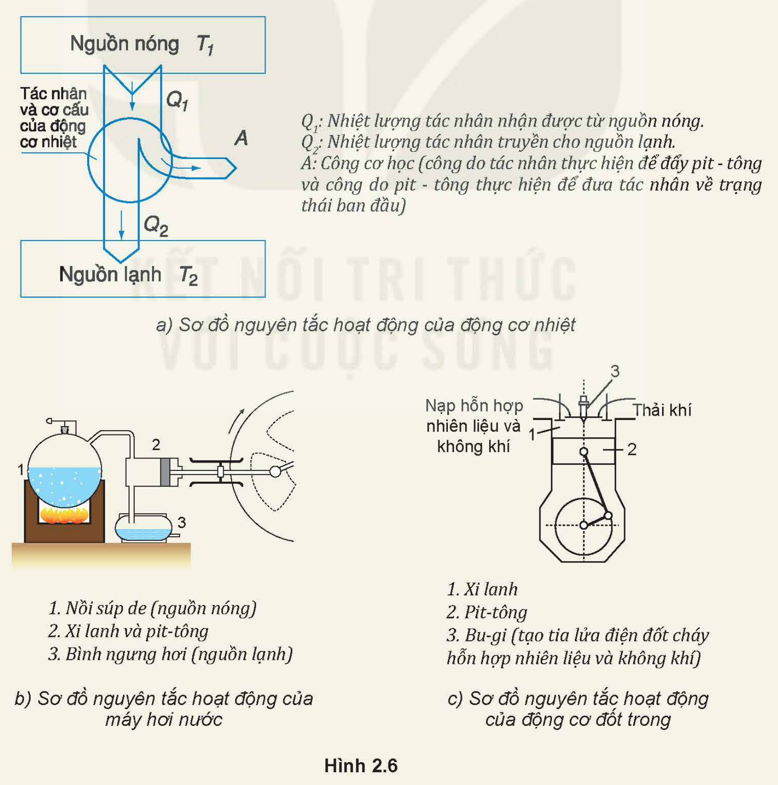

<!-- pdf:12 -->

# BÀI 2: NỘI NĂNG. ĐỊNH LUẬT I CỦA NHIỆT ĐỘNG LỰC HỌC

## 🔴 Mở đầu

> Khi nước được đun tới lúc bắt đầu sôi thì dù có tiếp tục đun, nhiệt độ của nước cũng không thay đổi. Vậy nhiệt năng mà nước nhận được lúc này làm tăng dạng năng lượng nào của nước?

## I. KHÁI NIỆM NỘI NĂNG

### 1. Nội năng của một vật

Vì các phân tử chuyển động không ngừng nên chúng có động năng. Động năng này được gọi là **động năng phân tử**. Động năng phân tử phụ thuộc vào tốc độ chuyển động của phân tử.

Vì các phân tử tương tác với nhau nên chúng có thế năng. Thế năng này được gọi là **thế năng tương tác phân tử**, gọi tắt là **thế năng phân tử**. Thế năng phân tử phụ thuộc vào khoảng cách giữa các phân tử.

Tổng động năng và thế năng của các phân tử cấu tạo nên vật được gọi là **nội năng** của vật. Nội năng được kí hiệu bằng chữ $U$ và có đơn vị là jun (J).

Nội năng của một vật phụ thuộc vào nhiệt độ và thể tích của vật.

> **Câu hỏi:** Tại sao nội năng của vật lại phụ thuộc vào nhiệt độ và thể tích của vật?

> **Lưu ý:**
>
> 1. Vì các phân tử cấu tạo nên vật chuyển động không ngừng nên tốc độ và khoảng cách giữa các phân tử luôn thay đổi làm cho động năng và cả thế năng của các phân tử cũng không ngừng thay đổi. Do đó, khi nói động năng và thế năng của phân tử thì phải hiểu đó là *động năng và thế năng trung bình* của các phân tử cấu tạo nên vật.
> 2. Vì số phân tử trong một vật vô cùng lớn và các phân tử chuyển động hỗn loạn nên không thể xác định được chính xác độ lớn nội năng của một vật. Trong vật lí người ta chủ yếu quan tâm đến **độ biến thiên nội năng** ($\Delta U$) của vật.

> **Em có biết:**
>
> 
>
> **Nhiệt động lực học** là lĩnh vực vật lí nghiên cứu về năng lượng nhiệt và sự truyền nhiệt. Nhiệt động lực học ra đời vào giữa thế kỉ XIX trong quá trình con người tìm hiểu về sự chuyển hoá năng lượng dự trữ trong các nhiên liệu thành cơ năng để chế tạo các động cơ nhiệt.

<!-- pdf:13 -->

### 2. Thí nghiệm về mối liên hệ nội năng của vật với năng lượng của các phân tử cấu tạo nên vật

> **Hoạt động:**
>
> Thí nghiệm sau đây cho thấy mối liên hệ giữa nội năng của vật với năng lượng của các phân tử cấu tạo nên vật.
>
> *Chuẩn bị:*
> - Ống nghiệm (1).
> - Nút bấc có kích thước vừa khít miệng ống nghiệm (2).
> - Đèn cồn (3).
> - Giá đỡ thí nghiệm (4).
>
> *Tiến hành:*
> - Bố trí thí nghiệm như Hình 2.2.
> - Dùng đèn cồn đun nóng ống nghiệm cho đến khi nút bấc bật ra.
>
> 
>
> *Thực hiện các yêu cầu sau:*
> 1. Khi đun ống nghiệm tới một lúc nào đó thì thấy nút bấc bật ra. Giải thích vì sao nút bấc bật ra.
> 2. Khi nút chưa bị bật ra:
>    a) Nội năng của không khí trong ống nghiệm tăng hay giảm? Vì sao?
>    b) Nội năng của không khí trong ống nghiệm tăng có phải do thế năng phân tử khí tăng không? Tại sao?
>    c) Tại sao hiện tượng nút ống nghiệm bị bật ra lại chứng tỏ động năng của các phân tử khí trong ống nghiệm tăng?

## II. ĐỊNH LUẬT I CỦA NHIỆT ĐỘNG LỰC HỌC

### 1. Cách làm thay đổi nội năng

Có hai cách làm thay đổi nội năng là *thực hiện công* và *truyền năng lượng nhiệt* (gọi tắt là truyền nhiệt).
<!-- term: Thực hiện công -->
<!-- term: Truyền nhiệt -->

- Ví dụ về thực hiện công: Khi dùng tay thực hiện công cọ xát một miếng kim loại lên sàn nhà thì miếng kim loại nóng lên, nội năng của nó đã thay đổi.
- Ví dụ về truyền nhiệt: Cũng có thể làm miếng kim loại nóng lên bằng cách cho nó tiếp xúc với một nguồn nhiệt. Khi đó nội năng của nó cũng thay đổi.
<!-- term: Thực hiện công -->
<!-- term: Truyền nhiệt -->

> **Câu hỏi:**
>
> 1. Mô tả sự thay đổi nội năng của lượng khí trong xi lanh ở Hình 2.3.
> 2. Tìm thêm ví dụ về thực hiện công và truyền nhiệt làm thay đổi nội năng của vật.

<!-- pdf:14 -->

### 2. Định luật I của nhiệt động lực học

**Định luật I của nhiệt động lực học** là sự vận dụng định luật bảo toàn năng lượng vào các quá trình thay đổi nội năng.

Nếu vật vừa nhận được công vừa được truyền nhiệt thì: ***Độ biến thiên nội năng** của vật bằng tổng công và nhiệt lượng mà vật nhận được:*

$\Delta U = A + Q \quad (2.1)$

Với quy ước về dấu thích hợp thì hệ thức trên có thể áp dụng cho các quá trình thay đổi nội năng khác như vật truyền nhiệt cho vật khác, vật thực hiện công lên vật khác, vật vừa thực hiện công vừa truyền nhiệt cho vật khác.

Quy ước về dấu của $A$ và $Q$ trong hệ thức (2.1):

$Q > 0$: Vật nhận nhiệt lượng từ vật khác.

$Q < 0$: Vật truyền nhiệt lượng cho vật khác.

$A > 0$: Vật nhận công từ vật khác.

$A < 0$: Vật thực hiện công lên vật khác.

> **Lưu ý:** Vật ở đây là vật rắn, khối chất lỏng và khối chất khí.

> **Câu hỏi:**
>
> Các hệ thức sau đây mô tả các quá trình thay đổi nội năng nào?
> 1. $\Delta U = Q$ khi $Q > 0$ và khi $Q < 0$.
> 2. $\Delta U = A$ khi $A > 0$ và khi $A < 0$.
> 3. $\Delta U = A + Q$ khi $Q > 0$ và $A < 0$.
> 4. $\Delta U = A + Q$ khi $Q < 0$ và $A > 0$.
<!-- ocr-ok: đối chiếu ảnh trang PDF 14 khớp nguyên văn -->

> **Lưu ý:**
> - **Nhiệt lượng** là số đo nhiệt năng được truyền từ vật này sang vật khác trong quá trình truyền nhiệt. Khi *không* có quá trình truyền nhiệt thì *không* có nhiệt lượng.
> - Nội năng là một dạng năng lượng. Mọi vật luôn có nội năng.

> **Em có biết:**
>
> **Thí nghiệm minh hoạ định luật I của nhiệt động lực học**
>
> Định luật I của nhiệt động lực học được hình thành từ những thí nghiệm mà nhà vật lí người Anh Joule đã tiến hành trong những năm từ 1844 đến 1854.
>
> Một trong những thí nghiệm này được mô tả ở Hình 2.5. Thí nghiệm cho thấy công $A$ mà nước nhận được từ vật nặng chuyển động làm quay các cánh cản khiến nước nóng lên (nội năng của nước tăng) có độ lớn tương đương với độ tăng nội năng của nước.
>
> 
>
> Vào thời kì đó, người ta chưa đo được phần nhiệt lượng mà nước truyền cho các thiết bị thí nghiệm và môi trường xung quanh. Nếu tính cả phần nhiệt lượng này thì: $\Delta U = A + Q$ với $Q$ có giá trị âm vì vật truyền nhiệt cho môi trường.

<!-- pdf:15 -->

> **Hoạt động:**
>
> Định luật I của nhiệt động lực học có nhiều ứng dụng thực tế, một trong những ứng dụng quan trọng là để chế tạo các loại động cơ nhiệt. Ngoài ra, định luật này còn dùng để giải thích các hiện tượng liên quan đến sự truyền và biến đổi nội năng.
>
> **Động cơ nhiệt** là động cơ hoạt động dựa trên nguyên tắc biến nội năng của nhiên liệu thành cơ năng.
>
> Mỗi động cơ nhiệt đều có ba bộ phận chính (Hình 2.6a):
> - **Nguồn nóng** có nhiệt độ $T_1$ cung cấp nhiệt lượng cho động cơ.
> - Bộ phận phát động trong đó **tác nhân** nhận nhiệt từ nguồn nóng, giãn nở sinh công (Trong máy hơi nước, tác nhân là hơi nước; trong động cơ đốt trong, tác nhân là khí do nhiên liệu bị đốt cháy toả ra trong xi lanh).
> - **Nguồn lạnh** có nhiệt độ $T_2 < T_1$ nhận nhiệt lượng do động cơ toả ra.
>
> Hãy dựa vào các sơ đồ trong Hình 2.6b, c để trình bày sơ lược về cấu tạo và hoạt động của máy hơi nước và động cơ đốt trong.
>
> 

<!-- pdf:16 -->

> **Câu hỏi:**
>
> 1. Nội năng của vật biến đổi như thế nào trong các trường hợp sau:
>    a) Vật rắn đang nóng chảy.
>    b) Nước đá đang tan.
>    c) Hơi nước ngưng tụ ở nhiệt độ không đổi.
> 2. Một vật khối lượng $1\text{ kg}$ trượt không vận tốc ban đầu từ đỉnh xuống chân một mặt phẳng dài $21\text{ m}$, nghiêng $30^\circ$ so với mặt nằm ngang. Tốc độ của vật ở chân mặt phẳng là $4,1\text{ m/s}$. Tính công của lực ma sát và độ biến thiên nội năng của vật trong quá trình chuyển động trên. Lấy $g = 9,8\text{ m/s}^2$. Bỏ qua sự trao đổi nhiệt với mặt phẳng nghiêng.

## 📌 Em đã học

- Tổng động năng và thế năng của các phân tử cấu tạo nên vật được gọi là nội năng của vật. Nội năng được kí hiệu bằng chữ $U$ và có đơn vị là jun (J).
- Có thể làm thay đổi nội năng của vật bằng cách: thực hiện công, truyền nhiệt.
- Định luật I của nhiệt động lực học: Độ biến thiên nội năng của vật bằng tổng công và nhiệt lượng vật nhận được: $\Delta U = A + Q$.
  Quy ước về dấu của $A$ và $Q$:
  $Q > 0$: Vật nhận nhiệt lượng từ vật khác.
  $Q < 0$: Vật truyền nhiệt lượng cho vật khác.
  $A > 0$: Vật nhận công từ vật khác.
  $A < 0$: Vật thực hiện công lên vật khác.

## ✏️ Em có thể

- Dùng mô hình động học phân tử giải thích được một số hiện tượng liên quan đến sự chuyển thể của các chất.
- Dùng khái niệm nội năng và định luật I của nhiệt động lực học để giải thích một số hiện tượng đơn giản như sự chuyển hoá năng lượng trong các quá trình chuyển thể, nguyên tắc hoạt động của động cơ nhiệt (máy hơi nước, động cơ đốt trong).

## 📷 Danh sách hình trong bài

| Mã hình | Số hình SGK | Trang PDF | Chú thích |
| --- | --- | --- | --- |
| H12-vat_ly-b02-01 | Hình 2.1 | 12 | James Joule (Giêm Giun) (1818-1889), nhà vật lí người Anh có nhiều đóng góp cho sự hình thành và phát triển nhiệt động lực học |
| H12-vat_ly-b02-02 | Hình 2.2 | 13 | Thí nghiệm về mối liên hệ giữa nội năng của vật với năng lượng của các phân tử khí |
| H12-vat_ly-b02-03 | Hình 2.3 | 13 | Hai cách làm thay đổi nội năng của vật |
| H12-vat_ly-b02-04 | Hình 2.4 | 14 | Quy ước về dấu của Q và A trong hệ thức (2.1) |
| H12-vat_ly-b02-05 | Hình 2.5 | 14 | Sơ đồ mô tả thí nghiệm của Joule |
| H12-vat_ly-b02-06 | Hình 2.6 | 15 | a) Sơ đồ nguyên tắc hoạt động của động cơ nhiệt; b) Sơ đồ nguyên tắc hoạt động của máy hơi nước; c) Sơ đồ nguyên tắc hoạt động của động cơ đốt trong |
