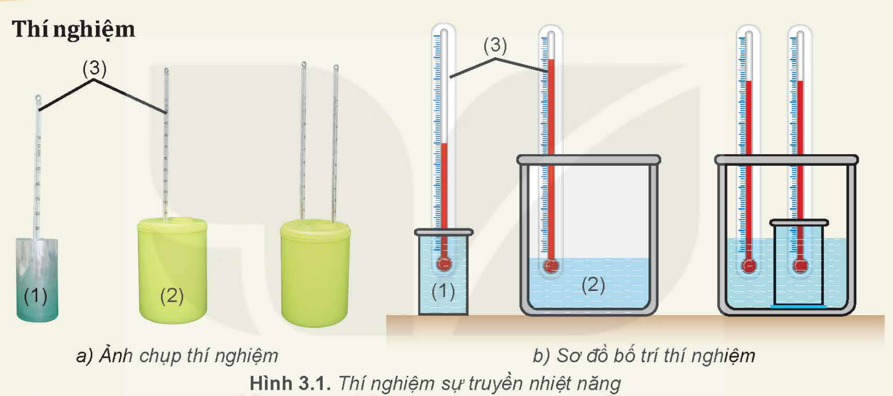
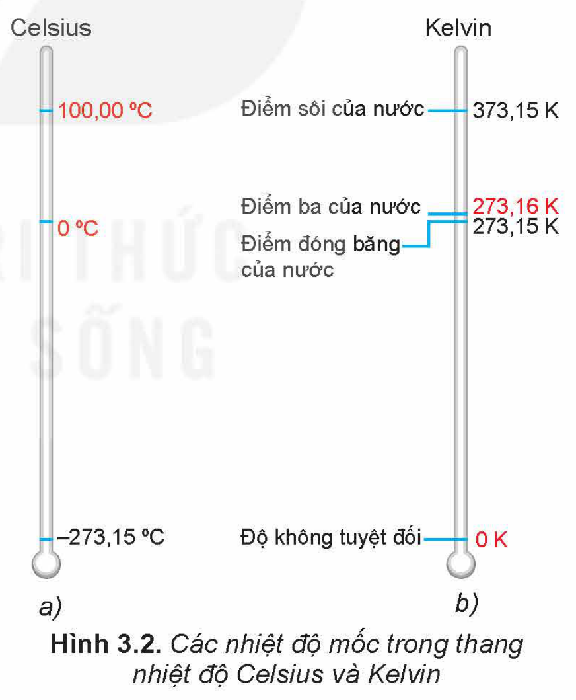
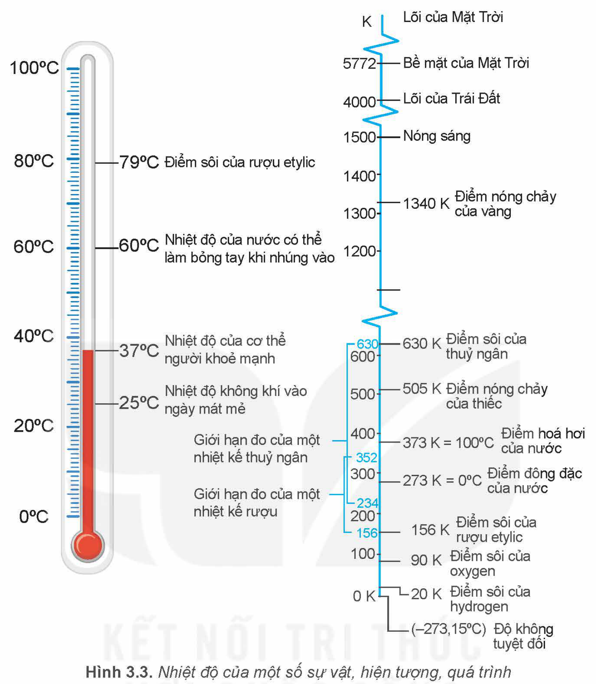

<!-- pdf:17 -->

# BÀI 3: NHIỆT ĐỘ. THANG NHIỆT ĐỘ – NHIỆT KẾ

## 🔴 Mở đầu

> Làm thế nào để nhận biết được sự truyền nhiệt năng giữa các vật? Ví dụ, làm thế nào để nhận biết: "Vật nào là vật truyền nhiệt năng, vật nào là vật nhận nhiệt năng; sự truyền nhiệt năng đã dừng lại hay còn đang tiếp tục;...?"

## I. KHÁI NIỆM NHIỆT ĐỘ

Thí nghiệm sau đây sẽ giúp chúng ta hiểu được ý nghĩa của khái niệm nhiệt độ, nhận biết được khi nào có hoặc không có quá trình truyền nhiệt năng và chiều truyền nhiệt năng giữa hai vật tiếp xúc nhau.

> **Hoạt động:**
>
> **Thí nghiệm**
>
> 
>
> *Chuẩn bị:*
> - Cốc nhôm đựng khoảng $200\text{ mL}$ nước ở nhiệt độ khoảng $30\text{ }^\circ\text{C}$ (1).
> - Bình cách nhiệt đựng khoảng $500\text{ mL}$ nước ở nhiệt độ khoảng $60\text{ }^\circ\text{C}$ (2).
> - Hai nhiệt kế (3).
>
> *Tiến hành:*
> - Đặt cốc nhôm vào trong lòng bình cách nhiệt sao cho nước trong bình cách nhiệt ngập một phần cốc nhôm (Hình 3.1).
> - Quan sát sự thay đổi nhiệt độ của nước trong bình và trong cốc từ khi bắt đầu thí nghiệm tới khi hai nhiệt độ này bằng nhau.
>
> *Trả lời các câu hỏi sau:*
> 1. Tại sao có thể biết nước trong bình truyền nhiệt năng cho nước trong cốc?
> 2. Làm thế nào để nhận biết quá trình truyền nhiệt năng giữa nước trong bình và nước trong cốc đã kết thúc?

Từ kết quả trên có thể rút ra kết luận sau:

**Nhiệt độ** cho biết trạng thái cân bằng nhiệt của các vật tiếp xúc nhau và chiều truyền nhiệt năng:

- Khi hai vật có nhiệt độ chênh lệch tiếp xúc nhau thì nhiệt năng truyền từ vật có nhiệt độ cao hơn sang vật có nhiệt độ thấp hơn.
- Khi hai vật có nhiệt độ bằng nhau tiếp xúc nhau thì không có sự truyền nhiệt năng giữa chúng. Hai vật ở **trạng thái cân bằng nhiệt**.

<!-- pdf:18 -->

> **Câu hỏi:** Có thể nói khi hai vật tiếp xúc với nhau thì nhiệt năng luôn tự truyền từ vật có *nội năng lớn hơn* sang vật có *nội năng nhỏ hơn* hay không? Tại sao? Tìm ví dụ minh hoạ.

## II. THANG NHIỆT ĐỘ – NHIỆT KẾ

### 1. Các thang nhiệt độ

**a) Thang nhiệt độ Celsius**

Thang nhiệt độ chúng ta vẫn dùng hằng ngày là thang Celsius. Hai nhiệt độ dùng làm mốc của thang này là nhiệt độ đóng băng và nhiệt độ sôi của nước tinh khiết, ở áp suất tiêu chuẩn (Hình 3.2a). Khoảng cách giữa hai nhiệt độ này được chia thành 100 phần bằng nhau, mỗi phần là 1 độ. Vì được chia thành 100 phần bằng nhau nên ban đầu thang nhiệt độ này được gọi là *thang nhiệt độ bách phân* (centigrade).

Năm 1948, Hội đồng quốc tế về trọng lượng và đo lường đã quyết định công nhận thang nhiệt độ này và đổi tên nó thành **thang nhiệt độ Celsius** để vinh danh nhà khoa học Thụy Điển Anders Celsius (An-đơ Xen-si-út) (1701–1774), người đầu tiên xây dựng thang nhiệt độ này vào năm 1742.

Nhiệt độ trong thang Celsius thường được kí hiệu bằng chữ $t$, đơn vị là độ C ($^\circ\text{C}$). Các nhiệt độ cao hơn $0\text{ }^\circ\text{C}$ có giá trị dương, thấp hơn $0\text{ }^\circ\text{C}$ có giá trị âm.

Hiện nay, hầu hết các nước trên thế giới đều sử dụng thang nhiệt độ này, trừ một số nước nói tiếng Anh vẫn sử dụng **thang nhiệt độ Fahrenheit** do nhà khoa học người Đức Gabriel Fahrenheit (Ga-bri-en Pha-ren-hai) (1686 – 1736) xây dựng năm 1714.

**b) Thang nhiệt độ Kelvin**

Năm 1848, nhà vật lí người Ireland là William Thomson (Wi-li-am Tôm-sơn) – Nam tước Kelvin thứ nhất (1824 – 1907) đề xuất một thang nhiệt độ trong đó mọi nhiệt độ đều có giá trị dương. Hai nhiệt độ được dùng làm mốc là:

1. Nhiệt độ thấp nhất mà các vật có thể có. Không có vật ở bất kì trạng thái nào có thể có nhiệt độ thấp hơn nhiệt độ này. Nhiệt độ này được gọi là "**Độ không tuyệt đối**" vì thế thang nhiệt độ này được gọi là **Thang nhiệt độ tuyệt đối**. Ở nhiệt độ không tuyệt đối, tất cả các chất đều có động năng chuyển động nhiệt của các phân tử bằng $0$ và thế năng của chúng là tối thiểu. Người ta xác định được giá trị của độ không tuyệt đối trong thang Celsius là $-273,15\text{ }^\circ\text{C}$. Cách xác định và ý nghĩa của độ không tuyệt đối sẽ được giới thiệu trong bài Định luật Charles (Bài 10) ở chương sau.
2. Nhiệt độ mà nước tinh khiết có thể tồn tại đồng thời ở cả ba thể rắn, lỏng và hơi, trong trạng thái cân bằng nhiệt ở áp suất tiêu chuẩn (nhiệt độ này có độ lớn là $0,01\text{ }^\circ\text{C}$), được gọi là **nhiệt độ điểm ba của nước** (Hình 3.2b).

<!-- pdf:19 -->

Hình 3.2 cho thấy mối quan hệ giữa các nhiệt độ của mốc trong thang nhiệt độ Celsius và Kelvin.

Năm 1954, Hội đồng quốc tế về trọng lượng và đo lường đã chính thức công nhận thang nhiệt độ tuyệt đối, gọi thang này là **thang nhiệt độ Kelvin**, nhiệt độ trong thang được gọi là **nhiệt độ nhiệt động lực học**, có đơn vị đo là Kelvin (K). Mỗi độ chia ($1\text{ K}$) trong thang nhiệt độ Kelvin có độ lớn bằng $\frac{1}{273,16}$ khoảng cách giữa hai nhiệt độ mốc của thang nhiệt độ này.

> **Hoạt động:**
>
> Hình 3.3 giới thiệu nhiệt độ của một số sự vật, hiện tượng, quá trình.
> 1. Nhiệt độ không tuyệt đối là nhiệt độ nào trong hai thang nhiệt độ Celsius và Kelvin?
> 2. Nêu ý nghĩa của nhiệt độ không tuyệt đối.
> 3. Hãy dựa vào bảng so sánh hai thang nhiệt độ Celsius và Kelvin ở Hình 3.2 để chứng minh rằng: mỗi độ chia ($1\text{ }^\circ\text{C}$) trong thang nhiệt độ Celsius có độ lớn bằng 1 độ chia ($1\text{ K}$) trong thang nhiệt độ Kelvin.
> 4. Chứng minh công thức chuyển nhiệt độ từ thang Celsius sang thang Kelvin và ngược lại:
>    $t\text{ }(^\circ\text{C}) = T\text{ (K)} - 273,15$
>    $T\text{ (K)} = t\text{ }(^\circ\text{C}) + 273,15.$

<!-- pdf:20 -->

> **Lưu ý:** Người ta thường làm tròn số như sau:
> $t\text{ }(^\circ\text{C}) = T\text{ (K)} - 273 \quad (1)$
> $T\text{ (K)} = t\text{ }(^\circ\text{C}) + 273 \quad (2)$
<!-- ocr-ok: đối chiếu ảnh trang PDF 20 khớp nguyên văn -->

> **Câu hỏi:**
>
> 1. Chuyển đổi nhiệt độ:
>    a) Từ thang Celsius sang thang Kelvin: $270\text{ }^\circ\text{C}$; $-270\text{ }^\circ\text{C}$; $500\text{ }^\circ\text{C}$.
>    b) Từ thang Kelvin sang thang Celsius: $0\text{ K}$; $500\text{ K}$; $1\text{ }000\text{ K}$.
> 2. Một vật được làm lạnh từ $100\text{ }^\circ\text{C}$ xuống $0\text{ }^\circ\text{C}$. Hỏi nhiệt độ của vật theo thang Kelvin giảm đi bao nhiêu độ?
> 3. Thang nhiệt độ Kelvin có những ưu điểm gì so với thang nhiệt độ Celsius?

> **Em có biết:**
>
> 1. Một số nước nói tiếng Anh còn sử dụng **thang nhiệt độ Fahrenheit**. Trong thang này, nhiệt độ của nước đá đang tan là $32\text{ }^\circ\text{F}$, của nước đang sôi là $212\text{ }^\circ\text{F}$.
>    Công thức chuyển đổi:
>    $t\text{ }(^\circ\text{F}) = 32 + 1,8t\text{ }(^\circ\text{C}).$
> 2. Trong nhiệt động lực học người ta coi **nhiệt độ** là đại lượng đặc trưng cho động năng trung bình của **chuyển động nhiệt** của phân tử. Động năng trung bình của các phân tử cấu tạo nên vật càng lớn thì nhiệt độ của vật càng cao.

### 2. Nhiệt kế

**Nhiệt kế** là thiết bị dùng để đo nhiệt độ. Nhiệt kế được chế tạo dựa trên một số tính chất vật lí phụ thuộc vào nhiệt độ của các chất, các vật liệu, các linh kiện điện và điện tử,...

Tính chất vật lí được sử dụng nhiều trong trong việc chế tạo nhiệt kế là sự nở vì nhiệt.

Các nhiệt kế thường dùng là các nhiệt kế được chế tạo dựa trên sự nở dài của cột chất lỏng trong ống thuỷ tinh (nhiệt kế rượu, nhiệt kế thuỷ ngân, nhiệt kế dầu). Sự nở dài của một thanh kim loại mỏng thẳng hoặc xoắn ốc được dùng trong việc chế tạo các loại nhiệt kế kim loại; sự nở vì nhiệt của thể tích một lượng khí xác định ở áp suất không đổi được dùng để chế tạo các loại nhiệt kế khí.

> **Em có biết:**
>
> Các tính chất vật lí sau đây cũng đang được sử dụng một cách rộng rãi trong việc chế tạo nhiệt kế:
> - Sự phụ thuộc vào nhiệt độ của điện trở (nhất là điện trở nhiệt) theo các hệ thức khác nhau tuỳ theo phạm vi nhiệt độ cần đo và vật liệu làm điện trở. Ví dụ, trong phạm vi từ $0\text{ }^\circ\text{C}$ đến $600\text{ }^\circ\text{C}$ thì điện trở của một dây platin phụ thuộc vào nhiệt độ theo hệ thức $R_t = R_0(1 + At + Bt^2)$, trong đó các hệ số tỉ lệ $A$ và $B$ phụ thuộc vào cách lắp ráp điện trở.

<!-- pdf:21 -->

> - Sự phụ thuộc vào nhiệt độ của hiệu điện thế **cặp nhiệt điện** ($U = kt$, trong đó hệ số tỉ lệ $k$ thay đổi tuỳ theo loại cặp nhiệt điện).
> - Sự phụ thuộc vào nhiệt độ của bước sóng của sóng điện từ theo hệ thức Wien: $\lambda_{\max} \cdot T = 2\text{ }900\text{ }\mu\text{mK}$ được dùng vào việc chế tạo các nhiệt kế thường dùng hằng ngày như nhiệt kế hồng ngoại, cũng như các nhiệt kế dùng trong thiên văn để đo nhiệt độ bề mặt các thiên thể.
>
> Việc sử dụng các linh kiện điện và điện tử có các tính chất vật lí phụ thuộc vào nhiệt độ để lắp các mạch điện cảm biến trong đó các thay đổi về tính chất của cảm biến theo nhiệt độ được chuyển thành các tín hiệu điện từ đang được sử dụng nhiều trong việc chế tạo các nhiệt kế dùng trong khoa học, kĩ thuật.

## 📌 Em đã học

- Nhiệt độ cho biết trạng thái cân bằng nhiệt của các vật tiếp xúc nhau và chiều truyền nhiệt năng.
  - Khi hai vật có nhiệt độ chênh lệch tiếp xúc nhau thì nhiệt năng truyền từ vật có nhiệt độ cao sang vật có nhiệt độ thấp.
  - Khi hai vật có nhiệt độ bằng nhau tiếp xúc nhau thì chúng ở trạng thái cân bằng nhiệt và không có sự truyền nhiệt năng giữa chúng.
- Thang nhiệt độ Celsius có hai mốc là nhiệt độ đóng băng của nước tinh khiết ($0\text{ }^\circ\text{C}$) và nhiệt độ sôi của nước tinh khiết ($100\text{ }^\circ\text{C}$), ở áp suất tiêu chuẩn. Thang nhiệt độ Kelvin có hai mốc là nhiệt độ thấp nhất mà các vật có thể có được ($0\text{ K}$) và nhiệt độ mà nước tinh khiết có thể tồn tại đồng thời ở cả ba thể rắn, lỏng và hơi ($273,16\text{ K}$).
- Công thức chuyển nhiệt độ từ thang Celsius sang thang Kelvin:
  $T\text{ (K)} = t\text{ }(^\circ\text{C}) + 273$
- Nhiệt kế là thiết bị đo nhiệt độ được chế tạo dựa trên một số tính chất vật lí phụ thuộc vào nhiệt độ.

## ✏️ Em có thể

- Giải thích được các hiện tượng truyền nhiệt năng thường gặp trong đời sống.
- Phân biệt được hai thang nhiệt độ Celsius và Kelvin.
- Chuyển đổi được nhiệt độ Celsius sang nhiệt độ Kelvin và ngược lại.

## 📷 Danh sách hình trong bài

| Mã hình | Số hình SGK | Trang PDF | Chú thích |
| --- | --- | --- | --- |
| H12-vat_ly-b03-01 | Hình 3.1 | 17 | Thí nghiệm sự truyền nhiệt năng |
| H12-vat_ly-b03-02 | Hình 3.2 | 18 | Các nhiệt độ mốc trong thang nhiệt độ Celsius và Kelvin |
| H12-vat_ly-b03-03 | Hình 3.3 | 19 | Nhiệt độ của một số sự vật, hiện tượng, quá trình |
