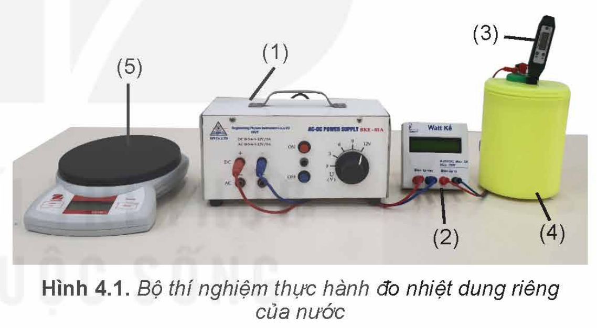
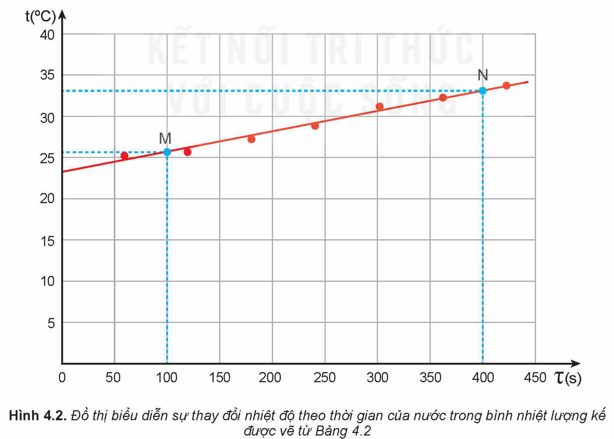

<!-- pdf:22 -->

# BÀI 4: NHIỆT DUNG RIÊNG

## 🔴 Mở đầu

> Nhiệt lượng cần để làm nóng $1\text{ kg}$ nước lên thêm $1\text{ }^\circ\text{C}$ khác với nhiệt lượng cần để làm nóng $1\text{ kg}$ rượu lên thêm $1\text{ }^\circ\text{C}$. Đại lượng vật lí nào có thể dùng để mô tả sự khác biệt như trên của các chất khác nhau?

## I. KHÁI NIỆM NHIỆT DUNG RIÊNG

### 1. Hệ thức tính nhiệt lượng trong quá trình truyền nhiệt để làm thay đổi nhiệt độ của vật

Các hiện tượng quan sát được hằng ngày cho thấy độ lớn của nhiệt lượng cần cung cấp cho vật để làm tăng nhiệt độ của nó phụ thuộc vào các yếu tố sau:

- Khối lượng của vật;
- Độ tăng nhiệt độ của vật;
- Tính chất của chất làm vật.

> **Câu hỏi:** Hãy tìm ví dụ trong đời sống để minh hoạ cho nội dung trên.

*Bảng 4.1. Giá trị gần đúng nhiệt dung riêng của một số chất*

| Chất | Nhiệt dung riêng (J/kg.K) |
| --- | --- |
| Nước | $4\text{ }200$ |
| Nước đá | $2\text{ }100$ |
| Không khí | $1\text{ }000$ |
| Thuỷ tinh | $840$ |
| Đất | $800$ |
| Sắt | $440$ |
| Đồng | $380$ |
| Thuỷ ngân | $140$ |
| Chì | $130$ |
<!-- ocr-ok: đối chiếu ảnh trang PDF 22 khớp nguyên văn -->

Các thí nghiệm chứng tỏ rằng nhiệt lượng $Q$ cần cung cấp cho vật để làm nó nóng lên tỉ lệ thuận với khối lượng $m$ và độ tăng nhiệt độ $\Delta t$ của vật nên:

$\frac{Q}{m\Delta T} = \text{hằng số} \quad (4.1)$

Trong đó: $Q$ là nhiệt lượng cần truyền cho vật (J);

$m$ là khối lượng vật (kg);

$\Delta T$ là độ tăng nhiệt độ của vật (K).

Với mỗi chất, hằng số trong hệ thức trên có độ lớn riêng. Hằng số này gọi là **nhiệt dung riêng** của chất làm vật, kí hiệu là $c$, có giá trị là $c = \frac{Q}{m\Delta T}$ (4.2), đơn vị là $\text{J/kg.K}$.

Do đó, hệ thức tính nhiệt lượng trong quá trình truyền nhiệt để làm thay đổi nhiệt độ của vật là:

$Q = mc\Delta T \quad (4.3)$

### 2. Định nghĩa nhiệt dung riêng

Vì $c = \frac{Q}{m\Delta T}$ nên có thể định nghĩa nhiệt dung riêng của một chất như sau:

<!-- pdf:23 -->

**Nhiệt dung riêng** của một chất là nhiệt lượng cần truyền cho $1\text{ kg}$ chất đó để làm cho nhiệt độ của nó tăng thêm $1\text{ }^\circ\text{C}$.

Nhiệt dung riêng là thông tin quan trọng thường được dùng khi thiết kế các hệ thống làm mát, sưởi ấm,...

> **Hoạt động:**
>
> 1. Biết nhiệt dung riêng của nước lớn gấp hơn hai lần của dầu, tại sao trong bộ tản nhiệt (làm mát) của máy biến thế, người ta lại dùng dầu mà không dùng nước như trong bộ tản nhiệt của động cơ nhiệt?
> 2. Hãy dựa vào giá trị của nhiệt dung riêng của nước và của đất trong Bảng 4.1 để giải thích tại sao ban ngày có gió mát thổi từ biển vào đất liền, ban đêm có gió ấm thổi từ đất liền ra biển.
> 3. Một thùng đựng $20\text{ lít}$ nước ở nhiệt độ $20\text{ }^\circ\text{C}$. Cho khối lượng riêng của nước là $1\text{ }000\text{ kg/m}^3$.
>    a) Tính nhiệt lượng cần truyền cho nước trong thùng để nhiệt độ của nó tăng lên tới $70\text{ }^\circ\text{C}$.
>    b) Tính thời gian truyền nhiệt lượng cần thiết nếu dùng một thiết bị điện có công suất $2,5\text{ kW}$ để đun lượng nước trên. Biết chỉ có $80\%$ điện năng tiêu thụ được dùng để làm nóng nước.

## II. THỰC HÀNH ĐO NHIỆT DUNG RIÊNG CỦA NƯỚC

### 1. Mục đích thí nghiệm

Xác định nhiệt dung riêng của nước.

### 2. Dụng cụ thí nghiệm

- Biến thế nguồn (1).
- Bộ đo công suất nguồn điện (oát kế) có tích hợp chức năng đo thời gian (2).
- Nhiệt kế điện tử hoặc cảm biến nhiệt độ có thang đo từ $-20\text{ }^\circ\text{C}$ đến $110\text{ }^\circ\text{C}$ và độ phân giải$^{(*)}$ nhiệt độ $\pm 0,1\text{ }^\circ\text{C}$ (3).
- Nhiệt lượng kế bằng nhựa có vỏ xốp, kèm dây điện trở (gắn ở mặt trong của nắp bình) (4).
- Cân điện tử (5) (hoặc bình đong).
- Các dây nối.

### 3. Thiết kế phương án thí nghiệm

> **Hoạt động:**
>
> Hãy trả lời các câu hỏi sau:
> - Từ hệ thức (4.3), cho biết cần đo đại lượng nào để xác định nhiệt dung riêng của nước?
> - Nhiệt lượng mà nước trong bình nhiệt lượng kế thu được lấy từ đâu?
> - Xác định nhiệt lượng mà nước thu được bằng cách nào?
> - Mô tả các bước tiến hành thí nghiệm.

$^{(*)}$ **Độ phân giải** là sự thay đổi nhỏ nhất của đại lượng cần đo mà cảm biến có thể phát hiện được.

<!-- pdf:24 -->

### 4. Tiến hành thí nghiệm

- Đổ một lượng nước vào bình nhiệt lượng kế, sao cho toàn bộ dây điện trở chìm trong nước, xác định khối lượng nước này.
- Cắm đầu đo của nhiệt kế vào nhiệt lượng kế.
- Nối oát kế với nhiệt lượng kế và nguồn điện.
- Bật nguồn điện.
- Khuấy liên tục để nước nóng đều. Cứ sau mỗi khoảng thời gian 1 phút, đọc công suất dòng điện từ oát kế, nhiệt độ từ nhiệt kế rồi điền kết quả vào vở theo mẫu tương tự Bảng 4.2.
- Tắt nguồn điện.

*Bảng 4.2. Ví dụ về kết quả thí nghiệm đo nhiệt dung riêng của nước*

*Khối lượng nước $m = 0,15\text{ kg}$*

| Nhiệt độ $t\text{ }(^\circ\text{C})$ | Thời gian $\tau\text{ (s)}$ | Công suất $\mathscr{P}\text{ (W)}$ |
| --- | --- | --- |
| $25,2$ | $60$ | $15,04$ |
| $25,4$ | $120$ | $15,07$ |
| $27,0$ | $180$ | $15,03$ |
| $28,7$ | $240$ | $15,94$ |
| $31,2$ | $300$ | $15,84$ |
| $32,3$ | $360$ | $15,94$ |
| $33,8$ | $420$ | $15,94$ |
<!-- ocr-ok: đối chiếu ảnh trang PDF 24 khớp nguyên văn -->

### 5. Kết quả thí nghiệm

> **Hoạt động:**
>
> - Vẽ đồ thị nhiệt độ $t$ theo thời gian $\tau$ và vẽ đường thẳng đi gần nhất các điểm thực nghiệm (tham khảo Hình 4.2).
> - Chọn hai điểm M, N trên đồ thị, xác định các giá trị thời gian $\tau_\text{M}$, $\tau_\text{N}$ và nhiệt độ $t_\text{M}$, $t_\text{N}$ tương ứng.

<!-- pdf:25 -->

> - Từ kết quả thí nghiệm thu được, thực hiện yêu cầu sau:
>   - Tính giá trị trung bình của công suất dòng điện.
>   - Tính nhiệt dung riêng của nước theo hệ thức:
>     $c_{\text{H}_2\text{O}} = \frac{Q}{m\Delta t} = \frac{\overline{\mathscr{P}}(\tau_\text{N} - \tau_\text{M})}{m(t_\text{N} - t_\text{M})}$
>   - Xác định sai số của phép đo nhiệt dung riêng của nước.
>   - So sánh kết quả đo với nhiệt dung riêng của nước ở Bảng 4.1 và giải thích tại sao có sự sai khác (nếu có).

## 📌 Em đã học

- Nhiệt dung riêng của một chất là nhiệt lượng cần truyền cho $1\text{ kg}$ chất đó để làm cho nhiệt độ của nó tăng thêm $1\text{ }^\circ\text{C}$. Đơn vị của nhiệt dung riêng là: $\text{J/kg.K}$.
- Hệ thức tính nhiệt lượng trong quá trình truyền nhiệt để làm thay đổi nhiệt độ của vật: $Q = mc\Delta T$.
- Cách xác định nhiệt dung riêng của nước.

## ✏️ Em có thể

- Xác định được nhiệt dung riêng của một chất.
- Dùng khái niệm nhiệt dung riêng để giải thích các hiện tượng thực tế có liên quan.

> **Em có biết:**
>
> **Nhiệt dung riêng của nước**
>
> Nước là chất có nhiệt dung riêng lớn hơn nhiều so với các chất lỏng thông thường khác. Nhờ đó, nước có vai trò quan trọng đối với đời sống con người. Khoảng $70\%$ bề mặt của Trái Đất được bao phủ bởi nước. Nhờ có nhiệt dung riêng lớn nên lượng nước này có thể hấp thụ lượng nhiệt khổng lồ của năng lượng mặt trời mà vẫn giữ cho nhiệt độ của bề mặt Trái Đất tăng không nhanh và không nhiều, tạo điều kiện thuận lợi cho sự sống của con người và các sinh vật khác. Cũng nhờ có nhiệt dung riêng lớn mà nước biển nóng lên và nguội đi chậm hơn các vùng đất xung quanh. Do sự ổn định này của nhiệt độ nước biển mà các đảo và các vùng đất ven biển có khí hậu tương đối ôn hoà, thích hợp với con người.
>
> Cũng nhờ có nhiệt dung riêng lớn mà nước thường được dùng trong các thiết bị làm mát của động cơ nhiệt.

## 📷 Danh sách hình trong bài

| Mã hình | Số hình SGK | Trang PDF | Chú thích |
| --- | --- | --- | --- |
| H12-vat_ly-b04-01 | Hình 4.1 | 23 | Bộ thí nghiệm thực hành đo nhiệt dung riêng của nước |
| H12-vat_ly-b04-02 | Hình 4.2 | 24 | Đồ thị biểu diễn sự thay đổi nhiệt độ theo thời gian của nước trong bình nhiệt lượng kế được vẽ từ Bảng 4.2 |
