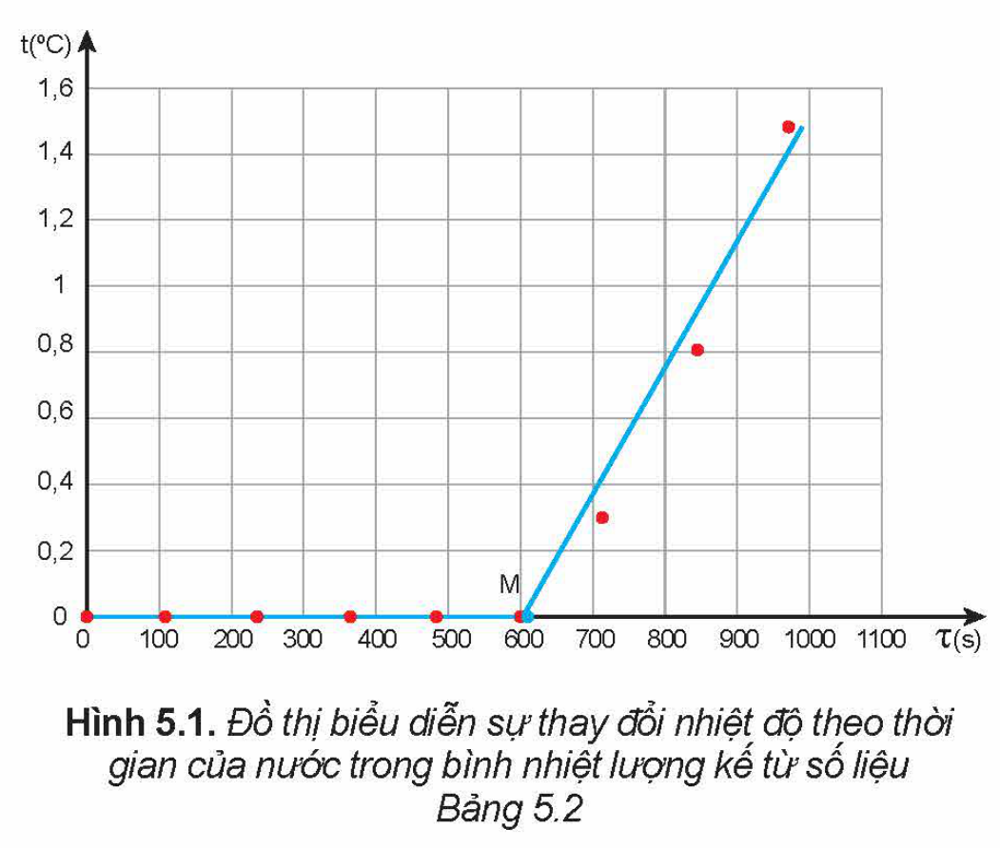

<!-- pdf:26 -->

# BÀI 5: NHIỆT NÓNG CHẢY RIÊNG

## 🔴 Mở đầu

> Khi vật bắt đầu nóng chảy phải tiếp tục cung cấp nhiệt lượng cho vật để vật nóng chảy hoàn toàn. Nhiệt lượng này phụ thuộc vào những đại lượng nào?

## I. KHÁI NIỆM NHIỆT NÓNG CHẢY RIÊNG

### 1. Hệ thức tính nhiệt lượng trong quá trình truyền nhiệt để làm vật nóng chảy hoàn toàn

Nhiệt lượng cần truyền cho vật khi vật bắt đầu nóng chảy tới khi vật nóng chảy hoàn toàn phụ thuộc vào khối lượng của vật và tính chất của chất làm vật.

Thí nghiệm cho thấy nhiệt lượng này tỉ lệ thuận với khối lượng của vật:

$\frac{Q}{m} = \text{hằng số} \quad (5.1)$

Trong đó: $Q$ là nhiệt lượng cần truyền cho vật (J);

$m$ là khối lượng của vật (kg);

Với mỗi chất, hằng số trong hệ thức (5.1) có độ lớn riêng. Hằng số này được gọi là **nhiệt nóng chảy riêng** của chất làm vật, kí hiệu là $\lambda$, có giá trị là $\lambda = \frac{Q}{m}$ (5.2), đơn vị là $\text{J/kg}$.

Do đó, hệ thức tính nhiệt lượng trong quá trình truyền nhiệt để làm vật nóng chảy hoàn toàn là:

$Q = \lambda m \quad (5.3)$

*Bảng 5.1. Giá trị gần đúng của nhiệt nóng chảy riêng ở nhiệt độ nóng chảy dưới áp suất tiêu chuẩn của một số chất*

| Chất | Nhiệt độ nóng chảy ($^\circ\text{C}$) | Nhiệt nóng chảy riêng ($\text{J/kg}$) |
| --- | --- | --- |
| Nước đá | $0$ | $3,34 \cdot 10^5$ |
| Sắt | $1\text{ }535$ | $2,77 \cdot 10^5$ |
| Đồng | $1\text{ }084$ | $1,80 \cdot 10^5$ |
| Chì | $327$ | $0,25 \cdot 10^5$ |
<!-- ocr-ok: đối chiếu ảnh trang PDF 26 khớp nguyên văn -->

### 2. Định nghĩa nhiệt nóng chảy riêng

Vì $\lambda = \frac{Q}{m}$ nên có thể phát biểu định nghĩa nhiệt nóng chảy riêng của một chất như sau: **Nhiệt nóng chảy riêng** của một chất là nhiệt lượng cần để làm cho một kilôgam chất đó nóng chảy hoàn toàn ở nhiệt độ nóng chảy.

Nhiệt nóng chảy riêng và nhiệt độ nóng chảy là những thông tin giúp xác định được năng lượng cần cung cấp cho lò nung, thời gian nung, thời điểm đổ kim loại nóng chảy vào khuôn, thời điểm lấy sản phẩm ra khỏi khuôn. Các đại lượng này cũng cần cho việc lựa chọn vật liệu chế tạo hợp kim phù hợp với từng yêu cầu sử dụng khác nhau, tách các kim loại nguyên chất ra khỏi quặng hỗn hợp,...

> **Câu hỏi:**
>
> 1. Tại sao khi chế tạo các vật bằng chì, đồng, thường hay dùng phương pháp đúc?
> 2. Tính thời gian cần thiết để làm nóng chảy hoàn toàn $2\text{ kg}$ đồng có nhiệt độ ban đầu $30\text{ }^\circ\text{C}$, trong một lò nung điện có công suất $20\text{ }000\text{ W}$. Biết chỉ có $50\%$ năng lượng tiêu thụ của lò được dùng vào việc làm đồng nóng lên và nóng chảy hoàn toàn ở nhiệt độ không đổi.

<!-- pdf:27 -->

## II. THỰC HÀNH ĐO NHIỆT NÓNG CHẢY RIÊNG CỦA NƯỚC ĐÁ

### 1. Mục đích thí nghiệm

Xác định nhiệt nóng chảy riêng của nước đá.

### 2. Dụng cụ thí nghiệm

- Bộ dụng cụ thí nghiệm như bài đo nhiệt dung riêng (Hình 4.1).
- Các viên nước đá nhỏ và nước lạnh.

### 3. Thiết kế phương án thí nghiệm

> **Hoạt động:**
>
> Hãy trả lời các câu hỏi sau:
> - Từ công thức (5.3), hãy cho biết cần đo đại lượng nào để xác định nhiệt nóng chảy riêng của nước đá?
> - Nhiệt lượng làm các viên nước đá trong nhiệt lượng kế nóng chảy được lấy từ đâu?
> - Nhiệt lượng nước đá thu được trong bình nhiệt lượng kế được xác định bằng cách nào?
> - Mô tả các bước tiến hành thí nghiệm.

### 4. Tiến hành thí nghiệm

- Cho viên nước đá (khối lượng $m\text{ kg}$) và một ít nước lạnh vào bình nhiệt lượng kế, sao cho toàn bộ điện trở chìm trong hỗn hợp nước và nước đá.
- Cắm đầu đo của nhiệt kế vào bình nhiệt lượng kế.
- Nối oát kế với nhiệt lượng kế và nguồn điện.
- Bật nguồn điện.
- Khuấy liên tục nước đá, cứ sau mỗi khoảng thời gian 2 phút lại đọc số đo thời gian trên oát kế và nhiệt độ trên nhiệt kế rồi ghi kết quả vào vở theo mẫu tương tự Bảng 5.2.
- Tắt nguồn điện.

*Bảng 5.2. Ví dụ về kết quả thí nghiệm đo nhiệt nóng chảy riêng của nước đá.*

*Khối lượng nước đá $m = 0,25\text{ kg}$*

| Thời gian $\tau\text{ (s)}$ | Nhiệt độ $t\text{ }(^\circ\text{C})$ | Công suất $\mathscr{P}\text{ (W)}$ |
| --- | --- | --- |
| $0$ | $0$ | $14,25$ |
| $120$ | $0$ | $14,23$ |
| $240$ | $0$ | $14,19$ |
| $360$ | $0$ | $14,25$ |
| $480$ | $0$ | $14,23$ |
| $600$ | $0$ | $14,24$ |
| $720$ | $0,3$ | $14,22$ |
| $840$ | $0,8$ | $14,32$ |
| $960$ | $1,5$ | $14,26$ |
<!-- ocr-ok: đối chiếu ảnh trang PDF 27 khớp nguyên văn -->

<!-- pdf:28 -->

### 5. Kết quả thí nghiệm

> **Hoạt động:**
>
> Từ kết quả thí nghiệm thu được thực hiện yêu cầu sau:
> - Vẽ đồ thị sự phụ thuộc nhiệt độ $t$ theo thời gian $\tau$.
> - Vẽ hai đường thẳng đi gần nhất các điểm trên đồ thị (tham khảo Hình 5.1).
> - Chọn điểm M là giao điểm của hai đường thẳng, đọc giá trị $\tau_\text{M}$.
> - Tính công suất trung bình $\overline{\mathscr{P}}$ của dòng điện qua điện trở trong nhiệt lượng kế.
> - Tính nhiệt nóng chảy riêng của nước đá theo công thức:
>   $\lambda_{\text{H}_2\text{O}} = \frac{\overline{\mathscr{P}}\tau_\text{M}}{m}$
>   Trong đó $\overline{\mathscr{P}}\tau_\text{M}$ là nhiệt lượng do dòng điện qua điện trở toả ra trong thời gian $\tau_\text{M}$ và $m$ là khối lượng nước đá.
> - Xác định sai số của phép đo nhiệt nóng chảy riêng của nước đá.
> - So sánh giá trị nhiệt nóng chảy riêng của nước đá đo được với giá trị ở Bảng 5.1 và giải thích nguyên nhân gây ra sự sai khác (nếu có).

## 📌 Em đã học

- Nhiệt nóng chảy riêng của một chất là nhiệt lượng cần để làm cho một kilôgam chất đó nóng chảy hoàn toàn ở nhiệt độ nóng chảy.
- Đơn vị của nhiệt nóng chảy riêng là: $\text{J/kg}$.
- Hệ thức tính nhiệt lượng trong quá trình truyền nhiệt để làm vật nóng chảy hoàn toàn ở nhiệt độ nóng chảy: $Q = \lambda m$.
- Cách xác định nhiệt nóng chảy riêng của nước đá.

## ✏️ Em có thể

- Xác định được nhiệt nóng chảy riêng của một chất.
- Dùng khái niệm nhiệt nóng chảy riêng để giải thích các hiện tượng thực tế có liên quan. Ví dụ: công nghệ phân kim (tách kim loại) bằng nóng chảy, dùng thiếc để hàn,...

## 📷 Danh sách hình trong bài

| Mã hình | Số hình SGK | Trang PDF | Chú thích |
| --- | --- | --- | --- |
| H12-vat_ly-b05-01 | Hình 5.1 | 27 | Đồ thị biểu diễn sự thay đổi nhiệt độ theo thời gian của nước trong bình nhiệt lượng kế từ số liệu Bảng 5.2 |
