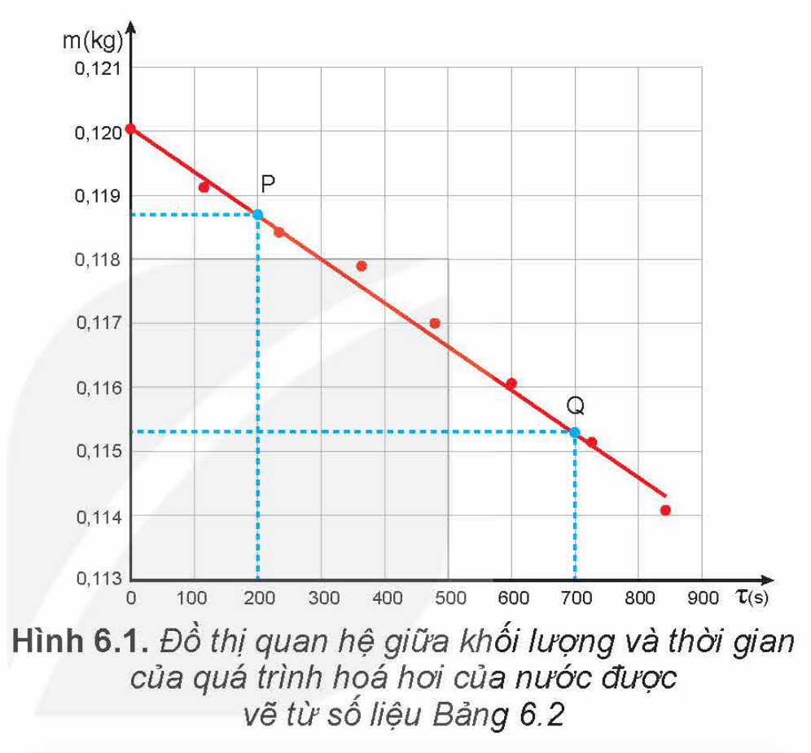

<!-- pdf:29 -->

# BÀI 6: NHIỆT HOÁ HƠI RIÊNG

## 🔴 Mở đầu

> Khi nước bắt đầu sôi, phải tiếp tục cung cấp nhiệt lượng cho nước để nước tiếp tục sôi (hoá hơi). Làm thế nào để xác định được độ lớn của nhiệt lượng làm hoá hơi hoàn toàn một lượng nước ở nhiệt độ không đổi?

## I. KHÁI NIỆM NHIỆT HOÁ HƠI RIÊNG

### 1. Hệ thức tính nhiệt lượng trong quá trình truyền nhiệt khi một lượng chất lỏng hoá hơi ở nhiệt độ không đổi

Nhiệt lượng cần cung cấp cho một lượng chất lỏng hoá hơi ở nhiệt độ không đổi phụ thuộc vào khối lượng và bản chất của chất lỏng. Thí nghiệm cho thấy nhiệt lượng này tỉ lệ thuận với khối lượng của chất lỏng:

$\frac{Q}{m} = \text{hằng số} \quad (6.1)$

Trong đó: $Q$ là nhiệt lượng cần truyền cho chất lỏng (J);

$m$ là khối lượng chất lỏng (kg);

Với mỗi chất lỏng, hằng số trong hệ thức (6.1) có độ lớn riêng. Hằng số này được gọi là **nhiệt hoá hơi riêng** của chất lỏng, kí hiệu là $L$, có giá trị là $L = \frac{Q}{m}$ (6.2), đơn vị là $\text{J/kg}$.

Do đó, hệ thức tính nhiệt lượng cần cung cấp cho một lượng chất lỏng hoá hơi hoàn toàn ở nhiệt độ không đổi là:

$Q = Lm \quad (6.3)$

*Bảng 6.1. Giá trị gần đúng của nhiệt hoá hơi ở nhiệt độ sôi dưới áp suất tiêu chuẩn của một số chất*

| Chất | Nhiệt độ sôi ($^\circ\text{C}$) | Nhiệt hoá hơi riêng ($\text{J/Kg}$) |
| --- | --- | --- |
| Nước | $100$ | $2,26 \cdot 10^6$ |
| Rượu | $78$ | $8,57 \cdot 10^5$ |
| Thuỷ ngân | $357$ | $2,85 \cdot 10^5$ |
| Ether | $34,5$ | $0,40 \cdot 10^6$ |
<!-- ocr-ok: đối chiếu ảnh trang PDF 29 khớp nguyên văn -->

### 2. Định nghĩa nhiệt hoá hơi riêng

Vì $L = \frac{Q}{m}$ nên có thể định nghĩa nhiệt hoá hơi riêng của một chất lỏng ở một nhiệt độ xác định như sau: **Nhiệt hoá hơi riêng** của một chất lỏng là nhiệt lượng cần để làm cho một kilôgam chất lỏng đó hoá hơi hoàn toàn ở nhiệt độ xác định.

> **Lưu ý:** Chất lỏng có thể hoá hơi ở các nhiệt độ khác nhau. Thường thì nhiệt hoá hơi riêng của một chất tăng khi nhiệt độ giảm. Ví dụ, nhiệt hoá hơi riêng của nước ở $100\text{ }^\circ\text{C}$ là $2,26 \cdot 10^6\text{ J/kg}$, ở $50\text{ }^\circ\text{C}$ là $2,39 \cdot 10^6\text{ J/kg}$.

Nhiệt hoá hơi riêng là thông tin cần thiết trong việc thiết kế, chế tạo các sản phẩm có sử dụng hiện tượng hoá hơi nhằm tiết kiệm năng lượng, bảo vệ môi trường. Ví dụ như các thiết bị làm lạnh (máy điều hoà nhiệt độ, dàn lạnh, dàn bay hơi,...), nồi hấp tiệt trùng trong y học, thiết bị xử lí rác thải ứng dụng công nghệ nhiệt hoá hơi,...

<!-- pdf:30 -->

> **Hoạt động:**
>
> 1. Tính nhiệt lượng cần thiết để làm cho $10\text{ kg}$ nước ở $25\text{ }^\circ\text{C}$ chuyển hoàn toàn thành hơi ở $100\text{ }^\circ\text{C}$. Cho nhiệt dung riêng của nước là $4\text{ }200\text{ J/kg.K}$; nhiệt hoá hơi riêng của nước ở $100\text{ }^\circ\text{C}$ là $2,26 \cdot 10^6\text{ J/kg}$.
> 2. Vận động viên chạy Marathon mất rất nhiều nước trong khi thi đấu. Các vận động viên thường chỉ có thể chuyển hoá khoảng $20\%$ năng lượng hoá học dự trữ trong cơ thể thành năng lượng dùng cho các hoạt động của cơ thể, đặc biệt là hoạt động chạy. Phần năng lượng còn lại chuyển thành nhiệt thải ra ngoài nhờ sự bay hơi của nước qua hô hấp và da để giữ cho nhiệt độ của cơ thể không đổi. Nếu vận động viên dùng hết $11\text{ }000\text{ kJ}$ trong cuộc thi thì có khoảng bao nhiêu lít nước đã thoát ra khỏi cơ thể? Coi nhiệt độ cơ thể của vận động viên hoàn toàn không đổi và nhiệt hoá hơi riêng của nước trong cơ thể vận động viên là $2,45 \cdot 10^6\text{ J/kg}$.

## II. THỰC HÀNH ĐO NHIỆT HOÁ HƠI RIÊNG CỦA NƯỚC

### 1. Mục đích thí nghiệm

Xác định nhiệt hoá hơi riêng của nước ở nhiệt độ sôi ($100\text{ }^\circ\text{C}$).

### 2. Dụng cụ thí nghiệm

- Chuẩn bị bộ dụng cụ thí nghiệm như bài đo nhiệt dung riêng (Hình 4.1).
- Một lượng nước nóng.

### 3. Thiết kế phương án thí nghiệm

> **Hoạt động:**
>
> Hãy trả lời các câu hỏi sau:
> - Từ công thức (6.3), cho biết cần đo đại lượng nào để xác định nhiệt hoá hơi riêng của nước?
> - Nhiệt lượng làm cho nước trong bình nhiệt lượng kế hoá hơi được lấy từ đâu?
> - Xác định nhiệt lượng nước trong bình nhiệt lượng kế thu được để hoá hơi bằng cách nào?
> - Mô tả các bước tiến hành thí nghiệm.
> - Để đảm bảo an toàn trong khi làm thí nghiệm cần phải chú ý điều gì?

### 4. Tiến hành thí nghiệm

- Đặt nhiệt lượng kế lên cân. Đổ nước nóng vào nhiệt lượng kế. Xác định khối lượng nước trong bình.
- Tháo nắp bình ra khỏi nhiệt lượng kế.
- Nối oát kế với điện trở và nguồn điện.
- Đặt dây điện trở vào nhiệt lượng kế sao cho toàn bộ dây điện trở chìm trong nước.
- Bật nguồn điện.
- Đun sôi nước trong bình nhiệt lượng kế. Sau mỗi khoảng thời gian 2 phút, đọc số đo công suất trên oát kế, khối lượng nước trong bình nhiệt lượng kế trên cân. Ghi các kết quả vào vở theo mẫu tương tự Bảng 6.2.
- Tắt nguồn điện.

<!-- pdf:31 -->

### 5. Kết quả thí nghiệm

*Bảng 6.2. Ví dụ về kết quả thí nghiệm đo nhiệt hoá hơi riêng của nước*

| Thời gian $\tau\text{ (s)}$ | $0$ | $120$ | $240$ | $360$ | $480$ | $600$ | $720$ | $840$ |
| --- | --- | --- | --- | --- | --- | --- | --- | --- |
| Công suất $\mathscr{P}\text{ (W)}$ | $0$ | $15,21$ | $15,19$ | $15,21$ | $15,23$ | $15,19$ | $15,21$ | $15,19$ |
| Khối lượng $m\text{ (kg)}$ | $0,1200$ | $0,1191$ | $0,1184$ | $0,1179$ | $0,1170$ | $0,1161$ | $0,1152$ | $0,1141$ |
<!-- ocr-ok: đối chiếu ảnh trang PDF 31 khớp nguyên văn -->

> **Hoạt động:**
>
> Từ kết quả thí nghiệm thu được, thực hiện các yêu cầu sau:
> - Vẽ đồ thị khối lượng $m$ theo thời gian $\tau$.
> - Vẽ đường thẳng đi gần các điểm thực nghiệm nhất (tham khảo Hình 6.1). Chọn hai điểm P, Q tuỳ ý trên đồ thị, xác định giá trị khối lượng $m_\text{P}$, $m_\text{Q}$ và thời gian $\tau_\text{P}$, $\tau_\text{Q}$ tương ứng.
> - Tính công suất trung bình của dòng điện qua điện trở của nhiệt lượng kế.
> - Tính nhiệt hoá hơi riêng của nước theo công thức:
>   $L = \frac{Q}{m} = \frac{\overline{\mathscr{P}}(\tau_\text{Q} - \tau_\text{P})}{m_\text{P} - m_\text{Q}}$
>   Trong đó $\overline{\mathscr{P}}(\tau_\text{Q} - \tau_\text{P})$ là nhiệt lượng do dòng điện qua điện trở toả ra trong thời gian $\tau_\text{Q} - \tau_\text{P}$; $(m_\text{P} - m_\text{Q})$ là khối lượng nước đã hoá hơi trong khoảng thời gian trên.
> - Xác định sai số của phép đo nhiệt hoá hơi riêng của nước.

## 📌 Em đã học

- Nhiệt hoá hơi riêng của một chất lỏng là nhiệt lượng cần để làm cho một kilôgam chất lỏng đó hoá hơi hoàn toàn ở nhiệt độ xác định.
- Đơn vị của nhiệt hoá hơi riêng là: $\text{J/kg}$.
- Hệ thức tính nhiệt lượng trong quá trình truyền nhiệt để làm chất lỏng hoá hơi hoàn toàn ở nhiệt độ xác định:
  $Q = Lm.$
- Cách xác định nhiệt hoá hơi riêng của nước.

## ✏️ Em có thể

- Xác định được nhiệt hoá hơi riêng của nước ở nhiệt độ sôi.
- Sử dụng khái niệm nhiệt hoá hơi riêng để giải thích các hiện tượng có liên quan.

> **Em có biết:**
>
> Người ta gọi nhiệt nóng chảy riêng và nhiệt hoá hơi riêng là "**ẩn nhiệt riêng**" vì sự truyền nhiệt trong các trường hợp này không được biểu hiện bằng sự thay đổi nhiệt độ.

## 📷 Danh sách hình trong bài

| Mã hình | Số hình SGK | Trang PDF | Chú thích |
| --- | --- | --- | --- |
| H12-vat_ly-b06-01 | Hình 6.1 | 31 | Đồ thị quan hệ giữa khối lượng và thời gian của quá trình hoá hơi của nước được vẽ từ số liệu Bảng 6.2 |
