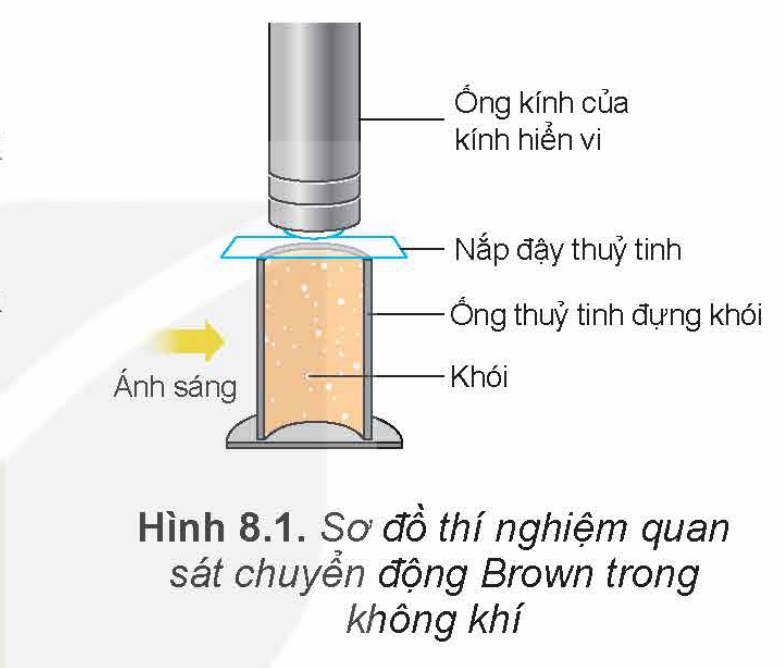
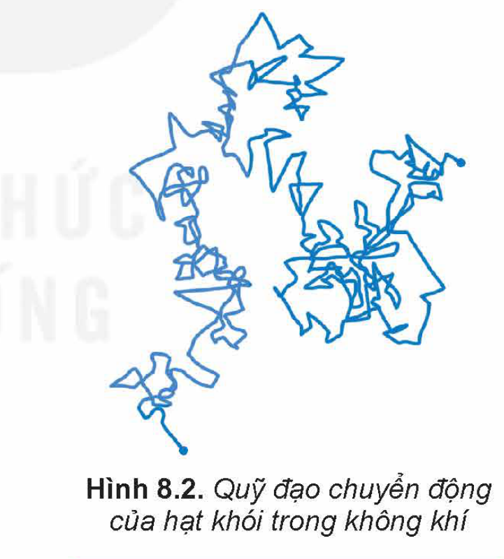
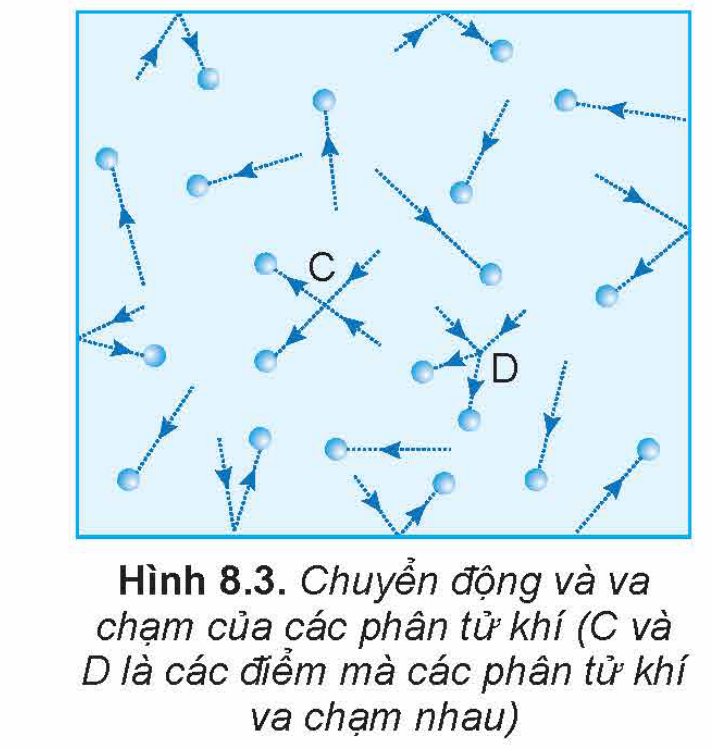

<!-- pdf:36 -->

# BÀI 8: MÔ HÌNH ĐỘNG HỌC PHÂN TỬ CHẤT KHÍ

## 🔴 Mở đầu

> Khi học môn Khoa học tự nhiên ở lớp 6, các em đã biết một số tính chất đặc biệt của chất ở thể khí so với chất ở thể lỏng và thể rắn. Tại sao chất ở thể khí lại có một số tính chất vật lí khác chính chất đó ở các thể khác?

## I. CHUYỂN ĐỘNG VÀ TƯƠNG TÁC CỦA CÁC PHÂN TỬ KHÍ

### 1. Chuyển động Brown trong chất khí

Chuyển động Brown không chỉ xảy ra trong chất lỏng mà xảy ra cả trong chất khí.

Hình 8.1 vẽ sơ đồ thí nghiệm dùng để quan sát chuyển động Brown trong chất khí.

> 1. Dựa vào Hình 8.1, hãy mô tả thí nghiệm dùng để quan sát chuyển động Brown trong không khí.
> 2. Hãy dựa vào quỹ đạo chuyển động của hạt khói trong không khí (Hình 8.2) để chứng tỏ rằng các phân tử không khí chuyển động hỗn loạn, không ngừng.
> 3. Khi quan sát tia nắng mặt trời chiếu qua cửa sổ vào trong phòng, ta có thể thấy các hạt bụi trong ánh nắng chuyển động không ngừng. Chuyển động này có phải là chuyển động Brown không? Tại sao?

Thí nghiệm mô tả ở Hình 8.1 còn cho thấy, khi tăng nhiệt độ của không khí trong ống thuỷ tinh chứa khói thì các hạt khói chuyển động nhanh hơn.

Từ thí nghiệm trên có thể rút ra các kết luận sau:

- Chất khí được cấu tạo từ các phân tử chuyển động hỗn loạn, không ngừng.
- Nhiệt độ của khí càng cao thì tốc độ chuyển động hỗn loạn của các phân tử khí càng lớn.
<!-- term: Chuyển động Brown trong chất khí -->

> Trong khi chuyển động hỗn loạn, các phân tử khí không ngừng va chạm với nhau và với thành bình (Hình 8.3) nên tốc độ chuyển động của chúng không ngừng thay đổi. Do đó, tốc độ phân tử mà ta nói tới ở trên là **tốc độ trung bình của các phân tử**. Trong một khối khí có thể có các phân tử
<!-- pdf:37 -->
> chuyển động nhanh hơn, bằng hoặc nhỏ hơn tốc độ trung bình. Người ta nói tốc độ chuyển động của phân tử có *tính thống kê* và chỉ có ý nghĩa khi có rất nhiều phân tử. Tốc độ này có độ lớn:
> $$\bar{v} = \frac{v_1 + v_2 + ... + v_n}{n}$$
> Ở điều kiện chuẩn [$T = 273\text{ K}$ ($0\text{ }^\circ\text{C}$) và $p = 1\text{ atm}$ ($10^5\text{ Pa}$)], các phân tử khí oxygen chuyển động với tốc độ trung bình vào khoảng $400\text{ m/s}$.

### 2. Tương tác giữa các phân tử khí

Giữa các phân tử khí cũng có lực đẩy và lực hút, gọi chung là **lực liên kết**. Khoảng cách giữa các phân tử ở thể khí rất lớn so với ở thể lỏng và thể rắn nên lực liên kết giữa các phân tử ở thể khí rất yếu so với ở thể lỏng và thể rắn.

> 1. Hãy nêu các hiện tượng thực tế chứng tỏ lực liên kết giữa các phân tử ở thể khí rất yếu so với ở thể lỏng và thể rắn.
> 2. Hãy dựa vào khối lượng riêng ở cùng điều kiện nhiệt độ và áp suất của cùng một chất ở các thể khác nhau để chứng tỏ khoảng cách giữa các phân tử ở thể khí rất lớn so với ở thể lỏng và thể rắn.

## II. MÔ HÌNH ĐỘNG HỌC PHÂN TỬ CHẤT KHÍ

Từ các thí nghiệm và thực tế, người ta đưa ra mô hình động học phân tử chất khí:

1. Chất khí được cấu tạo từ các phân tử có kích thước rất nhỏ so với khoảng cách giữa chúng. Lực liên kết giữa các phân tử ở thể khí rất yếu so với ở thể lỏng và thể rắn.
2. Các phân tử khí chuyển động hỗn loạn, không ngừng. Chuyển động này càng nhanh thì nhiệt độ của khí càng cao.
3. Khi chuyển động hỗn loạn, các phân tử khí va chạm với nhau và với thành bình. Khi va chạm với thành bình các phân tử khí tác dụng lực, gây áp suất lên thành bình.
<!-- term: Mô hình động học phân tử chất khí -->

> Hãy điền vào các ô còn trống trong Bảng 8.1.
>
> **Bảng 8.1.** *Bảng các thí nghiệm và hiện tượng thực tế làm cơ sở cho việc đưa ra mô hình động học phân tử chất khí*
>
> | STT | Mô hình động học phân tử chất khí | Các thí nghiệm và hiện tượng thực tế |
> | --- | --- | --- |
> | 1 | Phân tử khí chuyển động hỗn loạn, không ngừng. | Chuyển động Brown trong không khí |
> | 2 | Kích thước của các phân tử khí rất nhỏ so với khoảng cách giữa chúng. | ? |
> | 3 | Khi chuyển động các phân tử khí va chạm với nhau và với thành bình. | ? |

<!-- pdf:38 -->

## III. KHÍ LÍ TƯỞNG

Để tìm hiểu các tính chất của chất khí, người ta dùng một mô hình khí đơn giản hơn **khí thực** (khí tồn tại trong thực tế) nhưng vẫn phản ánh được các đặc điểm cơ bản của khí này:

1. Các phân tử khí được coi là các *chất điểm*, không tương tác với nhau khi chưa va chạm.
2. Các phân tử khí tương tác khi va chạm với nhau và va chạm với thành bình. Các va chạm này là va chạm hoàn toàn *đàn hồi*.

Mô hình trên bỏ qua thể tích của phân tử khí, bỏ qua tương tác của các phân tử khi chưa va chạm và coi va chạm là hoàn toàn đàn hồi làm cho việc mô tả các hiện tượng về chất khí trở nên đơn giản, dễ dàng. Chất khí trong mô hình trên được gọi là **khí lí tưởng**.

> Hãy dùng mô hình động học phân tử chất khí để chứng tỏ với một khối lượng khí xác định thì nếu giảm thể tích của bình chứa và giữ nguyên nhiệt độ khí thì áp suất của khí tác dụng lên thành bình tăng. Hãy tìm ví dụ trong thực tế để minh hoạ cho tính chất trên của chất khí.

## 📌 Em đã học

- Chất khí được cấu tạo từ các phân tử có kích thước rất nhỏ so với khoảng cách giữa chúng.
- Các phân tử khí chuyển động hỗn loạn, không ngừng. Chuyển động này càng nhanh thì nhiệt độ của khí càng cao.
- Khi chuyển động hỗn loạn, các phân tử khí va chạm với nhau và với thành bình. Khi va chạm với thành bình chất khí gây áp suất lên thành bình.

## ✏️ Em có thể

Dùng thuyết động học phân tử chất khí để giải thích được các hiện tượng có liên quan. Ví dụ: chất khí luôn chiếm toàn bộ dung tích của bình chứa; chất khí gây áp suất lên thành bình theo mọi hướng; sự phụ thuộc áp suất của một lượng khí xác định tác dụng lên thành bình vào thể tích và nhiệt độ,...

## 📷 Danh sách hình trong bài

| Mã hình | Số hiệu | Trang PDF | Chú thích |
| --- | --- | --- | --- |
| H12-vat_ly-b08-01 | Hình 8.1 | 36 | Hình 8.1. Sơ đồ thí nghiệm quan sát chuyển động Brown trong không khí |
| H12-vat_ly-b08-02 | Hình 8.2 | 36 | Hình 8.2. Quỹ đạo chuyển động của hạt khói trong không khí |
| H12-vat_ly-b08-03 | Hình 8.3 | 36 | Hình 8.3. Chuyển động và va chạm của các phân tử khí (C và D là các điểm mà các phân tử khí va chạm nhau) |
