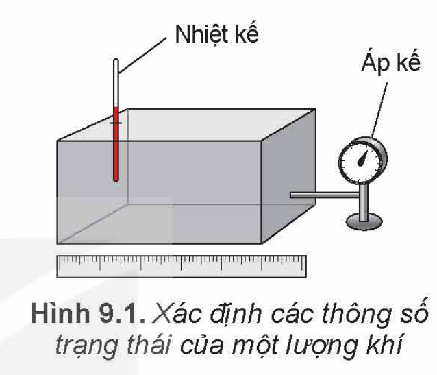
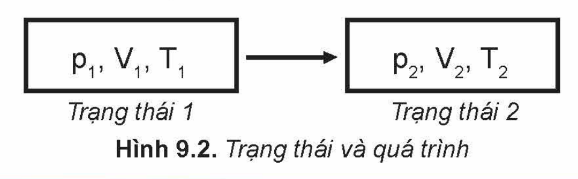
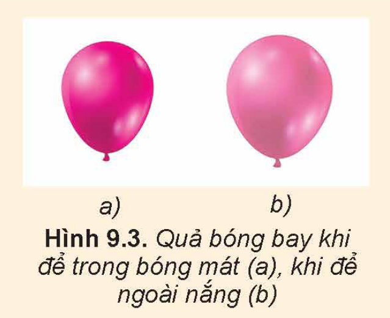
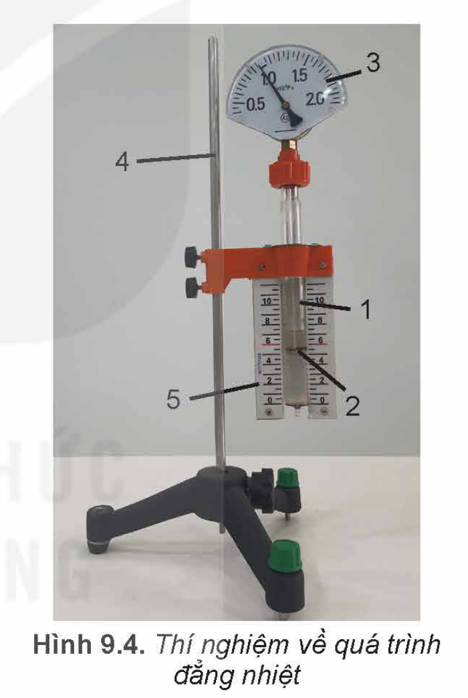
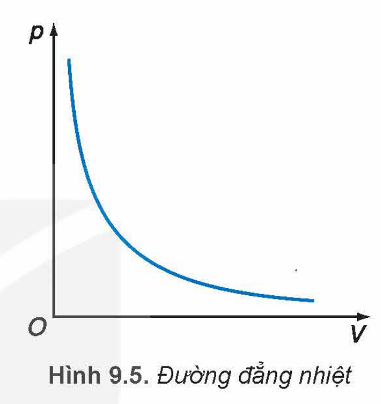
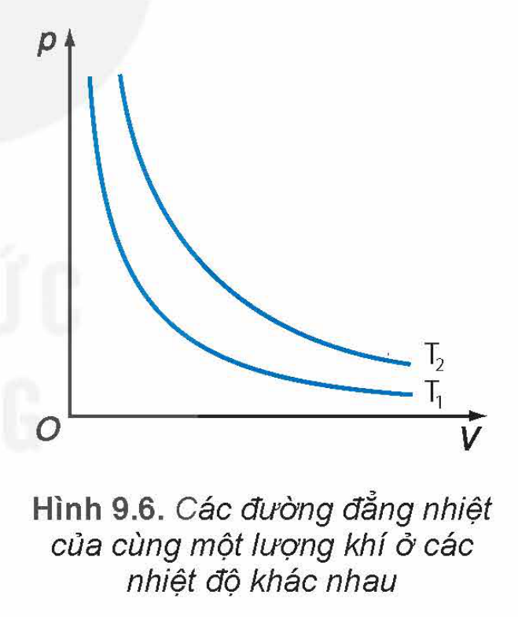

<!-- pdf:39 -->

# BÀI 9: ĐỊNH LUẬT BOYLE

## 🔴 Mở đầu

> Khi thay đổi thể tích của một khối lượng khí xác định ở nhiệt độ không đổi thì áp suất khí thay đổi như thế nào?
<!-- ocr-ok: đối chiếu ảnh trang PDF 39 khớp nguyên văn -->

## I. CÁC THÔNG SỐ TRẠNG THÁI CỦA MỘT LƯỢNG KHÍ

Một lượng khí đựng trong một bình kín được xác định bởi bốn đại lượng là khối lượng ($m$), thể tích ($V$), nhiệt độ ($T$) và áp suất ($p$).

Khi thể tích, nhiệt độ và áp suất của một khối lượng khí xác định không thay đổi, ta nói lượng khí ở **trạng thái cân bằng**. Thể tích, áp suất và nhiệt độ của lượng khí được gọi là các **thông số trạng thái** của nó.

> Các thông số trạng thái của một lượng khí đều là đại lượng có thể đo hoặc xác định được bằng các dụng cụ đo lường.
> 1. Người ta dùng các dụng cụ nào để đo, xác định các thông số trạng thái của lượng khí trong hộp kín ở Hình 9.1?
> 2. Nêu tên đơn vị của các đại lượng này trong hệ SI.

Khí chuyển từ trạng thái này sang trạng thái khác bằng các **quá trình biến đổi trạng thái**, gọi tắt là **quá trình**.

Người ta thường biểu diễn trạng thái và quá trình biến đổi trạng thái của một khối lượng khí xác định bằng Hình 9.2 dưới đây:

> **EM CÓ BIẾT?**
>
> Các phân tử khí chuyển động hỗn loạn, không ngừng nên vận tốc và số va chạm của các phân tử khí lên thành bình thay đổi theo thời gian và áp suất chất khí tác dụng lên thành bình tại các thời điểm khác nhau có thể khác nhau. Do đó, áp suất chất khí được hiểu là **áp suất trung bình** của các phân tử khí tác dụng lên thành bình.

> Hãy so sánh các thông số trạng thái của không khí trong một quả bóng bay đã được bơm khi để trong bóng mát và khi để ngoài nắng (Hình 9.3).

<!-- pdf:40 -->

Trong hầu hết các quá trình biến đổi trạng thái của một khối lượng khí xác định thì cả ba thông số trạng thái (áp suất, thể tích, nhiệt độ) đều có thể biến đổi. Tuy nhiên, để thuận lợi cho việc tìm hiểu mối quan hệ giữa các thông số trạng thái, người ta thực hiện những quá trình đơn giản trong đó chỉ có hai thông số biến đổi còn một thông số không đổi, gọi là các **đẳng quá trình**. Các nhà vật lí đã dùng thí nghiệm để nghiên cứu các đẳng quá trình, xác định mối quan hệ của từng cặp thông số trạng thái, từ đó xây dựng phương trình về mối quan hệ giữa cả ba thông số.

## II. ĐỊNH LUẬT BOYLE

### 1. Quá trình đẳng nhiệt

Quá trình biến đổi trạng thái của một khối lượng khí xác định khi nhiệt độ giữ không đổi được gọi là **quá trình đẳng nhiệt**. Thí nghiệm về quá trình đẳng nhiệt sẽ giúp ta xác định được mối quan hệ giữa áp suất $p$ và thể tích $V$ của một khối lượng khí xác định trong quá trình này.

### 2. Thí nghiệm

> *Chuẩn bị:* Bộ thí nghiệm về chất khí
> - Xi lanh trong suốt có độ chia nhỏ nhất $0,5\text{ cm}^3$ (1).
> - Pit-tông có ống nối khí trong xi lanh với áp kế (2).
> - Áp kế có độ chia nhỏ nhất $0,05.10^5\text{ Pa}$ (3).
> - Giá đỡ thí nghiệm (4).
> - Thước đo (5).
>
> *Tiến hành:*
> - Bố trí thí nghiệm như Hình 9.4.
> - Dịch chuyển từ từ pit-tông để làm thay đổi thể tích khí.
> - Đọc và ghi kết quả thí nghiệm vào vở tương tự mẫu ở Bảng 9.1.

**Bảng 9.1.** *Ví dụ về kết quả thí nghiệm khảo sát mối quan hệ của thể tích và áp suất trong quá trình đẳng nhiệt của một lượng khí xác định*

| Lần thí nghiệm | $V\text{ (cm}^3\text{)}$ | $p\text{ (}10^5\text{ Pa)}$ |
| --- | --- | --- |
| 1 | 3,0 | 1,0 |
| 2 | 2,5 | 1,2 |
| 3 | 2,0 | 1,5 |
| 4 | 1,5 | 1,9 |

<!-- pdf:41 -->

> Từ kết quả thí nghiệm ở Bảng 9.1, thực hiện các yêu cầu sau:
> 1. Xác định giá trị của tích $pV$ trong mỗi lần thí nghiệm.
> 2. Vẽ đường biểu diễn sự phụ thuộc của áp suất $p$ vào thể tích $V$ trong hệ toạ độ ($p, V$).
> 3. Phát biểu mối quan hệ giữa $p$ và $V$ trong quá trình đẳng nhiệt.

### 3. Định luật Boyle

*Khi nhiệt độ của một khối lượng khí xác định giữ không đổi thì áp suất gây ra bởi khí tỉ lệ nghịch với thể tích của nó:*
$$pV = \text{hằng số} \quad (9.1)$$
Định luật trên được nhà vật lí và hoá học người Ireland là Robert Boyle (Rô-bớt Bôi-lơ) (1627-1691) tìm ra bằng thực nghiệm năm 1662 nên được gọi là **định luật Boyle**.

Đồ thị biểu diễn định luật Boyle là một nhánh của đường hypebol (Hình 9.5).

Đường đẳng nhiệt của cùng một lượng khí ứng với các nhiệt độ khác nhau thì khác nhau. Hình 9.6 vẽ hai đường đẳng nhiệt của cùng một lượng khí ứng với hai nhiệt độ $T_1$ và $T_2$, với $T_1 < T_2$.
<!-- term: Đường đẳng nhiệt -->

Nếu gọi $p_1, V_1$ là áp suất và thể tích của khí ở trạng thái 1; $p_2, V_2$ là áp suất và thể tích của khí ở trạng thái 2 thì:

$$p_1V_1 = p_2V_2 \quad (9.2)$$
<!-- ocr-ok: đối chiếu ảnh trang PDF 41 khớp nguyên văn -->

> 1. Nếu vẽ đường biểu diễn sự phụ thuộc của $p$ vào $\frac{1}{V}$ thì đường biểu diễn sẽ có dạng như thế nào? Tại sao?
> 2. Tìm ví dụ về quá trình đẳng nhiệt trong đời sống.

*Bài tập ví dụ:*

Một lượng khí có thể tích là $10\text{ lít}$ ở áp suất $10^5\text{ Pa}$. Tính thể tích của lượng khí này ở áp suất $1,25.10^5\text{ Pa}$. Biết nhiệt độ của khí không đổi.

*Các bước giải:*

1. Xác định quá trình biến đổi trạng thái trong bài toán: Đây là bài toán về quá trình đẳng nhiệt.
2. Xác định các trạng thái của khí:
   Trạng thái 1: $p_1 = 10^5\text{ Pa}$; $V_1 = 10\text{ L}$.
   Trạng thái 2: $p_2 = 1,25.10^5\text{ Pa}$; $V_2 = ?$
3. Áp dụng định luật Boyle:
   Theo định luật Boyle: $p_1V_1 = p_2V_2$. Suy ra: $V_2 = \frac{p_1V_1}{p_2} = \frac{10^5.10}{1,25.10^5} = 8\text{ L}$.

<!-- pdf:42 -->

*Bài tập vận dụng*

1. Một quả bóng chứa $0,04\text{ m}^3$ không khí ở áp suất $120\text{ kPa}$. Tính áp suất của không khí trong bóng khi làm giảm thể tích bóng còn $0,025\text{ m}^3$ ở nhiệt độ không đổi.
2. Một bọt khí nổi từ đáy giếng sâu $6\text{ m}$ lên mặt nước. Khi lên tới mặt nước, thể tích của bọt khí tăng lên bao nhiêu lần? Coi áp suất khí quyển là $1,013.10^5\text{ Pa}$; khối lượng riêng của nước giếng là $1\text{ }003\text{ kg/m}^3$ và nhiệt độ của nước giếng không thay đổi theo độ sâu.

## 📌 Em đã học

- Trạng thái và quá trình biến đổi trạng thái:
  Trạng thái 1 ($p_1, V_1, T_1$) $\longrightarrow$ Trạng thái 2 ($p_2, V_2, T_2$)
- **Định luật Boyle**: *Khi nhiệt độ của một khối lượng khí xác định giữ không đổi thì áp suất gây ra bởi khí tỉ lệ nghịch với thể tích của nó:*
  $$pV = \text{hằng số hay } p_1V_1 = p_2V_2$$

## ✏️ Em có thể

- Dùng định luật Boyle giải thích được các hiện tượng thực tế đơn giản có liên quan.

## 📷 Danh sách hình trong bài

| Mã hình | Số hiệu | Trang PDF | Chú thích |
| --- | --- | --- | --- |
| H12-vat_ly-b09-01 | Hình 9.1 | 39 | Hình 9.1. Xác định các thông số trạng thái của một lượng khí |
| H12-vat_ly-b09-02 | Hình 9.2 | 39 | Hình 9.2. Trạng thái và quá trình |
| H12-vat_ly-b09-03 | Hình 9.3 | 39 | Hình 9.3. Quả bóng bay khi để trong bóng mát (a), khi để ngoài nắng (b) |
| H12-vat_ly-b09-04 | Hình 9.4 | 40 | Hình 9.4. Thí nghiệm về quá trình đẳng nhiệt |
| H12-vat_ly-b09-05 | Hình 9.5 | 41 | Hình 9.5. Đường đẳng nhiệt |
| H12-vat_ly-b09-06 | Hình 9.6 | 41 | Hình 9.6. Các đường đẳng nhiệt của cùng một lượng khí ở các nhiệt độ khác nhau |
