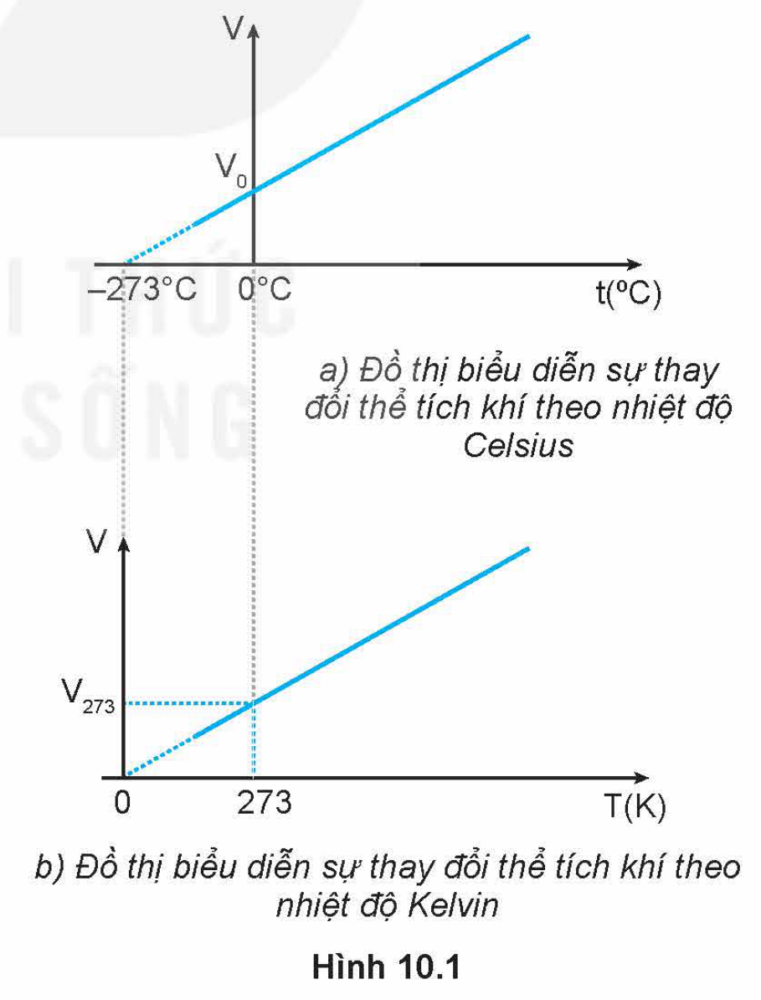
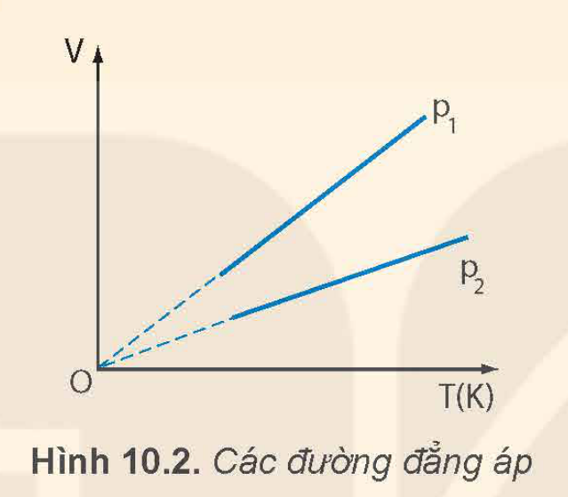
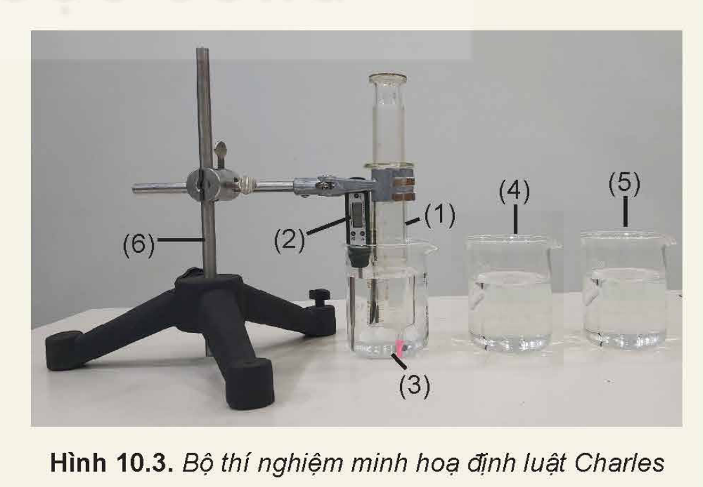
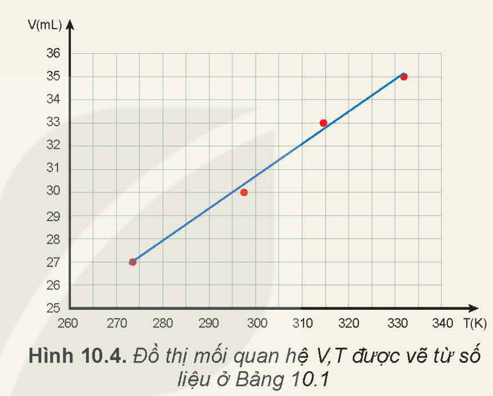

<!-- pdf:43 -->

# BÀI 10: ĐỊNH LUẬT CHARLES

## 🔴 Mở đầu

> Khi giữ nguyên áp suất của một khối lượng khí xác định thì thể tích của khí phụ thuộc như thế nào vào nhiệt độ của nó?

## I. ĐỊNH LUẬT CHARLES

### 1. Quá trình đẳng áp

Quá trình biến đổi trạng thái của một khối lượng khí xác định khi giữ áp suất không đổi được gọi là **quá trình đẳng áp**.

### 2. Nghiên cứu của Charles

Năm 1787, nhà vật lí người Pháp là Charles (Sác-lơ) đã dùng thực nghiệm để nghiên cứu sự thay đổi thể tích theo nhiệt độ của một khối lượng khí xác định trong quá trình đẳng áp. Làm thí nghiệm với các chất khí khác nhau, ông nhận thấy khi tăng nhiệt độ khí từ $t_0 = 0\text{ }^\circ\text{C}$ tới $t\text{ }^\circ\text{C}$ đồng thời giữ áp suất không đổi thì độ tăng thể tích của 1 đơn vị thể tích khí khi được tăng thêm 1 đơn vị nhiệt độ của các chất khí khác nhau đều bằng nhau và bằng $\frac{1}{273}$:

$$\frac{V - V_0}{V_0\Delta t} = \frac{1}{273} \quad (10.1)$$
<!-- ocr-ok: đối chiếu ảnh trang PDF 43 khớp nguyên văn -->

Trong đó $V_0$ là thể tích khí ở nhiệt độ $0\text{ }^\circ\text{C}$; $V$ là thể tích khí ở nhiệt độ $t\text{ }^\circ\text{C}$; $\Delta t$ là độ tăng nhiệt độ của khí.

Nếu kí hiệu $\alpha = \frac{1}{273}$ thì $V = V_0(1 + \alpha\Delta t)$

Vì $\Delta t = t - t_0 = t$ nên: $V = V_0(1 + \alpha t) \quad (10.2)$

Đồ thị biểu diễn sự phụ thuộc của thể tích $V$ theo nhiệt độ Celsius được vẽ ở Hình 10.1a.

> Hãy giải thích cách vẽ đồ thị của hàm: $V = V_0(1 + \alpha t)$ trong Hình 10.1a.

Đồ thị vẽ ở Hình 10.1a cho thấy đường biểu diễn không đi qua gốc toạ độ chứng tỏ thể tích $V$ của khí không tăng tỉ lệ thuận với nhiệt độ Celsius.

> Hãy chứng tỏ rằng nếu đổi nhiệt độ Celsius $t$ trong hệ thức (10.2) sang nhiệt độ Kelvin $T$ tương ứng thì sẽ được một hệ thức mới chứng tỏ thể tích $V$ của chất khí tỉ lệ thuận với nhiệt độ Kelvin: $\frac{V}{T} = \text{hằng số}$.

<!-- pdf:44 -->

### 3. Định luật Charles

*Khi áp suất của một khối lượng khí xác định giữ không đổi thì thể tích của khí tỉ lệ thuận với nhiệt độ tuyệt đối của nó:*

$$\frac{V}{T} = \text{hằng số.} \quad (10.3)$$
<!-- ocr-ok: đối chiếu ảnh trang PDF 44 khớp nguyên văn -->

Nếu gọi $V_1, T_1$ lần lượt là thể tích và nhiệt độ tuyệt đối ở trạng thái 1; $V_2, T_2$ lần lượt là thể tích và nhiệt độ tuyệt đối ở trạng thái 2 thì:

$$\frac{V_1}{T_1} = \frac{V_2}{T_2} \quad (10.4)$$
<!-- ocr-ok: đối chiếu ảnh trang PDF 44 khớp nguyên văn -->

Đồ thị biểu diễn định luật Charles như Hình 10.1b.

> **Độ không tuyệt đối:**
>
> Đồ thị vẽ ở Hình 10.1a cho thấy nếu kéo dài đường biểu diễn thì đường này sẽ cắt trục nhiệt độ ở $-273\text{ }^\circ\text{C}$. Ở nhiệt độ này, thể tích của lượng khí sẽ bằng 0. Điều này chứng tỏ người ta không thể hạ nhiệt độ xuống tới $-273\text{ }^\circ\text{C}$ vì thể tích của một lượng khí không thể bằng 0. Chính vì thế mà người ta gọi nhiệt độ này là **độ không tuyệt đối** và dùng nó làm mốc nhiệt độ thấp nhất của thang nhiệt độ Kelvin ($0\text{ K}$). Tính chất của các chất ở nhiệt độ này đã được nêu trong Bài 3, Chương I.

> 1. Ứng với các áp suất khác nhau của cùng một lượng khí, ta có những đường đẳng áp khác nhau. Hình 10.2 vẽ hai đường đẳng áp của cùng một lượng khí ứng với hai áp suất $p_1$ và $p_2$. Hãy so sánh $p_1$ và $p_2$.
> 2. Hãy tìm ví dụ về ứng dụng định luật Charles trong đời sống.
<!-- term: Đường đẳng áp -->

## II. THÍ NGHIỆM MINH HOẠ ĐỊNH LUẬT CHARLES

> *Chuẩn bị:*
> - Xi lanh thuỷ tinh dung tích $50\text{ mL}$, có độ chia nhỏ nhất $1\text{ mL}$ (1).
> - Nhiệt kế điện tử (2).
> - Ba cốc thuỷ tinh (3), (4), (5).
> - Nút cao su để bịt đầu ra của xi lanh.
> - Giá đỡ thí nghiệm (6).
> - Nước đá, nước ấm, nước nóng.
> - Dầu bôi trơn.
>
> *Tiến hành:*
>
> Bước 1: Cho một chút dầu bôi trơn vào pit-tông để pit-tông dễ dàng di chuyển trong xi lanh. Điều chỉnh pit-tông ở mức $30\text{ mL}$, bịt đầu ra của xi lanh bằng nút cao su.

<!-- pdf:45 -->

> Bước 2: Ghi giá trị nhiệt độ phòng và thể tích không khí trong xi lanh vào vở tương tự như Bảng 10.1.
>
> Bước 3: Đổ nước đá vào cốc (3).
>
> Bước 4: Nhúng xi lanh và nhiệt kế vào cốc. Sau khoảng thời gian 3 phút, ghi giá trị thể tích $V$ của không khí trong xi lanh và nhiệt độ $t$ vào bảng số liệu.
>
> Bước 5: Lần lượt đổ nước ấm vào cốc (4) và nước nóng vào cốc (5). Thực hiện tương tự bước 4 ở mỗi trường hợp.
>
> **Bảng 10.1.** *Ví dụ về kết quả thí nghiệm minh hoạ định luật Charles*
>
> | Lần thí nghiệm | $t\text{ (}^\circ\text{C)}$ | $T\text{ (K)}$ | $V\text{ (mL)}$ |
> | --- | --- | --- | --- |
> | 1 | 24,5 | 297,5 | 30 |
> | 2 | 0,5 | 273,5 | 27 |
> | 3 | 41,5 | 314,5 | 33 |
> | 4 | 59,3 | 332,3 | 35 |
>
> Từ kết quả thí nghiệm, thực hiện các yêu cầu sau:
> - Tính $T$, $\frac{V}{T}$.
> - Từ số liệu thu được, vẽ đồ thị mối quan hệ $V, T$.
> 1. Kết quả thí nghiệm thu được có phù hợp với định luật Charles không?
> 2. Giải thích tại sao có thể coi quá trình biến đổi trạng thái của khí trong thí nghiệm trên là quá trình đẳng áp?

## III. BÀI TẬP

*Bài tập ví dụ*

Khi tăng nhiệt độ của một lượng khí xác định từ $32\text{ }^\circ\text{C}$ lên $117\text{ }^\circ\text{C}$ và giữ áp suất không đổi thì thể tích khí tăng thêm $1,7\text{ lít}$. Tìm thể tích của lượng khí trước và sau khi tăng nhiệt độ.

*Bài giải:*

Hiện tượng trong bài là quá trình đẳng áp.

Trạng thái 1: $T_1 = 305\text{ K}$; $V_1$.

Trạng thái 2: $T_2 = 390\text{ K}$; $V_2 = V_1 + 1,7\text{ L}$.

Áp dụng định luật Charles: $\frac{V_1}{T_1} = \frac{V_2}{T_2}$

$$\frac{V_1}{305} = \frac{V_1 + 1,7}{390}$$
<!-- ocr-ok: đối chiếu ảnh trang PDF 45 khớp nguyên văn -->

Suy ra: $V_1 = 6,1\text{ L}$; $V_2 = 7,8\text{ L}$.

<!-- pdf:46 -->

*Bài tập vận dụng*

1. Thể tích của một lượng khí xác định tăng thêm $10\%$ khi nhiệt độ của khí được tăng tới $47\text{ }^\circ\text{C}$. Xác định nhiệt độ ban đầu của lượng khí, biết quá trình trên là đẳng áp.
2. Một khối lượng khí $12\text{ g}$ có thể tích $4\text{ lít}$ ở nhiệt độ $7\text{ }^\circ\text{C}$. Sau khi được đun nóng đẳng áp thì khối lượng riêng của khí là $1,2\text{ g/lít}$. Xác định nhiệt độ của khí sau khi được đun nóng.

## IV. CÁC ĐỊNH LUẬT BOYLE VÀ CHARLES LÀ CÁC ĐỊNH LUẬT GẦN ĐÚNG

Các định luật Boyle và Charles được rút ra từ những thí nghiệm thực hiện trong điều kiện áp suất không quá $10^6\text{ Pa}$, nhiệt độ không dưới $200\text{ K}$.

Các thí nghiệm thực hiện trong điều kiện áp suất rất cao và nhiệt độ rất thấp cho kết quả không phù hợp với các định luật trên.

Để phân biệt khí lí tưởng với khí thực người ta định nghĩa *khí lí tưởng là khí tuân theo đúng các định luật Boyle và Charles*.

Tuy nhiên, sự khác biệt giữa khí lí tưởng và khí thực không lớn ở điều kiện bình thường về áp suất và nhiệt độ nên người ta vẫn có thể áp dụng các định luật của khí lí tưởng cho khí thực nếu không cần độ chính xác cao.

## 📌 Em đã học

- **Định luật Charles**: Khi áp suất của một khối lượng khí xác định giữ không đổi thì thể tích của khí tỉ lệ thuận với nhiệt độ tuyệt đối của nó:
  $$\frac{V}{T} = \text{hằng số hay } \frac{V_1}{T_1} = \frac{V_2}{T_2}.$$
<!-- ocr-ok: đối chiếu ảnh trang PDF 46 khớp nguyên văn -->

## ✏️ Em có thể

- Dùng định luật Charles giải thích được các hiện tượng thực tế có liên quan.

## 📷 Danh sách hình trong bài

| Mã hình | Số hiệu | Trang PDF | Chú thích |
| --- | --- | --- | --- |
| H12-vat_ly-b10-01 | Hình 10.1 | 43 | Hình 10.1. a) Đồ thị biểu diễn sự thay đổi thể tích khí theo nhiệt độ Celsius; b) Đồ thị biểu diễn sự thay đổi thể tích khí theo nhiệt độ Kelvin |
| H12-vat_ly-b10-02 | Hình 10.2 | 44 | Hình 10.2. Các đường đẳng áp |
| H12-vat_ly-b10-03 | Hình 10.3 | 44 | Hình 10.3. Bộ thí nghiệm minh hoạ định luật Charles |
| H12-vat_ly-b10-04 | Hình 10.4 | 45 | Hình 10.4. Đồ thị mối quan hệ V, T được vẽ từ số liệu ở Bảng 10.1 |
