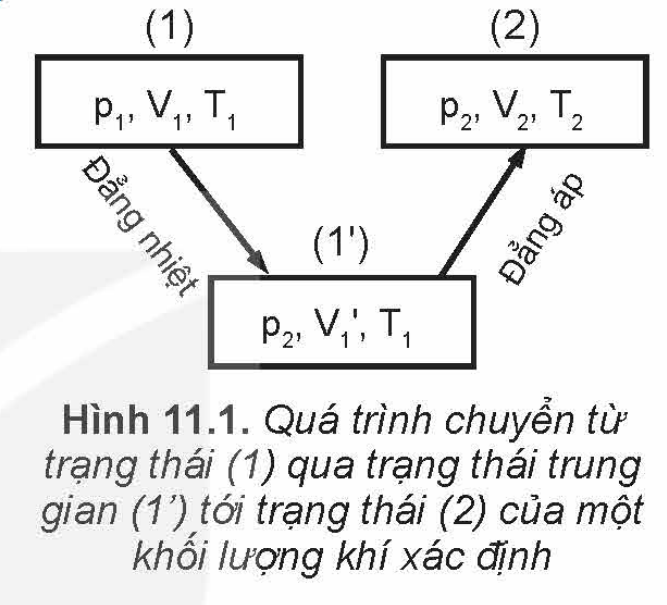

<!-- pdf:47 -->

# BÀI 11: PHƯƠNG TRÌNH TRẠNG THÁI CỦA KHÍ LÍ TƯỞNG

## 🔴 Mở đầu

> Các định luật Boyle và Charles chỉ xác định mối liên hệ giữa hai cặp thông số “áp suất – thể tích” và “thể tích – nhiệt độ” của một khối lượng khí xác định. Vậy, làm thế nào để xác định được mối liên hệ của cả ba thông số trạng thái của một khối lượng khí xác định?

## I. PHƯƠNG TRÌNH TRẠNG THÁI CỦA KHÍ LÍ TƯỞNG

### 1. Phương trình trạng thái của một lượng khí xác định

> Hãy dựa vào các định luật Boyle, Charles và Hình 11.1 về quá trình chuyển trạng thái của một khối lượng khí xác định để lập phương trình dưới đây về mối liên hệ giữa ba thông số trạng thái của một khối lượng khí xác định:
> $$\frac{p_1V_1}{T_1} = \frac{p_2V_2}{T_2} \Rightarrow \frac{pV}{T} = \text{hằng số} \quad (11.1)$$
> Độ lớn của hằng số trên phụ thuộc vào lượng khí ta xét.

Phương trình (11.1) được gọi là **phương trình trạng thái của một khối lượng khí lí tưởng xác định**, thường gọi tắt là **phương trình trạng thái của khí lí tưởng**.

> 1. Hãy lập phương trình $\frac{p_1V_1}{T_1} = \frac{p_2V_2}{T_2}$ bằng một cách biến đổi trạng thái khác cách trong Hình 11.1 để chứng tỏ: *Quá trình chuyển trạng thái không phụ thuộc cách chuyển trạng thái mà chỉ phụ thuộc trạng thái đầu và trạng thái cuối.*
> 2. Tại sao không gọi phương trình (11.1) là phương trình trạng thái của chất khí mà lại gọi là phương trình trạng thái của khí lí tưởng?

> 1. Hãy biểu diễn bằng đồ thị trong hệ toạ độ ($p - V$) các quá trình chuyển trạng thái vẽ ở Hình 11.1.
> 2. Từ phương trình trạng thái của khí lí tưởng suy ra hệ thức liên hệ giữa áp suất và nhiệt độ tuyệt đối trong quá trình đẳng tích.

*Bài tập ví dụ:*

Một cái bơm chứa $100\text{ cm}^3$ không khí ở nhiệt độ $27\text{ }^\circ\text{C}$ và áp suất $10^5\text{ Pa}$. Tính áp suất của không khí trong bơm khi nó bị nén xuống còn $20\text{ cm}^3$ và tăng nhiệt độ lên đến $39\text{ }^\circ\text{C}$.

*Các bước giải:*

1. Xác định tính chất của bài toán: Đây là bài toán mà cả ba thông số của một lượng khí đều thay đổi.
2. Xác định các trạng thái của khí
   Trạng thái 1: $p_1 = 10^5\text{ Pa}$; $V_1 = 100\text{ cm}^3$; $T_1 = 273 + 27 = 300\text{ K}$.
   Trạng thái 2: $p_2 = ?$; $V_2 = 20\text{ cm}^3$; $T_2 = 273 + 39 = 312\text{ K}$.

<!-- pdf:48 -->

Áp dụng phương trình trạng thái của một khối lượng khí xác định $\frac{p_1V_1}{T_1} = \frac{p_2V_2}{T_2}$, ta có:

$$p_2 = \frac{p_1V_1T_2}{V_2T_1} = \frac{10^5 \cdot 100 \cdot 312}{20 \cdot 300} = 5,2.10^5\text{ Pa}.$$
<!-- ocr-ok: đối chiếu ảnh trang PDF 48 khớp nguyên văn -->

### 2. Phương trình Clapeyron

Có thể xác định được độ lớn của hằng số trong phương trình trạng thái của một lượng $n\text{ mol}$ khí xác định ($n = \frac{m}{M}$, với $m$ là khối lượng khí, $M$ là khối lượng mol của lượng khí).

Trước hết cần xác định độ lớn của hằng số này đối với $1\text{ mol}$ khí. Có thể dựa vào độ lớn của thể tích, áp suất và nhiệt độ của $1\text{ mol}$ khí ở điều kiện tiêu chuẩn để xác định độ lớn của hằng số đối với $1\text{ mol}$ khí.

Một mol của bất kì khí nào ở điều kiện tiêu chuẩn đều có thể tích $V = 22,4.10^{-3}\text{ m}^3$; áp suất $p = 1,013.10^5\text{ Pa}$ và nhiệt độ $T = 273\text{ K}$. Do đó, phương trình trạng thái của $1\text{ mol}$ khí là:

$$\frac{pV}{T} = \frac{1,013 \cdot 10^5 \cdot 22,4 \cdot 10^{-3}}{273} = 8,31$$
<!-- ocr-ok: đối chiếu ảnh trang PDF 48 khớp nguyên văn -->

$R = 8,31$ được gọi là **hằng số khí lí tưởng** và có đơn vị là $\text{J/mol.K}$.

Vì thể tích của $n\text{ mol}$ khí bằng $n$ thể tích của $1\text{ mol}$ khí ở cùng nhiệt độ và áp suất nên nếu phương trình trạng thái của $1\text{ mol}$ khí là $\frac{pV}{T} = R$ thì phương trình trạng thái của $n\text{ mol}$ khí là:

$$\frac{pV}{T} = nR$$

Độ lớn của $nR$ là độ lớn của hằng số mà ta muốn xác định.

Phương trình trên thường được viết dưới dạng:

$$pV = nRT \quad (11.2)$$
<!-- ocr-ok: đối chiếu ảnh trang PDF 48 khớp nguyên văn -->

Phương trình (11.2) là phương trình trạng thái của một lượng $n\text{ mol}$ khí lí tưởng, cũng thường được gọi tắt là phương trình trạng thái của khí lí tưởng. Nhà vật lí Clapeyron (Cla-pây-rông) người Pháp là người lập ra phương trình này nên nó còn được gọi là **phương trình Clapeyron**.

## II. VẬN DỤNG

Phương trình trạng thái của khí lí tưởng có nhiều ứng dụng thực tế. Nó được dùng vào việc nghiên cứu, chế tạo các thiết bị có liên quan đến chất khí như khí cầu, bình đựng khí, trang phục lặn, máy điều hoà không khí, máy nén khí,...; nghiên cứu sự thay đổi áp suất và thể tích của các lớp khí tồn tại trong các vật liệu để tìm tòi, sản xuất các vật liệu đáp ứng được các yêu cầu sử dụng khác nhau. Phương trình này còn được dùng trong việc nghiên cứu sự thay đổi áp suất, nhiệt độ, khối lượng riêng của không khí trong khí quyển, tìm hiểu quá trình biến đổi khí hậu để dự báo thời tiết,...

<!-- pdf:49 -->

> 1. *Bóng thám không.* Bóng thám không được sử dụng để thu thập thông tin về môi trường không khí và thời tiết. Bóng thường được bơm khí hiếm nhẹ hơn không khí, nhờ đó có thể bay lên các tầng không khí khác nhau để thu thập thông tin về nhiệt độ, độ ẩm, áp suất, tốc độ gió,...
>    Người ta muốn chế tạo một bóng thám không có thể tăng bán kính lên tới $10\text{ m}$ khi bay ở tầng khí quyển có áp suất $0,3.10^5\text{ Pa}$ và nhiệt độ $200\text{ K}$. Hỏi bán kính của bóng khi vừa bơm xong phải bằng bao nhiêu? Biết bóng được bơm ở áp suất $1,02.10^5\text{ Pa}$ và nhiệt độ $300\text{ K}$.
> 2. *Túi khí.* Trong ô tô, người ta thường đặt ở hệ thống tay lái một thiết bị nhằm bảo vệ người lái xe khi xe gặp tai nạn, gọi là “túi khí”.
>    Túi khí được chế tạo bằng vật liệu co giãn, chịu được áp suất lớn. Trong túi khí thường chứa chất $\text{NaN}_3$, khi xe va chạm mạnh vào vật cản thì hệ thống cảm biến của xe sẽ kích thích chất rắn này làm nó phân huỷ tạo thành $\text{Na}$ và khí $\text{N}_2$. Khí $\text{N}_2$ được tạo thành có tác dụng làm phồng túi lên, giúp người lái xe không bị va chạm trực tiếp vào hệ thống lái (Hình 11.2).
>    a) Viết phương trình phân huỷ $\text{NaN}_3$.
>    b) Tính lượng chất khí $\text{N}_2$ được giải phóng khi xảy ra phản ứng phân huỷ $\text{NaN}_3$, biết trong túi chứa $100\text{ g NaN}_3$ và thể tích mol là $24,0\text{ lít/mol}$.
>    c) Biết thể tích túi khí khi phồng lên có độ lớn tới $48\text{ lít}$. Bỏ qua thể tích khí có trong túi trước khi phồng lên và thể tích của $\text{Na}$ được tạo thành trong túi do phản ứng phân huỷ. Tính áp suất của khí $\text{N}_2$ trong túi khí khi đã phồng lên, biết nhiệt độ là $30\text{ }^\circ\text{C}$.

## 📌 Em đã học

- **Phương trình trạng thái của một khối lượng khí lí tưởng xác định**: $\frac{pV}{T} = \text{hằng số}$.
  Độ lớn của hằng số phụ thuộc vào lượng khí mà ta xét.
- **Phương trình trạng thái của khí lí tưởng** (**phương trình Clapeyron**):
  $$pV = nRT$$
  Trong đó, $R$ là hằng số khí lí tưởng ($R = 8,31\text{ J/mol.K}$); $n$ là số mol khí:
  $$n = \frac{m\text{ (kg)}}{M\text{ (kg/mol)}}$$

## ✏️ Em có thể

Giải thích được một số hiện tượng, thiết bị có liên quan đến phương trình trạng thái của khí lí tưởng. Ví dụ: giải thích được cách sử dụng bình oxygen trong y tế, túi khí trên ô tô; tính được thể tích, khối lượng, nhiệt độ của chất khí tạo thành trong các phản ứng hoá học.

## 📷 Danh sách hình trong bài

| Mã hình | Số hiệu | Trang PDF | Chú thích |
| --- | --- | --- | --- |
| H12-vat_ly-b11-01 | Hình 11.1 | 47 | Hình 11.1. Quá trình chuyển từ trạng thái (1) qua trạng thái trung gian (1') tới trạng thái (2) của một khối lượng khí xác định |
| H12-vat_ly-b11-02 | Hình 11.2 | 49 | Hình 11.2. Túi khí trong ô tô khi phồng lên |
