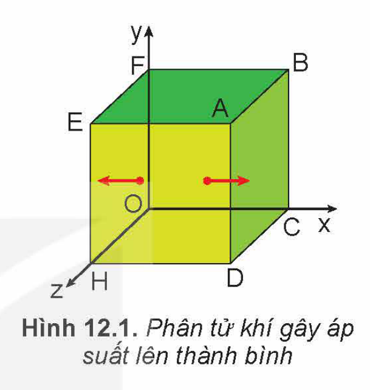

<!-- pdf:50 -->

# BÀI 12: ÁP SUẤT KHÍ THEO MÔ HÌNH ĐỘNG HỌC PHÂN TỬ. QUAN HỆ GIỮA ĐỘNG NĂNG PHÂN TỬ VÀ NHIỆT ĐỘ

## 🔴 Mở đầu

> Áp suất khí phụ thuộc như thế nào vào những đại lượng đặc trưng sau đây của phân tử: khối lượng phân tử, tốc độ chuyển động của phân tử, mật độ phân tử, lực liên kết phân tử?

## I. ÁP SUẤT KHÍ THEO MÔ HÌNH ĐỘNG HỌC PHÂN TỬ

### 1. Tác dụng của một phân tử khí lên thành bình

Xét một lượng khí gồm $N$ phân tử chứa trong một bình lập phương có cạnh $l$, trong hệ toạ độ vuông góc $Oxyz$ (Hình 12.1).

Một phân tử khối lượng $m$ chuyển động thẳng đều song song với trục $Ox$ với tốc độ $v$ từ thành bình $EFOH$ tới va chạm đàn hồi và trực diện với thành bình $ABCD$. Sau khi va chạm, phân tử chuyển động theo chiều ngược lại với tốc độ có cùng độ lớn $v$ tới thành bình đối diện.

Do độ lớn của vận tốc tức thời và tốc độ tức thời của một chuyển động có độ lớn bằng nhau nên động lượng của phân tử trước khi va chạm với thành bình có giá trị là $+mv$, sau khi va chạm với thành bình có giá trị là $-mv$. Độ biến thiên động lượng của phân tử do va chạm với thành bình $ABCD$ có độ lớn là:

$$|\Delta \vec{p}| = |-mv - (+mv)| = |-2mv| = 2mv.$$
<!-- ocr-ok: đối chiếu ảnh trang PDF 50 khớp nguyên văn -->

> 1. Tại sao có thể coi chuyển động của phân tử khí trước và sau khi va chạm với thành bình là chuyển động thẳng đều?
> 2. Hãy dựa vào tính chất trên của chuyển động phân tử để tính thời gian $\Delta t$ giữa hai va chạm liên tiếp của một phân tử lên thành bình $ABCD$ theo $l$ và $v$.
>    Từ đó dùng công thức tính xung lượng của lực trong thời gian $\Delta t$ (đã học ở lớp 10) để chứng minh:
>    a) Lực do thành bình $ABCD$ tác dụng lên một phân tử khí có giá trị là $-\frac{mv^2}{l}$; lực do một phân tử khí tác dụng lên thành bình $ABCD$ có giá trị là $+\frac{mv^2}{l}$.
>    b) Áp suất do một phân tử khí tác dụng lên thành bình $ABCD$ có giá trị là: $p_m = \frac{m}{V}v^2$ với thể tích lượng khí $V = l^3$.

Như vậy vận dụng các định luật cơ học Newton vào mô hình khí lí tưởng có thể xác định được **áp suất của một phân tử khí** tác dụng lên thành bình là $p_m = \frac{m}{V}v^2$, với $v$ là tốc độ chuyển động của phân tử, $V$ là thể tích của lượng khí.

> Chú ý về các kí hiệu:
> - Động lượng kí hiệu là $\vec{p}$.
> - Áp suất của một lượng khí kí hiệu là $p$.
> - Áp suất của một phân tử khí kí hiệu là $p_m$.

<!-- pdf:51 -->

### 2. Tác dụng của N phân tử khí lên thành bình

Vì số phân tử $N$ vô cùng lớn và các phân tử chuyển động hỗn loạn trong bình nên các hướng $Ox$, $Oy$ và $Oz$ là bình đẳng. Do đó, số phân tử chuyển động theo hướng $Ox$, từ mặt $EFOH$ sang mặt $ABCD$ và ngược lại để gây áp suất lên hai mặt này chỉ bằng $\frac{1}{3}$ số phân tử có trong bình $\left(\frac{N}{3}\right)$.

Vì các phân tử chuyển động hỗn loạn nên tốc độ của các phân tử không bằng nhau, do đó áp suất của mỗi phân tử tác dụng lên thành bình cũng không bằng nhau. Trung bình mỗi phân tử tác dụng lên thành bình một áp suất $\bar{p}_m = \frac{m}{V}\overline{v^2}$, trong đó:

$$\overline{v^2} = \frac{v_1^2 + v_2^2 + ... + v_N^2}{N}$$
<!-- ocr-ok: đối chiếu ảnh trang PDF 51 khớp nguyên văn -->

Đại lượng này được gọi là “**trung bình của các bình phương tốc độ**”.

Từ những lập luận trên ta có thể viết được công thức tính áp suất của khí trong bình tác dụng lên thành bình $ABCD$:

$$p = \frac{N}{3}\bar{p}_m = \frac{1}{3}\frac{Nm}{V}\overline{v^2} \quad (12.1)$$
<!-- ocr-ok: đối chiếu ảnh trang PDF 51 khớp nguyên văn -->

Trong đó $\frac{N}{V}$ là số phân tử có trong một đơn vị thể tích, gọi là **mật độ phân tử**. Nếu kí hiệu mật độ phân tử là $\mu$, động năng trung bình của phân tử là $\overline{E}_đ = \frac{m\overline{v^2}}{2}$ và thay $\overline{E}_đ$ vào (12.1) ta được:

$$p = \frac{2}{3}\mu\overline{E}_đ \quad (12.2)$$
<!-- ocr-ok: đối chiếu ảnh trang PDF 51 khớp nguyên văn -->

Vì các mặt của hình lập phương là bình đẳng nên áp suất của chất khí tác dụng lên các mặt của bình đều như nhau và đều được xác định bằng các hệ thức (12.1), (12.2).

> 1. Hãy chứng tỏ hệ thức (12.1) phù hợp với định luật Boyle.
> 2. Hệ thức (12.2) cho thấy áp suất chất khí tác dụng lên thành bình phụ thuộc vào mật độ phân tử và động năng trung bình của phân tử. Hãy giải thích tại sao.

## II. MỐI QUAN HỆ GIỮA ĐỘNG NĂNG PHÂN TỬ VÀ NHIỆT ĐỘ

> Từ hai hệ thức $pV = nRT$ và $p = \frac{2}{3}\mu\overline{E}_đ$, hãy rút ra hệ thức: $\overline{E}_đ = \frac{3}{2} \cdot \frac{R}{N_A}T$. Trong đó $N_A$ là số Avogadro ($N_A = \frac{N}{n}$).

Vì $R$ và $N_A$ đều là các hằng số có giá trị xác định, nên ta có thể tính được giá trị của hằng số $k$:

$$k = \frac{R}{N_A} = \frac{8,31\text{ J/molK}}{6,02.10^{23}\text{ hạt/mol}} = 1,38.10^{-23}\text{ J/K}.$$
<!-- ocr-ok: đối chiếu ảnh trang PDF 51 khớp nguyên văn -->

Hằng số $k$ được gọi là **hằng số Boltzmann**.

<!-- pdf:52 -->

Do đó, **động năng trung bình của phân tử** được xác định bằng hệ thức:

$$\overline{E}_đ = \frac{3}{2}kT \quad (12.3)$$
<!-- ocr-ok: đối chiếu ảnh trang PDF 52 khớp nguyên văn -->

Từ hệ thức (12.3), ta thấy động năng trung bình của phân tử tỉ lệ thuận với nhiệt độ tuyệt đối.

Từ đó có thể rút ra những hệ quả sau:

- Các khí có bản chất khác nhau, khối lượng khác nhau nhưng nhiệt độ như nhau thì động năng trung bình của các phân tử bằng nhau.
- Động năng trung bình của phân tử khí càng lớn thì nhiệt độ của khí càng cao.
- Vì $\overline{E}_đ$ tỉ lệ thuận với $T$ nên người ta có thể coi nhiệt độ tuyệt đối là số đo động năng trung bình của phân tử theo một đơn vị khác.

> 1. Hãy dùng các hệ thức (12.2) và (12.3) để giải thích tại sao áp suất trong quá trình đẳng tích của một lượng khí xác định tỉ lệ thuận với nhiệt độ tuyệt đối.
> 2. Không khí chứa chủ yếu các phân tử khí nitrogen, oxygen và carbon dioxide. Hãy so sánh khối lượng, tốc độ trung bình, động năng trung bình của các phân tử khí trên trong một phòng có nhiệt độ không đổi.

> **EM CÓ BIẾT?**
>
> 1. Hệ thức $\overline{E}_đ = \frac{3}{2}kT$ được thành lập dựa trên mô hình của khí lí tưởng, trong đó phân tử được coi là chất điểm, chuyển động của phân tử là chuyển động tịnh tiến. Do đó, động năng trung bình trong hệ thức trên được gọi một cách đầy đủ là **động năng tịnh tiến trung bình**.
>    Khi phân tử không được coi là chất điểm thì ngoài chuyển động tịnh tiến, phân tử còn có thể có chuyển động quay, chuyển động riêng của các nguyên tử trong phân tử, chuyển động riêng của các electron trong nguyên tử,... Khi đó cần thiết phải nêu rõ động năng trung bình trong biểu thức trên chỉ là động năng của chuyển động tịnh tiến của phân tử, gọi tắt là động năng tịnh tiến trung bình.
> 2. Động năng tịnh tiến trung bình của phân tử có độ lớn bằng tổng động năng tịnh tiến của các phân tử chia cho số phân tử.
>    $$\overline{E}_đ = \frac{\frac{mv_1^2}{2} + \frac{mv_2^2}{2} + ... + \frac{mv_N^2}{2}}{N} = \frac{m}{2} \cdot \frac{(v_1^2 + v_2^2 + ... + v_N^2)}{N}$$
>    $$\Rightarrow \overline{E}_đ = \frac{m}{2}\overline{v^2}.$$

<!-- pdf:53 -->

> Căn bậc hai của $\overline{v^2}$ là $\sqrt{\overline{v^2}}$, độ lớn của đại lượng này không phải là trung bình cộng của các tốc độ của phân tử, nghĩa là không phải là tốc độ trung bình của các phân tử. Nó được gọi là **tốc độ căn quân phương** của phân tử.

## 📌 Em đã học

- **Áp suất chất khí theo mô hình động học phân tử**: $p = \frac{1}{3}\mu m\overline{v^2} = \frac{2}{3}\mu\overline{E}_đ$.
  Trong đó $\mu$ là mật độ phân tử khí ($\mu = \frac{N}{V}$), $\overline{v^2}$ là trung bình của các bình phương tốc độ phân tử.
- Liên hệ giữa động năng trung bình của phân tử và nhiệt độ: $\overline{E}_đ = \frac{3}{2}kT$.
  Trong đó $k$ là hằng số Boltzmann: $k = 1,38.10^{-23}\text{ J/K}$.

## ✏️ Em có thể

- Giải thích được một số hiện tượng có liên quan đến áp suất theo mô hình phân tử. Ví dụ, tại sao trong quá trình đẳng tích áp suất tỉ lệ thuận với nhiệt độ, trong quá trình đẳng nhiệt áp suất tỉ lệ nghịch với thể tích,...

## 📷 Danh sách hình trong bài

| Mã hình | Số hiệu | Trang PDF | Chú thích |
| --- | --- | --- | --- |
| H12-vat_ly-b12-01 | Hình 12.1 | 50 | Hình 12.1. Phân tử khí gây áp suất lên thành bình |
