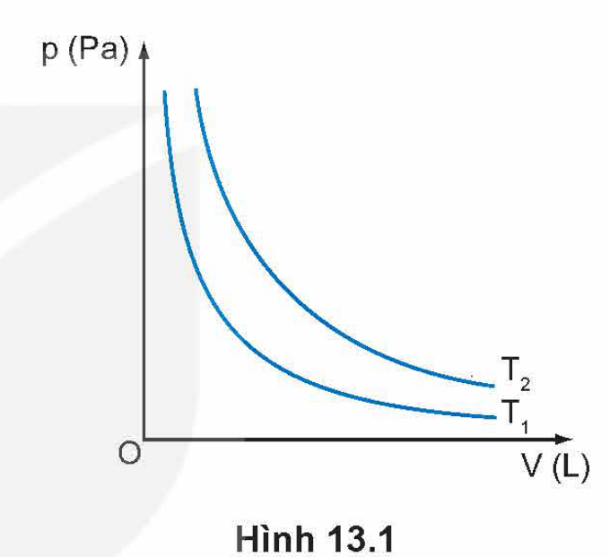
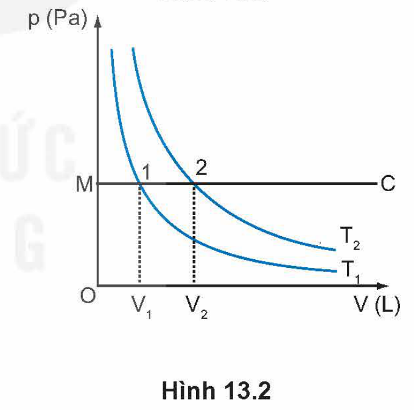
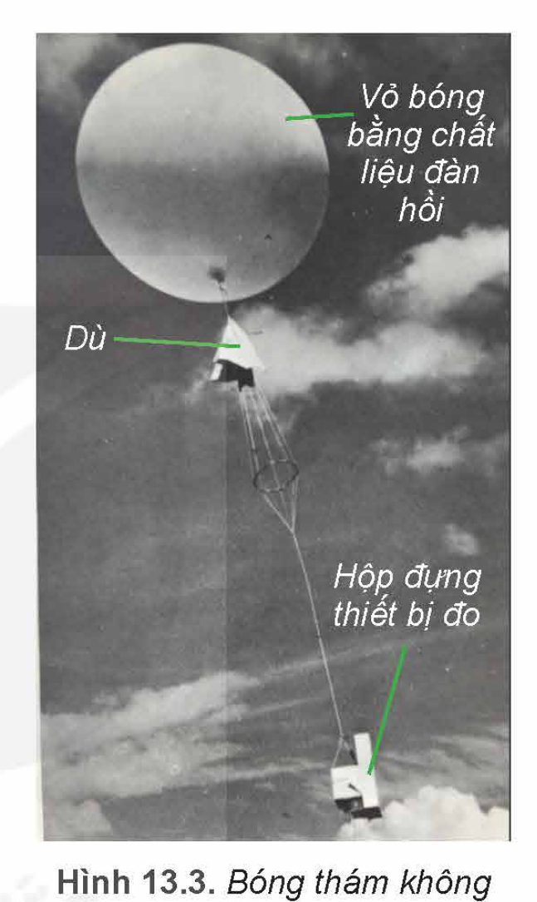
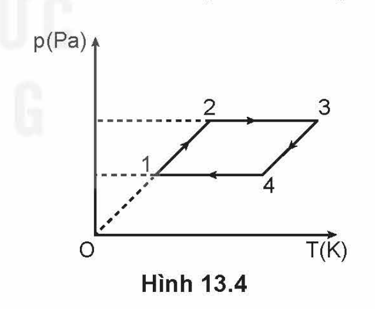

<!-- pdf:54 -->

# BÀI 13: BÀI TẬP VỀ KHÍ LÍ TƯỞNG

## 🔴 Mở đầu

> Để giải các bài tập về sự chuyển trạng thái của khí lí tưởng thì cần dùng những công thức nào? Nêu rõ ý nghĩa và cách dùng của từng công thức.

## I. MỘT SỐ LƯU Ý TRONG VIỆC GIẢI BÀI TẬP VỀ KHÍ LÍ TƯỞNG

Phần khí lí tưởng bao gồm bốn nội dung chính: Mô hình động học phân tử chất khí, phương trình trạng thái của khí lí tưởng, áp suất khí theo mô hình động học phân tử và động năng phân tử.

### 1. Lưu ý khi giải bài tập định tính

Các bài tập này thường yêu cầu vận dụng mô hình khí lí tưởng và mối quan hệ giữa các thông số trạng thái ($p, V, T$) để giải thích các hiện tượng, ứng dụng thực tế có liên quan. Khi giải các bài tập này cần lưu ý đến điều kiện về *khối lượng khí xác định*.

### 2. Lưu ý khi giải bài tập định lượng

Các bài tập định lượng chủ yếu là các bài tập về sự chuyển trạng thái của khí lí tưởng.

Việc giải các bài tập này thường được tiến hành theo ba bước chính sau đây:

1. Xác định lượng khí có thay đổi hay không, có biết khối lượng, khối lượng mol hoặc số mol của lượng khí hay không.
2. Xác định trạng thái đầu, trạng thái cuối và quá trình chuyển trạng thái của lượng khí.
3. Xác định các thông số đặc trưng cho lượng khí trong từng trạng thái như thể tích, áp suất, nhiệt độ, khối lượng, khối lượng mol, số mol.

Dựa vào kết quả của ba bước trên để lựa chọn các hệ thức thích hợp cho việc giải bài tập.

### 3. Lưu ý khi giải bài tập thí nghiệm

Các bài tập thí nghiệm về chất khí thường tập trung vào yêu cầu xử lí số liệu đã cho từ thí nghiệm, biểu diễn bằng đồ thị mối quan hệ giữa các đại lượng $p, V, T$ trong các hệ trục toạ độ khác nhau để rút ra những kết luận cần thiết, trả lời các câu hỏi của đề bài.

## II. BÀI TẬP VÍ DỤ

1. Một bình hình trụ dung tích $8\text{ lít}$, đặt thẳng đứng, đậy kín bằng một nắp khối lượng $2\text{ kg}$, đường kính $20\text{ cm}$. Trong bình chứa khí ở nhiệt độ $100\text{ }^\circ\text{C}$ và áp suất bằng áp suất khí quyển $10^5\text{ Pa}$. Khi nhiệt độ trong bình giảm còn $20\text{ }^\circ\text{C}$ thì:
   a) áp suất khí trong bình bằng bao nhiêu?
   b) muốn mở nắp bình cần một lực tối thiểu bằng bao nhiêu? Lấy $g = 9,8\text{ m/s}^2$.

<!-- pdf:55 -->

*Giải*

a) Khí trong bình có khối lượng và thể tích không đổi.
- Trạng thái 1: $V_1 = 8\text{ L}$; $T_1 = 373\text{ K}$; $p_1 = 10^5\text{ Pa} = 1,0.10^5\text{ Pa}$.
  Trạng thái 2: $V_2 = 8\text{ L}$; $T_2 = 293\text{ K}$; $p_2 = ?$
- Vì quá trình chuyển trạng thái là đẳng tích nên:
  $$\frac{p_1}{T_1} = \frac{p_2}{T_2} \Rightarrow p_2 = \frac{p_1T_2}{T_1} = 7,86.10^4\text{ Pa} \approx 7,9.10^4\text{ Pa}.$$
<!-- ocr-ok: đối chiếu ảnh trang PDF 55 khớp nguyên văn -->

b) Muốn mở được nắp bình cần tác dụng vào nắp một lực tối thiểu để cùng với áp lực bên trong bình thắng trọng lực của nắp và áp lực của không khí bên ngoài:
$$F + p_2S = mg + p_1S\text{, với } S = \frac{\pi d^2}{4}.$$
$$F = 692\text{ N}.$$

2. Hình 13.1 vẽ đường biểu diễn hai quá trình đẳng nhiệt của một lượng khí lí tưởng ở hai nhiệt độ $T_1, T_2$ trong hệ toạ độ ($p, V$). Hãy nêu cách so sánh $T_1$ và $T_2$.

*Giải*

- Từ M vẽ đường đẳng áp MC. Từ giao điểm của MC với hai đường đẳng nhiệt, kẻ đường vuông góc với trục OV ta sẽ được hai điểm $V_1$ và $V_2$ (Hình 13.2).
- Hình 13.2 cho thấy: $V_1 < V_2$, vì quá trình chuyển từ trạng thái 1 sang trạng thái 2 là đẳng áp, suy ra $T_1 < T_2$.

3. Một bình kín có thể tích không đổi chứa một khối lượng khí $m = 1,00\text{ kg}$ ở áp suất $p_1 = 10^7\text{ Pa}$. Lấy ở bình ra một lượng khí cho tới khi áp suất của khí còn lại trong bình là $p_2 = 2,5.10^6\text{ Pa}$. Tính khối lượng khí được lấy ra khỏi bình, biết nhiệt độ khí không đổi.

*Giải*

Lượng khí trong bài tập này có khối lượng đã biết và thay đổi khi chuyển trạng thái.

Trong quá trình chuyển trạng thái có hai thông số không đổi là thể tích $V$ và nhiệt độ $T$.

- Lượng khí ban đầu $m_1 = 1,00\text{ kg}$ có: $V_1 = V$; $T_1 = T$; $p_1 = 10^7\text{ Pa}$.
  Lượng khí còn lại $m_2 = (m_1 - \Delta m)$ có: $V_2 = V$; $T_2 = T$; $p_2 = 2,5.10^6\text{ Pa}$.
- Viết phương trình trạng thái của khí lí tưởng cho hai lượng khí trên:
  $$p_1V_1 = n_1RT_1 \Rightarrow p_1V_1 = \frac{m_1}{M}RT_1 \quad (1)$$
  $$p_2V_2 = n_2RT_2 \Rightarrow p_2V_2 = \frac{m_2}{M}RT_2 \quad (2)$$
  Ta có: $\Delta m = m_1 - m_2 \quad (3)$
  Thay các giá trị đã biết vào (1), (2) và (3) tính được: $\Delta m = 0,75\text{ kg}$.
<!-- ocr-ok: đối chiếu ảnh trang PDF 55 khớp nguyên văn -->

<!-- pdf:56 -->

> 1. Hãy giải bài tập ví dụ 2 bằng cách vẽ đường đẳng tích thay cho đường đẳng áp.
> 2. Hãy dùng phương trình $\frac{pV}{T} = \text{hằng số}$ để giải Bài tập ví dụ 3.

## III. BÀI TẬP VẬN DỤNG

1. Một lượng khí ở điều kiện tiêu chuẩn có thể tích $2\text{ m}^3$. Nếu nén đẳng nhiệt lượng khí này tới áp suất $5.10^5\text{ Pa}$ thì thể tích của lượng khí sẽ là
   A. $10\text{ m}^3$.
   B. $1\text{ m}^3$.
   C. $0,4\text{ m}^3$.
   D. $4\text{ m}^3$.

2. Một bóng thám không có các bộ phận chính như mô tả ở Hình 13.3.
   a) Tại sao vỏ bóng phải được làm bằng chất liệu đàn hồi?
   b) Tại sao để bóng bay lên, người ta phải bơm vào bóng một loại khí có khối lượng riêng nhỏ hơn không khí?
   c) Bóng thám không thường chỉ bay lên tới độ cao khoảng từ $30\text{ km}$ đến $40\text{ km}$ là bị vỡ. Tại sao bóng bị vỡ?

3. Một bình dung tích $40\text{ dm}^3$ chứa $3,96\text{ kg}$ khí oxygen. Hỏi ở nhiệt độ nào thì bình có thể bị vỡ, biết bình chỉ chịu được áp suất không quá $60\text{ atm}$. Lấy khối lượng riêng của oxygen ở điều kiện tiêu chuẩn là $1,43\text{ kg/m}^3$.

4. Một bình chứa một chất khí được nén ở nhiệt độ $27\text{ }^\circ\text{C}$ và áp suất $40\text{ atm}$. Nếu nhiệt độ của khí giảm xuống còn $12\text{ }^\circ\text{C}$ và một nửa lượng khí thoát ra khỏi bình thì áp suất khí sẽ bằng bao nhiêu?

5. Hình 13.4 vẽ đường biểu diễn bốn quá trình chuyển trạng thái liên tiếp của một lượng khí trong hệ toạ độ ($p, T$): ($1 \rightarrow 2$); ($2 \rightarrow 3$); ($3 \rightarrow 4$); ($4 \rightarrow 1$). Hãy chứng tỏ rằng chỉ có một trong bốn quá trình trên là đẳng tích.

## 📌 Em đã học

- Cách giải các bài tập về khí lí tưởng.

## ✏️ Em có thể

- Vận dụng được các phương trình trạng thái của khí lí tưởng để giải các bài tập có liên quan.

## 📷 Danh sách hình trong bài

| Mã hình | Số hiệu | Trang PDF | Chú thích |
| --- | --- | --- | --- |
| H12-vat_ly-b13-01 | Hình 13.1 | 55 | Hình 13.1. Đường biểu diễn hai quá trình đẳng nhiệt của một lượng khí lí tưởng ở hai nhiệt độ T1, T2 |
| H12-vat_ly-b13-02 | Hình 13.2 | 55 | Hình 13.2. Cách so sánh hai nhiệt độ T1 và T2 trên đồ thị đẳng nhiệt |
| H12-vat_ly-b13-03 | Hình 13.3 | 56 | Hình 13.3. Bóng thám không |
| H12-vat_ly-b13-04 | Hình 13.4 | 56 | Hình 13.4. Đường biểu diễn bốn quá trình chuyển trạng thái liên tiếp của một lượng khí trong hệ toạ độ (p, T) |
