<!-- pdf:58 -->

# BÀI 14: TỪ TRƯỜNG

## 🔴 Mở đầu

> Ta đã biết nam châm và dòng điện đều tác dụng lực lên kim nam châm. Vậy xung quanh dòng điện có tồn tại từ trường không? Tính chất cơ bản của từ trường là gì? Từ trường được biểu diễn như thế nào?

## I. TƯƠNG TÁC TỪ

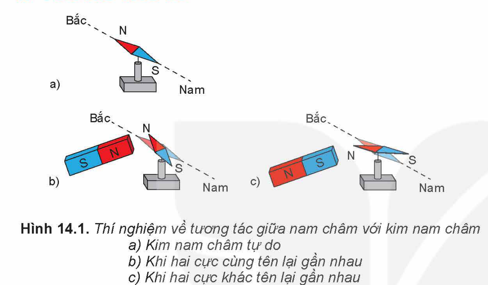

Hình 14.1. Thí nghiệm về tương tác giữa nam châm với kim nam châm: a) Kim nam châm tự do; b) Khi hai cực cùng tên lại gần nhau; c) Khi hai cực khác tên lại gần nhau

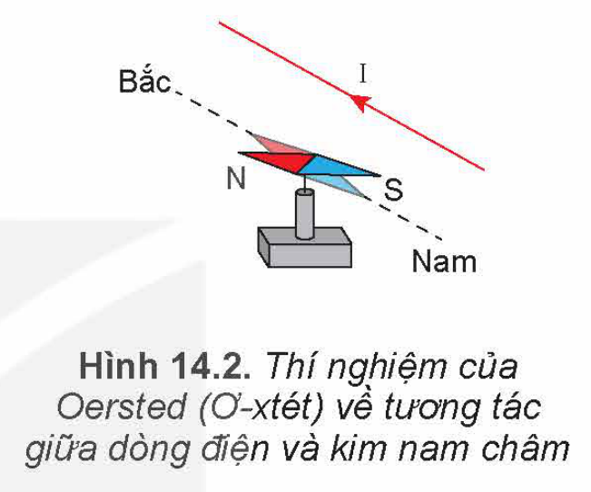

Hình 14.2. Thí nghiệm của Oersted (Ơ-xtét) về tương tác giữa dòng điện và kim nam châm

> ✋ 1. Khi đưa hai cực cùng tên hay khác tên của một nam châm thẳng và kim nam châm lại gần nhau (Hình 14.1) thì chúng đẩy nhau hay hút nhau?
>
> 2. Khi cho dòng điện chạy qua dây dẫn ta thấy kim nam châm lệch một góc so với phương ban đầu (Hình 14.2). Dự đoán điều gì xảy ra nếu ta đổi chiều dòng điện chạy qua dây dẫn. Trong thí nghiệm này, kim nam châm có tác dụng lực lên dòng điện không?
>
> 3. Khi cho dòng điện chạy qua hai tấm kim loại mỏng, nhẹ như ở Hình 14.3, ta thấy hai tấm kim loại đẩy nhau. Hãy dự đoán hiện tượng xảy ra nếu dòng điện qua hai tấm kim loại cùng chiều.

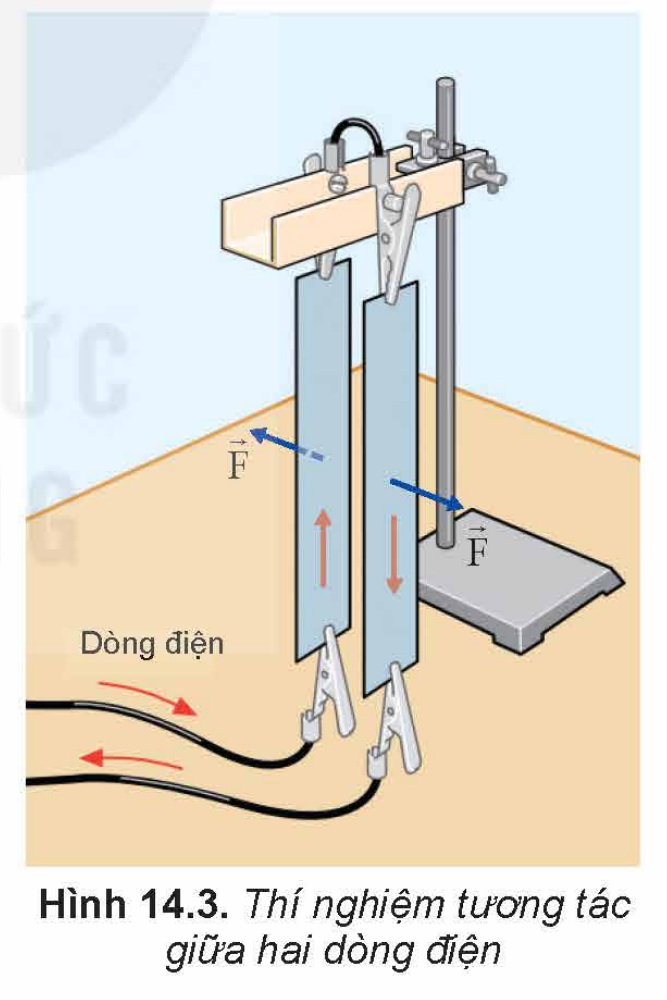

Hình 14.3. Thí nghiệm tương tác giữa hai dòng điện

Tương tác giữa nam châm với nam châm, giữa dòng điện với nam châm và giữa dòng điện với dòng điện đều gọi là **tương tác từ**. Lực tương tác trong các trường hợp đó gọi là **lực từ**.

## II. TỪ TRƯỜNG

### 1. Khái niệm từ trường

Các thí nghiệm ở trên cho thấy khi kim nam châm đặt gần một nam châm hay một dòng điện, thì có lực từ tác dụng lên kim nam châm. Ta nói, xung quanh nam châm, xung quanh dòng điện có từ trường.

<!-- pdf:59 -->

**Từ trường** là trường lực gây ra bởi dòng điện hoặc nam châm, là một dạng của vật chất tồn tại xung quanh dòng điện hoặc nam châm mà biểu hiện cụ thể là sự xuất hiện của lực từ tác dụng lên một dòng điện hay một nam châm khác đặt trong nó.

> ✋ Hãy mô tả một thí nghiệm khảo sát lực từ do nam châm tác dụng lên dòng điện.

### 2. Tính chất cơ bản của từ trường

Tính chất cơ bản của từ trường là nó gây ra lực từ tác dụng lên một nam châm hay một dòng điện đặt trong nó. Nhờ tính chất này người ta dùng kim nam châm, gọi là **nam châm thử** để phát hiện sự tồn tại của từ trường.

### 3. Cảm ứng từ

- Để đặc trưng cho từ trường về mặt tác dụng lực người ta đưa vào một đại lượng vectơ gọi là **cảm ứng từ**, kí hiệu là $\vec{B}$. Khi nam châm thử nằm cân bằng ở các điểm khác nhau trong từ trường thì nói chung nó định hướng theo các phương khác nhau. Điều đó gợi ý rằng có thể coi phương của nam châm thử nằm cân bằng tại một điểm trong từ trường là phương của vectơ cảm ứng từ $\vec{B}$ của từ trường tại điểm đó. Người ta quy ước lấy chiều từ cực Nam sang cực Bắc của nam châm thử là chiều của vectơ cảm ứng từ $\vec{B}$.
- Ta thừa nhận rằng lực từ tác dụng lên một dòng điện (đoạn dây dẫn có dòng điện chạy qua) hay một nam châm đặt trong từ trường ở điểm nào lớn hơn thì cảm ứng từ tại điểm đó lớn hơn. Độ lớn của cảm ứng từ $\vec{B}$ được xác định ở bài sau (xem Bài 15).
- **Từ trường đều** là từ trường có cảm ứng từ $\vec{B}$ tại mọi điểm đều bằng nhau.

## III. ĐƯỜNG SỨC TỪ

### 1. Từ phổ

Để có thể thấy hình ảnh trực quan của từ trường, ta sử dụng các mạt sắt mịn. Các mạt sắt mịn đặt trong từ trường bị nhiễm từ khiến chúng trở thành các nam châm thử.

> ✋ **Thí nghiệm 1**
>
> *Chuẩn bị:*
>
> - Hộp nhựa có một mặt trong suốt, bên trong chứa dầu và mạt sắt mịn.
> - Nam châm thẳng.
> - Nam châm hình chữ U.
>
> *Tiến hành:*
>
> - Lắc nhẹ hộp nhựa sao cho các mạt sắt phân bố đều. Đặt hộp nhựa trên mặt phẳng nằm ngang, mặt trong suốt hướng lên trên.
> - Đặt nhẹ nhàng thanh nam châm thẳng lên trên mặt trong suốt của hộp nhựa rồi gõ nhẹ. Quan sát hình ảnh mạt sắt vừa được tạo thành trong hộp nhựa (Hình 14.4a).

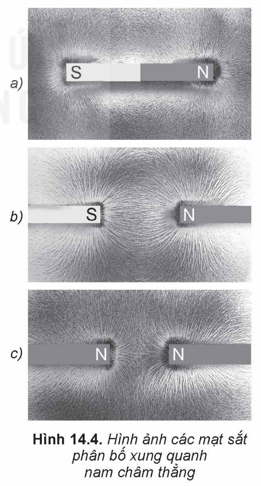

Hình 14.4. Hình ảnh các mạt sắt phân bố xung quanh nam châm thẳng

<!-- pdf:60 -->

> - Nhấc thanh nam châm thẳng lên khỏi mặt hộp nhựa. Lắc nhẹ hộp nhựa cho các mạt sắt phân bố đều trở lại. Tiếp tục đặt nhẹ nhàng hai thanh nam châm thẳng lên trên mặt trong suốt của hộp nhựa (sao cho hai cực trái dấu của hai thanh nam châm thẳng gần nhau) rồi gõ nhẹ. Quan sát hình ảnh mạt sắt vừa được tạo thành trong hộp nhựa (Hình 14.4b).
> - Thực hiện tương tự như trên nhưng cho hai cực cùng tên của hai thanh nam châm gần nhau. Quan sát hình ảnh mạt sắt vừa được tạo thành trong hộp nhựa (Hình 14.4c).
> - Tiến hành thí nghiệm tương tự đối với nam châm hình chữ U (Hình 14.5).
>
> 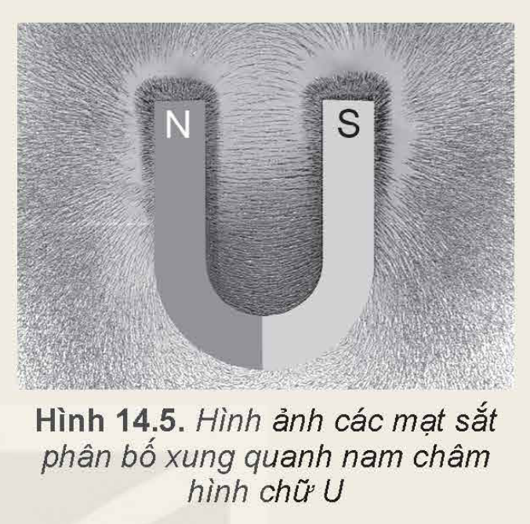
>
> Hình 14.5. Hình ảnh các mạt sắt phân bố xung quanh nam châm hình chữ U
>
> *Thực hiện các yêu cầu sau:*
>
> 1. Nhận xét hình ảnh sự phân bố mạt sắt ở khoảng giữa của hai nam châm thẳng Hình 14.4b và ở khoảng giữa của hai nam châm thẳng Hình 14.4c.
> 2. Nhận xét về hình ảnh sự phân bố mạt sắt ở giữa hai cực của nam châm hình chữ U. Từ đó có thể rút ra kết luận gì về từ trường trong khoảng giữa hai cực của nam châm hình chữ U.

> ✋ **Thí nghiệm 2**
>
> *Chuẩn bị:*
>
> - Hộp nhựa có một mặt trong suốt, bên trong chứa dầu và mạt sắt mịn.
> - Ống dây gắn với hộp nhựa.
> - Dây dẫn thẳng.
> - Nguồn điện một chiều.
>
> *Tiến hành:*
>
> - Lắc nhẹ hộp nhựa có gắn ống dây sao cho các mạt sắt phân bố đều ở bên ngoài và bên trong lòng ống dây.
> - Cho dòng điện chạy qua ống dây.
> - Gõ nhẹ vào hộp nhựa để các mạt sắt phân bố ổn định (Hình 14.6).
>
> 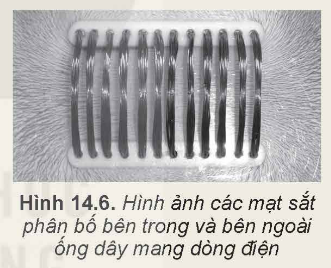
>
> Hình 14.6. Hình ảnh các mạt sắt phân bố bên trong và bên ngoài ống dây mang dòng điện
>
> Tiến hành thí nghiệm tương tự với dây dẫn thẳng ta thu được hình ảnh như Hình 14.7.
>
> 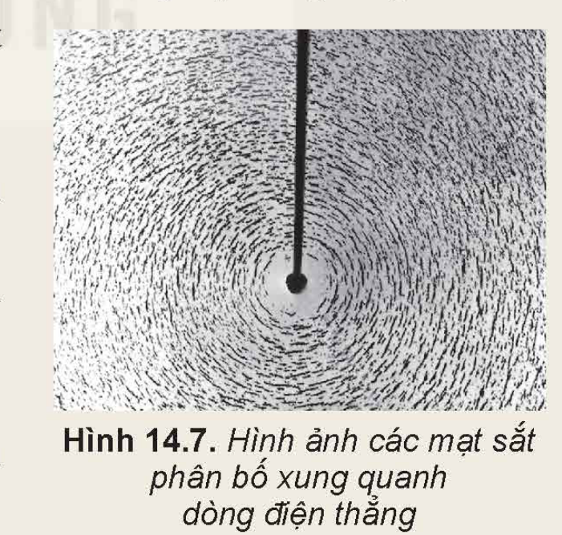
>
> Hình 14.7. Hình ảnh các mạt sắt phân bố xung quanh dòng điện thẳng
>
> *Thực hiện các yêu cầu sau:*
>
> 1. Mô tả hình ảnh sự phân bố mạt sắt phân bố xung quanh dòng điện thẳng.
> 2. Nhận xét về hình ảnh sự phân bố mạt sắt bên trong ống dây và bên ngoài ống dây.
> 3. So sánh hình ảnh và sự phân bố mạt sắt ở bên ngoài ống dây với hình ảnh đường sức từ của nam châm thẳng.

Hình ảnh những đường tạo ra bởi các mạt sắt trong các thí nghiệm trên được gọi là **từ phổ**. Từ phổ cho ta thấy hình ảnh trực quan của từ trường.

<!-- pdf:61 -->

### 2. Đường sức từ

Để biểu diễn về mặt hình học của từ trường trong không gian, người ta đưa ra khái niệm đường sức từ.

**Đường sức từ** là những đường vẽ ở trong không gian có từ trường sao cho tiếp tuyến với nó tại mỗi điểm trùng với phương của vectơ cảm ứng từ tại điểm đó. Chiều của đường sức từ là chiều của vectơ cảm ứng từ.

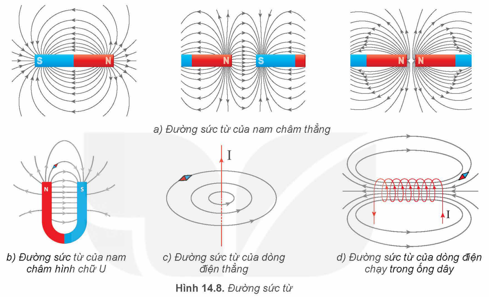

Hình 14.8. Đường sức từ: a) Đường sức từ của nam châm thẳng; b) Đường sức từ của nam châm hình chữ U; c) Đường sức từ của dòng điện thẳng; d) Đường sức từ của dòng điện chạy trong ống dây

Đường sức từ vẽ trong Hình 14.8 tương ứng với các từ phổ của nam châm thẳng, nam châm hình chữ U, của dòng điện thẳng và dòng điện chạy qua ống dây.

Đối với nam châm, các đường sức từ ở ngoài nam châm có chiều đi ra từ cực Bắc, đi vào cực Nam.

- *Các đặc điểm của đường sức từ:*
  + Tại mỗi điểm trong từ trường, chỉ có thể vẽ được một đường sức từ đi qua và chỉ một mà thôi.
  + Các đường sức từ là những đường cong khép kín.
  + Nơi nào từ trường mạnh hơn thì các đường sức từ ở đó vẽ dày hơn, nơi nào từ trường yếu hơn thì các đường sức từ vẽ thưa hơn.

Dùng nam châm thử đặt trên đường sức từ, ta biết được chiều của đường sức từ (Hình 14.8). Ta cũng có thể xác định chiều của đường sức từ theo quy tắc *nắm bàn tay phải* như sau:

+ Đối với dòng điện thẳng: *Giơ ngón cái của bàn tay phải hướng theo chiều dòng điện, khum bốn ngón tay kia xung quanh dây dẫn thì chiều từ cổ tay đến bốn ngón tay đó là chiều của đường sức từ* (Hình 14.9).
<!-- term: Quy tắc nắm bàn tay phải -->

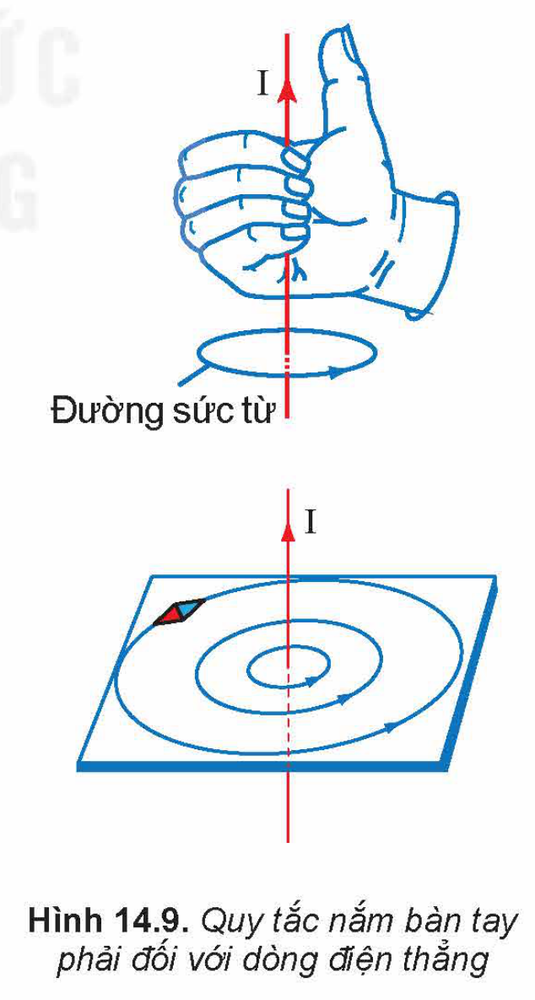

Hình 14.9. Quy tắc nắm bàn tay phải đối với dòng điện thẳng

<!-- pdf:62 -->

+ Đối với dòng điện tròn và ống dây: *Khum bàn tay phải sao cho chiều từ cổ tay đến các ngón tay trùng với chiều dòng điện chạy qua các vòng dây thì chiều ngón tay cái choãi ra chỉ chiều của đường sức từ* (Hình 14.10).
<!-- term: Quy tắc nắm bàn tay phải -->

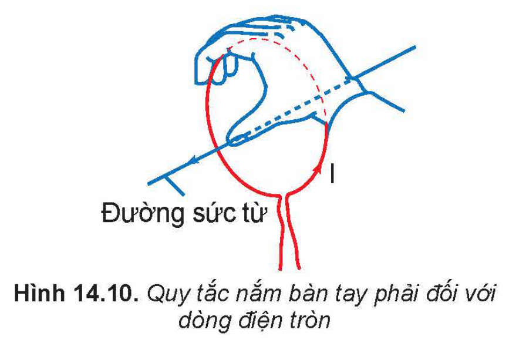

Hình 14.10. Quy tắc nắm bàn tay phải đối với dòng điện tròn

> ❓ Đặt một kim nam châm nhỏ trên mặt phẳng vuông góc với dòng điện thẳng. Khi cân bằng, kim nam châm nằm ở vị trí như Hình 14.11. Hãy xác định chiều của dòng điện chạy qua dây dẫn.
>
> 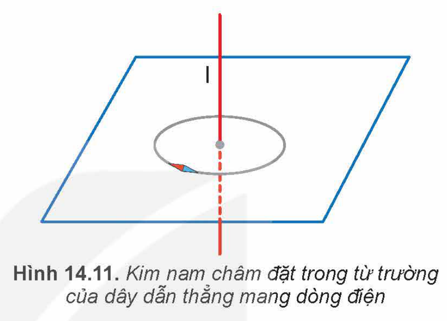
>
> Hình 14.11. Kim nam châm đặt trong từ trường của dây dẫn thẳng mang dòng điện

## 📌 Em đã học

- Từ trường là trường lực gây ra bởi dòng điện hoặc nam châm, là một dạng vật chất tồn tại xung quanh dòng điện hoặc nam châm mà biểu hiện cụ thể là sự xuất hiện của lực từ tác dụng lên một dòng điện hay một nam châm khác đặt trong nó.
- Đường sức từ là những đường vẽ ở trong không gian có từ trường sao cho tiếp tuyến với nó tại mỗi điểm trùng với phương của vectơ cảm ứng từ tại điểm đó. Chiều của đường sức từ là chiều của vectơ cảm ứng từ.

## ✏️ Em có thể

- Giải thích được nguyên tắc hoạt động của la bàn.
- Nêu được ứng dụng của nam châm trong cuộc sống như tàu đệm từ, nam châm điện.

## 📷 Danh sách hình trong bài

| Mã hình | Trang PDF | Vị trí | Chú thích gốc |
|---|---|---|---|
| H12-vat_ly-b14-01 | 58 | Mục I | Hình 14.1. Thí nghiệm về tương tác giữa nam châm với kim nam châm: a) Kim nam châm tự do; b) Khi hai cực cùng tên lại gần nhau; c) Khi hai cực khác tên lại gần nhau |
| H12-vat_ly-b14-02 | 58 | Mục I | Hình 14.2. Thí nghiệm của Oersted (Ơ-xtét) về tương tác giữa dòng điện và kim nam châm |
| H12-vat_ly-b14-03 | 58 | Mục I | Hình 14.3. Thí nghiệm tương tác giữa hai dòng điện |
| H12-vat_ly-b14-04 | 59 | Mục III.1, Thí nghiệm 1 | Hình 14.4. Hình ảnh các mạt sắt phân bố xung quanh nam châm thẳng |
| H12-vat_ly-b14-05 | 60 | Mục III.1, Thí nghiệm 1 | Hình 14.5. Hình ảnh các mạt sắt phân bố xung quanh nam châm hình chữ U |
| H12-vat_ly-b14-06 | 60 | Mục III.1, Thí nghiệm 2 | Hình 14.6. Hình ảnh các mạt sắt phân bố bên trong và bên ngoài ống dây mang dòng điện |
| H12-vat_ly-b14-07 | 60 | Mục III.1, Thí nghiệm 2 | Hình 14.7. Hình ảnh các mạt sắt phân bố xung quanh dòng điện thẳng |
| H12-vat_ly-b14-08 | 61 | Mục III.2 | Hình 14.8. Đường sức từ: a) Đường sức từ của nam châm thẳng; b) Đường sức từ của nam châm hình chữ U; c) Đường sức từ của dòng điện thẳng; d) Đường sức từ của dòng điện chạy trong ống dây |
| H12-vat_ly-b14-09 | 61 | Mục III.2 | Hình 14.9. Quy tắc nắm bàn tay phải đối với dòng điện thẳng |
| H12-vat_ly-b14-10 | 62 | Mục III.2 | Hình 14.10. Quy tắc nắm bàn tay phải đối với dòng điện tròn |
| H12-vat_ly-b14-11 | 62 | Mục III.2, hộp Câu hỏi | Hình 14.11. Kim nam châm đặt trong từ trường của dây dẫn thẳng mang dòng điện |
