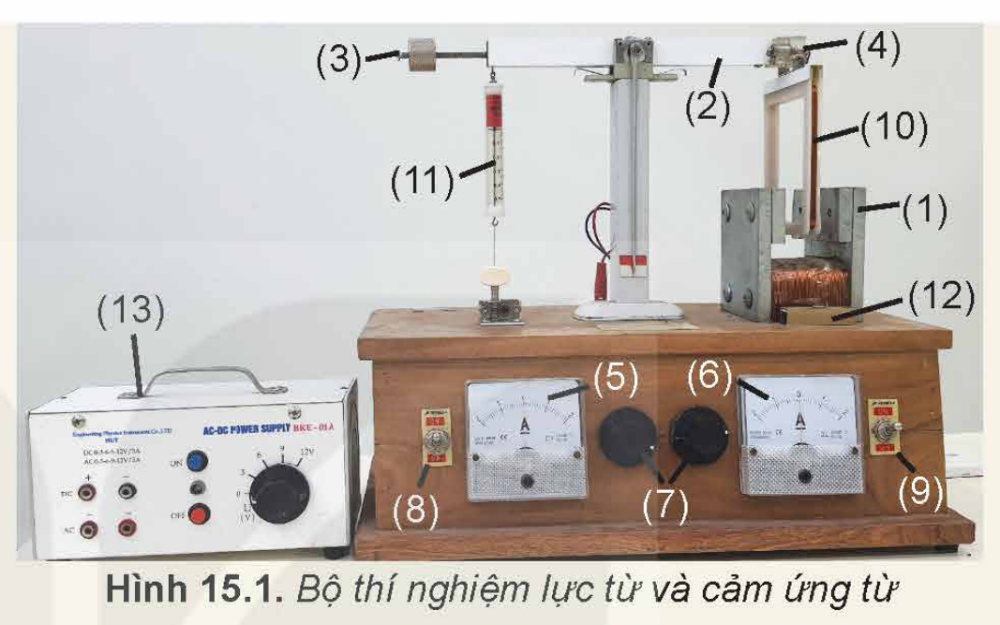
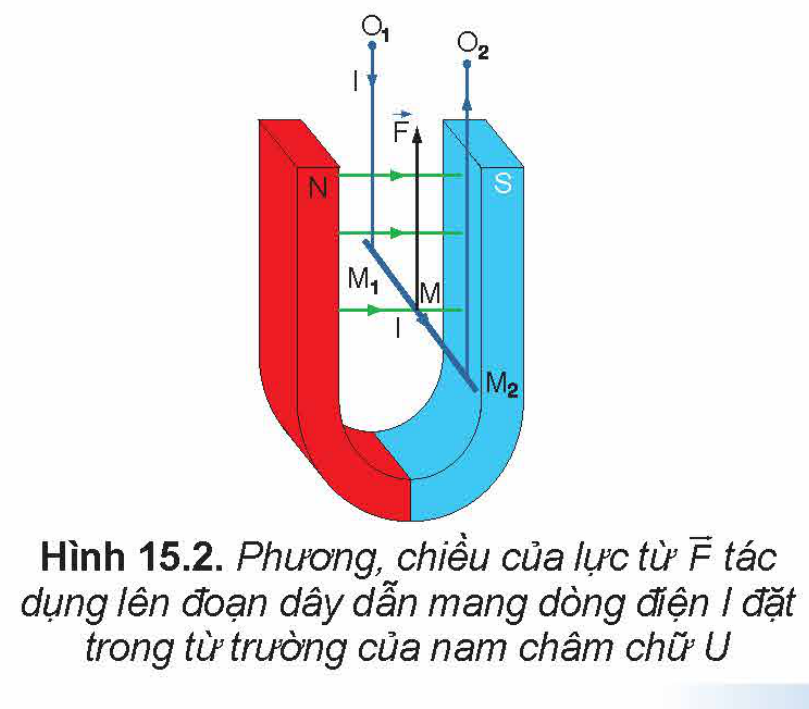
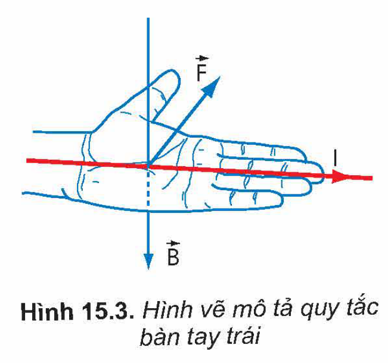
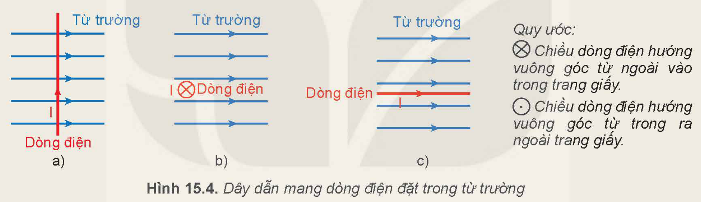
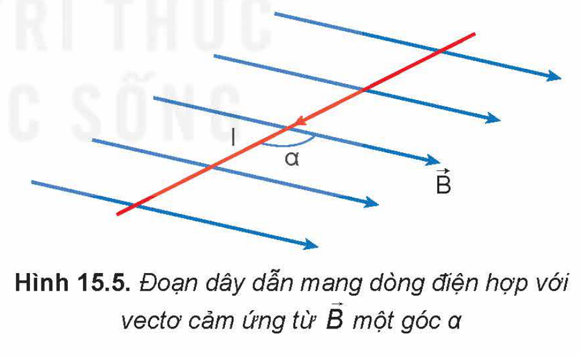
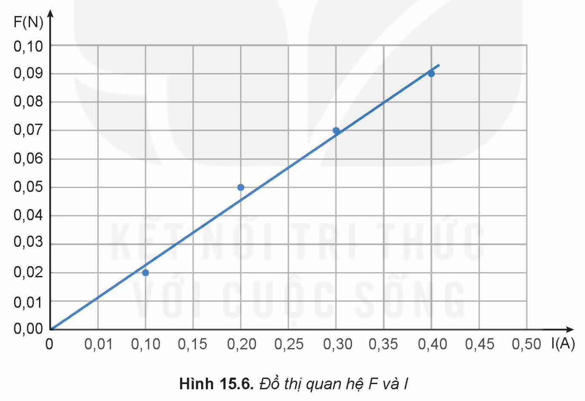
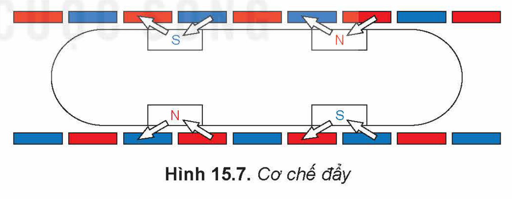
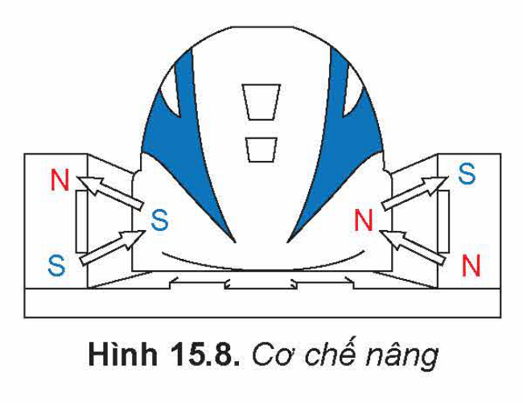

<!-- pdf:63 -->

# BÀI 15: LỰC TỪ TÁC DỤNG LÊN DÂY DẪN MANG DÒNG ĐIỆN. CẢM ỨNG TỪ

## 🔴 Mở đầu

> Tính chất cơ bản của từ trường là gây ra lực từ tác dụng lên một nam châm hay một dòng điện đặt trong từ trường đó. Vậy lực từ có đặc điểm như thế nào?

## I. THÍ NGHIỆM VỀ LỰC TỪ TÁC DỤNG LÊN ĐOẠN DÂY DẪN MANG DÒNG ĐIỆN

Để khảo sát lực từ tác dụng lên đoạn dây dẫn mang dòng điện người ta sử dụng thiết bị như Hình 15.1.

> ✋ **Thí nghiệm**
>
> *Chuẩn bị:* Thiết bị thí nghiệm gồm:
>
> - Hộp gỗ có gắn các thiết bị dưới đây:
>   + Nam châm điện có gắn hai tấm thép (1).
>   + Đòn cân (2) có gắn gia trọng (3) và khớp nối với khung dây dẫn (4).
>   + Hai ampe kế có giới hạn đo 2 A (5), (6).
>   + Hai biến trở xoay $100\ \Omega - 2\text{ A}$ (7).
>   + Hai công tắc dùng để đảo chiều dòng điện qua nam châm điện và khung dây (8), (9).
> - Khung dây $n = 200$ vòng có chiều dài một cạnh $l = 10\text{ cm}$ (10).
> - Lực kế có giới hạn đo 0,5 N (11).
> - Đèn chỉ hướng từ trường trong lòng nam châm điện (12).
> - Nguồn điện một chiều, điện áp 12 V (13) và các dây nối.
>
> 
>
> Hình 15.1. Bộ thí nghiệm lực từ và cảm ứng từ
>
> *Tiến hành:*
>
> - Nối hai cực của nguồn điện DC với hai chốt cắm trên hộp gỗ. Cắm khung dây vào khớp nối trên đòn cân, sao cho cạnh dưới của khung dây nằm trong từ trường của nam châm.
> - Đóng công tắc điện.
>
> *Thực hiện các yêu cầu sau:*
>
> 1. Quan sát và giải thích hiện tượng xảy ra với khung dây.
> 2. Quan sát đèn chỉ hướng từ trường trong lòng nam châm điện, các cực của nguồn điện nối với khung dây, chiều chuyển động của khung dây; từ đó xác định chiều của cảm ứng từ bên trong lòng nam châm điện, chiều dòng điện và chiều của lực từ tác dụng lên đoạn dây dẫn mang dòng điện $I$ trong từ trường.
> 3. Dự đoán hiện tượng xảy ra nếu đổi chiều dòng điện chạy qua nam châm điện hoặc khung dây.
> 4. Đề xuất cách xác định chiều của lực từ.

Từ kết quả thí nghiệm và nhiều thí nghiệm khác cũng cho thấy:

- Khi cho dòng điện có cường độ $I$ chạy qua đoạn dây dẫn đặt trong từ trường thì xuất hiện lực từ $\vec{F}$ tác dụng lên đoạn dây dẫn mang dòng điện.
- Lực từ $\vec{F}$ có phương vuông góc với đoạn dây dẫn mang dòng điện đặt trong từ trường và vuông góc với đường sức từ (Hình 15.2).

Hình 15.2. Phương, chiều của lực từ $\vec{F}$ tác dụng lên đoạn dây dẫn mang dòng điện $I$ đặt trong từ trường của nam châm chữ U

<!-- pdf:64 -->

Chiều của lực từ được xác định theo quy tắc bàn tay trái: *Đặt bàn tay trái sao cho vectơ cảm ứng từ $\vec{B}$ hướng vào lòng bàn tay, chiều từ cổ tay đến các ngón tay trùng với chiều dòng điện, thì ngón tay cái choãi ra $90^\circ$ chỉ chiều của lực từ $\vec{F}$ tác dụng lên dòng điện* (Hình 15.3).
<!-- term: Quy tắc bàn tay trái -->

Hình 15.3. Hình vẽ mô tả quy tắc bàn tay trái

> ✋ Sử dụng quy tắc bàn tay trái để kiểm chứng chiều của lực từ tác dụng lên thanh kim loại $\text{M}_1\text{M}_2$ trong Hình 15.2.

> ❓ Ba dây dẫn mang dòng điện đặt trong từ trường như Hình 15.4.
>
> 1. Hãy xác định phương và chiều của lực từ tác dụng lên dây dẫn ở Hình 15.4a, 15.4b.
> 2. Trong trường hợp Hình 15.4c, có lực từ tác dụng lên dây dẫn không? Dự đoán lực từ còn phụ thuộc vào yếu tố nào khác?
>
> 
>
> Hình 15.4. Dây dẫn mang dòng điện đặt trong từ trường
>
> *Quy ước:* $\otimes$ Chiều dòng điện hướng vuông góc từ ngoài vào trong trang giấy. $\odot$ Chiều dòng điện hướng vuông góc từ trong ra ngoài trang giấy.

## II. ĐỘ LỚN CẢM ỨNG TỪ

### 1. Biểu thức

Gọi góc $\alpha$ là góc hợp bởi dòng điện $I$ (đoạn dây dẫn $L$ mang dòng điện đặt trong từ trường) và đường sức từ (Hình 15.5).

Hình 15.5. Đoạn dây dẫn mang dòng điện hợp với vectơ cảm ứng từ $\vec{B}$ một góc $\alpha$

Tiếp tục tiến hành thí nghiệm như mô tả ở mục I. Trong đó, lần lượt cho $L$, $I$ và góc $\alpha$ thay đổi, các kết quả cho thấy thương số tương ứng $\frac{F}{L}$, $\frac{F}{I}$ và $\frac{F}{\sin\alpha}$ đều là các hằng số. Nghĩa là độ lớn của lực từ $F$ tác dụng lên đoạn dây dẫn mang dòng điện tỉ lệ với chiều dài $L$ của đoạn dây dẫn, tỉ lệ với cường độ dòng điện $I$ chạy qua đoạn dây và tỉ lệ với $\sin\alpha$. Nói cách khác thì thương số $\frac{F}{IL\sin\alpha}$ có giá trị không đổi.

Do đó, với một nam châm nhất định có thể lấy thương số này làm đại lượng đặc trưng cho từ trường về phương diện tác dụng lực. Người ta gọi thương số này là **độ lớn của cảm ứng từ** của từ trường tại vị trí khảo sát, kí hiệu là $B$.

$B = \frac{F}{IL\sin\alpha} \qquad (15.1)$

<!-- pdf:65 -->

Từ công thức (15.1), ta có thể rút ra:

$F = BIL\sin\alpha \qquad (15.2)$

Trong đó: $B$ là cảm ứng từ; $I$ là cường độ dòng điện; $L$ chiều dài đoạn dây mang dòng điện đặt trong từ trường; $\alpha$ là góc hợp bởi đoạn dây mang dòng điện và vectơ cảm ứng từ $\vec{B}$. Công thức (15.2) là công thức của định luật Am-pe về lực từ tác dụng lên đoạn dây dẫn mang dòng điện đặt trong từ trường đều.
<!-- term: Định luật Am-pe -->

### 2. Đơn vị

Trong hệ SI, đơn vị cảm ứng từ là **tesla** (T). Một tesla (1 T) là độ lớn cảm ứng từ của một từ trường đều mà khi ta đặt vào trong nó một dòng điện thẳng có cường độ 1 ampe vuông góc với các đường sức từ thì mỗi mét dài của dòng điện chịu tác dụng của một lực từ bằng 1 niutơn.

Trong công thức (15.1), $F$ đo bằng niutơn (N), $I$ đo bằng ampe (A) và $L$ đo bằng mét (m).

$1\text{ T} = \frac{1\text{ N}}{1\text{ m}.1\text{ A}}$

Vì $1\text{ N} = 1\text{ kg.m.s}^{-2}$ nên $1\text{ T} = 1\text{ N/A.m} = 1\text{ kg/A.s}^2 = 1\text{ kg.A}^{-1}\text{.s}^{-2}$.

> ❓ 1. Xét một đoạn dây dẫn thẳng có chiều dài $L = 1\text{ m}$, có dòng điện $I = 3\text{ A}$ chạy qua được đặt trong từ trường đều có cảm ứng từ $B = 5.10^{-2}\text{ T}$. Hãy xác định độ lớn của lực từ tác dụng lên đoạn dây dẫn mang dòng điện nếu phương của dây dẫn hợp với vectơ cảm ứng từ một góc $60^\circ$.
>
> 2. Một dây dẫn dài 50 cm có dòng điện chạy qua được đặt vuông góc với từ trường có độ lớn cảm ứng từ là 5 mT.
>
> a) Nếu có $10^{18}$ electron chạy qua dây dẫn trong mỗi giây thì cường độ dòng điện chạy qua dây dẫn bằng bao nhiêu? (Cho biết độ lớn điện tích electron là $|e| = 1,60\cdot 10^{-19}\text{ C}$).
>
> b) Tính độ lớn của lực từ tác dụng lên dây dẫn.

## III. THỰC HÀNH ĐO ĐỘ LỚN CẢM ỨNG TỪ

### 1. Mục đích thí nghiệm

Xác định độ lớn cảm ứng từ của từ trường đều.

### 2. Dụng cụ thí nghiệm

Dụng cụ thí nghiệm như Hình 15.1.

### 3. Thiết kế phương án thí nghiệm

> ✋ a) Từ công thức (15.1), hãy cho biết để xác định cảm ứng từ thì cần đo các đại lượng nào?
>
> b) Nên đặt góc $\alpha$ bằng bao nhiêu? Tại sao?
>
> c) Mô tả các bước tiến hành thí nghiệm để đo được cảm ứng từ của nam châm điện.

<!-- pdf:66 -->

### 4. Tiến hành thí nghiệm

a) Treo khung dây vào đầu đòn cân.

b) Điều chỉnh khung dây vuông góc với vectơ cảm ứng từ của nam châm điện ($\alpha = 90^\circ$).

c) Điều chỉnh gia trọng và dây căng lực kế để lực kế đo được lực từ.

d) Bật công tắc nguồn điện. Điều chỉnh cường độ dòng điện qua nam châm điện ở mức ban đầu 0,1 A. Xác định giá trị của lực từ $F$ qua lực kế.

e) Thay đổi giá trị cường độ dòng điện qua khung dây mỗi lần tăng lên 0,1 A. Đọc giá trị cường độ dòng điện $I$ qua khung dây và xác định giá trị lực từ $\vec{F}$ qua lực kế, ghi kết quả vào vở như ví dụ ở Bảng 15.1.

g) Đánh dấu các điểm thực nghiệm lên hệ trục toạ độ và vẽ đường thẳng đi gần nhất các điểm thực nghiệm (tham khảo Hình 15.6).

**Bảng 15.1.** *Kết quả thí nghiệm đo cảm ứng từ của nam châm điện. Trường hợp $\alpha = 90^\circ$; chiều dài dây dẫn đặt trong từ trường nam châm $L = nl = 20\text{ (m)}$*

| Lần thí nghiệm | $I\text{ (A)}$ | $F\text{ (N)}$ | $\frac{F}{IL}$ |
|---|---|---|---|
| 1 | 0,1 | 0,02 | 0,010 |
| 2 | 0,2 | 0,05 | 0,013 |
| 3 | 0,3 | 0,07 | 0,012 |
| 4 | 0,4 | 0,09 | 0,011 |

Hình 15.6. Đồ thị quan hệ $F$ và $I$

### 5. Kết quả thí nghiệm

> ✋ - Tính $\frac{F}{IL}$ và điền vào bảng như ví dụ minh hoạ ở Bảng 15.1.
> - Tính giá trị trung bình, sai số phép đo độ lớn cảm ứng từ $B$ của từ trường nam châm.
>
> *Nhận xét và đánh giá kết quả thí nghiệm:*
>
> Nhận xét về nguyên nhân gây ra sai số của phép đo và đề ra giải pháp để giảm sai số đó.

<!-- pdf:67 -->

## 📌 Em đã học

- Lực từ $\vec{F}$ tác dụng lên đoạn dây dẫn dài $L$ mang dòng điện có cường độ $I$, đặt trong từ trường đều có cảm ứng từ $\vec{B}$ có:
  + Điểm đặt tại trung điểm của đoạn dây mang dòng điện;
  + Phương vuông góc với $I$ và $\vec{B}$;
  + Chiều tuân theo theo quy tắc bàn tay trái;
  + Độ lớn: $F = BIL\sin\alpha$.
- Vectơ cảm ứng từ $\vec{B}$ của từ trường tại một điểm:
  + Có phương trùng với phương của nam châm thử đặt tại điểm đó.
  + Có chiều đi từ cực Nam sang cực Bắc của nam châm thử đặt tại điểm đó.
  + Có độ lớn $B = \frac{F}{IL\sin\alpha}$.
- Cách xác định độ lớn cảm ứng từ của từ trường đều bằng thiết bị thí nghiệm.

## ✏️ Em có thể

- Giải thích được nguyên tắc hoạt động của tàu đệm từ.

> 💡 EM CÓ BIẾT?
>
> **TÀU ĐỆM TỪ**
>
> **Tàu đệm từ** là một phương tiện giao thông chạy trên đệm từ trường, tàu vận hành rất êm, không rung lắc và không gây ra nhiều tiếng ồn như tàu truyền thống.
>
> Tàu sử dụng cơ chế nâng, đẩy và dẫn lái để khi di chuyển với tốc độ cao mà tàu không bị bay ra khỏi bề mặt đường ray.
>
> Cơ chế đẩy: Khi từ trường của các nam châm điện đặt ở hai bên thành đường ray tương tác với từ trường của nam châm siêu dẫn đặt trên thành tàu sẽ sinh ra lực đẩy tàu hướng về phía trước (Hình 15.7).
>
> 
>
> Hình 15.7. Cơ chế đẩy
>
> Cơ chế nâng: Cơ chế này tương tự như cơ chế đẩy nhưng với mục đích nâng tàu lên. Bánh xe sẽ được nâng lên khi tàu đạt tới tốc độ tới hạn. Ở tốc độ tới hạn, lực từ lúc này đủ lớn để nâng tàu lướt trên đường ray (Hình 15.8).
>
> Hệ thống dẫn lái: Bằng cách sử dụng tính chất của nam châm, cùng cực thì đẩy nhau, khác cực thì hút nhau, hệ thống lái có nhiệm vụ giúp tàu cân bằng, ổn định tàu với đường ray khi di chuyển.
>
> 
>
> Hình 15.8. Cơ chế nâng

## 📷 Danh sách hình trong bài

| Mã hình | Trang PDF | Vị trí | Chú thích gốc |
|---|---|---|---|
| H12-vat_ly-b15-01 | 63 | Mục I, Thí nghiệm | Hình 15.1. Bộ thí nghiệm lực từ và cảm ứng từ |
| H12-vat_ly-b15-02 | 63 | Mục I | Hình 15.2. Phương, chiều của lực từ $\vec{F}$ tác dụng lên đoạn dây dẫn mang dòng điện I đặt trong từ trường của nam châm chữ U |
| H12-vat_ly-b15-03 | 64 | Mục I | Hình 15.3. Hình vẽ mô tả quy tắc bàn tay trái |
| H12-vat_ly-b15-04 | 64 | Mục I, hộp Câu hỏi | Hình 15.4. Dây dẫn mang dòng điện đặt trong từ trường |
| H12-vat_ly-b15-05 | 64 | Mục II.1 | Hình 15.5. Đoạn dây dẫn mang dòng điện hợp với vectơ cảm ứng từ $\vec{B}$ một góc $\alpha$ |
| H12-vat_ly-b15-06 | 66 | Mục III.4 | Hình 15.6. Đồ thị quan hệ F và I |
| H12-vat_ly-b15-07 | 67 | Hộp Em có biết | Hình 15.7. Cơ chế đẩy |
| H12-vat_ly-b15-08 | 67 | Hộp Em có biết | Hình 15.8. Cơ chế nâng |
