<!-- pdf:68 -->

# BÀI 16: TỪ THÔNG. HIỆN TƯỢNG CẢM ỨNG ĐIỆN TỪ

## 🔴 Mở đầu

> Khi số đường sức từ xuyên qua tiết diện của cuộn dây dẫn kín biến thiên thì trong cuộn dây dẫn đó xuất hiện dòng điện cảm ứng. Hãy cho biết có những cách nào làm cho số đường sức từ qua tiết diện của cuộn dây dẫn kín biến thiên?

## I. TỪ THÔNG

Xét một vòng dây dẫn kín (C) có diện tích $S$, được đặt trong từ trường đều $\vec{B}$. Vẽ vectơ đơn vị pháp tuyến $\vec{n}$ của $S$. Chiều của $\vec{n}$ có thể chọn tuỳ ý. Góc hợp thành bởi $\vec{B}$ và $\vec{n}$ kí hiệu là $\alpha$ (Hình 16.1). Ta đặt: $\Phi = BS\cos\alpha \qquad (16.1)$. Đại lượng $\Phi$ gọi là **từ thông** qua diện tích $S$.

Đơn vị của từ thông trong hệ SI là **vêbe** (weber), kí hiệu Wb.

Ta có: $1\text{ Wb} = 1\text{ T}.1\text{ m}^2$.

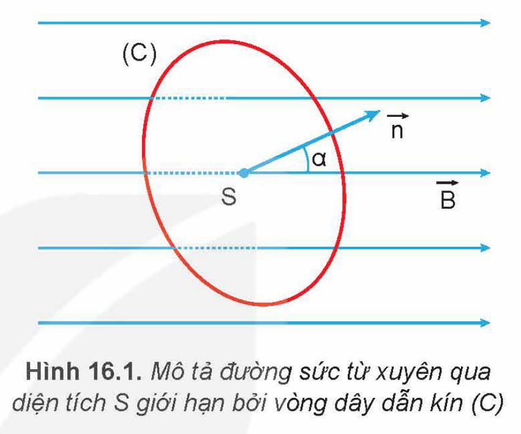

Hình 16.1. Mô tả đường sức từ xuyên qua diện tích $S$ giới hạn bởi vòng dây dẫn kín (C)

Khi cảm ứng từ $\vec{B}$ vuông góc với mặt phẳng vòng dây thì $\alpha = 0$, ta có: $\cos\alpha = 1$. Nếu vòng dây có diện tích là $1\text{ m}^2$, theo biểu thức (16.1), ta có trị số của từ thông bằng độ lớn của cảm ứng từ.

Trong trường hợp này, từ thông qua một đơn vị diện tích của vòng dây trong từ trường có vectơ pháp tuyến của vòng dây đặt song song với vectơ cảm ứng từ và có độ lớn bằng độ lớn cảm ứng từ $\vec{B}$. Do đó, từ thông có thể diễn tả số đường sức từ xuyên qua một diện tích nào đó.

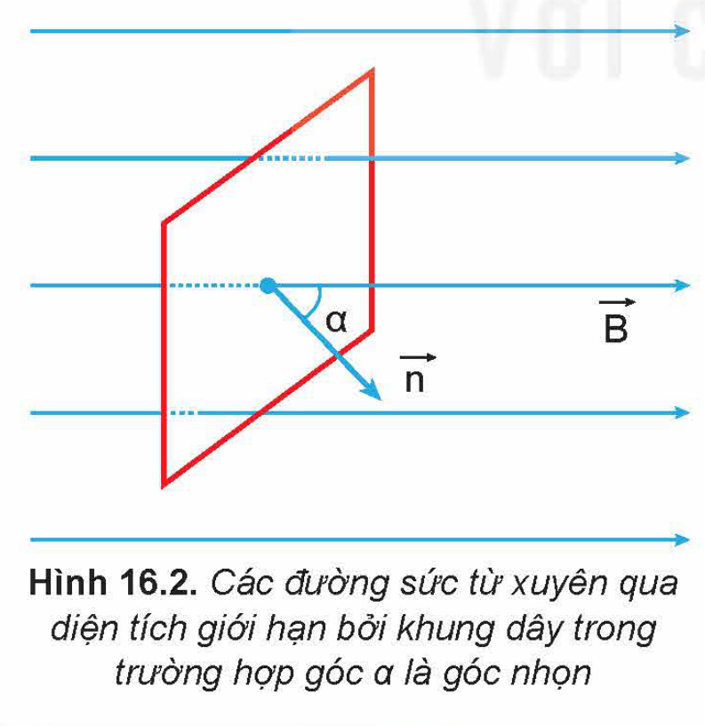

Hình 16.2. Các đường sức từ xuyên qua diện tích giới hạn bởi khung dây trong trường hợp góc $\alpha$ là góc nhọn

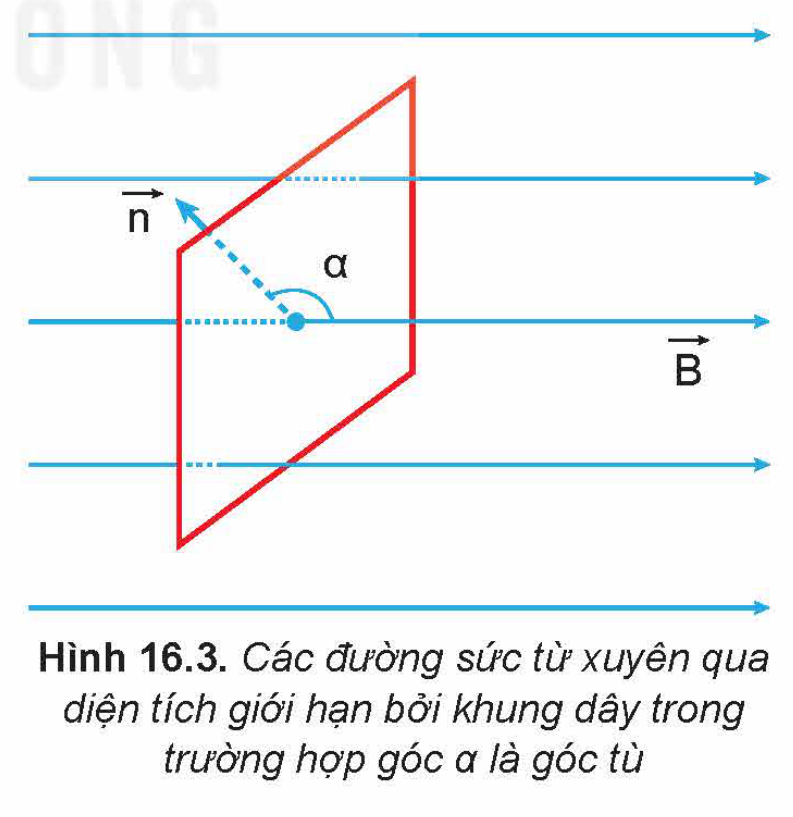

Hình 16.3. Các đường sức từ xuyên qua diện tích giới hạn bởi khung dây trong trường hợp góc $\alpha$ là góc tù

> ❓ Từ biểu thức (16.1) hãy cho biết trong trường hợp nào thì từ thông qua vòng dây diện tích $S$ giới hạn bởi dẫn kín (C) có trị số bằng 0, có trị số dương, trị số âm.

<!-- pdf:69 -->

> ✋ Để làm từ thông biến thiên, có thể biến đổi từng đại lượng $B$, $S$, $\alpha$ trong biểu thức (16.1). Hãy đề xuất các cách có thể làm biến thiên từ thông qua tiết diện khung dây dẫn mềm nối với điện kế thành mạch kín trong các trường hợp sau:
>
> Trường hợp 1: Khung dây dẫn đặt cạnh nam châm vĩnh cửu (Hình 16.4).
>
> Trường hợp 2: Khung dây dẫn đặt cạnh nam châm điện (Hình 16.5).
>
> 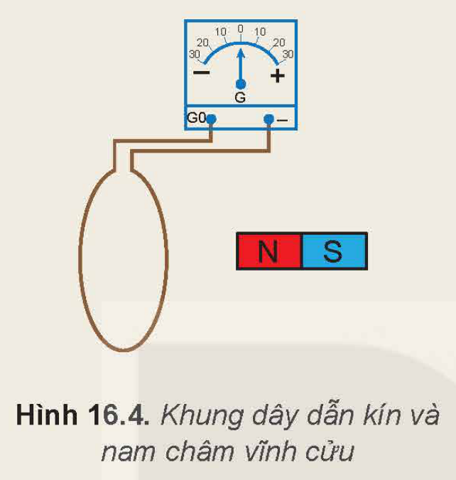
>
> Hình 16.4. Khung dây dẫn kín và nam châm vĩnh cửu
>
> 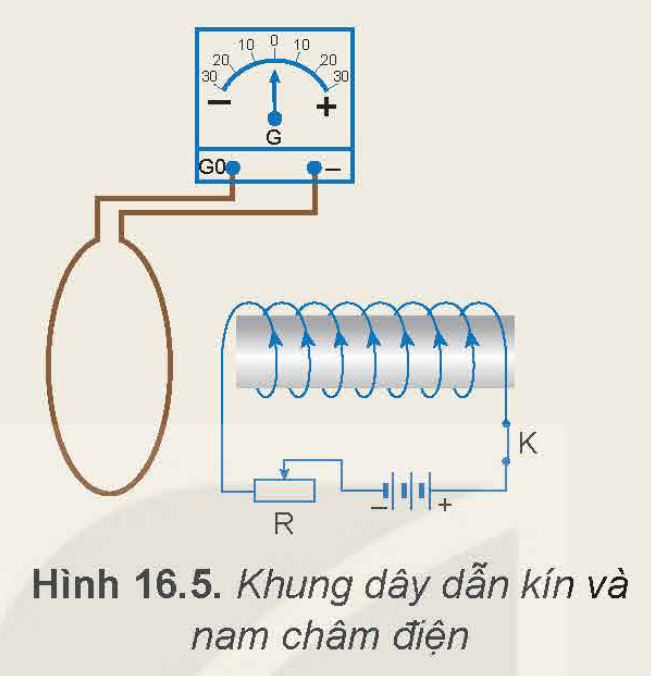
>
> Hình 16.5. Khung dây dẫn kín và nam châm điện
>
> ❗ Nếu dòng điện đi vào chốt $\text{G}_0$ và ra chốt $(-)$ thì kim điện kế lệch về phía $(+)$ (lệch sang phải); ngược lại, kim điện kế lệch về phía $(-)$ (lệch sang trái).

## II. HIỆN TƯỢNG CẢM ỨNG ĐIỆN TỪ

Ở lớp 9, ta đã biết *khi số đường sức từ xuyên qua tiết diện của cuộn dây dẫn kín biến thiên thì trong cuộn dây dẫn đó xuất hiện dòng điện cảm ứng* và hiện tượng xuất hiện dòng điện cảm ứng này gọi là hiện tượng cảm ứng điện từ.

> ❓ Từ các cách làm biến thiên từ thông qua cuộn dây dẫn kín, hãy đề xuất một số phương án thí nghiệm minh hoạ hiện tượng cảm ứng điện từ.

> ✋ **Thí nghiệm 1**
>
> *Chuẩn bị:* Nam châm (1), cuộn dây (2), điện kế (3) và các dây dẫn.
>
> *Tiến hành:*
>
> - Bố trí thí nghiệm như Hình 16.6 và điều chỉnh kim điện kế chỉ đúng vạch số 0.
> - Quan sát chiều lệch của kim điện kế trong các trường hợp sau:
>   + Dịch chuyển cực Bắc của nam châm lại gần cuộn dây.
>   + Dịch chuyển cực Bắc của nam châm ra xa cuộn dây.
>
> 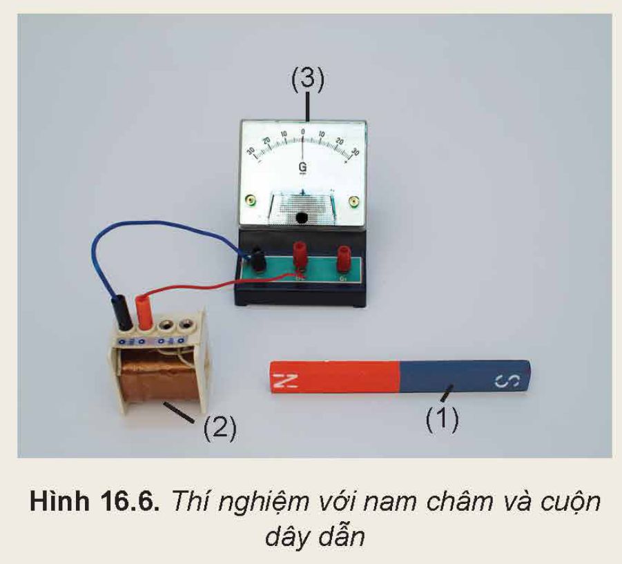
>
> Hình 16.6. Thí nghiệm với nam châm và cuộn dây dẫn

<!-- pdf:70 -->

> *Từ kết quả thí nghiệm quan sát được, thực hiện các yêu cầu sau:*
>
> 1. Khi nào kim điện kế dịch chuyển? Kim điện kế lệch khỏi vạch 0 chứng tỏ điều gì?
> 2. Giải thích sự biến thiên từ thông qua cuộn dây trong các trường hợp trên.
> 3. Nhận xét về mối liên hệ giữa sự biến thiên của từ thông qua cuộn dây với sự xuất hiện của dòng điện cảm ứng trong cuộn dây đó.

> ✋ **Thí nghiệm 2**
>
> *Chuẩn bị:* Nam châm điện (1), cuộn dây (2), điện kế (3), khoá K (4), nguồn điện (5), biến trở (6) và các dây dẫn.
>
> *Tiến hành:*
>
> - Lắp mạch điện như Hình 16.7 và điều chỉnh kim điện kế chỉ đúng vạch số 0.
> - Quan sát kim điện kế khi đóng hoặc ngắt khoá K.
> - Đóng khoá K rồi di chuyển con chạy trên biến trở sang trái hoặc sang phải. Quan sát kim điện kế.
>
> 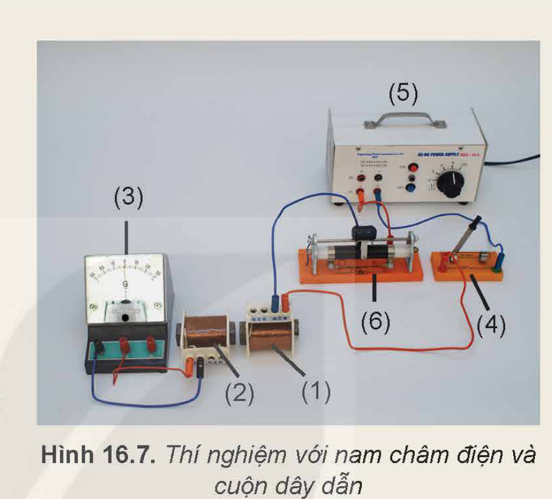
>
> Hình 16.7. Thí nghiệm với nam châm điện và cuộn dây dẫn
>
> *Từ kết quả thí nghiệm quan sát được, thực hiện các yêu cầu sau:*
>
> 1. Khi đóng, ngắt khoá K hoặc di chuyển con chạy trên biến trở thì kim điện kế có lệch khỏi vạch 0 không? Giải thích.
> 2. Khi đóng hoặc ngắt khoá K, đại lượng nào trong công thức (16.1) thay đổi làm xuất hiện dòng điện cảm ứng trong cuộn dây dẫn kín?

Dựa vào công thức từ thông (16.1), ta thấy rằng khi một trong các đại lượng $B$, $S$ hoặc $\alpha$ thay đổi thì từ thông $\Phi$ biến thiên.

Các thí nghiệm trên và nhiều thí nghiệm tương tự khác chứng tỏ rằng:

*Khi từ thông qua cuộn dây dẫn kín biến thiên thì trong cuộn dây dẫn đó xuất hiện một dòng điện gọi là **dòng điện cảm ứng**. Hiện tượng xuất hiện dòng điện cảm ứng trong cuộn dây dẫn gọi là **hiện tượng cảm ứng điện từ**.*

*Hiện tượng này chỉ tồn tại trong khoảng thời gian từ thông qua cuộn dây dẫn kín biến thiên.*

## III. CHIỀU DÒNG ĐIỆN CẢM ỨNG. ĐỊNH LUẬT LENZ

Để xác định chiều dòng điện cảm ứng trong thí nghiệm 1 (Hình 16.6), ta có thể sử dụng sơ đồ thí nghiệm tương tự như trên Hình 16.8.

Khi dịch chuyển cực Bắc của nam châm lại gần hoặc ra xa cuộn dây dẫn nối với điện kế thì chiều dòng điện cảm ứng qua cuộn dây được mô tả như trong Hình 16.8.

<!-- pdf:71 -->

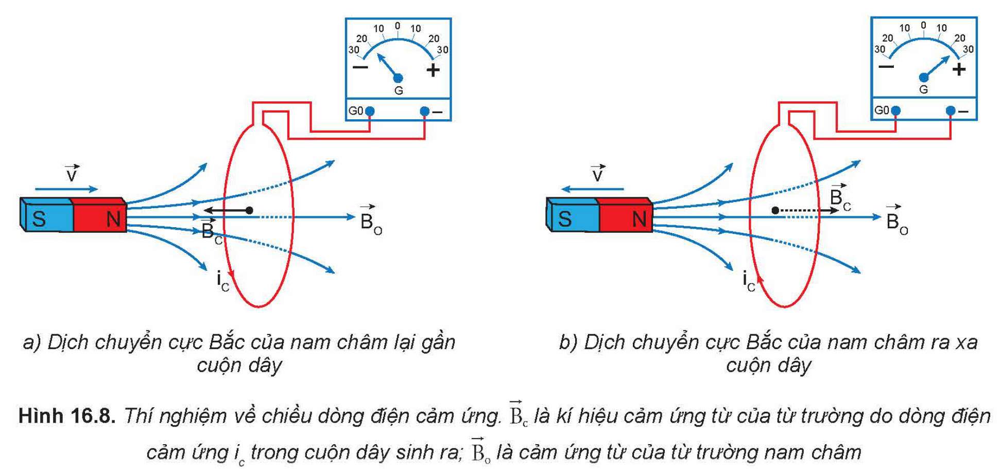

Hình 16.8. Thí nghiệm về chiều dòng điện cảm ứng. $\vec{B}_c$ là kí hiệu cảm ứng từ của từ trường do dòng điện cảm ứng $i_c$ trong cuộn dây sinh ra; $\vec{B}_0$ là cảm ứng từ của từ trường nam châm: a) Dịch chuyển cực Bắc của nam châm lại gần cuộn dây; b) Dịch chuyển cực Bắc của nam châm ra xa cuộn dây

Từ thí nghiệm, ta có nhận xét rằng khi nam châm lại gần cuộn dây ($\vec{B}_c$ và $\vec{B}_0$ ngược chiều – Hình 16.8a) thì từ trường của dòng điện cảm ứng trong cuộn dây có xu hướng ngăn cản nam châm lại gần nó; còn khi nam châm ra xa cuộn dây ($\vec{B}_c$ và $\vec{B}_0$ cùng chiều – Hình 16.8b) thì từ trường của dòng điện cảm ứng lại có xu hướng ngăn cản nam châm ra xa nó.

Nhận xét trên về chiều của dòng điện cảm ứng có thể phát biểu khái quát: *Dòng điện cảm ứng xuất hiện trong mạch kín có chiều sao cho từ trường do nó sinh ra có tác dụng chống lại sự biến thiên của từ thông qua mạch kín đó.* Phát biểu này là nội dung **định luật Lenz** về chiều dòng điện cảm ứng.

> ✋ Hãy xác định chiều quấn của cuộn dây (2) trong thí nghiệm 2 (Hình 16.7) và vận dụng định luật Lenz để kiểm chứng chiều dòng điện cảm ứng trong cuộn dây này khi đóng hoặc ngắt khoá K (4).

## IV. SUẤT ĐIỆN ĐỘNG CẢM ỨNG. ĐỊNH LUẬT FARADAY

Nếu một mạch điện kín có dòng điện thì trong mạch tồn tại suất điện động. Do đó, ta gọi suất điện động sinh ra dòng điện cảm ứng trong mạch kín như trong cuộn dây dẫn (thí nghiệm 1 và thí nghiệm 2) là **suất điện động cảm ứng**, kí hiệu $e_c$. Ở các thí nghiệm đó, khi có sự biến thiên của từ thông qua cuộn dây dẫn kín thì trong mạch xuất hiện suất điện động cảm ứng.

Thực nghiệm chứng tỏ rằng: *Độ lớn của suất điện động cảm ứng trong mạch kín tỉ lệ với tốc độ biến thiên của từ thông qua mạch.* Phát biểu này được gọi là **định luật Faraday** về cảm ứng điện từ.

Nếu trong khoảng thời gian $\Delta t$ đủ nhỏ, từ thông qua mạch kín biến thiên một lượng $\Delta\Phi$ thì $\left|\frac{\Delta\Phi}{\Delta t}\right|$ là **tốc độ biến thiên của từ thông**. Vì vậy, định luật Faraday có thể viết:

$|e_c| = k\left|\frac{\Delta\Phi}{\Delta t}\right|$

<!-- pdf:72 -->

Trong hệ SI, hệ số tỉ lệ $k = 1$. Nếu kể đến định luật Lenz thì công thức xác định suất điện động cảm ứng được viết dưới dạng:

$e_c = -\frac{\Delta\Phi}{\Delta t}$

Trong trường hợp mạch điện là một cuộn dây có $N$ vòng dây thì:

$e_c = -N\frac{\Delta\Phi}{\Delta t}$

Trong đó $\Phi$ là từ thông qua diện tích giới hạn bởi một vòng dây.

> ✋ Thí nghiệm với thanh kim loại MN trượt trên hai đoạn dây dẫn điện MQ và NP được nối với ampe kế thành mạch điện kín như Hình 16.9. Mạch điện được đặt trong từ trường đều có cảm ứng từ $B$ vuông góc với mặt phẳng MNPQ. Xác định chiều dòng điện cảm ứng và biểu thức suất điện động cảm ứng trong mạch khi thanh kim loại trượt đều với tốc độ $v$ trên hai đoạn dây dẫn.
>
> 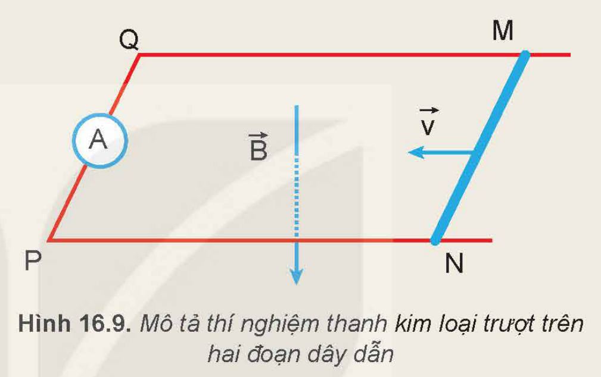
>
> Hình 16.9. Mô tả thí nghiệm thanh kim loại trượt trên hai đoạn dây dẫn

## 📌 Em đã học

- Từ thông qua diện tích $S$ đặt trong từ trường đều $\vec{B}$ dùng để diễn tả số đường sức từ xuyên qua diện tích $S$ đó: $\Phi = BS\cos\alpha$. Từ thông có đơn vị weber (kí hiệu Wb).
- Hiện tượng cảm ứng điện từ chỉ tồn tại trong khoảng thời gian từ thông qua cuộn dây dẫn kín biến thiên.
- Định luật Lenz về chiều dòng điện cảm ứng.
- Định luật Faraday về độ lớn của suất điện động cảm ứng trong mạch kín. Biểu thức suất điện động cảm ứng:

  $e_c = -N\frac{\Delta\Phi}{\Delta t}$

  Trong đó, $N$ là số vòng dây và $\left|\frac{\Delta\Phi}{\Delta t}\right|$ là tốc độ biến thiên của từ thông qua mạch kín.

## ✏️ Em có thể

- Nêu được nguyên tắc hoạt động của máy phát điện.

<!-- pdf:73 -->

> 💡 EM CÓ BIẾT
>
> Cho nam châm thẳng rơi qua cuộn dây dẫn kín. Cuộn dây này được nối với cảm biến điện thế (Hình 16.10) thì ta sẽ thu được suất điện động của cuộn dây như mô tả trong Hình 16.11 và 16.12. Thí nghiệm này chứng tỏ trọng lực sinh công làm biến thiên từ thông qua cuộn dây để sinh ra suất điện động cảm ứng, nghĩa là cơ năng đã chuyển hoá thành điện năng. Do đó, bản chất của hiện tượng cảm ứng điện từ là quá trình chuyển hoá cơ năng thành điện năng. Nhà bác học Faraday (Fa-ra-đây) là người đầu tiên khám phá ra hiện tượng này làm cơ sở để tạo ra phương thức sản xuất điện năng mới cho cuộc cách mạng khoa học lần thứ hai trong lịch sử.
>
> 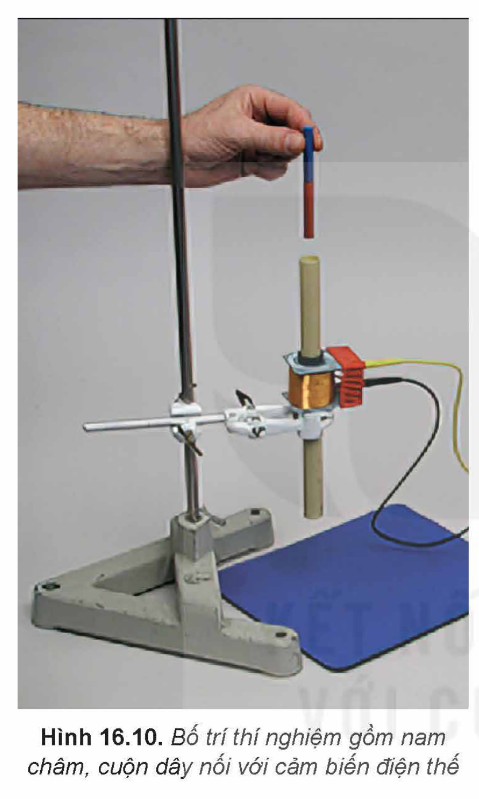
>
> Hình 16.10. Bố trí thí nghiệm gồm nam châm, cuộn dây nối với cảm biến điện thế
>
> 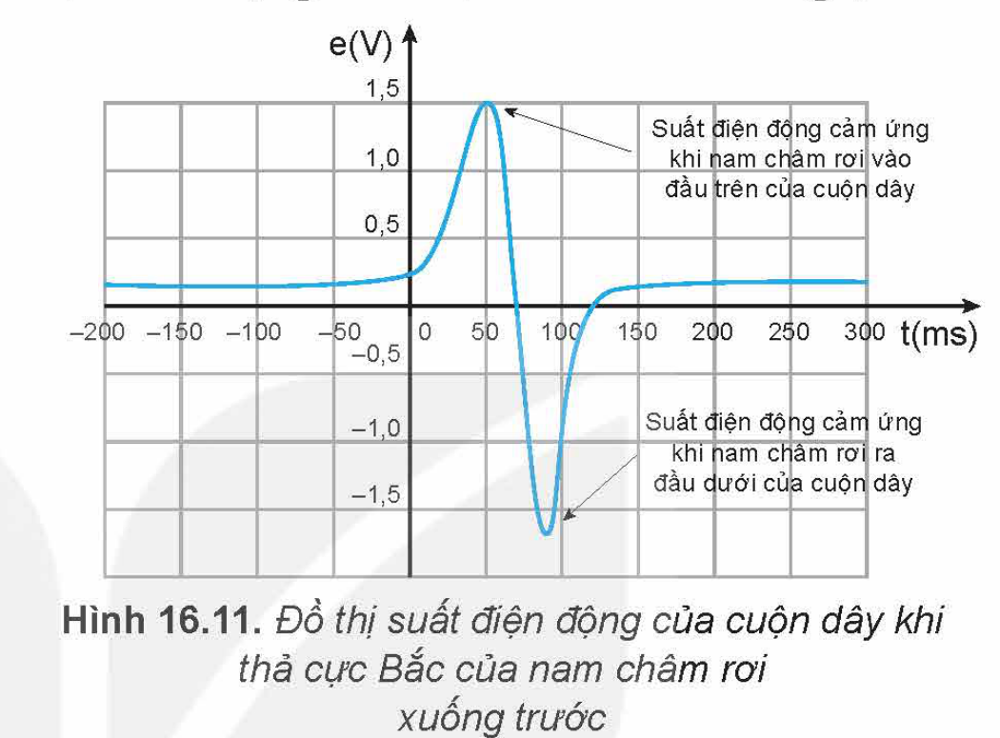
>
> Hình 16.11. Đồ thị suất điện động của cuộn dây khi thả cực Bắc của nam châm rơi xuống trước
>
> 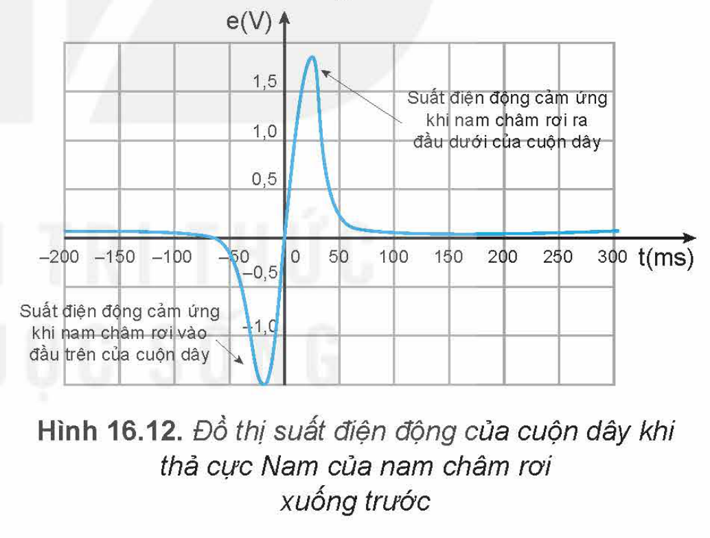
>
> Hình 16.12. Đồ thị suất điện động của cuộn dây khi thả cực Nam của nam châm rơi xuống trước

## 📷 Danh sách hình trong bài

| Mã hình | Trang PDF | Vị trí | Chú thích gốc |
|---|---|---|---|
| H12-vat_ly-b16-01 | 68 | Mục I | Hình 16.1. Mô tả đường sức từ xuyên qua diện tích S giới hạn bởi vòng dây dẫn kín (C) |
| H12-vat_ly-b16-02 | 68 | Mục I | Hình 16.2. Các đường sức từ xuyên qua diện tích giới hạn bởi khung dây trong trường hợp góc $\alpha$ là góc nhọn |
| H12-vat_ly-b16-03 | 68 | Mục I | Hình 16.3. Các đường sức từ xuyên qua diện tích giới hạn bởi khung dây trong trường hợp góc $\alpha$ là góc tù |
| H12-vat_ly-b16-04 | 69 | Mục I, hộp Hoạt động | Hình 16.4. Khung dây dẫn kín và nam châm vĩnh cửu |
| H12-vat_ly-b16-05 | 69 | Mục I, hộp Hoạt động | Hình 16.5. Khung dây dẫn kín và nam châm điện |
| H12-vat_ly-b16-06 | 69 | Mục II, Thí nghiệm 1 | Hình 16.6. Thí nghiệm với nam châm và cuộn dây dẫn |
| H12-vat_ly-b16-07 | 70 | Mục II, Thí nghiệm 2 | Hình 16.7. Thí nghiệm với nam châm điện và cuộn dây dẫn |
| H12-vat_ly-b16-08 | 71 | Mục III | Hình 16.8. Thí nghiệm về chiều dòng điện cảm ứng. $\vec{B}_c$ là kí hiệu cảm ứng từ của từ trường do dòng điện cảm ứng $i_c$ trong cuộn dây sinh ra; $\vec{B}_0$ là cảm ứng từ của từ trường nam châm |
| H12-vat_ly-b16-09 | 72 | Mục IV, hộp Hoạt động | Hình 16.9. Mô tả thí nghiệm thanh kim loại trượt trên hai đoạn dây dẫn |
| H12-vat_ly-b16-10 | 73 | Hộp Em có biết | Hình 16.10. Bố trí thí nghiệm gồm nam châm, cuộn dây nối với cảm biến điện thế |
| H12-vat_ly-b16-11 | 73 | Hộp Em có biết | Hình 16.11. Đồ thị suất điện động của cuộn dây khi thả cực Bắc của nam châm rơi xuống trước |
| H12-vat_ly-b16-12 | 73 | Hộp Em có biết | Hình 16.12. Đồ thị suất điện động của cuộn dây khi thả cực Nam của nam châm rơi xuống trước |
