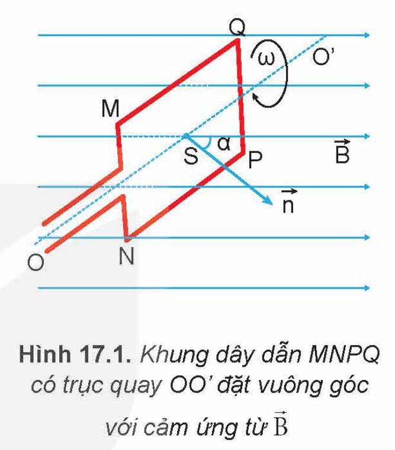
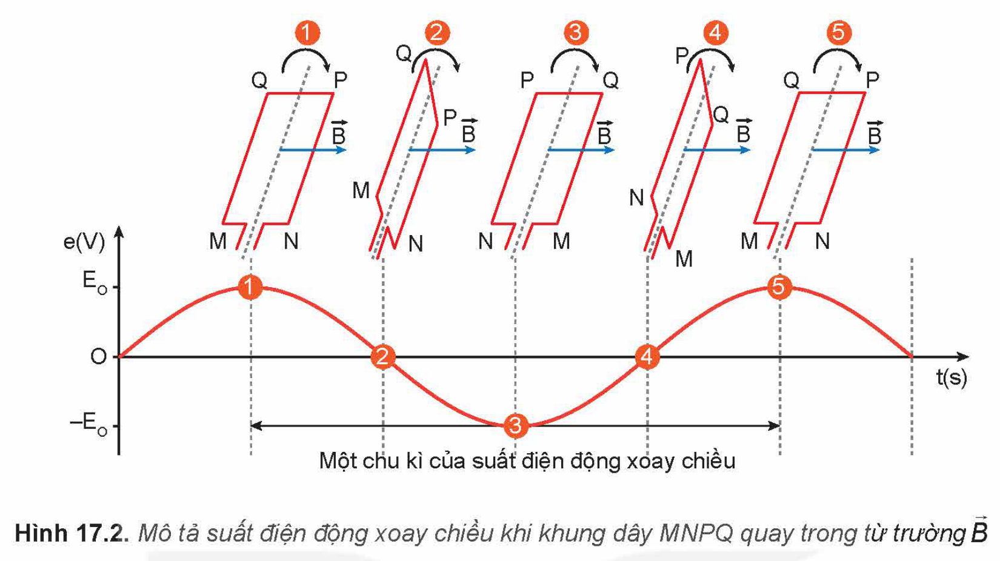
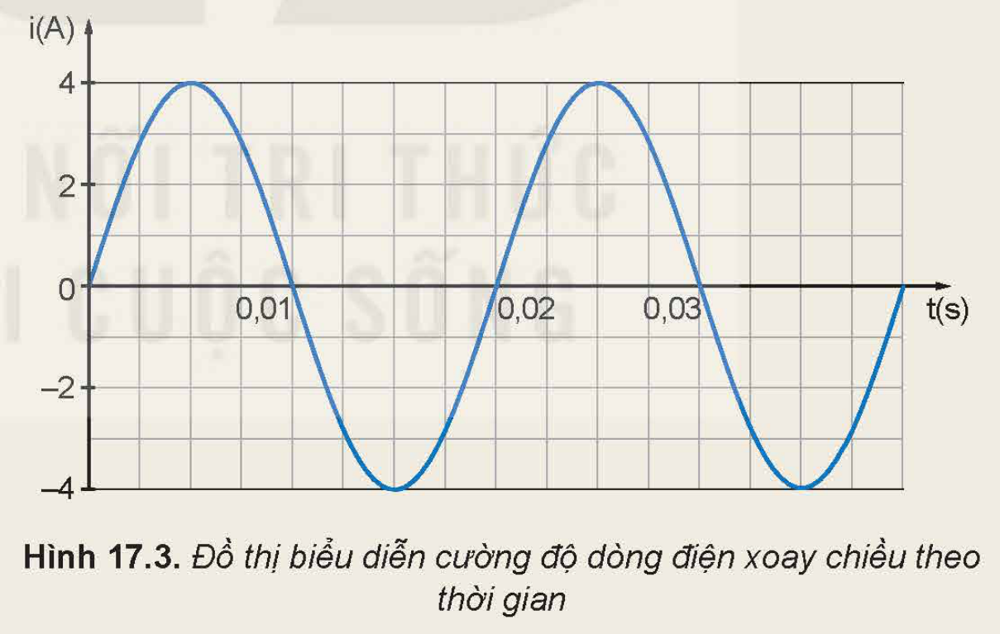
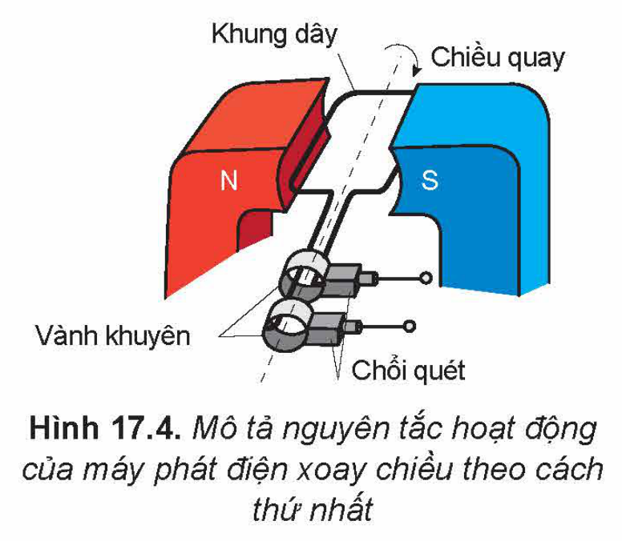
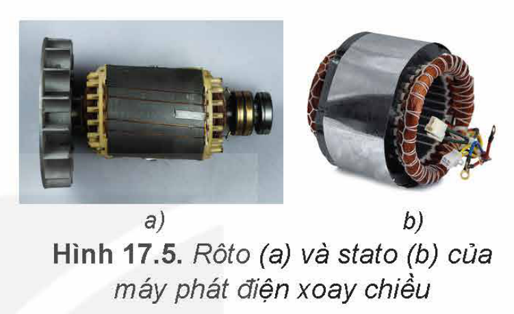
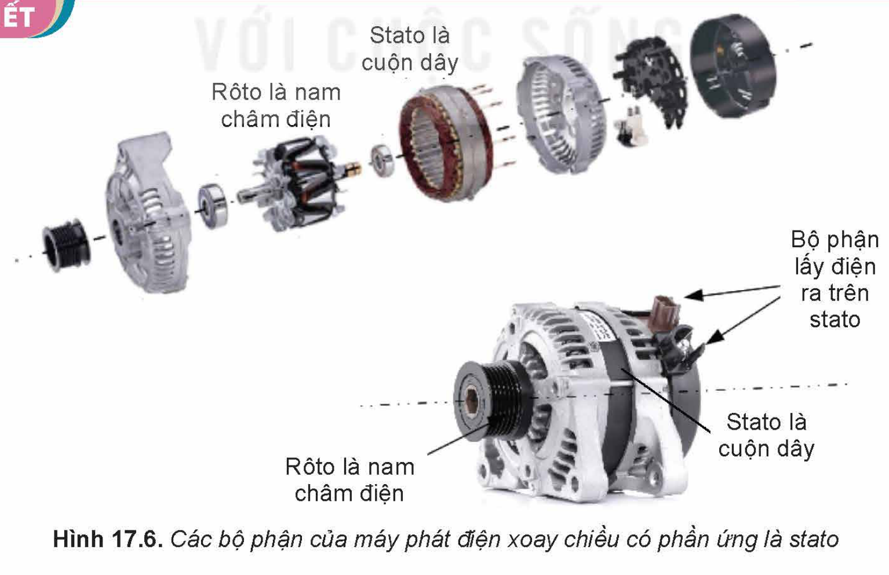
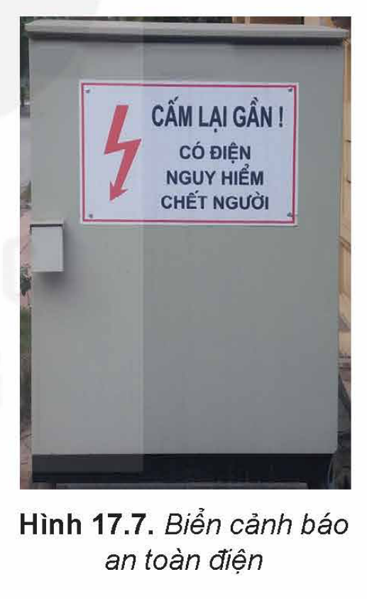
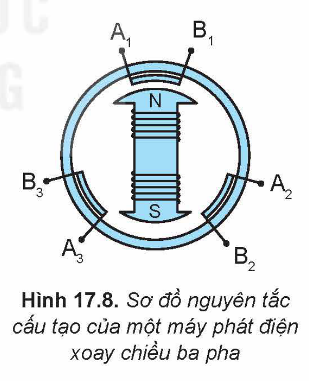

<!-- pdf:74 -->

# BÀI 17: MÁY PHÁT ĐIỆN XOAY CHIỀU

## 🔴 Mở đầu

> Dòng điện xoay chiều được sử dụng rất phổ biến trong đời sống. Dòng điện xoay chiều được tạo ra bằng cách nào?

## I. NGUYÊN TẮC TẠO RA DÒNG ĐIỆN XOAY CHIỀU

Xét một khung dây dẫn MNPQ có diện tích $S$, quay đều với tốc độ góc $\omega$ quanh một trục OO' vuông góc với các đường sức của một từ trường đều có cảm ứng từ $\vec{B}$ (Hình 17.1).

Theo hiện tượng cảm ứng điện từ đã học ở Bài 16, trong khung dây xuất hiện một suất điện động biến đổi theo thời gian:

$e = E_0\cos(\omega t + \varphi_0) \qquad (17.1)$

Trong đó, $E_0 = BS\omega$ là **suất điện động cực đại** trong khung dây; $\varphi_0$ là pha ban đầu của suất điện động.

Nếu khung dây dẫn MNPQ có $N$ vòng dây thì suất điện động cực đại của khung dây là $E_0 = NBS\omega$.

Hình 17.1. Khung dây dẫn MNPQ có trục quay OO' đặt vuông góc với cảm ứng từ $\vec{B}$

Suất điện động biến đổi theo thời gian theo định luật dạng cosin (hoặc sin) trong biểu thức (17.1) được gọi là **suất điện động xoay chiều**. Chu kì $T$ và tần số $f$ của suất điện động liên hệ với tần số góc $\omega$ bởi các công thức:

$T = \frac{2\pi}{\omega}\text{ (s)}, \quad f = \frac{\omega}{2\pi}\text{ (Hz)}$

Khi nối hai đầu khung dây dẫn trên với điện trở thuần $R$ tạo thành mạch kín, thì dòng điện trong khung dây dẫn biến thiên theo thời gian với tần số bằng tần số của suất điện động xoay chiều. Dòng điện này gọi là dòng điện xoay chiều.

Do đó, nguyên tắc tạo ra dòng điện xoay chiều dựa trên hiện tượng cảm ứng điện từ là làm cho từ thông qua khung dây dẫn biến thiên điều hoà theo thời gian.
<!-- term: Nguyên tắc tạo ra dòng điện xoay chiều -->

> ❓ 1. Khung dây dẫn trong Hình 17.2 ở vị trí nào thì suất điện động có giá trị cực đại? Giải thích.
>
> 2. Giả sử tại thời điểm $t$, từ thông qua khung dây dẫn phẳng MNPQ là:
>
> $\Phi = BS\cos\alpha = BS\cos\omega t$
>
> Hãy chứng tỏ, suất điện động cảm ứng xuất hiện trong khung dây này có dạng:
>
> $e = BS\omega\cos(\omega t + \varphi_0)\text{ (V)}$

<!-- pdf:75 -->

Hình 17.2. Mô tả suất điện động xoay chiều khi khung dây MNPQ quay trong từ trường $\vec{B}$

> ✋ Dựa trên nguyên tắc tạo ra dòng điện xoay chiều, hãy thực hiện các nhiệm vụ sau:
>
> 1. Làm thế nào để dẫn dòng điện ra mạch ngoài khi khung dây dẫn quay đều trong từ trường (Hình 17.2)?
> 2. Thảo luận về:
>    - nguyên tắc tạo ra suất điện động xoay chiều.
>    - các yếu tố cần để tạo ra dòng điện xoay chiều.
>    - thiết kế phương án tạo ra dòng điện xoay chiều.

## II. DÒNG ĐIỆN XOAY CHIỀU

### 1. Biểu thức dòng điện xoay chiều

Nếu nối hai đầu của khung dây dẫn MNPQ (Hình 17.1) với đoạn mạch tiêu thụ điện thì giữa hai đầu đoạn mạch có một hiệu điện thế. Hiệu điện thế này biến thiên theo thời gian theo quy luật dạng cosin (hoặc sin) gọi là **hiệu điện thế xoay chiều** hay **điện áp xoay chiều**. Điện áp xoay chiều có cùng chu kì, tần số với suất điện động xoay chiều và có dạng:

$u = U_0\cos(\omega t + \varphi_u)\text{ (V)} \qquad (17.2)$

Khi đó, dòng điện chạy qua mạch điện tiêu thụ là dòng điện xoay chiều có dạng:

$i = I_0\cos(\omega t + \varphi_i)\text{ (A)} \qquad (17.3)$

Trong các biểu thức (17.2), (17.3):

- $u$ và $i$ tương ứng là giá trị điện áp tức thời và cường độ dòng điện tức thời tại thời điểm $t$;
- $U_0$ và $I_0$ tương ứng là giá trị cực đại của điện áp và cường độ dòng điện xoay chiều;
- $\omega$ là tần số góc của dòng điện xoay chiều, có đơn vị là rad/s;
- $\varphi_u$, $\varphi_i$ lần lượt là pha ban đầu của điện áp và cường độ dòng điện xoay chiều.

<!-- pdf:76 -->

Các đại lượng $(\omega t + \varphi_u)$ và $(\omega t + \varphi_i)$ là pha của điện áp và cường độ dòng điện xoay chiều; $\Delta\varphi = \varphi_u - \varphi_i$ gọi là **độ lệch pha** giữa điện áp và cường độ dòng điện xoay chiều.

*Dòng điện có cường độ biến thiên điều hoà với thời gian theo quy luật của hàm cosin (hoặc sin) như biểu thức (17.3), gọi là **dòng điện xoay chiều**.*

### 2. Giá trị hiệu dụng

Dòng điện xoay chiều cũng có tác dụng nhiệt như dòng điện không đổi.

Cho dòng điện xoay chiều có cường độ $i = I_0\cos(\omega t + \varphi_i)\text{ (A)}$ chạy qua đoạn mạch chỉ có điện trở $R$, nhiệt lượng toả ra trong thời gian $t$ (đủ lớn so với chu kì $T$ của dòng điện) là $Q$.

Cho dòng điện không đổi có cường độ $I$ chạy qua điện trở nói trên trong cùng khoảng thời gian $t$ sao cho nhiệt lượng toả ra cũng bằng $Q$.

Người ta đã thiết lập được mối liên hệ giữa giá trị $I$ và giá trị cực đại $I_0$ của cường độ dòng điện xoay chiều:

$I = \frac{I_0}{\sqrt{2}} \qquad (17.4)$

Đại lượng $I$ gọi là **giá trị hiệu dụng của cường độ dòng điện xoay chiều** hay **cường độ hiệu dụng** của dòng điện xoay chiều.

Người ta cũng xác định được mối liên hệ giữa giá trị hiệu dụng $U$ và giá trị cực đại $U_0$ của điện áp xoay chiều:

$U = \frac{U_0}{\sqrt{2}} \qquad (17.5)$

> ✋ Dựa vào đồ thị biểu diễn cường độ dòng điện xoay chiều theo thời gian như Hình 17.3, hãy thực hiện các yêu cầu sau:
>
> - Xác định chu kì $T\text{ (s)}$ và tần số $f\text{ (Hz)}$ của dòng điện xoay chiều.
> - Xác định giá trị cực đại, giá trị hiệu dụng và pha ban đầu của cường độ dòng điện xoay chiều.
> - Viết biểu thức cường độ dòng điện theo thời gian.
>
> 
>
> Hình 17.3. Đồ thị biểu diễn cường độ dòng điện xoay chiều theo thời gian

## III. MÁY PHÁT ĐIỆN XOAY CHIỀU

### 1. Cấu tạo

**Máy phát điện xoay chiều** hoạt động dựa trên hiện tượng cảm ứng điện từ, có hai bộ phận chính là phần cảm và phần ứng. Một trong hai bộ phận chính được đặt cố định, gọi là **stato**, phần còn lại quay quanh một trục, gọi là **rôto**.

- **Phần cảm** là nam châm điện hoặc nam châm vĩnh cửu dùng để tạo ra từ trường.
- **Phần ứng** là các cuộn dây dẫn, trong đó xuất hiện suất điện động cảm ứng khi máy hoạt động.

<!-- pdf:77 -->

### 2. Nguyên tắc hoạt động

Các máy phát điện xoay chiều hoạt động theo cách thứ nhất có stato là nam châm đặt cố định, rôto là khung dây quay quanh một trục trong từ trường tạo bởi stato (Hình 17.4). Để dẫn điện ra ngoài thì cần có hai vành khuyên, trong đó mỗi vành khuyên được gắn chặt vào một đầu của khung dây. Cả hai vành khuyên này được đặt đồng trục với trục quay của khung dây và cùng quay với khung dây.

Hình 17.4. Mô tả nguyên tắc hoạt động của máy phát điện xoay chiều theo cách thứ nhất

Khi máy hoạt động, mỗi vành khuyên có một chổi quét tì vào nên khi khung dây quay, hai vành khuyên trượt trên hai chổi quét, dòng điện truyền từ khung dây qua hai chổi quét ra mạch ngoài.

Các máy phát điện xoay chiều hoạt động theo cách thứ hai có rôto là nam châm, thường là nam châm điện được nuôi bởi dòng điện một chiều (các cuộn dây của rôto cũng có lõi sắt và xếp thành vòng tròn, Hình 17.5a) và stato gồm nhiều cuộn dây có lõi sắt, xếp thành một vòng tròn (Hình 17.5b) thì không cần vành khuyên và chổi quét, mà dòng điện được dẫn trực tiếp ra mạch ngoài bởi các cuộn dây đặt cố định.

Hình 17.5. Rôto (a) và stato (b) của máy phát điện xoay chiều

> ✋ 1. Hãy viết biểu thức suất điện động của máy phát điện xoay chiều trong trường hợp khung dây có $N$ vòng dây, quay với tốc độ góc $\omega$ trong từ trường đều có cảm ứng từ $\vec{B}$ ($\vec{B}$ vuông góc với trục quay của khung).
>
> 2. Vì sao cần sử dụng vành khuyên và chổi quét để dẫn điện ra mạch ngoài đối với các máy phát điện xoay chiều hoạt động theo cách thứ nhất?

> 💡 EM CÓ BIẾT
>
> 
>
> Hình 17.6. Các bộ phận của máy phát điện xoay chiều có phần ứng là stato
>
> Khi khung dây quay với tốc độ cao thì vành khuyên, chổi quét sẽ nhanh mòn. Do đó, người ta chế tạo máy phát điện xoay chiều có stato là phần ứng gồm nhiều cuộn dây như Hình 17.6.

<!-- pdf:78 -->

## IV. ỨNG DỤNG VÀ QUY TẮC AN TOÀN KHI SỬ DỤNG DÒNG ĐIỆN XOAY CHIỀU

### 1. Ứng dụng của dòng điện xoay chiều trong cuộc sống

Dòng điện xoay chiều có ưu thế trong việc truyền tải điện năng đi xa, dẫn điện đến các nhà máy, xí nghiệp sản xuất, nơi tiêu thụ có sử dụng dòng điện xoay chiều.

Dòng điện xoay chiều được sử dụng rộng rãi trong cuộc sống là nhờ vào các tác dụng nhiệt, tác dụng từ, tác dụng phát sáng và tác dụng sinh lí của nó.

Các thiết bị như quạt điện, động cơ điện, đèn điện,... đã chuyển hoá năng lượng điện thành các dạng năng lượng khác nhằm đáp ứng các nhu cầu sống, sinh hoạt, lao động, sản xuất,... của con người.

Trong y học, dòng điện xoay chiều được sử dụng để vận hành các thiết bị y tế bao gồm: máy chẩn đoán hình ảnh (như máy chụp cộng hưởng từ, máy siêu âm, máy chụp X – quang) hoặc các máy hỗ trợ điều trị bệnh nhân (như máy sốc điện, máy điện tim),...

> ✋ Thảo luận để thực hiện các yêu cầu sau:
>
> 1. Ngoài thắp sáng, chạy máy thì dòng điện xoay chiều còn được sử dụng vào những việc gì?
> 2. Tìm hiểu thông qua sách báo, internet về các biện pháp giảm hao phí trong truyền tải điện năng đi xa bằng dòng điện xoay chiều.

### 2. Quy tắc an toàn khi sử dụng dòng điện xoay chiều

Để cảnh báo về an toàn điện, người ta đã đưa ra các biển báo an toàn điện.

Một số quy tắc an toàn khi sử dụng dòng điện xoay chiều:

- Tuân thủ theo các biển báo an toàn điện.
- Tuyệt đối không chạm tay vào chỗ hở của đường dây điện hay cầm vật trực tiếp bằng kim loại cắm vào ổ điện.
- Tránh lại gần những khu vực có điện thế nguy hiểm.
- Kiểm tra, bảo trì các thiết bị điện định kì theo đúng hướng dẫn.
- Ngắt nguồn điện khi có thiên tai, sấm sét.

Hình 17.7. Biển cảnh báo an toàn điện

> ✋ Thảo luận để thực hiện các yêu cầu sau:
>
> 1. Nhận biết được ý nghĩa của những biển báo an toàn điện.
> 2. Vì sao không nên sử dụng thiết bị điện trong quá trình sạc pin?
> 3. Vì sao cần lựa chọn và lắp đặt thiết bị đóng, ngắt điện ở vị trí phù hợp, dễ tiếp cận nhất tại gia đình?
> 4. Vì sao cần lựa chọn thiết bị điện có chất lượng, có công suất phù hợp với mạng lưới điện?
> 5. Nêu tầm quan trọng của việc tuân thủ quy tắc an toàn khi sử dụng dòng điện xoay chiều trong cuộc sống.

<!-- pdf:79 -->

## 📌 Em đã học

- Dòng điện xoay chiều là dòng điện có cường độ biến thiên điều hoà với thời gian theo quy luật hàm số sin hoặc cosin.

  $i = I_0\cos(\omega t + \varphi_i)$

- Mối liên hệ giữa giá trị hiệu dụng và giá trị cực đại của dòng điện và điện áp xoay chiều lần lượt là: $I = \frac{I_0}{\sqrt{2}}$ và $U = \frac{U_0}{\sqrt{2}}$.
- Dòng điện xoay chiều có ưu thế trong việc truyền tải điện năng đi xa nên được sử dụng phổ biến.
- Máy phát điện xoay chiều hoạt động dựa trên hiện tượng cảm ứng điện từ, chuyển hoá cơ năng thành điện năng. Máy phát điện xoay chiều có cấu tạo gồm hai bộ phận chính là phần cảm và phần ứng. Phần cảm là bộ phận tạo ra từ trường và phần ứng là những cuộn dây xuất hiện suất điện động cảm ứng khi máy hoạt động.
- Cần tuân thủ các quy tắc an toàn khi sử dụng dòng điện xoay chiều.

## ✏️ Em có thể

- Nêu được ý nghĩa của các thông số ghi trên các thiết bị điện.
- Giải thích được cách tạo ra dòng điện xoay chiều trong nhà máy thuỷ điện.
- Đề xuất được một số biện pháp sử dụng điện an toàn trong gia đình.

> 💡 EM CÓ BIẾT
>
> **Máy phát điện xoay chiều ba pha** thường được sử dụng trong thực tế có sơ đồ cấu tạo đơn giản như Hình 17.8. Trong đó rôto là nam châm điện quay quanh trục (phần cảm) còn stato là ba cuộn dây riêng rẽ, đặt trên vòng tròn và lệch nhau $120^\circ$ (phần ứng).
>
> Suất điện động trong ba cuộn dây khi máy hoạt động tạo ra có đặc điểm là lệch pha nhau $\frac{2\pi}{3}$.
>
> 
>
> Hình 17.8. Sơ đồ nguyên tắc cấu tạo của một máy phát điện xoay chiều ba pha
>
> Nếu suất điện động xoay chiều trong cuộn dây $\text{A}_1\text{B}_1$ là $e_1 = E_0\cos\omega t\text{ (V)}$ thì suất điện động trong các cuộn dây $\text{A}_2\text{B}_2$ và $\text{A}_3\text{B}_3$ tương ứng là:
>
> $e_2 = E_0\cos\left(\omega t + \frac{2\pi}{3}\right)\text{ (V)}$
>
> $e_3 = E_0\cos\left(\omega t - \frac{2\pi}{3}\right)\text{ (V)}.$

## 📷 Danh sách hình trong bài

| Mã hình | Trang PDF | Vị trí | Chú thích gốc |
|---|---|---|---|
| H12-vat_ly-b17-01 | 74 | Mục I | Hình 17.1. Khung dây dẫn MNPQ có trục quay OO' đặt vuông góc với cảm ứng từ $\vec{B}$ |
| H12-vat_ly-b17-02 | 75 | Mục I | Hình 17.2. Mô tả suất điện động xoay chiều khi khung dây MNPQ quay trong từ trường $\vec{B}$ |
| H12-vat_ly-b17-03 | 76 | Mục II.2, hộp Hoạt động | Hình 17.3. Đồ thị biểu diễn cường độ dòng điện xoay chiều theo thời gian |
| H12-vat_ly-b17-04 | 77 | Mục III.2 | Hình 17.4. Mô tả nguyên tắc hoạt động của máy phát điện xoay chiều theo cách thứ nhất |
| H12-vat_ly-b17-05 | 77 | Mục III.2 | Hình 17.5. Rôto (a) và stato (b) của máy phát điện xoay chiều |
| H12-vat_ly-b17-06 | 77 | Mục III.2, hộp Em có biết | Hình 17.6. Các bộ phận của máy phát điện xoay chiều có phần ứng là stato |
| H12-vat_ly-b17-07 | 78 | Mục IV.2 | Hình 17.7. Biển cảnh báo an toàn điện |
| H12-vat_ly-b17-08 | 79 | Hộp Em có biết | Hình 17.8. Sơ đồ nguyên tắc cấu tạo của một máy phát điện xoay chiều ba pha |
