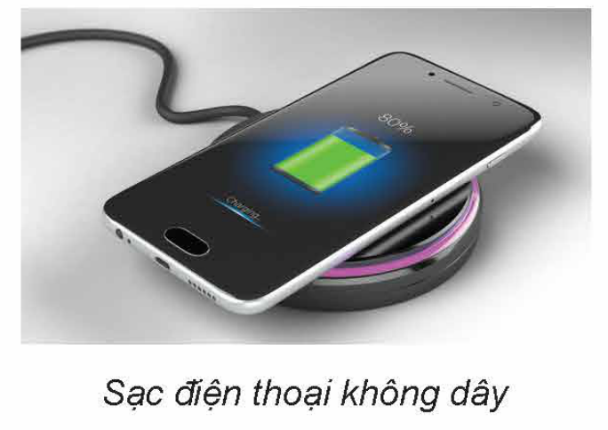
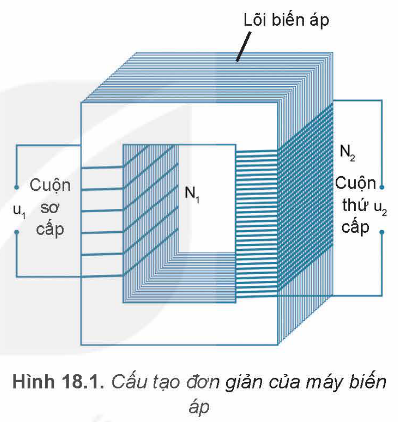
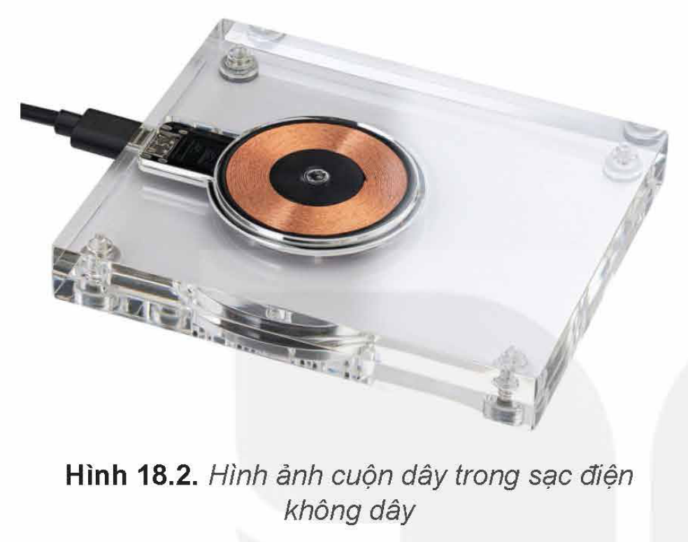
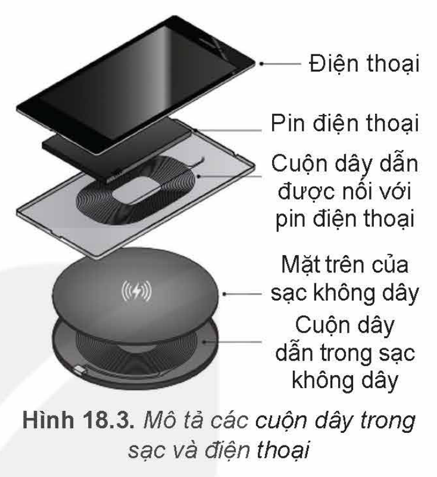
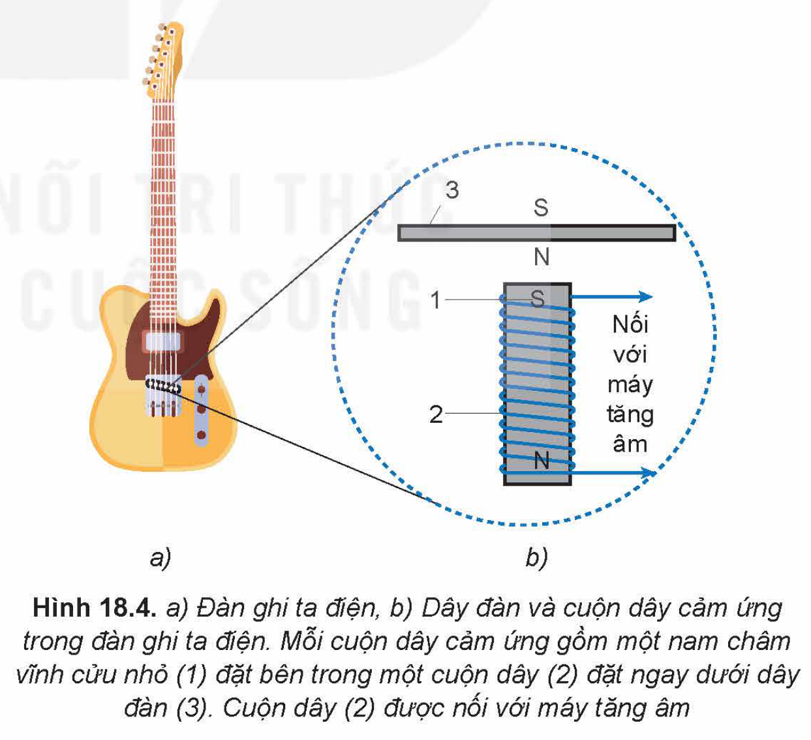
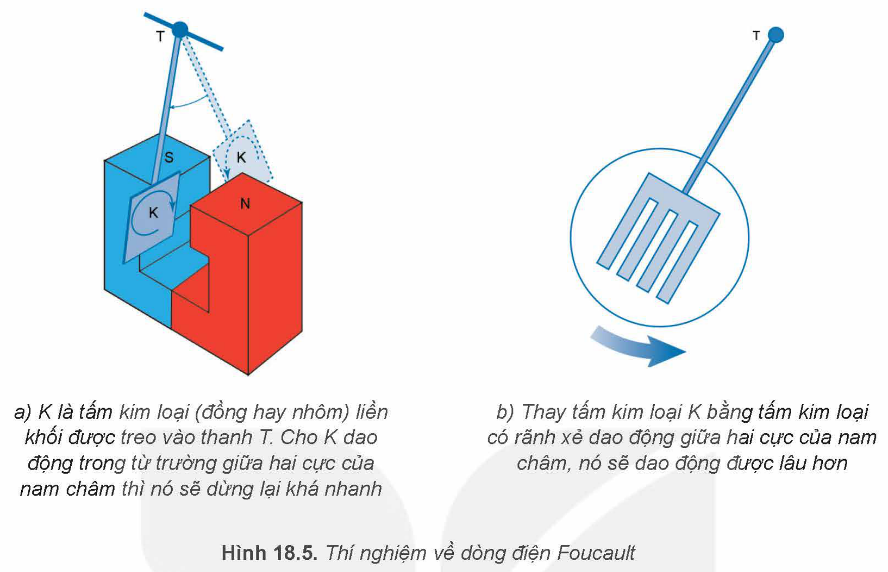

<!-- pdf:80 -->

# BÀI 18: ỨNG DỤNG HIỆN TƯỢNG CẢM ỨNG ĐIỆN TỪ

## 🔴 Mở đầu

> Sạc điện không dây ngày càng được sử dụng rộng rãi để sạc điện thoại, đồng hồ thông minh, máy hút bụi,... Sạc điện hoạt động dựa trên hiện tượng nào để truyền điện từ nguồn điện đến điện thoại?
>
> 
>
> Sạc điện thoại không dây

## I. MÁY BIẾN ÁP

**Máy biến áp** gồm hai cuộn dây có số vòng khác nhau quấn trên một lõi kín (lõi biến áp – Hình 18.1). Lõi thường làm bằng các lá sắt hoặc thép pha silicon, ghép cách điện với nhau để giảm hao phí điện năng do dòng điện Foucault (Phu-cô). Các cuộn dây gồm nhiều vòng thường làm bằng đồng, có phủ lớp cách điện. Một trong hai cuộn dây của máy biến áp được nối với nguồn điện xoay chiều, được gọi là **cuộn sơ cấp**.

Điện áp xoay chiều $u_1$ giữa hai đầu cuộn sơ cấp có giá trị thay đổi theo thời gian. Cuộn thứ hai được nối với tải tiêu thụ điện năng, được gọi là **cuộn thứ cấp**.

Hình 18.1. Cấu tạo đơn giản của máy biến áp

Hoạt động của máy biến áp dựa trên hiện tượng cảm ứng điện từ. Dòng điện xoay chiều chạy trong cuộn sơ cấp gây ra từ thông biến thiên qua cuộn thứ cấp, làm xuất hiện trong cuộn thứ cấp một suất điện động xoay chiều thay đổi theo thời gian. Khi đó, nếu đo điện áp xoay chiều $u_2$ ở hai đầu cuộn thứ cấp thì thu được giá trị của nó thay đổi theo thời gian tương ứng. Nếu mạch thứ cấp kín thì có dòng điện chạy trong cuộn thứ cấp.

Do cấu tạo của máy biến áp, hầu như mọi đường sức từ chỉ chạy trong lõi biến áp nên từ thông qua mỗi vòng dây ở cả hai cuộn bằng nhau, suất điện động cảm ứng trong mỗi vòng dây cũng bằng nhau.

> ✋ 1. Dựa vào biểu thức suất điện động cảm ứng của định luật Faraday:
>
> $e_c = -N\frac{\Delta\Phi}{\Delta t}$
>
> Hãy chứng tỏ mối liên hệ sau:
>
> $\frac{U_1}{U_2} = \frac{N_1}{N_2}$
>
> trong đó, $U_1$ và $U_2$ lần lượt là điện áp hiệu dụng giữa hai đầu cuộn dây sơ cấp và cuộn dây thứ cấp; với $N_1$ và $N_2$ lần lượt là số vòng dây của cuộn sơ cấp và thứ cấp.
>
> 2. Giải thích nguyên nhân xuất hiện điện áp $u_2$ ở hai đầu cuộn thứ cấp.

<!-- pdf:81 -->

> 💡 EM CÓ BIẾT
>
> Sạc điện thoại không dây hoạt động dựa trên hiện tượng cảm ứng điện từ như máy biến áp. Ở trên sạc có cuộn dây được nối với dòng điện xoay chiều, đóng vai trò như cuộn sơ cấp (Hình 18.2). Phía sau của điện thoại có cuộn dây được nối với pin, đóng vai trò như cuộn thứ cấp. Khi đặt mặt sau của điện thoại lên mặt trên của sạc thì hai cuộn dây này được đặt cạnh nhau (Hình 18.3). Dòng điện xoay chiều qua cuộn dây của sạc biến thiên sẽ sinh ra suất điện động cảm ứng trong cuộn dây để sạc pin điện thoại.
>
> 
>
> Hình 18.2. Hình ảnh cuộn dây trong sạc điện không dây
>
> 
>
> Hình 18.3. Mô tả các cuộn dây trong sạc và điện thoại

## II. ĐÀN GHI TA ĐIỆN

**Đàn ghi ta điện** có cấu tạo đặc, không có hộp cộng hưởng (Hình 18.4a). Sở dĩ ta nghe được âm phát ra từ dây đàn là nhờ sáu cuộn dây cảm ứng gắn vào đàn ở bên dưới sáu dây đàn này.

Vì dây đàn bằng thép nên đoạn dây đàn nằm sát ngay bên trên nam châm của cuộn dây cảm ứng được từ hoá, nghĩa là nó trở thành một nam châm có cực từ được mô tả như Hình 18.4b.

Hình 18.4. a) Đàn ghi ta điện, b) Dây đàn và cuộn dây cảm ứng trong đàn ghi ta điện. Mỗi cuộn dây cảm ứng gồm một nam châm vĩnh cửu nhỏ (1) đặt bên trong một cuộn dây (2) đặt ngay dưới dây đàn (3). Cuộn dây (2) được nối với máy tăng âm

> ❓ Trong Hình 18.4, khi gảy dây đàn (3) thì nó dao động. Khi đó, từ trường của đoạn dây đàn (3) gây ra sự biến thiên từ thông qua cuộn dây cảm ứng (2) như thế nào?

<!-- pdf:82 -->

Khi từ thông qua cuộn dây (2) thay đổi thì trong cuộn dây xuất hiện dòng điện cảm ứng, biến đổi cả về chiều và cường độ phù hợp với dao động của dây đàn, nghĩa là cùng tần số với dao động của âm. Dòng điện cảm ứng được đưa đến máy tăng âm rồi đến loa làm ta nghe được âm do dây đàn phát ra.

> ✋ 1. Tại sao dây đàn ghi ta điện cần làm bằng thép?
>
> 2. Vì sao đàn ghi ta điện có cấu tạo đặc và không có hộp cộng hưởng mà ta vẫn nghe được âm thanh phát ra từ dây đàn?
>
> 3. Vận dụng biểu thức về suất điện động cảm ứng:
>
> $e_c = -N\frac{\Delta\Phi}{\Delta t}$
>
> hãy giải thích vì sao khi gảy dây đàn mạnh hoặc nhẹ thì độ to của âm thay đổi tương ứng.

> ❓ Nêu một số ứng dụng đơn giản khác của hiện tượng cảm ứng điện từ trong cuộc sống.

## 📌 Em đã học

- Nguyên tắc hoạt động của máy biến áp, đàn ghi ta điện dựa trên hiện tượng cảm ứng điện từ, định luật Lenz, định luật Faraday.

## ✏️ Em có thể

- Vận dụng định luật Faraday và định luật Lenz để giải thích được một số ứng dụng của hiện tượng cảm ứng điện từ trong cuộc sống như phanh điện từ, bếp từ, sạc điện thoại không dây,...

> 💡 EM CÓ BIẾT
>
> **Dòng điện Foucault**
>
> Trong thí nghiệm về dòng điện Foucault (Hình 18.5a), khi tấm kim loại K dao động, nó cắt các đường sức từ của nam châm. Do đó trong tấm kim loại sinh ra dòng điện cảm ứng. Tấm kim loại dừng lại nhanh, vì dòng điện cảm ứng trong tấm kim loại có tác dụng ngăn cản sự chuyển động của chính tấm kim loại đó.
>
> Nếu một khối vật dẫn đặt trong từ trường biến đổi theo thời gian, thì trong khối vật dẫn đó cũng sinh ra dòng điện cảm ứng. Dòng điện cảm ứng được sinh ra ở trong khối vật dẫn khi vật dẫn chuyển động trong từ trường hay được đặt trong từ trường biến thiên theo thời gian gọi là **dòng điện Foucault**.

<!-- pdf:83 -->

> 
>
> Hình 18.5. Thí nghiệm về dòng điện Foucault: a) K là tấm kim loại (đồng hay nhôm) liền khối được treo vào thanh T. Cho K dao động trong từ trường giữa hai cực của nam châm thì nó sẽ dừng lại khá nhanh; b) Thay tấm kim loại K bằng tấm kim loại có rãnh xẻ dao động giữa hai cực của nam châm, nó sẽ dao động được lâu hơn
>
> Đặc tính chung của các dòng điện Foucault là tính chất xoáy. Nói cách khác, các dòng điện Foucault là các đường cong kín trong khối vật dẫn. Điều này giải thích vì sao nếu thay tấm kim loại liền khối trong thí nghiệm Hình 18.5a bằng tấm kim loại có rãnh xẻ như Hình 18.5b, thì thấy tấm kim loại này dao động lâu hơn, vì khi đó điện trở của tấm kim loại đối với dòng điện Foucault tăng, làm cho cường độ dòng điện Foucault giảm.
>
> Dòng điện Foucault có nhiều ứng dụng trong thực tế như trong luyện kim, làm đệm từ trường, chế tạo bếp từ, đồng hồ đo điện, phanh điện từ,...
>
> Dòng điện Foucault cũng có tác hại đối với thiết bị điện. Ví dụ như trong máy biến áp, do tác dụng toả nhiệt của dòng điện Foucault làm lõi biến áp nóng lên gây hao phí điện năng. Để giảm tác hại của dòng điện Foucault, trong máy biến áp, người ta không dùng lõi biến áp liền khối, mà dùng những lá thép pha silicon mỏng có phủ lớp sơn cách điện ghép sát với nhau và đặt song song với đường sức từ. Làm như vậy điện trở của lõi biến áp đối với dòng Foucault sẽ tăng lên, làm giảm tác dụng toả nhiệt của nó.

## 📷 Danh sách hình trong bài

| Mã hình | Trang PDF | Vị trí | Chú thích gốc |
|---|---|---|---|
| H12-vat_ly-b18-01 | 80 | Mở đầu | Sạc điện thoại không dây |
| H12-vat_ly-b18-02 | 80 | Mục I | Hình 18.1. Cấu tạo đơn giản của máy biến áp |
| H12-vat_ly-b18-03 | 81 | Mục I, hộp Em có biết | Hình 18.2. Hình ảnh cuộn dây trong sạc điện không dây |
| H12-vat_ly-b18-04 | 81 | Mục I, hộp Em có biết | Hình 18.3. Mô tả các cuộn dây trong sạc và điện thoại |
| H12-vat_ly-b18-05 | 81 | Mục II | Hình 18.4. a) Đàn ghi ta điện, b) Dây đàn và cuộn dây cảm ứng trong đàn ghi ta điện. Mỗi cuộn dây cảm ứng gồm một nam châm vĩnh cửu nhỏ (1) đặt bên trong một cuộn dây (2) đặt ngay dưới dây đàn (3). Cuộn dây (2) được nối với máy tăng âm |
| H12-vat_ly-b18-06 | 83 | Hộp Em có biết | Hình 18.5. Thí nghiệm về dòng điện Foucault |
