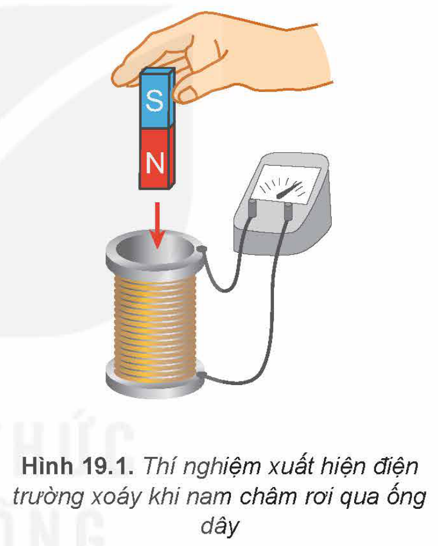
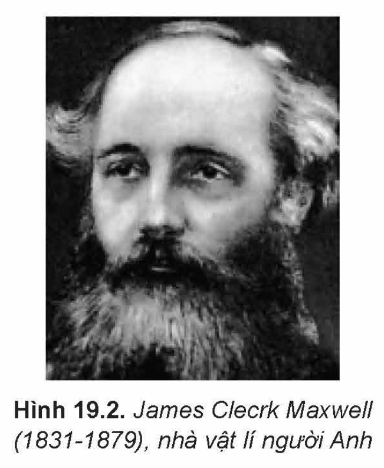
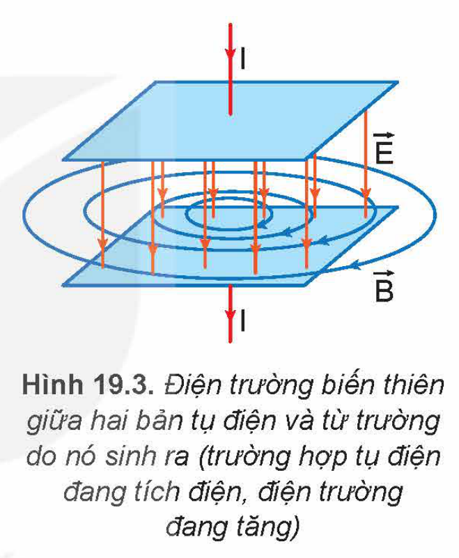
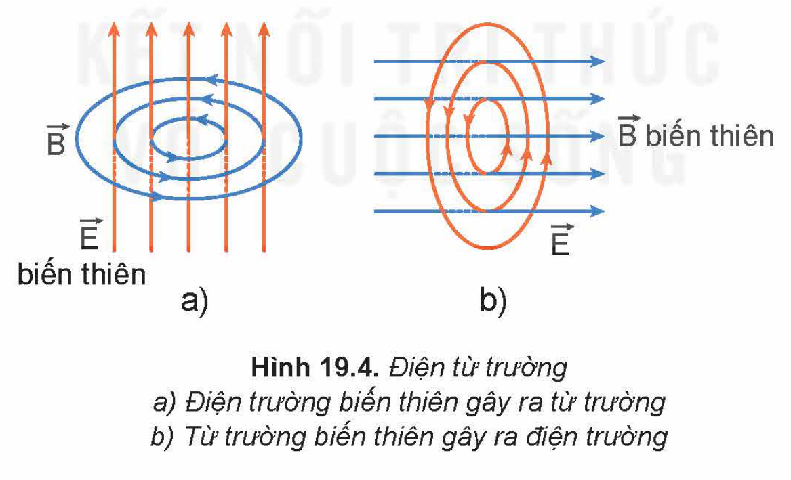
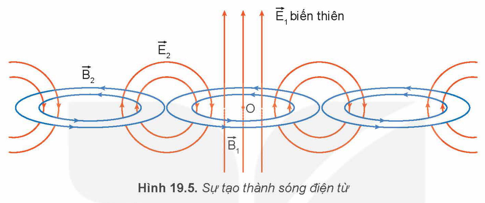
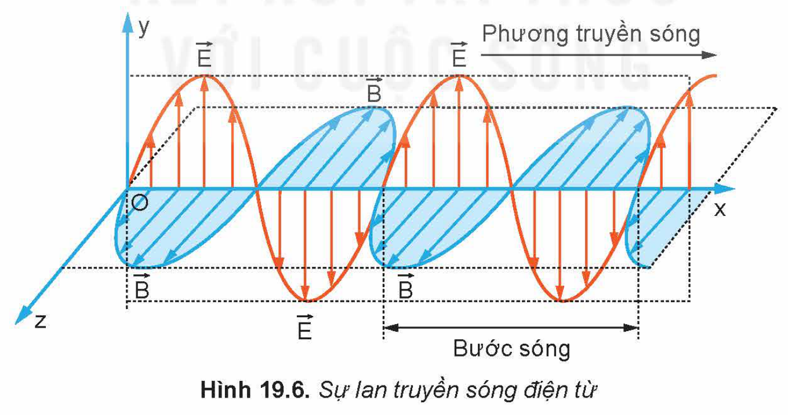

<!-- pdf:84 -->

# BÀI 19: ĐIỆN TỪ TRƯỜNG. MÔ HÌNH SÓNG ĐIỆN TỪ

## 🔴 Mở đầu

> Thang sóng điện từ bao gồm rất nhiều vùng như hồng ngoại, tử ngoại, ánh sáng nhìn thấy,... Sóng điện từ được tạo thành và lan truyền như thế nào?

## I. LIÊN HỆ GIỮA ĐIỆN TRƯỜNG BIẾN THIÊN VÀ TỪ TRƯỜNG BIẾN THIÊN

### 1. Từ trường biến thiên và điện trường xoáy

Trong thí nghiệm về hiện tượng cảm ứng điện từ, khi cho nam châm rơi qua ống dây, từ thông qua ống dây kín biến thiên thì trong ống dây xuất hiện dòng điện cảm ứng (Hình 19.1). Sự xuất hiện của dòng điện cảm ứng chứng tỏ trong dây dẫn đã xuất hiện một điện trường, có chiều là chiều của dòng điện cảm ứng; đường sức của điện trường mới này là các đường cong kín. Điện trường có tính chất này là **điện trường xoáy**.

James Clecrk Maxwell (Giêm Cờ-lếch Mắc-xoen) đã phân tích bản chất của hiện tượng trên và cho rằng: điện trường xoáy vẫn xuất hiện ngay cả khi không có ống dây và vai trò của các vòng dây giúp ta nhận biết điện trường ấy trong suốt thời gian từ thông biến thiên.

Hình 19.1. Thí nghiệm xuất hiện điện trường xoáy khi nam châm rơi qua ống dây

Khái quát bản chất của hiện tượng trên, Maxwell kết luận: *Trong vùng không gian có từ trường biến thiên theo thời gian thì trong vùng đó xuất hiện một điện trường xoáy.*

> ✋ So sánh sự giống nhau và khác nhau giữa điện trường gây ra bởi điện tích đứng yên và điện trường xoáy.

### 2. Điện trường biến thiên và từ trường

Trong thí nghiệm Hình 19.1, khi từ trường biến thiên theo thời gian làm xuất hiện điện trường xoáy. Một câu hỏi ngược lại có thể đặt ra là điện trường biến thiên theo thời gian có làm xuất hiện từ trường không?

<!-- pdf:85 -->

Thí nghiệm với dòng điện xoay chiều qua tụ điện cho thấy điện trường biến thiên theo thời gian và làm xuất hiện từ trường. Khi một tụ điện đang tích điện hoặc phóng điện, do sự thay đổi điện tích trên các bản tụ điện thì giữa hai bản tụ điện có một điện trường biến thiên tương đương với một dòng điện gọi là **dòng điện dịch** (Hình 19.3). Chính dòng điện này gây ra từ trường. Các đường sức của từ trường này bao quanh các đường sức của điện trường và luôn khép kín.

Hình 19.2. James Clecrk Maxwell (1831-1879), nhà vật lí người Anh

### 3. Điện từ trường

Maxwell đã đưa ra kết luận về mối liên quan chặt chẽ giữa điện trường biến thiên và từ trường biến thiên:

*Từ trường biến thiên theo thời gian sinh ra trong không gian xung quanh một điện trường biến thiên theo thời gian; ngược lại, điện trường biến thiên theo thời gian cũng sinh ra một từ trường biến thiên theo thời gian trong không gian xung quanh.*

Hình 19.3. Điện trường biến thiên giữa hai bản tụ điện và từ trường do nó sinh ra (trường hợp tụ điện đang tích điện, điện trường đang tăng)

Như vậy, hai trường biến thiên này cùng tồn tại trong không gian, có thể chuyển hoá lẫn nhau trong một trường thống nhất, gọi là **điện từ trường** (Hình 19.4).

Hình 19.4. Điện từ trường: a) Điện trường biến thiên gây ra từ trường; b) Từ trường biến thiên gây ra điện trường

Sự biến thiên của từ trường và điện trường bao gồm sự thay đổi chiều và về độ lớn. Tuy nhiên, tại mỗi điểm trong không gian, vectơ cảm ứng từ $\vec{B}$ luôn vuông góc với vectơ cường độ điện trường $\vec{E}$.

> ❓ So sánh điểm khác nhau cơ bản giữa điện từ trường với điện trường, từ trường.

<!-- pdf:86 -->

## II. MÔ HÌNH SÓNG ĐIỆN TỪ

### 1. Sự tạo thành sóng điện từ

Nếu tại điểm O có một điện trường biến thiên $\vec{E}_1$, thì theo kết luận của Maxwell, tại vùng lân cận sẽ xuất hiện một từ trường biến thiên $\vec{B}_1$. Tiếp theo, vì có từ trường biến thiên, nên lại xuất hiện một điện trường $\vec{E}_2$ biến thiên ở vùng lân cận khác, rồi tương tự, lại xuất hiện $\vec{B}_2$,... Cứ như thế điện trường và từ trường lan truyền trong không gian như minh hoạ ở Hình 19.5.

Quá trình lan truyền điện từ trường trong không gian được gọi là **sóng điện từ**.

Hình 19.5. Sự tạo thành sóng điện từ

### 2. Sự lan truyền sóng điện từ

Tại mỗi điểm trong quá trình truyền sóng điện từ:

- Vectơ cường độ điện trường $\vec{E}$ luôn vuông góc với vectơ cảm ứng từ $\vec{B}$, cả hai vectơ này luôn vuông góc với phương truyền sóng. Do đó, sóng điện từ là sóng ngang (Hình 19.6).
- Cả $\vec{E}$ và $\vec{B}$ đều biến thiên điều hoà theo không gian và thời gian và luôn đồng pha.
<!-- term: Mô hình sóng điện từ -->

Hình 19.6. Sự lan truyền sóng điện từ

> ✋ 1. Nêu mô hình sóng điện từ.
>
> 2. Hãy cho biết phương truyền sóng điện từ trong Hình 19.5.
>
> 3. Dựa vào mô hình sóng điện từ, hãy chứng tỏ sóng điện từ là sóng ngang, có thể lan truyền trong chân không.

<!-- pdf:87 -->

Sóng điện từ truyền được trong chân không. Trong chân không, sóng điện từ có bước sóng $\lambda$ là:

$\lambda = cT = \frac{c}{f}$

trong đó $c$ là tốc độ ánh sáng trong chân không, $T$ là chu kì của dao động điện từ, $f$ là tần số của sóng điện từ.

Trong quá trình lan truyền, sóng điện từ mang theo năng lượng. Sóng có tần số càng cao thì khả năng truyền càng xa. Sóng điện từ tuân theo quy luật truyền thẳng, phản xạ, khúc xạ, giao thoa và nhiễu xạ giống như sóng cơ.

> ❓ 1. Sóng điện từ khác sóng cơ ở điểm nào?
>
> 2. Phát biểu nào sau đây là **sai** khi nói về sóng điện từ?
>
> A. Sóng điện từ là điện từ trường lan truyền trong không gian.
>
> B. Sóng điện từ không lan truyền được trong chân không.
>
> C. Sóng điện từ là sóng ngang.
>
> D. Tại một điểm trong không gian truyền sóng điện từ, vectơ $\vec{E}$ và vectơ $\vec{B}$ luôn đồng pha nhau.

## 📌 Em đã học

- Nếu tại một khoảng không gian có từ trường biến thiên theo thời gian thì trong khoảng không gian đó xuất hiện một điện trường biến thiên theo thời gian (gọi là điện trường xoáy).
- Nếu tại một khoảng không gian có điện trường biến thiên theo thời gian thì trong khoảng không gian đó xuất hiện một từ trường biến thiên theo thời gian. Đường sức của từ trường bao giờ cũng khép kín.
- Sóng điện từ là quá trình lan truyền điện từ trường trong không gian.
- Sóng điện từ truyền được trong mọi môi trường vật chất, kể cả trong chân không. Đây chính là sự khác biệt giữa sóng điện từ và sóng cơ.
- Tốc độ lan truyền sóng điện từ trong chân không bằng tốc độ ánh sáng.
- Tại mỗi điểm trong quá trình truyền sóng, các vectơ $\vec{E}$ và $\vec{B}$ luôn vuông góc với nhau và vuông góc với phương truyền sóng. Sóng điện từ là sóng ngang.
- Bước sóng của sóng điện từ trong chân không là $\lambda = cT$, trong đó: $c$ là tốc độ ánh sáng trong chân không, $T$ là chu kì của dao động điện từ.

## ✏️ Em có thể

- Mô tả được sự lan truyền sóng điện từ trong không gian.
- Sử dụng mô hình sóng điện từ giải thích được tính chất của sóng điện từ.

## 📷 Danh sách hình trong bài

| Mã hình | Trang PDF | Vị trí | Chú thích gốc |
|---|---|---|---|
| H12-vat_ly-b19-01 | 84 | Mục I.1 | Hình 19.1. Thí nghiệm xuất hiện điện trường xoáy khi nam châm rơi qua ống dây |
| H12-vat_ly-b19-02 | 85 | Mục I.2 | Hình 19.2. James Clecrk Maxwell (1831-1879), nhà vật lí người Anh |
| H12-vat_ly-b19-03 | 85 | Mục I.3 | Hình 19.3. Điện trường biến thiên giữa hai bản tụ điện và từ trường do nó sinh ra (trường hợp tụ điện đang tích điện, điện trường đang tăng) |
| H12-vat_ly-b19-04 | 85 | Mục I.3 | Hình 19.4. Điện từ trường: a) Điện trường biến thiên gây ra từ trường; b) Từ trường biến thiên gây ra điện trường |
| H12-vat_ly-b19-05 | 86 | Mục II.1 | Hình 19.5. Sự tạo thành sóng điện từ |
| H12-vat_ly-b19-06 | 86 | Mục II.2 | Hình 19.6. Sự lan truyền sóng điện từ |
