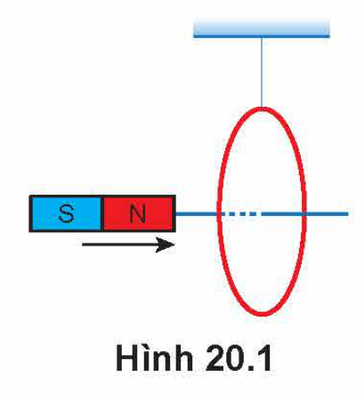
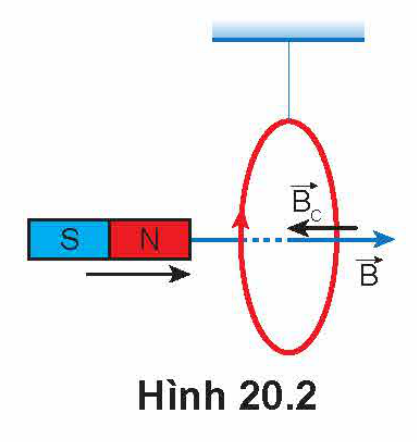
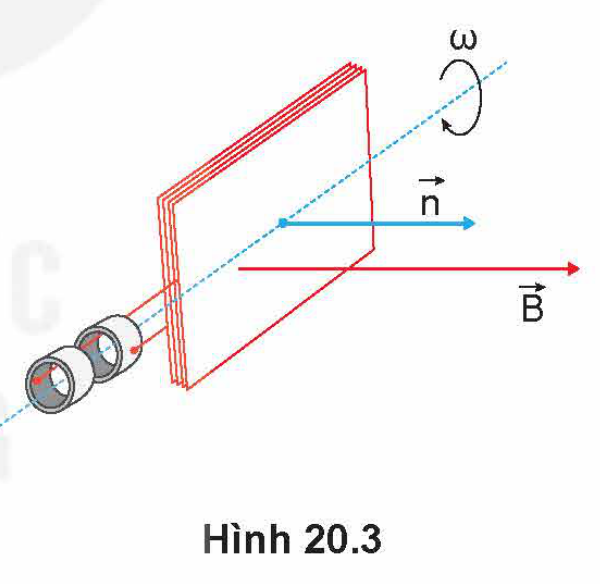
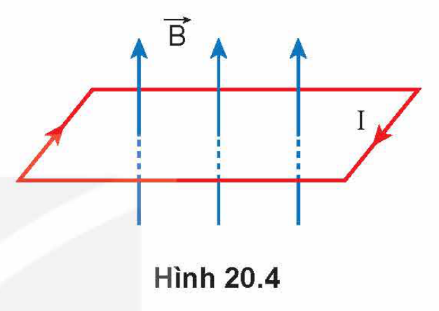
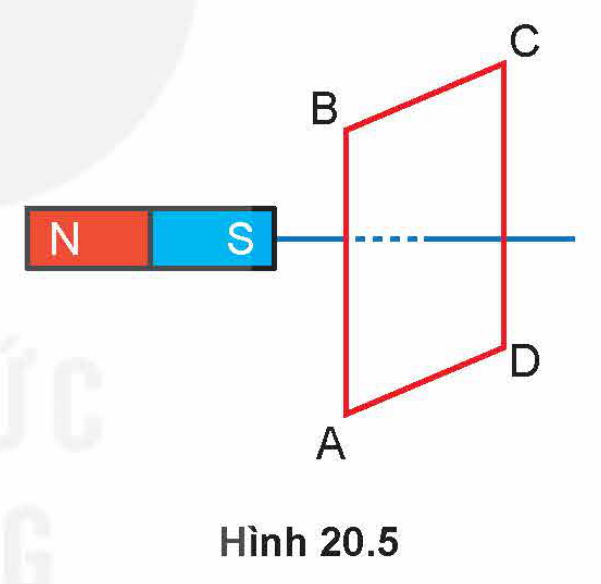
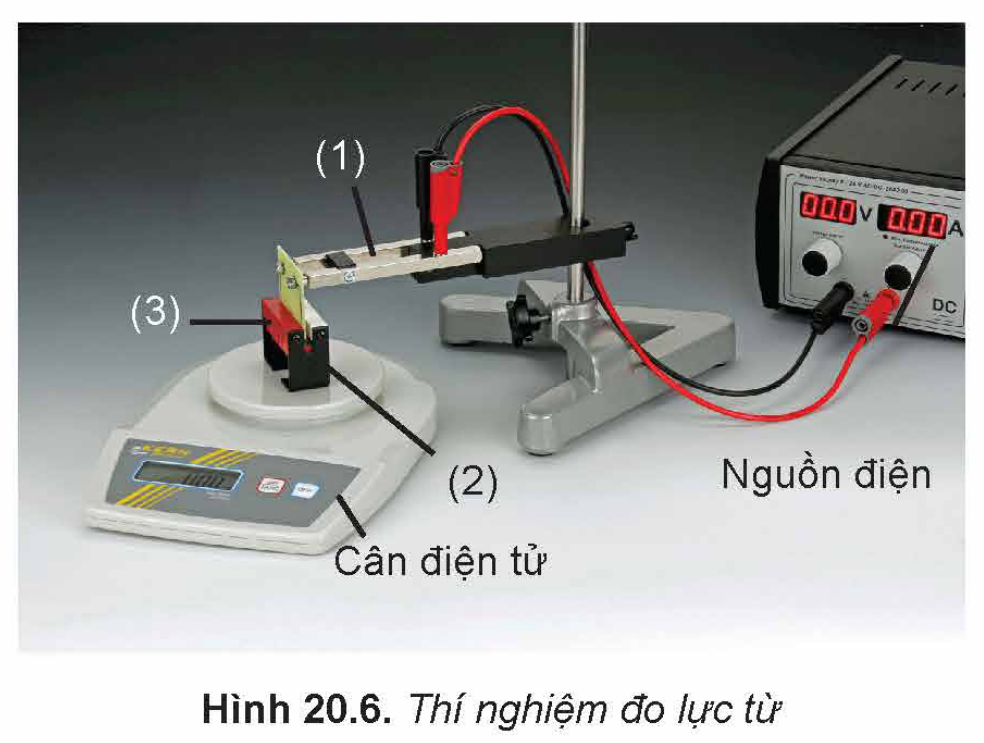

<!-- pdf:88 -->

# BÀI 20: BÀI TẬP VỀ TỪ TRƯỜNG

## 🔴 Mở đầu

> Để giải các bài tập về từ trường thì cần dùng những kiến thức cơ bản nào?

## I. MỘT SỐ LƯU Ý TRONG VIỆC GIẢI BÀI TẬP VỀ TỪ TRƯỜNG

Phần từ trường bao gồm những nội dung chính như: mô tả từ trường, lực từ tác dụng lên đoạn dây dẫn thẳng mang dòng điện; cảm ứng điện từ; dòng điện xoay chiều; sóng điện từ.

### 1. Lưu ý khi giải bài tập định tính

Các bài tập này thường yêu cầu mô tả tính chất của từ trường, xác định phương, chiều của cảm ứng từ $\vec{B}$ do các loại dòng điện tạo ra; xác định phương, chiều của lực từ tác dụng lên đoạn dây dẫn mang dòng điện; xác định chiều dòng điện cảm ứng, xác định điều kiện xuất hiện dòng điện cảm ứng; mô tả quá trình lan truyền sóng điện từ; giải thích các ứng dụng của lực từ, hiện tượng cảm ứng điện từ trong đời sống và trong kĩ thuật,...

### 2. Lưu ý khi giải bài tập định lượng

Các bài tập này thường yêu cầu vận dụng công thức xác định độ lớn của lực từ tác dụng lên đoạn dây dẫn, các công thức tính suất điện động cảm ứng, công thức xác định suất điện động của máy phát điện xoay chiều; công thức về mối quan hệ giữa các đại lượng hiệu dụng của dòng điện xoay chiều trong máy biến áp,...

### 3. Lưu ý khi giải bài tập thí nghiệm và bài tập đồ thị

Các bài tập này thường yêu cầu vận dụng các kiến thức và kĩ năng tiến hành, thu thập kết quả, xử lí số liệu, phân tích đồ thị. Để giải các bài tập này cần lưu ý việc chọn trục toạ độ, đơn vị cho phù hợp.

## II. BÀI TẬP VÍ DỤ

1. Đưa một nam châm lại gần vòng dây như Hình 20.1. Hãy xác định chiều dòng điện cảm ứng trong vòng dây và cho biết vòng dây sẽ chuyển động về phía nào?

Hình 20.1

*Giải*

- Cảm ứng từ của nam châm có chiều đi vào cực Nam (S), đi ra ở cực Bắc (N).
- Vì nam châm đang lại gần vòng dây nên từ thông qua vòng dây tăng. Theo định luật Lenz, trong vòng dây sẽ xuất hiện dòng điện cảm ứng có chiều chống lại sự tăng của từ thông. Dòng điện cảm ứng tạo ra cảm ứng từ $\vec{B}_C$ ngược chiều với cảm ứng từ $\vec{B}$ của nam châm, suy ra cảm ứng từ $\vec{B}_C$ có chiều từ phải sang trái.
- Áp dụng quy tắc nắm bàn tay phải suy ra chiều của dòng điện cảm ứng có chiều như Hình 20.2.

Hình 20.2

<!-- pdf:89 -->

- Cảm ứng từ của vòng dây có chiều đi vào mặt Nam, đi ra ở mặt Bắc, suy ra mặt đối diện của vòng dây với nam châm là mặt Bắc.
- Vì cực Bắc của nam châm lại gần mặt Bắc của vòng dây nên vòng dây bị đẩy ra xa.

2. Một dây dẫn có chiều dài 10 cm được đặt trong từ trường đều có cảm ứng từ $B = 5.10^{-2}\text{ T}$. Cho dòng điện có cường độ 10 A chạy qua dây dẫn.

   a) Xác định lực từ tác dụng lên dây dẫn khi dây dẫn đặt vuông góc với cảm ứng từ $\vec{B}$.

   b) Khi lực từ tác dụng có độ lớn bằng 0,043 N, xác định góc giữa cảm ứng từ $\vec{B}$ và chiều dòng điện.

*Giải*

a) Lực từ $\vec{F}$ có đặc điểm:

- Điểm đặt tại trung điểm đoạn dây dẫn mang dòng điện $I$.
- Có phương vuông góc với đoạn dây dẫn mang dòng điện $I$ và cảm ứng từ $\vec{B}$ có chiều tuân theo quy tắc bàn tay trái.
- Độ lớn: $F = BIL\sin\alpha = (5.10^{-2}).0,1.10.\sin 90^\circ = 0,05\text{ N}$.

b) Ta có:

$F = BIL\sin\alpha \Rightarrow \sin\alpha = \frac{F}{BIL} = \frac{0,043}{5.10^{-2}.10.0,1} \approx 0,86\text{. Vậy }\alpha \approx 60^\circ$

3. Một khung dây dẫn phẳng có diện tích $S = 20\text{ cm}^2$, có $N = 100$ vòng dây (Hình 20.3), quay đều với tốc độ 50 vòng/giây quanh một trục vuông góc với các đường sức của một từ trường đều có cảm ứng từ $B = 0,1\text{ T}$. Chọn gốc thời gian $t = 0$ là lúc vectơ pháp tuyến $\vec{n}$ của diện tích $S$ của khung dây cùng chiều với vectơ cảm ứng từ $\vec{B}$ và chiều dương là chiều quay của khung dây.

   a) Viết biểu thức xác định từ thông qua khung dây.

   b) Viết biểu thức xác định suất điện động xuất hiện trong khung dây.

Hình 20.3

*Giải*

a) Khung dây dẫn quay đều với tốc độ góc: $\omega = 50.2\pi = 100\pi\text{ (rad/s)}$.

Tại thời điểm ban đầu $t = 0$, vectơ pháp tuyến $\vec{n}$ của diện tích $S$ của khung dây có chiều trùng với chiều vectơ cảm ứng từ $\vec{B}$ của từ trường. Đến thời điểm $t$, pháp tuyến $\vec{n}$ của khung dây đã quay được một góc bằng $\omega t$. Lúc này từ thông qua khung dây là: $\Phi = NBS\cos(\omega t)$.

Như vậy, từ thông qua khung dây biến thiên điều hoà theo thời gian với tần số góc $\omega$ và với giá trị cực đại (biên độ) là $\Phi_0 = NBS$.

Thay $N = 100$, $B = 0,1\text{ T}$, $S = 20\text{ cm}^2 = 20.10^{-4}\text{ m}^2$ và $\omega = 100\pi\text{ (rad/s)}$ ta được biểu thức của từ thông qua khung dây là: $\Phi = 0,02\cos(100\pi t)\text{ (Wb)}$.

<!-- pdf:90 -->

b) Từ thông qua khung dây biến thiên điều hoà theo thời gian, theo định luật cảm ứng điện từ của Faraday thì trong khung dây xuất hiện một suất điện động cảm ứng.

Suất điện động cảm ứng xuất hiện trong khung dây được xác định theo công thức:

$e = \omega NBS\cos\left(\omega t - \frac{\pi}{2}\right)$

Thay $N = 100$, $B = 0,1\text{ T}$, $S = 20\text{ cm}^2 = 20.10^{-4}\text{ m}^2$ và $\omega = 100\pi\text{ (rad/s)}$, ta được biểu thức xác định suất điện động xuất hiện trong khung dây là: $e = 6,28\cos\left(100\pi t - \frac{\pi}{2}\right)\text{ (V)}$.

## III. BÀI TẬP VẬN DỤNG

1. Đặt một khung dây dẫn hình chữ nhật có dòng điện chạy qua trong từ trường, sao cho mặt phẳng khung dây vuông góc với các đường cảm ứng từ (Hình 20.4) thì lực từ

   A. làm dãn khung.

   B. làm khung dây quay.

   C. làm nén khung.

   D. không tác dụng lên khung.

Hình 20.4

2. Đặt một thanh nam châm thẳng ở gần một khung dây kín ABCD như Hình 20.5. Xác định chiều của dòng điện cảm ứng xuất hiện trong khung dây khi đưa nam châm lại gần khung dây.

Hình 20.5

3. Một vòng dây phẳng giới hạn diện tích $S = 40\text{ cm}^2$ đặt trong từ trường đều có cảm ứng từ $B = 0,1\text{ T}$. Mặt phẳng vòng dây hợp với cảm ứng từ $\vec{B}$ một góc $\alpha = 30^\circ$. Tính từ thông qua $S$.

4. Hình 20.6 là ảnh chụp thí nghiệm đo lực từ của nam châm vĩnh cửu tác dụng lên đoạn dây dẫn đặt trong từ trường. Biết dây dẫn được cố định vào giá thí nghiệm (1) sao cho phương của đoạn dây dẫn (2) nằm ngang vuông góc với vectơ cảm ứng từ $\vec{B}$ của nam châm (3) và không chạm vào nam châm nằm trên cân. Số liệu thí nghiệm thu được như trong Bảng 20.1. Trong đó $L$ là chiều dài đoạn dây dẫn mang dòng điện đặt trong từ trường, $F$ là độ lớn của lực từ tác dụng lên đoạn dây dẫn, $I$ là cường độ dòng điện.

Hình 20.6. Thí nghiệm đo lực từ

<!-- pdf:91 -->

**Bảng 20.1.** *Kết quả thí nghiệm*

| $I\text{ (A)}$ | 2,5 | 5,1 | 10,1 | 20,2 | 5,1 | 10,1 |
|---|---|---|---|---|---|---|
| $L\text{ (cm)}$ | 1,2 | 1,2 | 1,2 | 1,2 | 0,7 | 0,7 |
| $F\text{ (N)}$ | 0,008 | 0,015 | 0,030 | 0,060 | 0,009 | 0,017 |

a) Vì sao sử dụng cân điện tử như trong Hình 20.6 có thể xác định được độ lớn lực từ tác dụng lên đoạn dây?

b) Từ số liệu trong bảng, hãy tính độ lớn cảm ứng từ $B$ của nam châm.

## 📌 Em đã học

- Cách giải các bài tập về từ trường.

## ✏️ Em có thể

- Vận dụng các kiến thức về từ trường, lực từ tác dụng lên đoạn dây dẫn thẳng mang dòng điện, cảm ứng từ, dòng điện xoay chiều, sóng điện từ để giải các bài tập có liên quan.

## 📷 Danh sách hình trong bài

| Mã hình | Trang PDF | Vị trí | Chú thích gốc |
|---|---|---|---|
| H12-vat_ly-b20-01 | 88 | Mục II, Bài tập 1 | Hình 20.1 |
| H12-vat_ly-b20-02 | 88 | Mục II, Bài tập 1 | Hình 20.2 |
| H12-vat_ly-b20-03 | 89 | Mục II, Bài tập 3 | Hình 20.3 |
| H12-vat_ly-b20-04 | 90 | Mục III, Bài tập 1 | Hình 20.4 |
| H12-vat_ly-b20-05 | 90 | Mục III, Bài tập 2 | Hình 20.5 |
| H12-vat_ly-b20-06 | 90 | Mục III, Bài tập 4 | Hình 20.6. Thí nghiệm đo lực từ |
