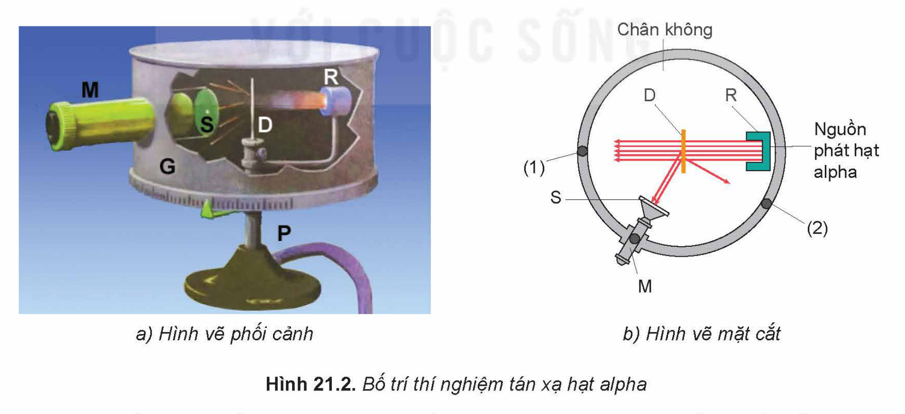
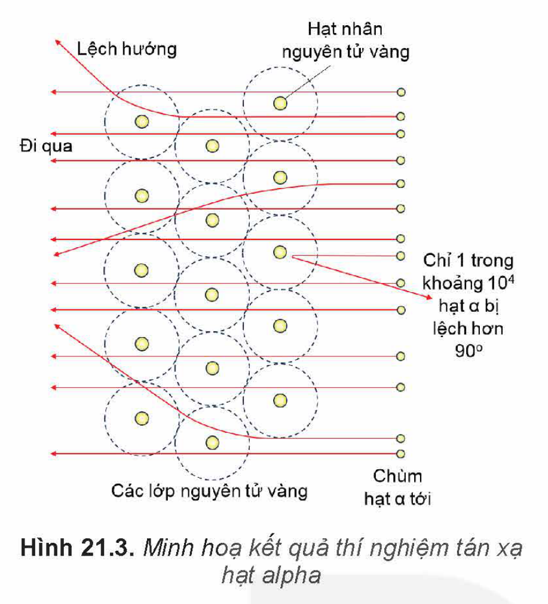
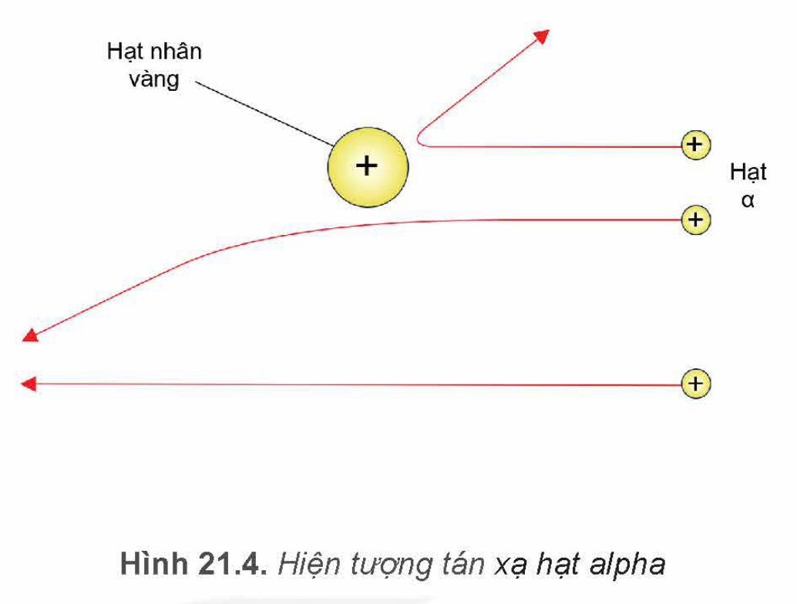
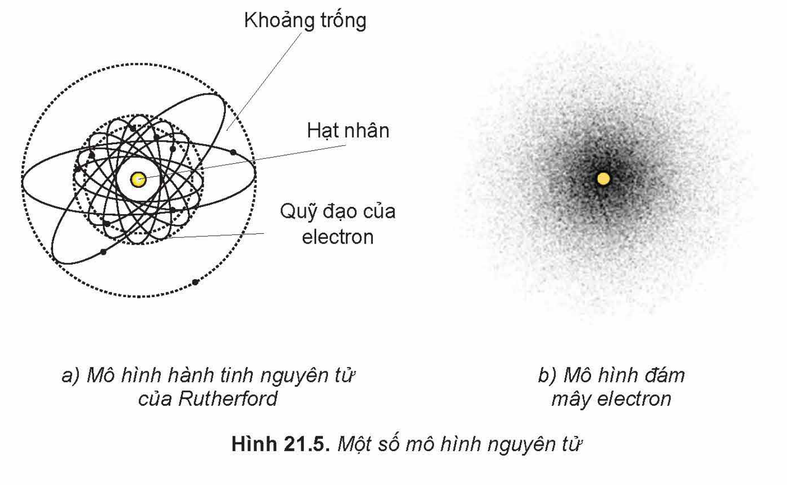
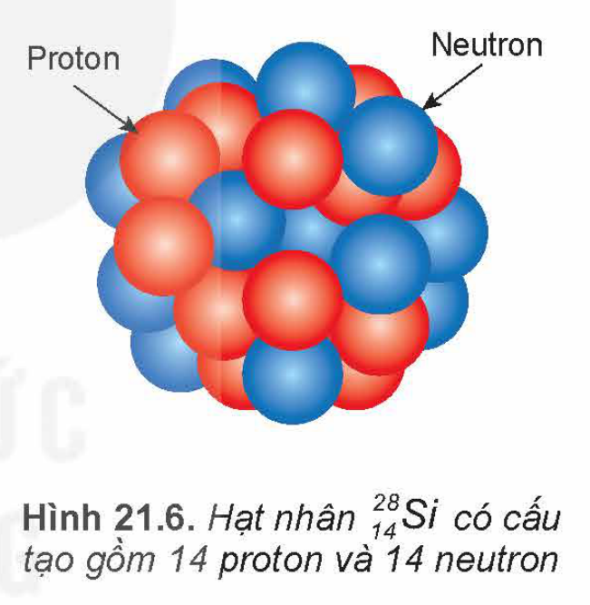
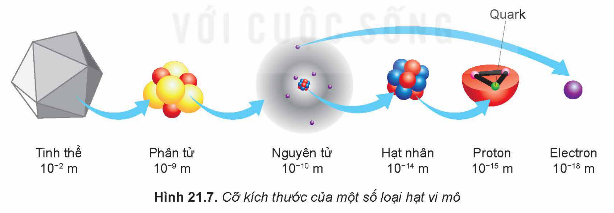

<!-- pdf:93 -->

# BÀI 21: CẤU TRÚC HẠT NHÂN

## 🔴 Mở đầu

> Kích thước nguyên tử nhỏ tới mức kính hiển vi quang học hiện đại nhất cũng không thể giúp chúng ta quan sát rõ. Hạt nhân có kích thước còn nhỏ hơn rất nhiều (khoảng $0,0001$ lần) so với nguyên tử. Các nhà khoa học đã làm thế nào để phát hiện ra điều đó?

## I. THÍ NGHIỆM TÁN XẠ HẠT ALPHA

Mô hình nguyên tử đầu tiên giống như một chiếc bánh ngọt có mận khô bên trong, các mẩu mận khô biểu diễn các electron mang điện tích âm có khối lượng và kích thước rất nhỏ so với nguyên tử (Hình 21.1). Phần còn lại của bánh biểu diễn phần còn lại của nguyên tử mang điện tích dương, nặng gần bằng nguyên tử và chiếm gần như toàn bộ không gian nguyên tử.

<!-- term: Mô hình hành tinh nguyên tử -->
<!-- term: Thí nghiệm tán xạ hạt alpha -->
Năm 1911, Ernest Rutherford (Ê-nét Ru-giơ-pho) tiến hành thí nghiệm khám phá cấu tạo nguyên tử vàng (Hình 21.2) và đề xuất mô hình nguyên tử mới có tên mô hình hành tinh nguyên tử. Trong thí nghiệm này, Rutherford sử dụng chùm **hạt alpha** mang điện tích dương (kí hiệu $\alpha$, chính là hạt nhân nguyên tử $\text{He}$). Chùm hạt này được phát ra từ nguồn R bắn vào lá vàng D rất mỏng (độ dày chỉ khoảng $4 \cdot 10^{-7}\text{ m}$), được đặt trong hộp chân không G. Để phát hiện các hạt alpha sau khi đi qua lá vàng, ông dùng kính hiển vi M để quan sát các đốm sáng phát ra khi các hạt này đập vào kính S có phủ chất huỳnh quang.

Khi di chuyển kính hiển vi từ vị trí (1) đến vị trí (2) (Hình 21.2b), tần suất đốm sáng xuất hiện trên màn S giảm đi rất nhanh. Tại vị trí (2) vẫn thấy xuất hiện các đốm sáng nhưng tần suất ít hơn so với tại vị trí (1) cỡ $10^4$ lần. Kết quả thí nghiệm có thể được minh hoạ như Hình 21.3.

<!-- pdf:94 -->

*Hiện tượng lệch hướng chuyển động của hạt alpha khi đến gần hạt nhân vàng gọi là **hiện tượng tán xạ hạt alpha*** (Hình 21.4).

> ✋ 1. Dựa vào kết quả thí nghiệm tán xạ hạt $\alpha$ để trả lời các câu hỏi sau:
>
> a) Tần suất đốm sáng xuất hiện khi kính hiển vi ở vị trí (1) (vị trí đối diện với nguồn phát tia $\alpha$ – Hình 21.2 b) là lớn nhất chứng tỏ điều gì?
>
> b) Tại sao có một số hạt $\alpha$ đổi hướng chuyển động khi đi qua lá vàng?
>
> c) Số hạt $\alpha$ không đi qua lá vàng mà bật lại tới vị trí (2) với tần suất chỉ bằng $10^{-4}$ lần tần suất hạt $\alpha$ đi qua lá vàng tới vị trí (1) chứng tỏ điều gì?
>
> 2. Dựa trên thí nghiệm tán xạ hạt $\alpha$, Rutherford đề xuất một mô hình hành tinh nguyên tử (Hình 21.5 a).
>
> a) Mô tả mô hình hành tinh nguyên tử của Rutherford.
>
> b) Giải thích mô hình cấu tạo nguyên tử của Rutherford dựa vào các câu trả lời ở ý 1.

<!-- pdf:95 -->

> 💡 **EM CÓ BIẾT**
>
> <!-- term: Mẫu nguyên tử Bohr -->
> <!-- term: Mô hình đám mây điện tử -->
> Mẫu hành tinh nguyên tử của Rutherford không giải thích được tính bền vững của các nguyên tử và sự tạo thành quang phổ vạch của các nguyên tử. Năm 1913, Bohr (Bo) đã dựa trên mô hình nguyên tử của Rutherford và vận dụng thuyết lượng tử ánh sáng để đề xuất mẫu nguyên tử mới gọi là mẫu nguyên tử Bohr. Trong mẫu này, Bohr vẫn giữ mô hình hành tinh nguyên tử của Rutherford nhưng đã bổ sung các tiên đề về cấu trúc nguyên tử. Mẫu này đã giải thích được sự tạo thành quang phổ vạch của các nguyên tử, đặc biệt là của nguyên tử hydrogen. Tuy nhiên, mô hình nguyên tử của Bohr không giải thích được nhiều tính chất của các nguyên tử khác. Hiện nay, người ta vận dụng các lí thuyết của Erwin Schrödinger (Ê-uyn Srô-đin-gơ) để đưa ra mô hình đám mây điện tử. Trong mô hình này, các electron có thể xuất hiện ở mọi vị trí trong không gian nguyên tử với xác suất nào đó và mật độ xác suất có mặt của electron được biểu diễn bằng các đám mây electron (Hình 21.5b). Mô hình này có thể giải thích được quang phổ vạch của các loại nguyên tử.

## II. NUCLEON VÀ KÍ HIỆU HẠT NHÂN

### 1. Nucleon

Theo mô hình nguyên tử Rutherford, hạt nhân tích điện dương bằng $Z \cdot e$ ($Z$ là số thứ tự trong bảng tuần hoàn, gọi là **số hiệu nguyên tử**), với kích thước của hạt nhân rất nhỏ.

*Hạt nhân được tạo thành bởi hai loại hạt là proton và neutron, hai loại hạt này có tên chung là **nucleon** (Hình 21.6).*

**Proton** (kí hiệu $\text{p}$), có khối lượng $m_{\text{p}} \approx 1,67262 \cdot 10^{-27}\text{ kg}$, điện tích là $q = +e \approx 1,6 \cdot 10^{-19}\text{ C}$ và hạt **neutron** (kí hiệu $\text{n}$) có khối lượng $m_{\text{n}} \approx 1,67493 \cdot 10^{-27}\text{ kg}$, trung hoà về điện.

Khối lượng nguyên tử bằng tổng khối lượng hạt nhân và electron có trong nguyên tử. Hạt nhân có khối lượng rất lớn so với khối lượng của các electron, vì vậy khối lượng nguyên tử gần như tập trung toàn bộ ở hạt nhân.

Để thuận lợi tính toán khối lượng của hạt nhân, người ta định nghĩa một đơn vị mới gọi là ***đơn vị khối lượng nguyên tử***, kí hiệu là $\text{amu}$. Đơn vị $\text{amu}$ có giá trị bằng $\frac{1}{12}$ khối lượng nguyên tử của đồng vị carbon-12:

$1\text{ amu} \approx 1,66054 \cdot 10^{-27}\text{ kg}$

> ❓ Xác định khối lượng của proton và neutron theo đơn vị $\text{amu}$.

Số proton trong hạt nhân bằng $Z$. Tổng số nucleon trong một hạt nhân được kí hiệu là $A$; $A$ gọi là **số khối**.

<!-- pdf:96 -->

<!-- term: Bán kính hạt nhân -->
Các nucleon nằm sát nhau và không chồng lấn vào nhau. Có thể coi hạt nhân nguyên tử như một quả cầu bán kính $R$; $R$ phụ thuộc vào tổng số hạt nucleon $A$ theo công thức gần đúng:

$R = 1,2 \cdot 10^{-15} \cdot A^{\frac{1}{3}}\text{ (m)} \quad (21.1)$

> ❓ Công thức 21.1 cho kết quả tốt hơn với $A > 12$. Nghiệm lại sự chính xác của công thức này cho các hạt nhân trong Bảng 21.1

**Bảng 21.1.** *Kích thước của một số hạt nhân*

| Tên nguyên tố | Số khối | Bán kính nguyên tử ($10^{-10}\text{ m}$) | Bán kính hạt nhân ($10^{-15}\text{ m}$) |
| --- | --- | --- | --- |
| Hydrogen | 1 | 1,2 | 0,9 |
| Helium | 4 | 1,4 | 1,7 |
| Oxigen | 16 | 1,5 | 2,7 |
| Silicon | 28 | 2,1 | 3,1 |
| Sắt | 56 | 1,9 | 3,7 |
| Cadimium | 114 | 1,6 | 4,6 |
| Vàng | 197 | 1,7 | 5,4 |
| Uranium | 238 | 1,9 | 5,9 |

> 💡 **EM CÓ BIẾT**
>
> Hạt nucleon vẫn chưa phải là hạt nhỏ nhất, còn có các hạt nhỏ bé hơn cấu tạo lên các nucleon, gọi là **hạt quark** (Hình 21.7).
>
> 

### 2. Kí hiệu hạt nhân

<!-- term: Kí hiệu hạt nhân -->
*Người ta dùng kí hiệu hoá học $\text{X}$ của nguyên tố để kí hiệu cho hạt nhân, kèm theo hai số $Z$ và $A$ như sau: $^{A}_{Z}\text{X}$.*

Ví dụ: hạt nhân carbon có $12$ nucleon trong đó có $6$ proton được kí hiệu $^{12}_{6}\text{C}$.

Để kí hiệu gọn hơn, người ta thường chỉ ghi theo dạng $^{A}\text{X}$ (ví dụ $^{12}\text{C}$).

<!-- pdf:97 -->

> ❓ 1. Trong kí hiệu hạt nhân, đại lượng $N = A - Z$ cho biết số lượng của loại hạt nào trong hạt nhân? Vì sao?
>
> 2. Bằng cách nào có thể tìm được số $Z$ và số $N$ của hạt nhân có kí hiệu dạng $^{A}\text{X}$?
>
> 3. Viết kí hiệu hạt nhân vàng ($\text{Au}$), helium ($\text{He}$) và nitrogen ($\text{N}$), biết rằng số lượng nucleon của các hạt nhân này lần lượt là $197$; $4$ và $14$.

### 3. Đồng vị

*Các hạt nhân **đồng vị** là những hạt nhân có cùng số $Z$, khác số $A$, nghĩa là cùng số proton và khác số neutron.*

Ví dụ: Hydrogen có ba đồng vị: hydrogen thường $^{1}_{1}\text{H}$; hydrogen nặng $^{2}_{1}\text{H}$ còn gọi là **deuterium** ($^{2}_{1}\text{D}$); hydrogen siêu nặng $^{3}_{1}\text{H}$ còn gọi là **tritium** ($^{3}_{1}\text{T}$).

Các đồng vị được chia làm hai loại: đồng vị bền và đồng vị phóng xạ (không bền). Hầu hết các mẫu chất trong tự nhiên đều là hỗn hợp của nhiều đồng vị.

Carbon có ba đồng vị chính là $^{12}_{6}\text{C}$, $^{13}_{6}\text{C}$, $^{14}_{6}\text{C}$, trong đó đồng vị $^{12}_{6}\text{C}$ và $^{13}_{6}\text{C}$ là đồng vị bền chiếm hơn $99\%$ carbon tự nhiên.

> ❓ Giải thích tại sao các chất cấu tạo từ cùng một loại nguyên tố nhưng khối lượng riêng vẫn có thể khác nhau.

## 📌 Em đã học

- Hạt nhân mang điện tích dương, có khối lượng gần bằng khối lượng nguyên tử chứa nó nhưng kích thước nhỏ hơn kích thước nguyên tử cỡ $10^4$ lần.
- Đơn vị khối lượng nguyên tử kí hiệu là $\text{amu}$; $1\text{ amu}$ có giá trị bằng $\frac{1}{12}$ khối lượng nguyên tử của đồng vị $^{12}_{6}\text{C}$; $1\text{ amu} \approx 1,66054 \cdot 10^{-27}\text{ kg}$.
- Hạt nhân nguyên tử được tạo thành bởi các hạt nucleon. Có hai loại nucleon là proton mang điện tích $+1e$ và neutron trung hoà về điện. Các nucleon có khối lượng xấp xỉ bằng $1\text{ amu}$.
- Kí hiệu hạt nhân $^{A}_{Z}\text{X}$, trong đó $\text{X}$, $A$, $Z$ lần lượt là kí hiệu hoá học nguyên tố, số khối và số hiệu nguyên tử.

## ✏️ Em có thể

- Giải thích được thế giới vật chất vĩ mô đa dạng quanh ta đều được tạo thành bởi các hạt proton, neutron và electron.
- Đánh giá được kích thước của hạt nhân từ thí nghiệm tán xạ hạt $\alpha$.

## 📷 Danh sách hình trong bài

| Mã hình | Trang PDF | Vị trí | Chú thích gốc |
| --- | --- | --- | --- |
| H12-vat_ly-b21-01 | 93 | Mục I | Hình 21.1. Ảnh chụp bánh ngọt có mận khô |
| H12-vat_ly-b21-02 | 93 | Mục I | Hình 21.2. Bố trí thí nghiệm tán xạ hạt alpha |
| H12-vat_ly-b21-03 | 94 | Mục I | Hình 21.3. Minh hoạ kết quả thí nghiệm tán xạ hạt alpha |
| H12-vat_ly-b21-04 | 94 | Mục I | Hình 21.4. Hiện tượng tán xạ hạt alpha |
| H12-vat_ly-b21-05 | 94 | Mục I | Hình 21.5. Một số mô hình nguyên tử |
| H12-vat_ly-b21-06 | 95 | Mục II.1 | Hình 21.6. Hạt nhân $^{28}_{14}\text{Si}$ có cấu tạo gồm 14 proton và 14 neutron |
| H12-vat_ly-b21-07 | 96 | Mục II.1, hộp Em có biết | Hình 21.7. Cỡ kích thước của một số loại hạt vi mô |
