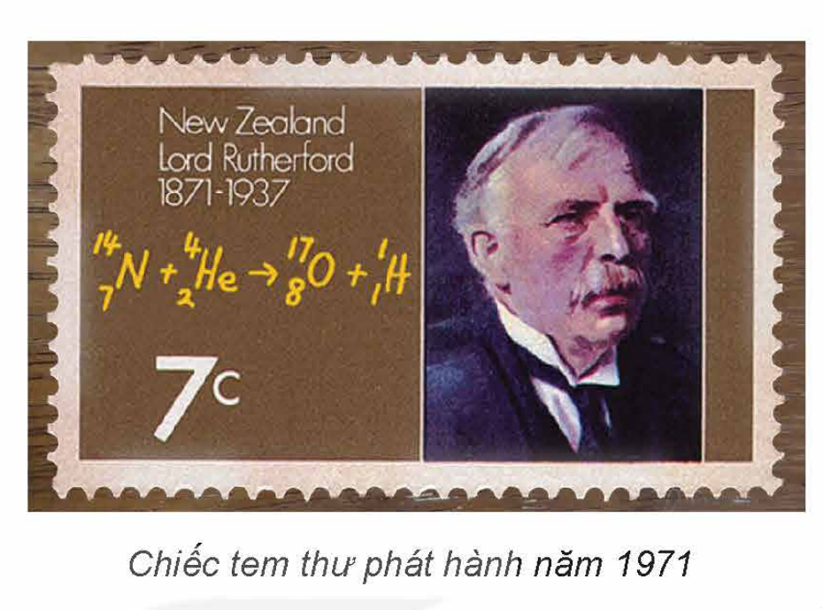
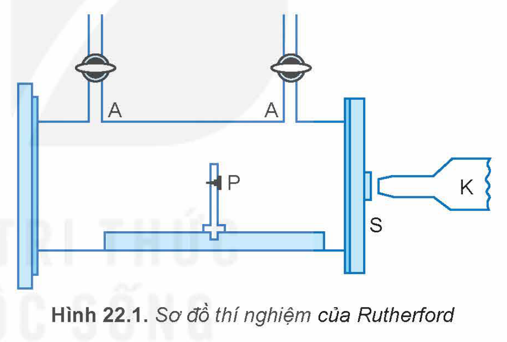
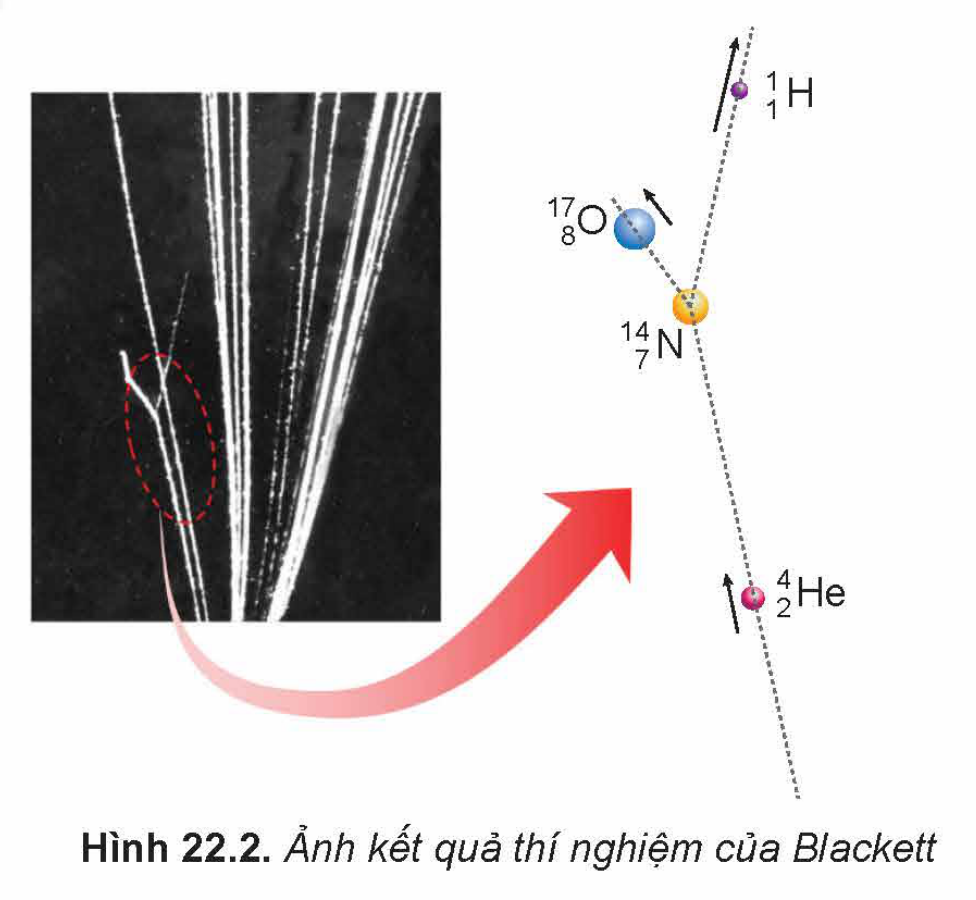
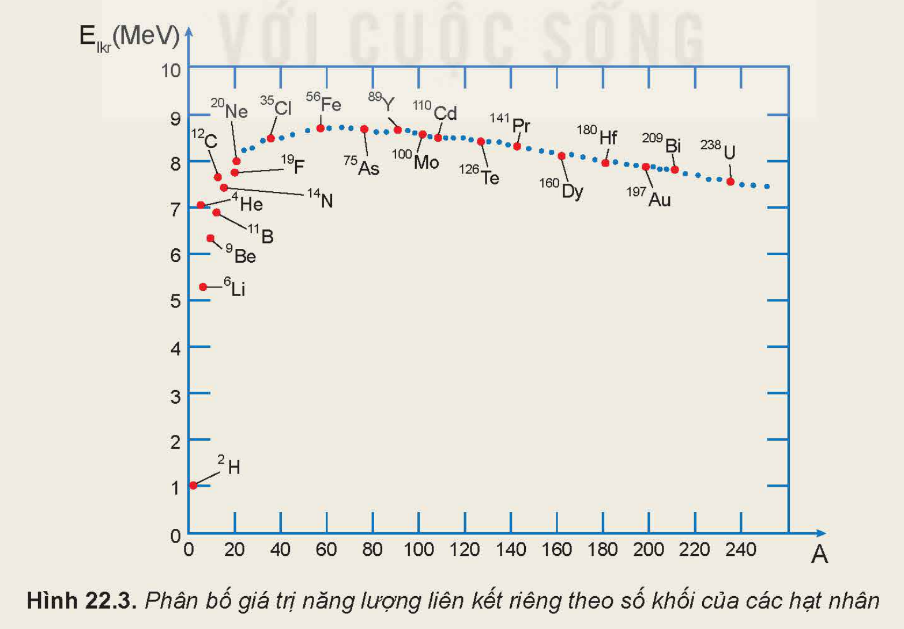
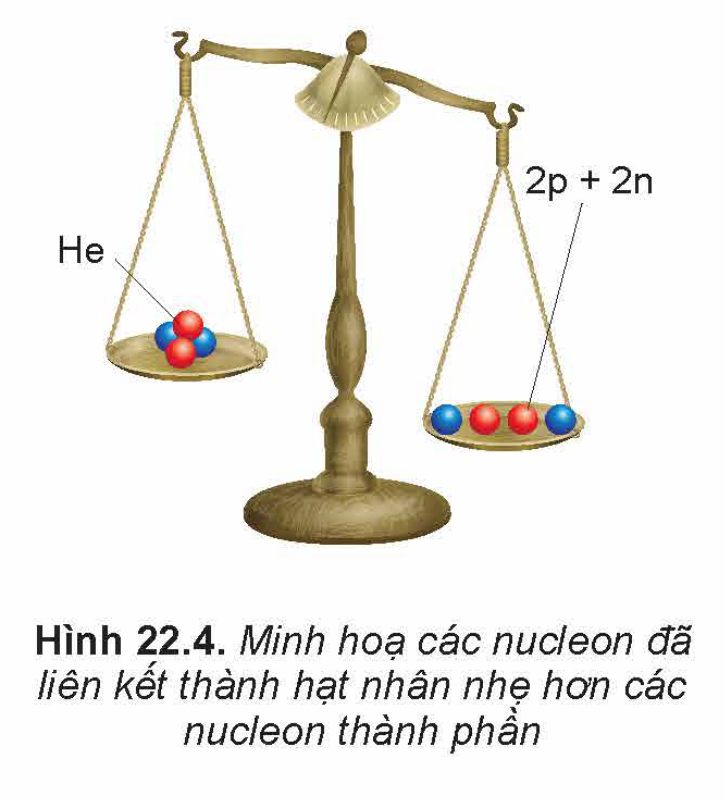
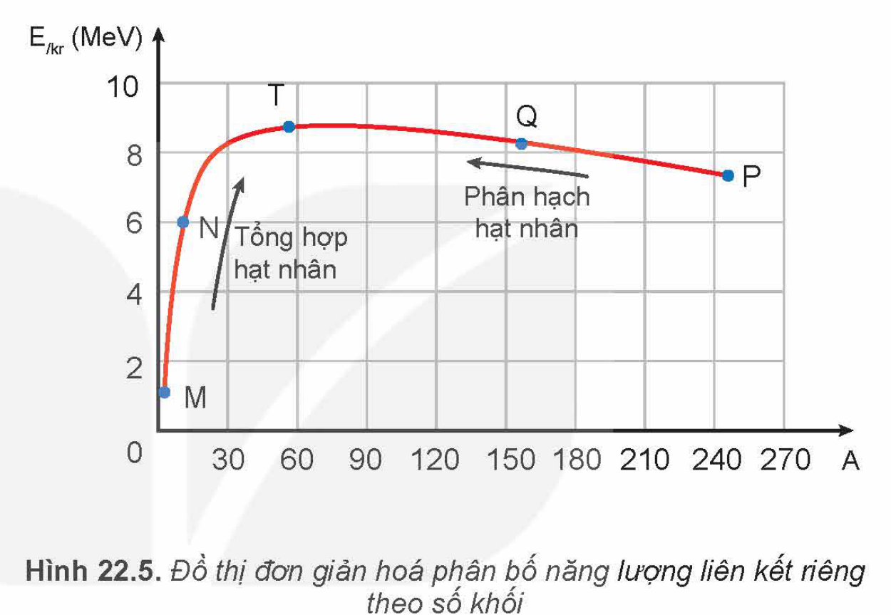
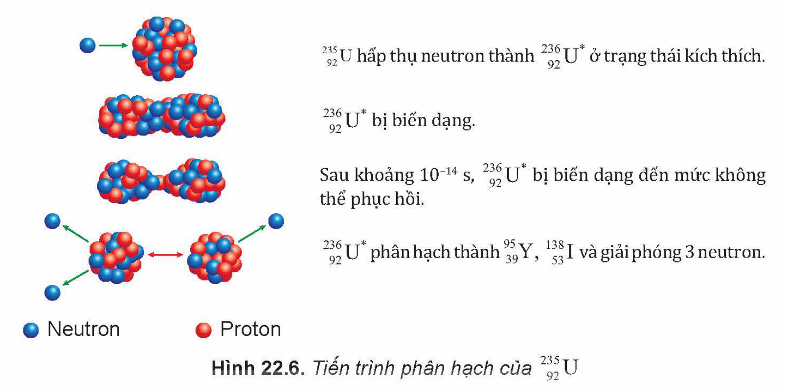
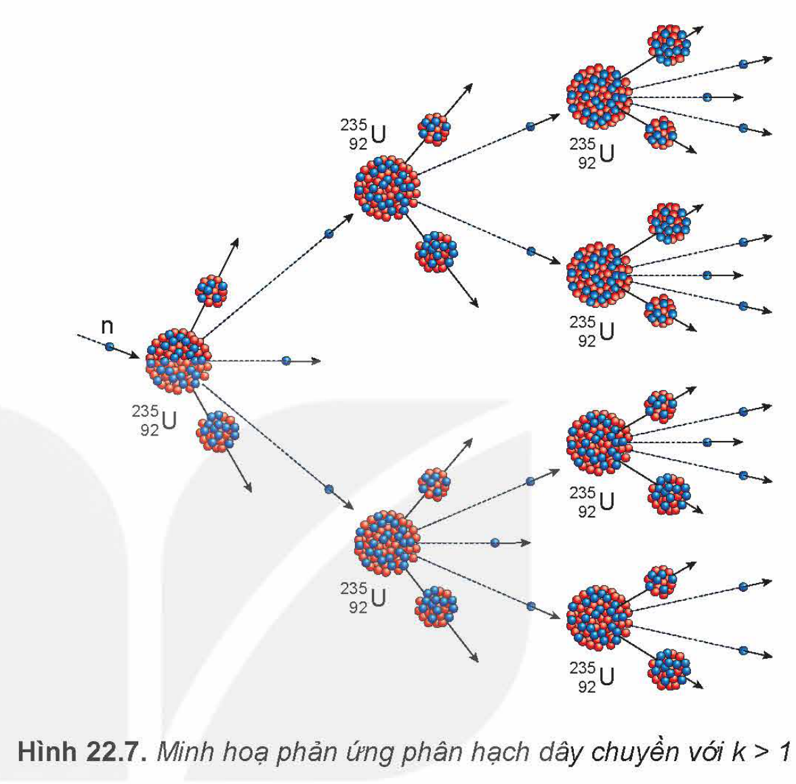

<!-- pdf:98 -->

# BÀI 22: PHẢN ỨNG HẠT NHÂN VÀ NĂNG LƯỢNG LIÊN KẾT

## 🔴 Mở đầu

> Chiếc tem thư phát hành năm 1971 có in hình Rutherford và phương trình phản ứng hạt nhân được thực hiện lần đầu tiên trên thế giới vào năm 1909. Người ta đã thực hiện thí nghiệm phát hiện phản ứng hạt nhân như thế nào? Các hạt nhân có thể biến đổi thành các hạt nhân khác không?
>
> 

## I. PHẢN ỨNG HẠT NHÂN

### 1. Thí nghiệm phát hiện phản ứng hạt nhân

Rutherford đã cho chùm hạt alpha ($^{4}_{2}\text{He}$), phóng ra từ nguồn phóng xạ $^{210}_{84}\text{Po}$ đặt tại P, bắn phá hạt nhân $^{14}_{7}\text{N}$ có trong không khí được dẫn theo đường nạp và hút khí A (Hình 22.1). Kính hiển vi K dùng để quan sát vết sáng được tạo ra do hạt nhân đập vào màn phủ huỳnh quang S. Từ kết quả thí nghiệm, ông cho rằng có hạt nhân $^{1}_{1}\text{H}$ trong sản phẩm. Tuy nhiên, ông chưa đưa ra được kết luận về bản chất diễn biến của quá trình tương tác trên.

Năm 1925, Patrick Blackett (Pa-trích Bơ-lách-két) đã sử dụng buồng sương để chụp được dấu vết tương tác này, đó chính là vết sương rẽ nhánh trong Hình 22.2. **Buồng sương** là một buồng hơi ở trạng thái siêu bão hòa, có thể tạo ra các vệt sương đủ to dọc theo đường đi của các hạt mang điện chuyển động mà mắt thường có thể nhìn thấy được. Kết quả phân tích hình ảnh của vết sương rẽ nhánh là bằng chứng giúp ông đi tới kết luận: Trong một số trường hợp, hạt $^{4}_{2}\text{He}$ bắn phá vào hạt nhân $^{14}_{7}\text{N}$ đã tạo ra hai hạt nhân mới đó là $^{17}_{8}\text{O}$ và $^{1}_{1}\text{H}$.

<!-- pdf:99 -->

> ✋ So sánh tổng số điện tích, tổng số nucleon của các hạt nhân trước và sau khi tương tác trong thí nghiệm như mô tả ở Hình 22.2.

### 2. Các loại phản ứng hạt nhân

Người ta gọi *quá trình biến đổi hạt nhân này thành hạt nhân khác là **phản ứng hạt nhân**.*

Phương trình phản ứng hạt nhân trong thí nghiệm của Blackett là:

$^{4}_{2}\text{He} + ^{14}_{7}\text{N} \rightarrow ^{17}_{8}\text{O} + ^{1}_{1}\text{H}$

Phản ứng hạt nhân thường được chia làm hai loại:

- ***Phản ứng hạt nhân kích thích***: là quá trình các hạt nhân tương tác với các hạt khác (ví dụ: hạt nhân, neutron,...) tạo ra các hạt nhân mới. Ví dụ: phản ứng phân hạch, phản ứng tổng hợp hạt nhân (xem mục III và IV).

- ***Phản ứng hạt nhân tự phát***: là quá trình tự phân rã của một hạt nhân không bền vững thành các hạt nhân mới. Ví dụ: hiện tượng phân rã hạt nhân $^{238}_{92}\text{U}$ được công bố lần đầu tiên trên thế giới bởi Henri Becquerel (Hen-ri Be-cơ-ren) (xem Bài 23):

$^{238}_{92}\text{U} \rightarrow ^{234}_{90}\text{Th} + ^{4}_{2}\text{He}$

> ❓ Hãy trình bày sự khác nhau giữa phản ứng hạt nhân và phản ứng hoá học.

### 3. Định luật bảo toàn số khối và bảo toàn điện tích trong phản ứng hạt nhân

Phản ứng hạt nhân là một quá trình vật lí, trong đó hệ các hạt tương tác được xem là hệ kín, do đó phản ứng hạt nhân tuân theo nhiều định luật bảo toàn.

**Định luật bảo toàn số nucleon** (**bảo toàn số khối A**)
*Trong phản ứng hạt nhân, tổng số nucleon của các hạt trước phản ứng bằng tổng số nucleon của các hạt tạo thành sau phản ứng. Bảo toàn số nucleon cũng là bảo toàn số khối $A$.*

**Định luật bảo toàn điện tích**
*Tổng đại số các điện tích của các hạt trước phản ứng bằng tổng đại số các điện tích của các hạt tạo thành sau phản ứng.*

> ✋ 1. Hãy viết biểu thức liên hệ giữa các số khối và biểu thức liên hệ giữa các điện tích của các hạt nhân trong phản ứng hạt nhân:
>
> $^{A_1}_{Z_1}\text{X}_1 + ^{A_2}_{Z_2}\text{X}_2 \rightarrow ^{A_3}_{Z_3}\text{X}_3 + ^{A_4}_{Z_4}\text{X}_4$
>
> 2. Khi bắn phá $^{235}_{92}\text{U}$ bằng neutron $^{1}_{0}\text{n}$ người ta thấy chúng hợp nhất thành hạt nhân $\text{X}$, ngay sau đó hạt nhân $\text{X}$ phân rã thành $^{99}_{42}\text{Mo}$, ba hạt neutron và một hạt nhân $\text{Y}$.
>
> a) Viết các phương trình phản ứng hạt nhân mô tả trong quá trình trên.
>
> b) Sử dụng bảng hệ thống tuần hoàn hãy xác định tên gọi và kí hiệu các hạt nhân $\text{X}$ và $\text{Y}$.

<!-- pdf:100 -->

## II. NĂNG LƯỢNG LIÊN KẾT

### 1. Lực hạt nhân và năng lượng liên kết

*Lực tương tác giữa các nucleon trong hạt nhân là lực hút, gọi là **lực hạt nhân***, có tác dụng liên kết các nucleon với nhau. Lực hạt nhân không phải là lực tĩnh điện, nó không phụ thuộc vào điện tích của nucleon. So với lực điện từ và lực hấp dẫn, lực hạt nhân có cường độ rất lớn. Tương tác hạt nhân chỉ đáng kể khi các hạt nucleon nằm cách nhau một khoảng rất ngắn, bằng hoặc nhỏ hơn kích thước của hạt nhân. Nói một cách khác, bán kính tác dụng của lực hạt nhân cỡ $10^{-15}\text{ m}$. Muốn tách nucleon ra khỏi hạt nhân, cần phải tốn năng lượng để thắng lực hạt nhân.

*Năng lượng tối thiểu dùng để tách toàn bộ số nucleon ra khỏi hạt nhân bằng **năng lượng liên kết hạt nhân** $E_{lk}$.*

Mức độ bền vững của một hạt nhân phụ thuộc vào **năng lượng liên kết riêng**, năng lượng này được tính theo công thức:

$E_{lkr} = \frac{E_{lk}}{A} \quad (22.1)$

Hạt nhân có $E_{lkr}$ càng lớn thì càng bền vững và ngược lại.

> ❓ Vì sao để tách được các nucleon ra khỏi hạt nhân cần một năng lượng lớn?

> ✋ 1. Nêu mối liên hệ giữa độ bền vững của hạt nhân và năng lượng liên kết riêng.
>
> 2. Giá trị năng lượng liên kết riêng $E_{lkr}$ của nhiều hạt nhân được biểu diễn trên đồ thị Hình 22.3. Em hãy:
>
> a) Chỉ ra hai hạt nhân bền vững nhất, ước lượng $E_{lkr}$ của chúng.
>
> b) Xác định năm hạt nhân nhẹ ($A \le 30$) và bốn hạt nhân nặng ($A \ge 160$) có $E_{lkr} < 8,2\text{ MeV}$.
>
> 

<!-- pdf:101 -->

### 2. Độ hụt khối

Khi so sánh khối lượng của hạt nhân $^{4}_{2}\text{He}$ ($m_{\text{He}} \approx 4,00015\text{ amu}$) với tổng khối lượng các nucleon tạo thành hạt nhân đó:

$2m_{\text{p}} + 2m_{\text{n}} \approx 2 \cdot 1,00728 + 2 \cdot 1,00866 = 4,03188\text{ amu}$,

ta thấy khối lượng của hạt nhân $^{4}_{2}\text{He}$ nhỏ hơn tổng khối lượng của các nucleon thành phần (Hình 22.4).

Tính chất này là tổng quát đối với mọi hạt nhân. *Độ chênh lệch giữa tổng khối lượng của các nucleon tạo thành hạt nhân và khối lượng $m_{\text{X}}$ của hạt nhân gọi là **độ hụt khối** của hạt nhân*, kí hiệu là $\Delta m$:

$\Delta m = [Zm_{\text{p}} + (A - Z)m_{\text{n}}] - m_{\text{X}} \quad (22.2)$

> ❓ Hãy tính độ hụt khối của hạt nhân oxygen $^{16}_{8}\text{O}$, biết khối lượng hạt nhân oxygen là $m_{\text{O}} \approx 15,99492\text{ amu}$.

### 3. Mối liên hệ giữa năng lượng và khối lượng

<!-- term: Hệ thức Einstein -->
Theo thuyết tương đối của Einstein (Anh-xtanh), một vật có khối lượng $m$ thì cũng có năng lượng tương ứng là $E$ và ngược lại:

$E = mc^2 \quad (22.3)$

Với $c$ là tốc độ của ánh sáng trong chân không.

> ❗ Cũng theo thuyết tương đối của Einstein, một vật có khối lượng $m_0$ ở trạng thái nghỉ sẽ có **năng lượng nghỉ** $E_0 = m_0 c^2$ thì khi chuyển động vật có khối lượng $m$ và năng lượng của vật khi đó gọi là **năng lượng toàn phần** $E = mc^2$.

Xét một hạt nhân $^{A}_{Z}\text{X}$, ở trạng thái 1 có $Z$ proton và $(A - Z)$ neutron liên kết chặt chẽ với nhau, hạt nhân có năng lượng là $E_1 = m_{\text{X}}c^2$. Giả sử, trạng thái 2 ứng với hệ gồm $Z$ proton và $(A - Z)$ neutron không liên kết với nhau, hệ ở trạng thái 2 có năng lượng là $E_2 = [Zm_{\text{p}} + (A - Z)m_{\text{n}}]c^2$. Năng lượng liên kết $E_{lk}$ của hạt nhân $^{A}_{Z}\text{X}$ được xác định như sau:

$E_{lk} = E_2 - E_1 = [Zm_{\text{p}} + (A - Z)m_{\text{n}} - m_{\text{X}}]c^2 = \Delta m c^2 \quad (22.4)$

*Năng lượng liên kết của một hạt nhân được tính bằng tích của độ hụt khối của hạt nhân với thừa số $c^2$.*

<!-- pdf:102 -->

> ✋ Hãy thực hiện các yêu cầu sau:
>
> a) Tính năng lượng liên kết và năng lượng liên kết riêng của hạt nhân $^{4}_{2}\text{He}$.
>
> b) Tìm hệ số chuyển đổi giữa các đơn vị $\text{amu}$ và $\text{MeV}/c^2$.

## III. PHẢN ỨNG PHÂN HẠCH HẠT NHÂN

Hình 22.5, là đồ thị phân bố năng lượng liên kết riêng $E_{lkr}$ theo số khối $A$ được vẽ đơn giản hoá từ đồ thị 22.3. Đồ thị này cho thấy, $E_{lkr}$ của hạt nhân nặng (ứng với đoạn đồ thị PQ) nhỏ hơn $E_{lkr}$ của hạt nhân có số khối trung bình (ứng với đoạn đồ thị QT). Do đó, quá trình biến đổi từ hạt nhân nặng vỡ thành các hạt nhân có số khối trung bình sẽ thu được các hạt nhân bền vững hơn.

***Phản ứng phân hạch** là phản ứng trong đó một hạt nhân nặng vỡ thành hai hạt nhân nhẹ hơn.* Hai hạt nhân này, hay còn gọi là **sản phẩm phân hạch**, có số khối trung bình và bền vững hơn so với hạt nhân ban đầu.

### 1. Sự phân hạch của uranium

Năm 1939, Otto Hahn (Ốt-tô Han) đã làm thí nghiệm dùng **neutron nhiệt** (động năng nhỏ hơn $0,1\text{ eV}$) bắn vào $^{235}_{92}\text{U}$. Kết quả cho thấy hạt nhân $^{235}_{92}\text{U}$ vỡ thành hai hạt nhân có khối lượng nhỏ hơn. Kèm theo quá trình phân hạch này có một số neutron được giải phóng (Hình 22.6).

Phương trình phản ứng là:

$^{1}_{0}\text{n} + ^{235}_{92}\text{U} \rightarrow ^{236}_{92}\text{U}^* \rightarrow ^{95}_{39}\text{Y} + ^{138}_{53}\text{I} + 3^{1}_{0}\text{n}$

Phản ứng toả ra năng lượng khoảng $200\text{ MeV}$ dưới dạng động năng của các hạt nhân sản phẩm.

<!-- pdf:103 -->

Các thí nghiệm đã cho thấy rằng phản ứng phân hạch của một hạt nhân $^{A}_{Z}\text{X}$ có thể xảy ra theo nhiều cách vỡ khác nhau. Quá trình này có thể viết dưới dạng phương trình phản ứng khái quát:

$^{1}_{0}\text{n} + ^{A}_{Z}\text{X} \rightarrow ^{A+1}_{Z}\text{X}^* \rightarrow ^{A_1}_{Z_1}\text{X}_1 + ^{A_2}_{Z_2}\text{X}_2 + k^{1}_{0}\text{n}$

Trong đó, $\text{X}_1$ và $\text{X}_2$ là các hạt nhân có số khối trung bình và hầu hết là các hạt nhân phóng xạ; $k = 1, 2, 3$ là số hạt neutron được sinh ra. Quá trình phân hạch của $^{A}_{Z}\text{X}$ là không trực tiếp mà phải qua trạng thái kích thích $^{A+1}_{Z}\text{X}^*$ không bền vững.

> ❗ Ngoài $^{235}_{92}\text{U}$ còn có một số đồng vị hạt nhân khác như $^{237}_{93}\text{Np}$, $^{239}_{94}\text{Pu}$, $^{251}_{98}\text{Cf}$,... cũng có tính chất phân hạch tương tự.

> ✋ Sự phân hạch hạt nhân là gì? Nêu đặc điểm phản ứng phân hạch của uranium.

### 2. Phản ứng phân hạch dây chuyền

*Các neutron sinh ra sau mỗi phân hạch của uranium (hoặc plutonium,...) có thể kích thích các hạt nhân khác trong mẫu chất phân hạch tạo nên những phản ứng phân hạch mới. Kết quả là các phản ứng phân hạch xảy ra liên tiếp tạo ra **phản ứng dây chuyền** và toả ra năng lượng rất lớn.*

> ❓ 1. Nêu đặc điểm của phản ứng phân hạch dây chuyền.
>
> 2. Tính năng lượng toả ra khi phân hạch hoàn toàn $1\text{ kg}$ $^{235}_{92}\text{U}$. Biết mỗi phân hạch toả ra năng lượng $200\text{ MeV}$.

<!-- pdf:104 -->

> 💡 **EM CÓ BIẾT**
>
> <!-- term: Hệ số nhân neutron -->
> Gọi $k$ là số neutron trung bình được giải phóng sau mỗi phân hạch đến kích thích các hạt nhân $^{235}_{92}\text{U}$ khác để tạo nên những phản ứng phân hạch mới hình thành dây chuyền phản ứng. Khi $k < 1$ ứng với phản ứng phân hạch dây chuyền tắt dần, $k \ge 1$ ứng với phân hạch dây chuyền tự duy trì (Hình 22.7).
>
> Trong phản ứng phân hạch dây chuyền tự duy trì, để giảm thiểu số neutron bị mất vì thoát ra ngoài, chất phân hạch phải có khối lượng lớn hơn một giá trị tối thiểu gọi là **khối lượng tới hạn** $m_{th}$. Nếu chất phân hạch $^{235}_{92}\text{U}$, $^{239}_{94}\text{Pu}$ không bị nén, không đặt trong thiết bị phản xạ neutron,... thì khối lượng tới hạn tương ứng của chúng đã được làm giàu khoảng $90\%$ là $m_{th} \approx 47\text{ kg}$ và $m_{th} \approx 10\text{ kg}$ (làm giàu là biện pháp làm tăng tỉ lệ $\%$ khối lượng của đồng vị mong muốn trong chất phân hạch).
>
> 

## IV. PHẢN ỨNG TỔNG HỢP HẠT NHÂN

***Phản ứng tổng hợp hạt nhân** là phản ứng hạt nhân trong đó hai hay nhiều hạt nhân nhẹ tổng hợp lại thành một hạt nhân nặng hơn.* Từ đồ thị (Hình 22.5), có thể thấy quá trình các hạt nhân nhẹ (ứng với đoạn đồ thị MN) tổng hợp thành hạt nhân có số khối nặng hơn (ứng với đoạn đồ thị NT) sẽ thu được hạt nhân bền vững hơn vì hạt nhân đó có năng lượng liên kết riêng lớn hơn.

Vào năm 1927, Oliphant (Ô-li-phan) đã dùng máy gia tốc để các hạt nhân $^{2}_{1}\text{H}$ tương tác với nhau, kết quả tạo ra phản ứng tổng hợp hạt nhân đầu tiên trên thế giới:

$^{2}_{1}\text{H} + ^{2}_{1}\text{H} \rightarrow ^{3}_{2}\text{He} + ^{1}_{0}\text{n}$

Phản ứng này toả năng lượng khoảng $4\text{ MeV}$.

Vì các hạt nhân đều mang điện tích dương, nên muốn cho hai hạt nhân nhẹ (số khối nhỏ) có thể hợp lại thành hạt nhân nặng hơn, ta phải cung cấp cho chúng một động năng đủ lớn để thắng lực đẩy tĩnh điện Coulomb giữa chúng và cho chúng tiến lại gần nhau đến mức mà lực hạt nhân phát huy tác dụng, làm chúng kết hợp với nhau. Phép tính chứng tỏ rằng, muốn có được một động năng lớn như vậy, khí $^{2}_{1}\text{H}$ phải có nhiệt độ cỡ $10^9\text{ K}$. Trên thực tế, chỉ cần nhiệt độ vào khoảng $10^7$ đến $10^8\text{ K}$ là phản ứng tổng hợp hạt nhân này đã có thể xảy ra. Chính vì sự tổng hợp hạt nhân chỉ xảy ra ở nhiệt độ rất cao nên phản ứng này còn được gọi là ***phản ứng nhiệt hạch***.

<!-- pdf:105 -->

> 💡 **EM CÓ BIẾT**
>
> <!-- term: Điều kiện phản ứng tổng hợp hạt nhân -->
> Ngoài điều kiện nhiệt độ cao còn phải thoả mãn hai điều kiện nữa để phản ứng tổng hợp hạt nhân có thể xảy ra. Đó là: mật độ hạt nhân $n$ phải đủ lớn, đồng thời thời gian $\Delta t$ duy trì nhiệt độ cao (vào khoảng $10^7$ đến $10^8\text{ K}$) cũng phải đủ dài. J. D. Lawson (Lau-sơn, nhà khoa học người Anh) đã chứng minh điều kiện: $n \cdot \Delta t > 10^{14}\text{ s/cm}^3$.

> ❓ 1. Sự tổng hợp hạt nhân là gì? Nêu điều kiện xảy ra phản ứng tổng hợp hạt nhân.
>
> 2. So sánh định tính phản ứng tổng hợp hạt nhân và phản ứng phân hạch về các đặc điểm: nhiên liệu phản ứng và điều kiện xảy ra phản ứng.

## 📌 Em đã học

- Phản ứng hạt nhân là quá trình biến đổi từ hạt nhân này thành hạt nhân khác, bao gồm phản ứng hạt nhân kích thích và phản ứng hạt nhân tự phát.
- Trong phản ứng hạt nhân, số khối và điện tích của hệ được bảo toàn.
- Phản ứng phân hạch là phản ứng hạt nhân trong đó một hạt nhân nặng vỡ thành hai mảnh nhẹ hơn.
- Phản ứng tổng hợp hạt nhân là phản ứng trong đó hai hay nhiều hạt nhân nhẹ tổng hợp lại thành một hạt nhân nặng hơn.
- Độ hụt khối ($\Delta m$) của hạt nhân là độ chênh lệch tổng khối lượng của các nucleon tạo thành hạt nhân và khối lượng của hạt nhân.

  $\Delta m = [Zm_{\text{p}} + (A - Z)m_{\text{n}}] - m_{\text{X}}$

- Năng lượng $E$ và khối lượng $m$ tương ứng của cùng một vật được liên hệ với nhau thông qua hệ thức Einstein:

  $E = mc^2$

  trong đó, $c$ là tốc độ của ánh sáng trong chân không.
- Năng lượng liên kết riêng $E_{lkr}$ của một hạt nhân có số khối $A$ bằng:

  $E_{lkr} = \frac{E_{lk}}{A}$

  trong đó, $E_{lk}$ là năng lượng tối thiểu dùng để tách toàn bộ số nucleon ra khỏi hạt nhân, gọi là năng lượng liên kết hạt nhân. Hạt nhân càng bền vững khi $E_{lkr}$ càng lớn.

## ✏️ Em có thể

- Nêu được nguyên tắc để biến một chất bất kì thành một chất mong muốn.
- Nêu được tiềm năng khai thác sử dụng năng lượng hạt nhân.
- Giải thích được vì sao phản ứng phân hạch và tổng hợp hạt nhân toả năng lượng.
- Giải thích nguồn gốc vạn vật.

## 📷 Danh sách hình trong bài

| Mã hình | Trang PDF | Vị trí | Chú thích gốc |
| --- | --- | --- | --- |
| H12-vat_ly-b22-01 | 98 | Hộp Mở đầu | Chiếc tem thư phát hành năm 1971 |
| H12-vat_ly-b22-02 | 98 | Mục I.1 | Hình 22.1. Sơ đồ thí nghiệm của Rutherford |
| H12-vat_ly-b22-03 | 98 | Mục I.1 | Hình 22.2. Ảnh kết quả thí nghiệm của Blackett |
| H12-vat_ly-b22-04 | 100 | Mục II.1, hộp Hoạt động | Hình 22.3. Phân bố giá trị năng lượng liên kết riêng theo số khối của các hạt nhân |
| H12-vat_ly-b22-05 | 101 | Mục II.2 | Hình 22.4. Minh hoạ các nucleon đã liên kết thành hạt nhân nhẹ hơn các nucleon thành phần |
| H12-vat_ly-b22-06 | 102 | Mục III | Hình 22.5. Đồ thị đơn giản hoá phân bố năng lượng liên kết riêng theo số khối |
| H12-vat_ly-b22-07 | 103 | Mục III.1 | Hình 22.6. Tiến trình phân hạch của $^{235}_{92}\text{U}$ |
| H12-vat_ly-b22-08 | 104 | Mục III.2, hộp Em có biết | Hình 22.7. Minh hoạ phản ứng phân hạch dây chuyền với $k > 1$ |
