<!-- pdf:106 -->

# BÀI 23: HIỆN TƯỢNG PHÓNG XẠ

## 🔴 Mở đầu

> Khi gói miếng kim loại hình chữ thập (+) cùng một hòn đá có chứa uranium bằng tấm phim và để trong bóng tối vài ngày, Becquerel đã phát hiện trên tấm phim có vết sáng giống dấu chữ thập như hình bên. Nguyên nhân nào gây tác dụng lên phim dù nó được để trong bóng tối?
>
> 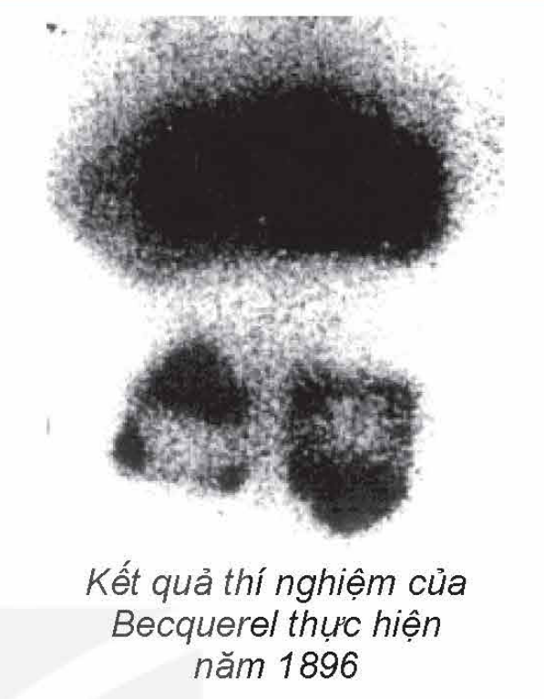

## I. HIỆN TƯỢNG PHÓNG XẠ

### 1. Định nghĩa hiện tượng phóng xạ

*Thí nghiệm buồng sương:* Khi đặt mẫu quặng uranium vào trong buồng sương, chúng ta thấy có nhiều vết sương màu trắng có dạng như các tia đi ra từ mẫu phóng xạ ở các hướng và các thời điểm ngẫu nhiên khác nhau (Hình 23.1). Các vết sương dạng tia này chính là đường đi của các hạt phóng ra từ mẫu quặng uranium, gọi là các **tia phóng xạ**.

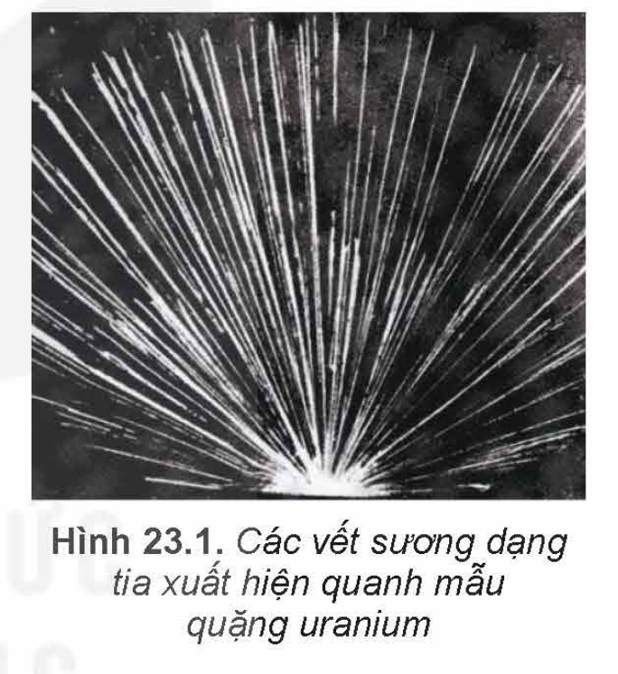

Ngoài quặng uranium còn có rất nhiều chất có thể phát ra tia phóng xạ. Tia phóng xạ không nhìn thấy được bằng mắt thường, nhưng có thể có những tác dụng như: ion hoá không khí, gây ra các hiệu ứng quang điện, phát xạ thứ cấp, làm đen kính ảnh, xuyên thấu lớp vật chất mỏng, phá huỷ tế bào, kích thích một số phản ứng hoá học,...

*Hiện tượng một hạt nhân không bền vững tự phát biến đổi thành một hạt nhân khác đồng thời phát ra tia phóng xạ gọi là **hiện tượng phóng xạ**.* Quá trình biến đổi hạt nhân này còn được gọi là **phân rã phóng xạ** hoặc phân rã hạt nhân. Hạt nhân không bền vững, tự phân rã được gọi là **hạt nhân mẹ**. Hạt nhân được tạo thành, bền vững hơn được gọi là **hạt nhân con**.

> ✋ Tìm hiểu thông tin về phát hiện của Becquerel và thí nghiệm trên, cho biết:
>
> 1. Hiện tượng phóng xạ xảy ra có tính tự phát hay phụ thuộc vào các yếu tố môi trường như nhiệt độ, áp suất,...?
>
> 2. Có thể điều khiển được hiện tượng phóng xạ không? Tại sao?

<!-- pdf:107 -->

### 2. Tính ngẫu nhiên của phân rã phóng xạ

Xét thí nghiệm được bố trí như Hình 23.2: Nguồn phóng xạ (1) được đặt gần một đầu thu phóng xạ Geiger–Müller (Gai-gơ Muy-lơ) (2) theo một phương xác định. Mỗi khi có tia phóng xạ từ nguồn đến đầu thu, nó sẽ gửi tín hiệu đến thiết bị chuyển đổi tín hiệu (3) làm loa (4) phát ra một xung âm thanh đồng thời số đếm tia phóng xạ được hiển thị trên màn hình (5) sẽ nhảy lên 1 đơn vị. Kết quả thí nghiệm sau mỗi $5\text{ s}$ liên tiếp được thể hiện trong Bảng 23.1.

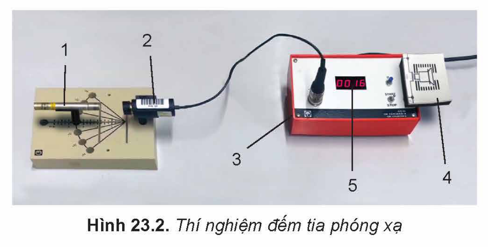

**Bảng 23.1.** *Kết quả ghi nhận số tia phóng xạ theo thời gian*

| Khoảng thời gian (s) | 0 – 5 | 5 – 10 | 10 – 15 | 15 – 20 | 20 – 25 | 25 – 30 |
| --- | --- | --- | --- | --- | --- | --- |
| Số tia phóng xạ | 1 | 3 | 2 | 0 | 3 | 1 |

> ✋ Sử dụng kết quả thí nghiệm trong Bảng 23.1 hãy thực hiện các yêu cầu sau:
>
> - Nhận xét về số lượng phân rã trong các khoảng thời gian bằng nhau liên tiếp.
> - Có thể dự đoán được thời điểm xảy ra và số lượng các phân rã phóng xạ không?

<!-- term: Tính ngẫu nhiên của phân rã phóng xạ -->
Bằng nhiều thí nghiệm khác nữa, người ta đã thấy *quá trình phóng xạ là ngẫu nhiên*. Với một hạt nhân phóng xạ cho trước, thời điểm phân rã của nó là không xác định.

### 3. Các dạng phóng xạ

Khi cho các tia phóng xạ đi qua điện trường hoặc từ trường, các tia phóng xạ có thể lệch theo các cách khác nhau (Hình 23.3). Người ta thường phân loại phóng xạ thành 3 dạng như sau: phóng xạ alpha (kí hiệu $\alpha$), phóng xạ beta (có hai loại kí hiệu là $\beta^-$ và $\beta^+$) và phóng xạ gamma (kí hiệu là $\gamma$).

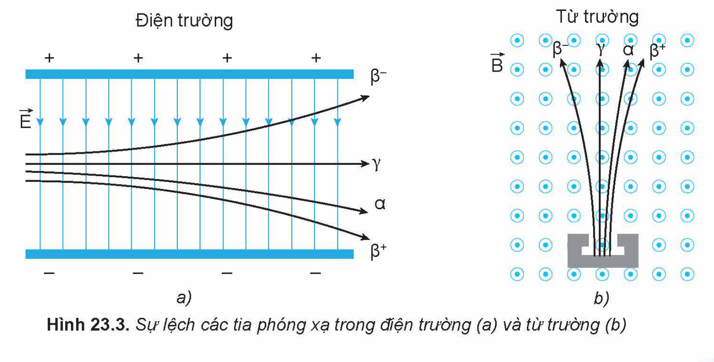

<!-- pdf:108 -->

**a) Phóng xạ alpha**

*Tia phóng xạ $\alpha$ là hạt nhân $^{4}_{2}\text{He}$ phóng ra từ hạt nhân mẹ có tốc độ khoảng $2 \cdot 10^7\text{ m/s}$.* Tia $\alpha$ làm ion hoá mạnh môi trường vật chất, do đó nó chỉ đi được khoảng vài $\text{cm}$ trong không khí và dễ dàng bị tờ giấy dày $1\text{ mm}$ chặn lại (Hình 23.4). Hạt nhân mẹ $\text{X}$ thường là các hạt nhân nặng, có số khối $A > 190$, phân rã tạo thành hạt nhân con $\text{Y}$, đồng thời phát ra tia phóng xạ $\alpha$. Phương trình của phân rã phóng xạ $\alpha$ có dạng:

$^{A}_{Z}\text{X} \rightarrow ^{A-4}_{Z-2}\text{Y} + ^{4}_{2}\text{He}$

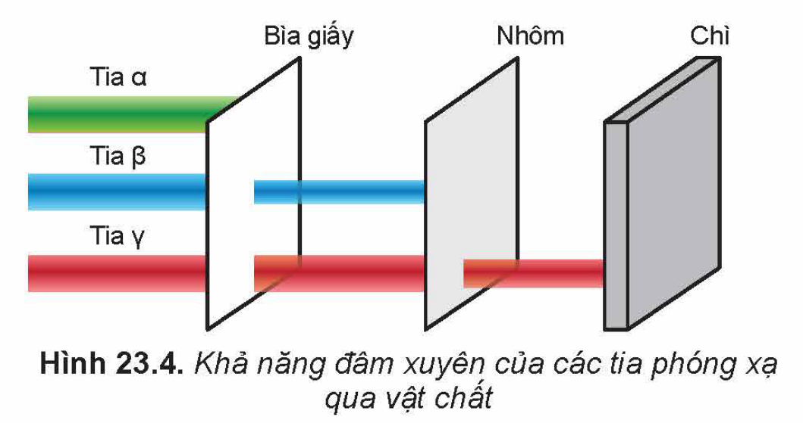

> ❓ 1. Hãy nêu các tính chất của tia phóng xạ $\alpha$.
>
> 2. Hãy viết phương trình phân rã $\alpha$ của hạt nhân $^{235}_{92}\text{U}$.

**b) Phóng xạ beta**

Phóng xạ $\beta$ gồm 2 loại: phóng xạ $\beta^-$ và phóng xạ $\beta^+$. Hai loại tia phóng xạ $\beta^-$ và $\beta^+$ có bản chất tương ứng là *hạt electron ($^{0}_{-1}\text{e}$) và hạt **positron**(\*) ($^{0}_{1}\text{e}$) phóng ra từ hạt nhân mẹ với tốc độ xấp xỉ tốc độ ánh sáng trong chân không.* Tia $\beta$ làm ion hoá môi trường vật chất ở mức trung bình, nó có thể xuyên qua tờ giấy khoảng $1\text{ mm}$ nhưng có thể bị chặn bởi tấm nhôm dày khoảng $1\text{ mm}$ (Hình 23.4).

Hạt nhân thực hiện phân rã tạo ra tia phóng xạ $\beta$, ngoài sản phẩm là hạt nhân con, các $^{0}_{-1}\text{e}$ và $^{0}_{1}\text{e}$ còn có hạt cơ bản khác là phản hạt neutrino ($\tilde{\nu}$) và hạt **neutrino** ($\nu$) không mang điện, có khối lượng nghỉ vô cùng nhỏ.

Phương trình của phân rã phóng xạ $\beta^-$ có dạng:

$^{A}_{Z}\text{X} \rightarrow ^{A}_{Z+1}\text{Y} + ^{0}_{-1}\text{e} + \tilde{\nu}$

Tương tự, đối với phóng xạ $\beta^+$:

$^{A}_{Z}\text{X} \rightarrow ^{A}_{Z-1}\text{Y} + ^{0}_{1}\text{e} + \nu$

> ❓ 1. Hãy nêu các tính chất của phóng xạ $\beta$.
>
> 2. Viết phương trình phân rã $\beta^-$ và $\beta^+$ tương ứng của các đồng vị $^{90}_{38}\text{Sr}$ và $^{18}_{9}\text{F}$.

**c) Phóng xạ gamma**

Một số hạt nhân con sau quá trình phóng xạ $\alpha$ hay $\beta$ được tạo ra trong trạng thái kích thích $^{A}_{Z}\text{Y}^*$. Khi đó, xảy ra tiếp *quá trình hạt nhân đó chuyển từ trạng thái kích thích về trạng thái có mức năng lượng thấp hơn $^{A}_{Z}\text{Y}$ và phát ra bức xạ điện từ $\gamma$ có bước sóng rất ngắn, cỡ nhỏ hơn $10^{-11}\text{ m}$, còn gọi là **tia $\gamma$**.* Các tia $\gamma$ có năng lượng cao, dễ dàng xuyên qua các vật liệu thông thường, ví dụ lớp bê tông dày hàng chục $\text{cm}$. Muốn cản trở được tia $\gamma$, người ta thường dùng vật liệu có mật độ vật chất lớn và bề dày lớn, ví dụ tấm chì dày khoảng $10\text{ cm}$ (Hình 23.4).

Phương trình của phân rã phóng xạ $\gamma$ có dạng:

$^{A}_{Z}\text{Y}^* \rightarrow ^{A}_{Z}\text{Y} + \gamma$

> (\*) ***Positron** là phản hạt của electron, có cùng khối lượng với electron nhưng mang điện tích $+e$.*

<!-- pdf:109 -->

> ❓ 1. Hãy nêu các tính chất của phóng xạ $\gamma$.
>
> 2. Technetium ($^{99}_{43}\text{Tc}^*$) là đồng vị phóng xạ $\gamma$, được sử dụng rất phổ biến trong y học hạt nhân để chụp ảnh cơ quan bên trong cơ thể người. Viết phương trình phân rã của đồng vị này.

> ✋ Dựa vào đặc điểm các tia phóng xạ em hãy:
>
> 1. Giải thích hướng lệch của từng tia phóng xạ trong điện trường và trong từ trường ở Hình 23.3.
>
> 2. Giải thích lí do tại sao các tia $\alpha$, $\beta$ và $\gamma$ có khả năng đâm xuyên khác nhau.

## II. ĐỊNH LUẬT PHÓNG XẠ. ĐỘ PHÓNG XẠ

### 1. Định luật phóng xạ

Các quá trình phân rã phóng xạ đã nêu ở trên là quá trình ngẫu nhiên. Mặc dù, với một hạt nhân phóng xạ cho trước, thời điểm phân rã của nó là không xác định, nhưng khi xét một mẫu chất phóng xạ bao gồm một số lượng rất lớn các hạt nhân phóng xạ thì ta có thể khảo sát sự biến đổi mang tính quy luật của các hạt nhân đó.

Khi thực hiện thí nghiệm phân rã phóng xạ một mẫu chất phóng xạ $^{220}_{86}\text{Rn}$ với số hạt nhân ban đầu $N_0$, người ta thấy rằng cứ sau mỗi khoảng thời gian $T = 55\text{ s}$, chỉ còn một nửa số hạt nhân của mẫu chất phóng xạ chưa bị phân rã. Trong quá trình phân rã phóng xạ, số hạt nhân mẹ sẽ giảm theo thời gian.

Thực nghiệm với các chất phóng xạ khác cũng thấy rằng, cứ sau một khoảng thời gian xác định $T$ thì một nửa số hạt nhân hiện có sẽ bị phân rã, biến đổi thành hạt nhân khác; $T$ được gọi là ***chu kì bán rã*** của chất phóng xạ.

Điều đó có nghĩa là sau các thời gian $t$ bằng $T, 2T, 3T, \dots, kT$ ($k$ là số nguyên dương), số hạt nhân (số nguyên tử) $N_t$ chưa phân rã tương ứng bằng $\frac{N_0}{2}, \frac{N_0}{4}, \frac{N_0}{8}, \dots, \frac{N_0}{2^k}$. Tức là:

$N_t = N_0 2^{-k}$, trong đó $t = kT$

hay là:

$N_t = N_0 2^{-\frac{t}{T}} \quad (23.1)$

Công thức (23.1) biểu diễn **định luật phóng xạ**: *Trong quá trình phân rã, số hạt nhân chất phóng xạ còn lại giảm theo thời gian theo định luật hàm số mũ.*

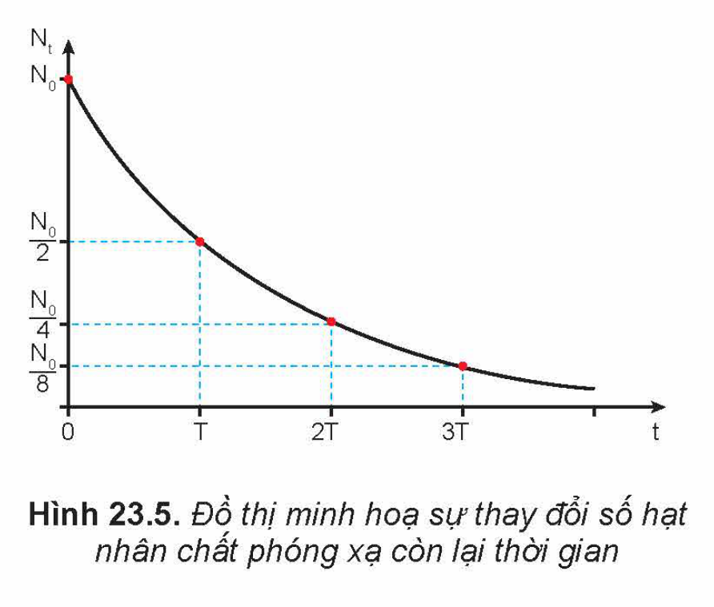

Định luật này được minh hoạ bằng đồ thị trên Hình 23.5.

Các đồng vị phóng xạ khác nhau có chu kì bán rã $T$ khác nhau (Bảng 23.2).

<!-- pdf:110 -->

**Bảng 23.2.** *Chu kì bán rã của một số đồng vị phóng xạ*

| Đồng vị phóng xạ | Chu kì bán rã $T$ |
| --- | --- |
| Carbon ($^{14}_{6}\text{C}$) | $5,7 \cdot 10^3$ năm |
| Iodine ($^{131}_{53}\text{I}$) | $8,0$ ngày |
| Oxygen ($^{15}_{8}\text{O}$) | $1,2 \cdot 10^2$ giây |
| Polonium ($^{210}_{84}\text{Po}$) | $1,4 \cdot 10^2$ ngày |
| Radium ($^{226}_{88}\text{Ra}$) | $1,6 \cdot 10^3$ năm |
| Radon ($^{219}_{86}\text{Rn}$) | $4,0$ giây |
| Uranium ($^{235}_{92}\text{U}$) | $7,0 \cdot 10^8$ năm |
<!-- ocr-ok: đối chiếu ảnh trang PDF 110 khớp nguyên văn (OCR đọc sai kí hiệu hạt nhân trong bảng) -->

> ❓ 1. Phát biểu định nghĩa chu kì bán rã?
>
> 2. Đồng vị phóng xạ $^{15}_{8}\text{O}$ sau khoảng thời gian $244\text{ s}$ có $75\%$ số hạt nhân ban đầu đã bị phân rã thành hạt nhân khác. Tính chu kì bán rã của $^{15}_{8}\text{O}$.

### 2. Độ phóng xạ

*Để đặc trưng cho tính phóng xạ mạnh hay yếu của một lượng chất phóng xạ, người ta dùng đại lượng **độ phóng xạ** (hay **hoạt độ phóng xạ**), kí hiệu là $H$, có giá trị bằng số hạt nhân phân rã trong một giây.*

Đơn vị độ phóng xạ là **becơren** (được lấy theo tên nhà bác học Becquerel), kí hiệu là $\text{Bq}$.

$1\text{ Bq} = 1\text{ phân rã}/1\text{ giây}$.

Trong thực tế, độ phóng xạ còn có đơn vị khác là **curi** (Curie, được lấy theo tên của hai nhà bác học: Marie Curie và chồng là Pierre Curie), kí hiệu là $\text{Ci}$.

$1\text{ Ci} = 3,7 \cdot 10^{10}\text{ Bq}$, xấp xỉ bằng độ phóng xạ của một gam $^{226}_{88}\text{Ra}$.

Độ phóng xạ có thể được đo nhờ các thiết bị đo phóng xạ.

Vì số hạt nhân của một lượng chất phóng xạ giảm dần, nên độ phóng xạ $H$ của chất phóng xạ cũng giảm theo thời gian. Xét một mẫu chất phóng xạ có $N_t$ hạt nhân tại thời điểm $t$. Tại thời điểm $t + \Delta t$, số hạt nhân đó giảm đi và trở thành $N_t + \Delta N$, với $\Delta N < 0$.

Số hạt nhân đã phân rã trong khoảng thời gian $\Delta t$ là $-\Delta N$, do đó theo định nghĩa độ phóng xạ thì $H_t = -\frac{\Delta N}{\Delta t}$. Xét khoảng thời gian $\Delta t$ rất bé và sử dụng biểu thức (23.1) ta có độ phóng xạ $H_t$ tại thời điểm $t$ bất kì là:

$H_t = -\frac{\text{d}N_t}{\text{d}t} = -N'_t = \frac{\ln 2}{T} N_0 2^{-\frac{t}{T}}$

Vậy $H_t = \lambda N_t \quad (23.2)$

<!-- pdf:111 -->

trong đó, đại lượng $\lambda = \frac{\ln 2}{T}$ được gọi là **hằng số phóng xạ**, đặc trưng cho chất phóng xạ đang xét. Đơn vị của $\lambda$ là $\text{s}^{-1}$. Với định nghĩa này, phương trình (23.1) và (23.2) có dạng:

$N_t = N_0 e^{-\lambda t} \quad (23.3)$

$H_t = H_0 e^{-\lambda t} \quad (23.4)$

Trong đó $H_0$ là độ phóng xạ tại thời điểm ban đầu $t = 0$.

> ❓ 1. Nêu ý nghĩa của hằng số phóng xạ.
>
> 2. Dược chất phóng xạ Flortaucipir (chứa $^{18}_{9}\text{F}$ là đồng vị phóng xạ $\beta^+$) được tiêm vào bệnh nhân nhằm chụp ảnh bên trong cơ thể (chụp ảnh PET – Bài 24). Biết $^{18}_{9}\text{F}$ có chu kì bán rã khoảng $110$ phút.
>
> a) Sau khi tiêm bao lâu thì lượng $^{18}_{9}\text{F}$ giảm còn $10\%$ và $1\%$ so với lúc đầu?
>
> b) Mỗi $\text{mL}$ dược chất phóng xạ Flortaucipir có độ phóng xạ ban đầu là $10^9\text{ Bq}$. Xác định số lượng hạt đồng vị $^{18}_{9}\text{F}$ có trong mỗi $\text{mL}$ dược chất tại thời điểm ban đầu và sau đó $1$ ngày.

> 💡 **EM CÓ BIẾT**
>
> **Đồng vị Carbon $^{14}_{6}\text{C}$, đồng hồ của Trái Đất**
>
> Năm 1947, Willand Frank Libby (Uy-lan Phờ-ranh Líp-bi) đã tìm ra phương pháp xác định niên đại của các cổ vật gốc hữu cơ, dựa vào các đặc tính của đồng vị phóng xạ carbon $^{14}_{6}\text{C}$. Đồng vị $^{14}_{6}\text{C}$ có chu kì bán rã là $5\,730$ năm. Sự phân rã này cân bằng với sự tạo ra $^{14}_{6}\text{C}$ trong khí quyển (Hình 23.6), nên từ hàng vạn năm nay, mật độ của $^{14}_{6}\text{C}$ trong khí quyển không đổi. Kí hiệu $K(14)$ là tỉ lệ số nguyên tử của tất cả đồng vị carbon và số nguyên tử đồng vị $^{14}_{6}\text{C}$ của một mẫu chất. Trong không khí $K(14) \approx 10^{12}$, tỉ lệ này giữ không đổi trong các sinh vật còn sống.
>
> 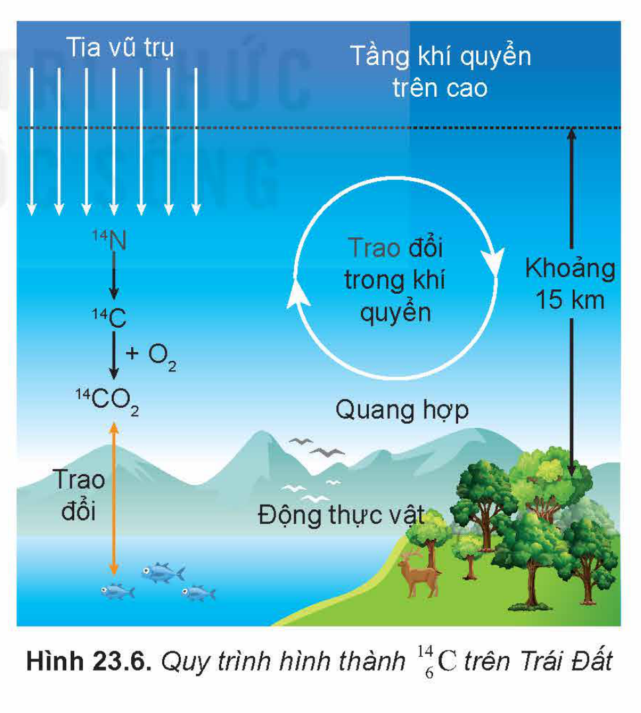

<!-- pdf:112 -->

> Khi thực vật chết đi, không còn hấp thụ $\text{CO}_2$ trong không khí và $^{14}_{6}\text{C}$ không còn tái sinh trong thực vật đó nữa. Vì $^{14}_{6}\text{C}$ phóng xạ nên số lượng $^{14}_{6}\text{C}$ giảm dần trong thực vật đó. Nói cách khác, tỉ lệ $K(14)$ trong thực vật đang xét giảm đi so với tỉ lệ đó trong không khí. So sánh hai tỉ lệ đó cho phép ta xác định thời gian từ lúc thực vật đó chết cho đến nay.
>
> Động vật ăn thực vật nên tỉ lệ $K(14)$ trong cơ thể cũng giảm sau khi chết. Vì vậy, có thể xác định tuổi các mẫu xương động vật tìm được trong các di chỉ khảo cổ bằng phương pháp này.
>
> Ngoài phương pháp xác định tuổi các mẫu vật có nguồn gốc hữu cơ dựa vào tính chất phóng xạ $^{14}_{6}\text{C}$, người ta còn sử dụng nhiều phương pháp khác để xác định tuổi các mẫu vật vô cơ dựa vào tính chất phóng xạ của $^{238}_{92}\text{U}$, $^{40}_{19}\text{K}$, $^{36}_{17}\text{Cl}$,...

## III. ẢNH HƯỞNG CỦA TIA PHÓNG XẠ. BIỂN CẢNH BÁO PHÓNG XẠ

### 1. Ảnh hưởng của tia phóng xạ

Các tia phóng xạ có thể gây tác động mạnh tới tế bào của con người cũng như sinh vật. Vì vậy khi bị phơi nhiễm tia phóng xạ với liều lượng lớn trong một khoảng thời gian dài, có thể ảnh hưởng nghiêm trọng tới sức khoẻ cũng như di truyền (Hình 23.7).

Trong một số trường hợp, với nguồn phóng xạ mạnh dù chỉ tiếp xúc thời gian ngắn nhưng cảm giác bỏng rát xuất hiện ngay, còn gọi là **bỏng phóng xạ**. Sau đó, nạn nhân xuất hiện các triệu chứng buồn nôn, nôn mửa, suy nhược thần kinh,... Các triệu chứng này còn gọi là **nhiễm độc phóng xạ**, ảnh hưởng lâu dài đến sức khoẻ, gây đột biến trong di truyền, ung thư,...

Ảnh hưởng của tia phóng xạ lên cơ thể người phụ thuộc vào cường độ, khả năng ion hoá, khả năng đâm xuyên, thời gian chiếu,... của tia phóng xạ.

- Với tia phóng xạ $\alpha$: khả năng đâm xuyên của tia $\alpha$ kém nên khi nguồn phóng xạ ở bên ngoài cơ thể thì nó không gây hậu quả đáng kể. Tuy nhiên, do khả năng ion hoá mạnh nên nếu nguồn phóng xạ $\alpha$ xâm nhập vào cơ thể thì sẽ gây hậu quả rất nghiêm trọng.
- Với tia phóng xạ $\beta$: khả năng ion hoá và khả năng đâm xuyên ở mức trung bình, khi nguồn phóng xạ $\beta$ ở trong hay ở ngoài cơ thể đều có thể gây ra các hậu quả đáng kể.
- Với tia phóng xạ $\gamma$: khả năng ion hoá kém hơn tia $\alpha$, tia $\beta$ nhưng khả năng đâm xuyên mạnh, khi nguồn phóng xạ $\gamma$ ở trong hay ở ngoài cơ thể đều có thể gây ra hậu quả nghiêm trọng nếu cơ thể phơi nhiễm tia $\gamma$ có cường độ lớn trong thời gian dài.

<!-- pdf:113 -->

### 2. Biển cảnh báo phóng xạ

**Biển cảnh báo phóng xạ** (Hình 23.8), được đặt tại khu vực lắp đặt thiết bị phát ra tia phóng xạ và nguồn phóng xạ, hoặc trên chính thiết bị và vật chứa của nguồn phóng xạ. Mục đích cảnh báo mọi người không nên tiếp cận hoặc làm hỏng thiết bị hoặc vật chứa thiết bị phóng xạ, vì điều này rất nguy hiểm.

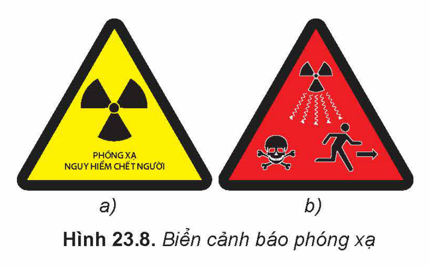

> ✋ 1. Tìm hiểu qua sách báo, internet về tác hại của phóng xạ đến sức khoẻ của con người và cho biết:
>
> a) các loại phơi nhiễm phóng xạ
>
> b) biểu hiện khi bị phơi nhiễm phóng xạ.
>
> c) cách phòng tránh nhiễm phóng xạ.
>
> 2. Nêu tên các địa điểm có nguy cơ phóng xạ trong Hình 23.9. Nếu gặp các biển cảnh báo đó em sẽ làm gì?

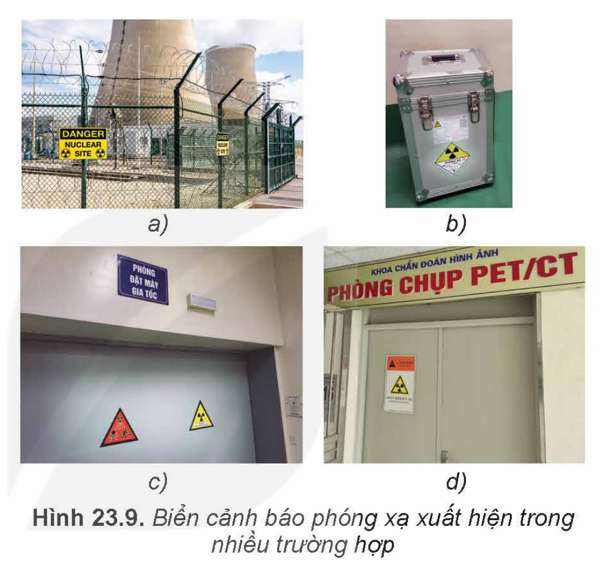

## IV. NGUYÊN TẮC AN TOÀN PHÓNG XẠ

Ngoài các nguồn phóng xạ được kiểm soát trong các hoạt động nghiên cứu và ứng dụng, con người có nguy cơ bị nhiễm phóng xạ thụ động như: phóng xạ có sẵn trong không khí (ví dụ $^{222}_{86}\text{Rn}$), từ các tia vũ trụ (ví dụ $^{14}_{6}\text{C}$), từ đá và vật liệu xây dựng có chứa đồng vị phóng xạ, trong thực phẩm (ví dụ đồng vị $^{40}_{19}\text{K}$),...

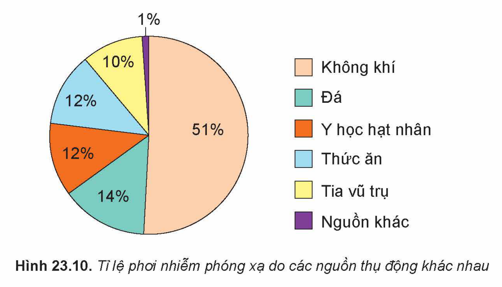

<!-- pdf:114 -->

<!-- term: Nguyên tắc an toàn phóng xạ -->
Hình 23.11 minh hoạ các nguyên tắc an toàn phóng xạ sau:

<!-- term: Nguyên tắc an toàn phóng xạ -->
a) Giữ khoảng cách đủ xa đối với nguồn phóng xạ. Nếu tăng gấp đôi khoảng cách từ chúng ta đến nguồn phóng xạ thì liều hấp thụ phóng xạ giảm đi $4$ lần.

<!-- term: Nguyên tắc an toàn phóng xạ -->
b) Cần sử dụng các tấm chắn nguồn phóng xạ đủ tốt. Tấm chắn càng dày và có khối lượng riêng càng lớn sẽ càng cản trở mạnh tia phóng xạ.

<!-- term: Nguyên tắc an toàn phóng xạ -->
c) Cần giảm thiểu thời gian phơi nhiễm phóng xạ.

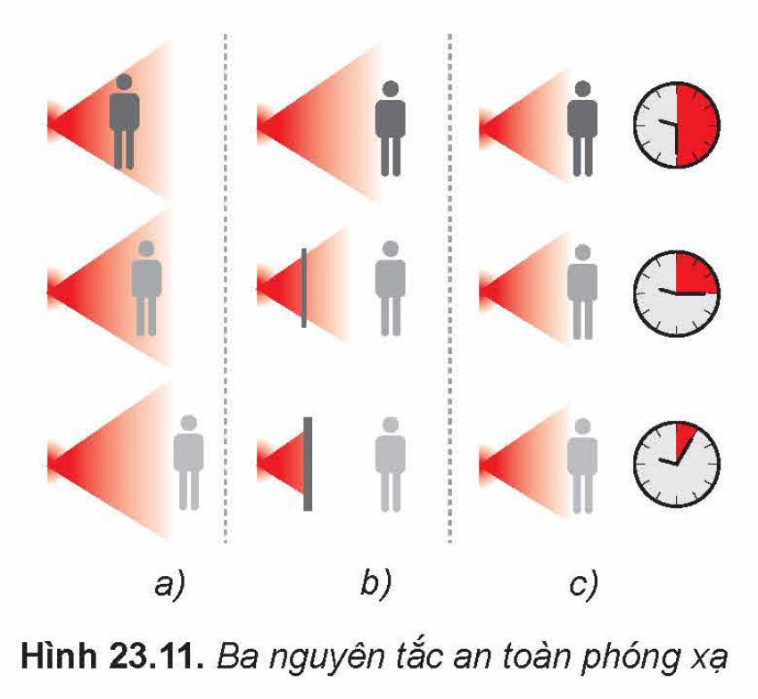

> ✋ 1. Hãy tìm hiểu và nêu thêm nguyên tắc an toàn phóng xạ. Việc tuân thủ quy tắc an toàn phóng xạ có vai trò gì?
>
> 2. Trong y học và công nghiệp, nguồn phóng xạ và chất thải phóng xạ được bảo quản trong các thiết bị lưu trữ (ví dụ như Hình 23.12) hoặc đặt trong các hầm cách li với các nguồn nước (ví dụ Hình 24.2). Người ta đã áp dụng nguyên tắc an toàn phóng xạ nào?

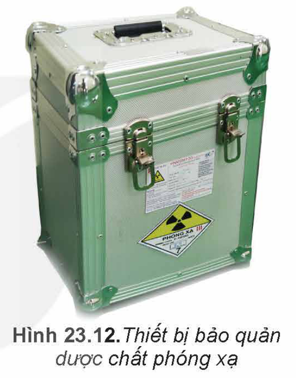

> 💡 **EM CÓ BIẾT**
>
> 1. Kính pha thêm chì (Hình 23.13) còn gọi là **thuỷ tinh pha lê** có tác dụng cản trở các tia phóng xạ mạnh hơn thuỷ tinh thường. Pha lê ngoài được sử dụng để tạo các đồ vật trang trí nó còn được dùng làm tấm kính giúp cho chúng ta vẫn nhìn được nguồn phóng xạ, nhưng hạn chế các tia phóng xạ chiếu vào người.
>
> 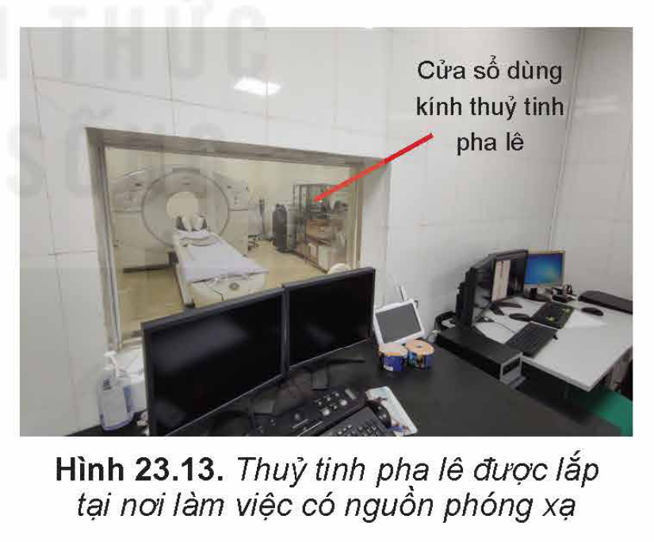
>
> 2. Nguyên tắc an toàn định lượng
>
> **Liều hấp thụ phóng xạ hiệu dụng** $D_{hd}$ cho con người được tính bởi hệ thức:
>
> $D_{hd} = DW$
>
> trong đó $D$ là **liều hấp thụ phóng xạ** (năng lượng hấp thụ phóng xạ trên mỗi $\text{kg}$ của vật), đơn vị ($\text{J/kg}$) và được gọi là **gray** ($\text{Gy}$: $1\text{ J/kg} = 1\text{ Gy}$); $W$ là **trọng số bức xạ**, phụ thuộc vào loại phóng xạ, bộ phận cơ thể bị chiếu xạ, $W$ không có đơn vị. (Ví dụ, khi xét toàn bộ cơ thể người thì $W = 1$ với tia gamma và beta, $W = 20$ với tia alpha,...)
>
> $D_{hd}$ có đơn vị trong hệ SI là **sieverts** (kí hiệu $\text{Sv}$).
>
> Trung bình một năm con người đã nhận một liều hấp thụ phóng xạ hiệu dụng từ các nguồn phóng xạ thụ động khoảng $2,4\text{ mSv}$.

<!-- pdf:115 -->

> Người ta đã đưa ra nguyên tắc an toàn định lượng đối với liều hấp thụ phóng xạ hiệu dụng cho con người trong một năm. Ngoài liều hấp thụ phóng xạ hiệu dụng từ các nguồn thụ động ($2,4\text{ mSv}$), khi làm việc trong môi trường có yếu tố phóng xạ, chiếu chụp X quang,... thì giới hạn liều hiệu dụng phải nhỏ hơn giá trị $D_{hd(\text{max})}$. Tại nước ta, theo thông tư 19/2012/TT-BKHCN, quy định chung cho mỗi người là: $D_{hd(\text{max})} = 1\text{ mSv}$. Trường hợp học sinh, sinh viên độ tuổi từ 16 đến 18, học nghề có thực hành với nguồn phóng xạ thì $D_{hd(\text{max})} = 6\text{ mSv}$. Ngoài ra, đối với người làm việc trong cơ sở bức xạ thì $D_{hd(\text{max})} = 20\text{ mSv}$.

## 📌 Em đã học

- Phân rã phóng xạ có tính tự phát và ngẫu nhiên.
- Tia phóng xạ là tia không nhìn thấy được, nhưng có các tính chất như: ion hoá, gây ra các hiệu ứng quang điện, phát xạ thứ cấp, làm đen kính ảnh, xuyên thấu lớp vật chất mỏng, phá huỷ tế bào, kích thích một số phản ứng hoá học,...
- Các loại tia phóng xạ chính:
  - Tia phóng xạ $\alpha$ là các hạt nhân $^{4}_{2}\text{He}$ được phóng ra từ hạt nhân bị phân rã, chuyển động với tốc độ khoảng $2 \cdot 10^7\text{ m/s}$.
  - Tia phóng xạ $\beta^-$ (hoặc $\beta^+$) là dòng các hạt $^{0}_{-1}\text{e}$ (hoặc $^{0}_{1}\text{e}$) phóng ra từ hạt nhân bị phân rã, chuyển động với tốc độ xấp xỉ tốc độ ánh sáng.
  - Tia phóng xạ $\gamma$ là sóng điện từ có bước sóng rất ngắn cỡ nhỏ hơn $10^{-11}\text{ m}$.
- Số hạt chưa phân rã của chất phóng xạ $N_t$ tại thời điểm $t$ và số hạt ban đầu $N_0$ của chất phóng xạ được liên hệ với nhau theo công thức:

  $N_t = N_0 2^{-\frac{t}{T}} = N_0 e^{-\lambda t}$

  trong đó $\lambda = \frac{\ln 2}{T}$ được gọi là hằng số phóng xạ, $T$ là chu kì bán rã.
- Độ phóng xạ $H$ đặc trưng cho tính phóng xạ mạnh hay yếu của một lượng chất phóng xạ, có giá trị bằng số hạt nhân phân rã trong một giây. Độ phóng xạ $H_t$ của một mẫu chất phóng xạ tại thời điểm $t$ được xác định theo công thức:

  $H_t = \lambda N_t = H_0 e^{-\lambda t}$

- Nguyên tắc an toàn khi làm việc với nguồn phóng xạ: giữ khoảng cách đủ xa đối với nguồn phóng xạ, cần sử dụng các tấm chắn nguồn phóng xạ đủ tốt và cần giảm thiểu thời gian phơi nhiễm phóng xạ.

## ✏️ Em có thể

- Nêu được cách xác định niên đại của các di vật khảo cổ bằng phóng xạ.
- Biết cách phòng tránh khi thấy biển cảnh báo vị trí có phóng xạ nguy hiểm.
- Giải thích được tại sao chúng ta vẫn có thể tiếp xúc với các nguồn phóng xạ một cách an toàn.

## 📷 Danh sách hình trong bài

| Mã hình | Trang PDF | Vị trí | Chú thích gốc |
| --- | --- | --- | --- |
| H12-vat_ly-b23-01 | 106 | Hộp Mở đầu | Kết quả thí nghiệm của Becquerel thực hiện năm 1896 |
| H12-vat_ly-b23-02 | 106 | Mục I.1 | Hình 23.1. Các vết sương dạng tia xuất hiện quanh mẫu quặng uranium |
| H12-vat_ly-b23-03 | 107 | Mục I.2 | Hình 23.2. Thí nghiệm đếm tia phóng xạ |
| H12-vat_ly-b23-04 | 107 | Mục I.3 | Hình 23.3. Sự lệch các tia phóng xạ trong điện trường (a) và từ trường (b) |
| H12-vat_ly-b23-05 | 108 | Mục I.3.a | Hình 23.4. Khả năng đâm xuyên của các tia phóng xạ qua vật chất |
| H12-vat_ly-b23-06 | 109 | Mục II.1 | Hình 23.5. Đồ thị minh hoạ sự thay đổi số hạt nhân chất phóng xạ còn lại thời gian |
| H12-vat_ly-b23-07 | 111 | Mục II.2, hộp Em có biết | Hình 23.6. Quy trình hình thành $^{14}_{6}\text{C}$ trên Trái Đất |
| H12-vat_ly-b23-08 | 112 | Mục III.1 | Hình 23.7. Cà chua đột biến khi bị phơi nhiễm phóng xạ có hình dạng không bình thường |
| H12-vat_ly-b23-09 | 113 | Mục III.2 | Hình 23.8. Biển cảnh báo phóng xạ |
| H12-vat_ly-b23-10 | 113 | Mục III.2 | Hình 23.9. Biển cảnh báo phóng xạ xuất hiện trong nhiều trường hợp |
| H12-vat_ly-b23-11 | 113 | Mục IV | Hình 23.10. Tỉ lệ phơi nhiễm phóng xạ do các nguồn thụ động khác nhau |
| H12-vat_ly-b23-12 | 114 | Mục IV | Hình 23.11. Ba nguyên tắc an toàn phóng xạ |
| H12-vat_ly-b23-13 | 114 | Mục IV | Hình 23.12. Thiết bị bảo quản dược chất phóng xạ |
| H12-vat_ly-b23-14 | 114 | Mục IV, hộp Em có biết | Hình 23.13. Thuỷ tinh pha lê được lắp tại nơi làm việc có nguồn phóng xạ |
