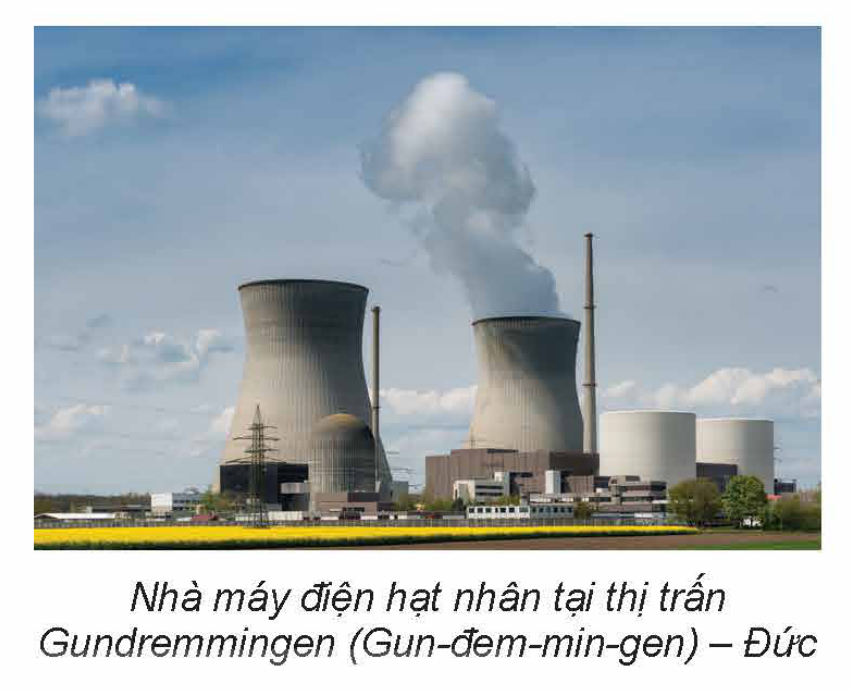
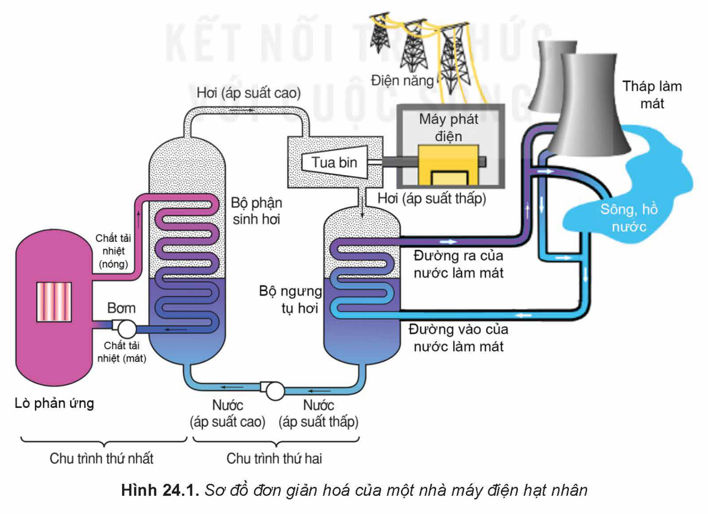
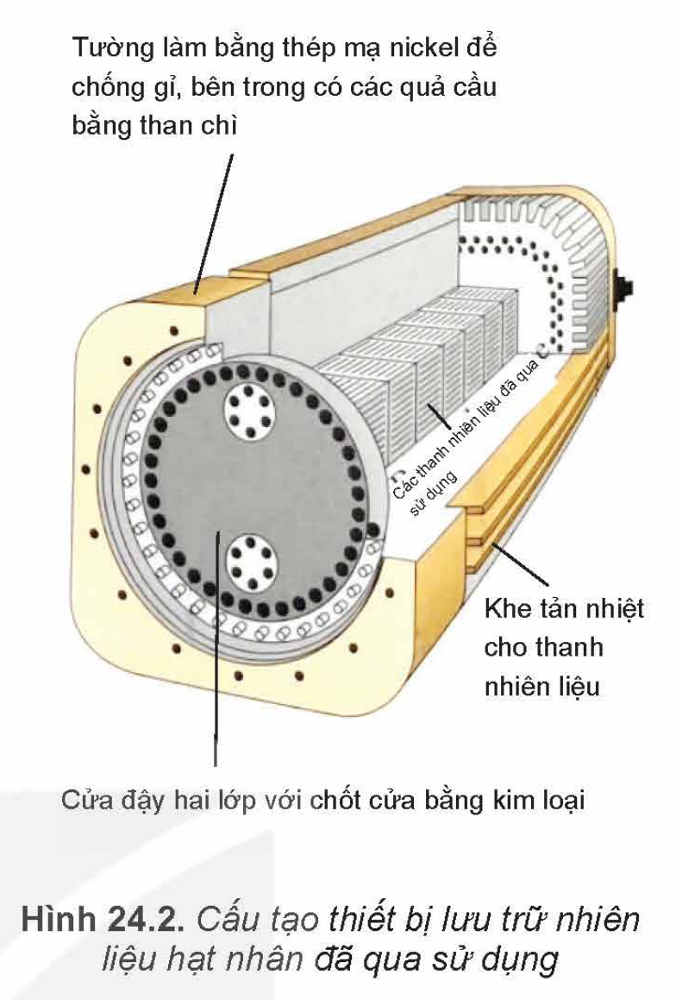
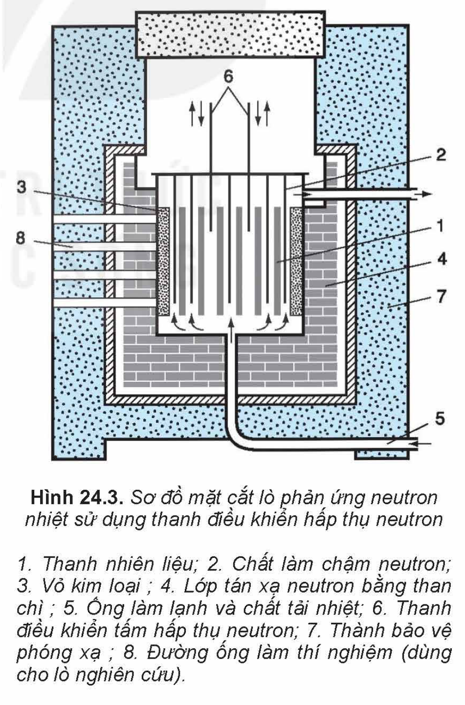
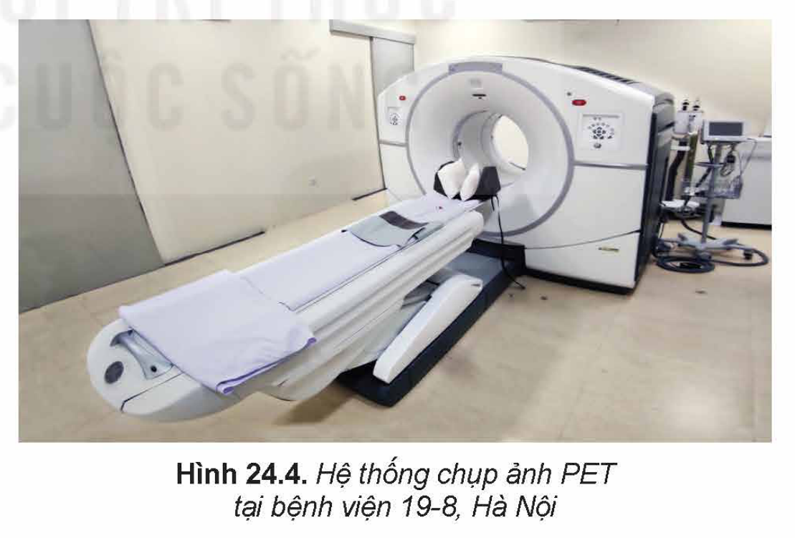
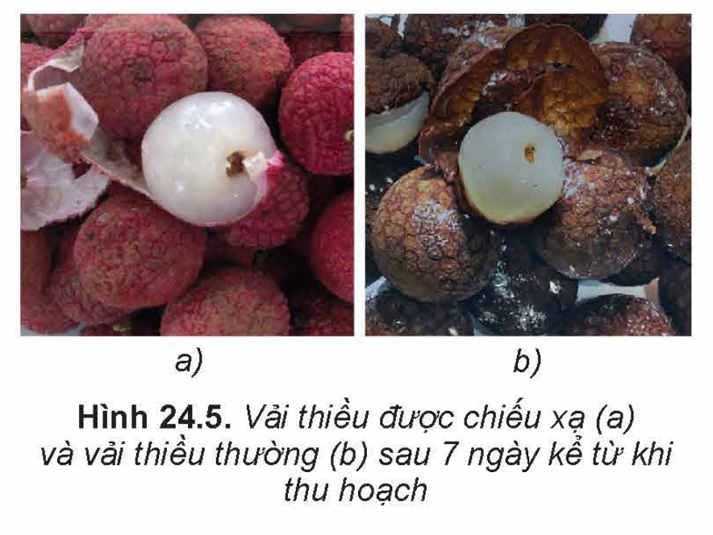

<!-- pdf:116 -->

# BÀI 24: CÔNG NGHIỆP HẠT NHÂN

## 🔴 Mở đầu

> Nhà máy điện hạt nhân có thể giải quyết vấn đề thiếu hụt năng lượng. Tuy vậy, một số quốc gia phát triển dự định sẽ đóng cửa các nhà máy điện hạt nhân trong tương lai. Nhà máy điện hạt nhân có những ưu điểm và nhược điểm gì?
>
> 

## I. NHÀ MÁY ĐIỆN HẠT NHÂN

<!-- term: Nhà máy điện hạt nhân -->
Năng lượng toả ra trong các phản ứng hạt nhân thường được chuyển hoá thành điện năng thông qua hệ thống lò phản ứng hạt nhân, tua bin và máy phát điện để hoà vào lưới điện hoặc cung cấp năng lượng cho tàu ngầm, tàu phá băng,... Hệ thống khai thác năng lượng hạt nhân có thể hoạt động trong thời gian dài mà không cần bổ sung nhiên liệu.

Bộ phận chính của nhà máy điện hạt nhân là lò phản ứng hạt nhân. Chất tải nhiệt sơ cấp, sau khi chạy qua vùng tâm lò, sẽ chảy qua bộ trao đổi nhiệt, cung cấp nhiệt cho lò sinh hơi. Hơi nước làm chạy tua bin phát điện giống như trong nhà máy điện thông thường (Hình 24.1).

<!-- pdf:117 -->

Nhà máy điện hạt nhân không trực tiếp phát khí thải ô nhiễm môi trường như $\text{CO}_2$, $\text{CO}$,... và có thể phát điện liên tục nhiều năm cho tới khi phải thay nhiên liệu mới.

Tuy nhiên, việc xử lí chất thải hạt nhân đòi hỏi công nghệ phức tạp với chi phí cao. Vật liệu chứa chất thải hạt nhân cần có độ bền rất cao để bảo quản cất giữ hàng trăm năm sau khi khai thác vì chu kì bán rã của một số đồng vị trong thanh nhiên liệu hạt nhân đã qua sử dụng là rất lớn (Ví dụ $^{90}\text{Sr}$, $^{137}\text{Cs}$ có chu kì bán rã khoảng $30$ năm) (Hình 24.2).

> 💡 **EM CÓ BIẾT**
>
> **Lò phản ứng hạt nhân**
>
> Năm 1942, Fermi và các cộng sự đã lần đầu tiên thực hiện thành công các chuỗi phản ứng phân hạch duy trì điều khiển được trong lò phản ứng ở trường đại học Chicago (Mĩ). **Lò phản ứng hạt nhân** là một hệ thống được sử dụng để khởi tạo và điều khiển chuỗi phản ứng phân hạch hạt nhân dây chuyền. Phần lớn các lò phản ứng hạt nhân đều có nhiều bộ phận chức năng giống nhau (Hình 24.3). Nhiên liệu phân hạch trong phần lớn các lò phản ứng là $^{235}\text{U}$ hay $^{239}\text{Pu}$. Để đảm bảo cho $k = 1$, trong các lò phản ứng người ta dùng các **thanh điều khiển** có chứa $\text{Bo}$ hay $\text{Cd}$, là các chất có tác dụng hấp thụ neutron nhiệt (động năng dưới $0,1\text{ eV}$). Khi số neutron trong lò tăng lên quá nhiều ($k > 1$), người ta cho các thanh điều khiển ngập sâu vào khu vực chứa nhiên liệu phân hạch để hấp thụ số neutron thừa. Nhờ vậy, năng lượng toả ra từ lò phản ứng không đổi theo thời gian.
>
> 

<!-- pdf:118 -->

> ❓ 1. Vì sao các nhà máy điện hạt nhân thường được xây dựng cạnh hồ, sông và bờ biển?
>
> 2. Liệt kê các nguy cơ ảnh hưởng tới sức khoẻ con người và môi trường nếu không may xảy ra sự cố tại lò phản ứng hạt nhân.

> ✋ Thảo luận để thực hiện các yêu cầu sau:
>
> 1. Nêu vai trò của các nhà máy điện hạt nhân trong đời sống.
>
> 2. Đánh giá các ưu điểm, nhược điểm và cơ hội phát triển của các nhà máy điện hạt nhân.

## II. Y HỌC HẠT NHÂN

Trong y học người ta khai thác các tính chất của tia phóng xạ để chẩn đoán và điều trị bệnh.

### 1. Chẩn đoán thông qua chụp ảnh phóng xạ cắt lớp bên trong cơ thể

Người ta đưa các đồng vị phóng xạ vào cơ thể thông qua **dược chất phóng xạ**. Thông qua thiết bị phát hiện tia phóng xạ và sử dụng máy vi tính, người ta có thể theo dõi sự dịch chuyển của các dược chất phóng xạ bên trong cơ thể (**phương pháp theo dõi vết phóng xạ**). Ví dụ: Khi tiêm dược chất phóng xạ vào tĩnh mạch để chụp ảnh phóng xạ gan mật, nhờ theo dõi vết phóng xạ chúng ta sẽ quan sát được toàn bộ quá trình sản xuất dịch mật của gan và sự dịch chuyển của dịch từ gan chảy tới túi mật.

> 💡 **EM CÓ BIẾT**
>
> <!-- term: Chụp ảnh phóng xạ cắt lớp -->
> Để tạo ra hình ảnh các bộ phận bên trong cơ thể người ta dùng kĩ thuật chụp ảnh phóng xạ cắt lớp SPECT (Single Photon Emission Computed Tomography) và PET (Positron Emission Tomography). Phương pháp chụp ảnh phóng xạ cắt lớp thường được phối hợp với chụp ảnh bằng các phương pháp khác (CT, MRI) để tăng độ chi tiết của hình ảnh cơ quan bên trong cơ thể (Hình 24.4). Theo dõi vết phóng xạ nhờ chụp ảnh phóng xạ cắt lớp cho ta các hình ảnh chi tiết của các bộ phận cơ thể theo nhiều góc quan sát khác nhau. Ngoài ra nó còn giúp ta theo dõi được sự luân chuyển của các chất trong cơ thể. Vì vậy, phương pháp này giúp cho việc chẩn đoán bệnh chính xác hơn.
>
> 

<!-- pdf:119 -->

> ✋ Thảo luận và thực hiện các yêu cầu sau:
>
> 1. Tại sao người ta sử dụng tia gamma trong chụp ảnh phóng xạ cắt lớp bên trong cơ thể?
>
> 2. Nêu vai trò của y học hạt nhân trong đời sống.
>
> 3. Đánh giá các ưu điểm, nhược điểm và cơ hội phát triển của y học hạt nhân.

### 2. Điều trị bệnh

<!-- term: Xạ trị -->
Trong điều trị bệnh ung thư, bệnh nhân được uống hoặc tiêm dược chất phóng xạ với thành phần chứa đồng vị phóng xạ (ví dụ thuốc Xofigo có chứa đồng vị phóng xạ $^{223}_{86}\text{Ra}$, hoặc thuốc Lutathe ra có chứa đồng vị phóng xạ $^{177}_{71}\text{Lu}$,...). Các tế bào ung thư sẽ chết do hấp thụ tia phóng xạ có trong dược chất phóng xạ được mạch máu vận chuyển tới.

<!-- term: Xạ trị -->
Ngoài cách sử dụng dược chất phóng xạ, người ta còn dùng máy xạ trị để chiếu tia phóng xạ từ bên ngoài cơ thể vào tế bào ung thư để tiêu diệt chúng. Tia phóng xạ cũng được dùng để khử trùng, khử khuẩn,...

> ❓ Khi sử dụng máy xạ trị để chữa bệnh, tia phóng xạ có tác động lên các tế bào khoẻ mạnh không? Hãy tìm thông tin về các triệu chứng của bệnh nhân sau khi xạ trị.

## III. ỨNG DỤNG PHÓNG XẠ HẠT NHÂN TRONG CÔNG NGHỆ SINH HỌC VÀ TRONG BẢO QUẢN THỰC PHẨM

Trong công nghệ sinh học, tia phóng xạ có thể được sử dụng hỗ trợ nghiên cứu gây đột biến gene, nhằm tạo ra các giống cây trồng mới có một số đặc điểm vượt trội như khả năng kháng sâu bệnh, năng suất cao, tạo quả trái mùa, hoặc một số loại quả không hạt,... Cây trồng đột biến gene có thể ít ảnh hưởng tới môi trường do cây chỉ cần sử dụng ít phân bón và các loại thuốc trừ sâu, thuốc kích thích sinh trưởng.

Tuy nhiên, cây trồng biến đổi gene vẫn có thể gây tác động xấu đến côn trùng, ảnh hưởng đến hệ sinh thái và sức khoẻ con người khi thường xuyên sử dụng.

<!-- term: Phương pháp đánh dấu phóng xạ -->
Phương pháp đánh dấu phóng xạ cũng được sử dụng trong nghiên cứu sinh học, nông nghiệp và lâm nghiệp. Ví dụ: Để nghiên cứu đường đi của phân bón trong cây trồng, người ta sẽ bón phân có đồng vị $^{32}_{15}\text{P}$ có tính phóng xạ $\beta$. Quan sát ảnh chụp phóng xạ của cây tại các thời điểm cách đều nhau, có thể đưa ra các biện pháp chăm sóc cây trồng phù hợp, giúp nâng cao chất lượng và năng suất.

<!-- pdf:120 -->

<!-- term: Chiếu xạ thực phẩm -->
Nhờ khả năng diệt vi trùng có hại của tia phóng xạ, nên chúng còn được sử dụng rộng rãi trong bảo quản sản phẩm nông nghiệp và thực phẩm. Chiếu tia phóng xạ còn có thể giúp kéo dài thời hạn sử dụng của thực phẩm nhờ thay đổi một số tính chất hoá học của thực phẩm tươi, giúp thực phẩm tránh bị mọc mầm, phân huỷ (Hình 24.5).

Bên cạnh các ưu điểm, một số loại thực phẩm chiếu xạ có thể bị thay đổi màu sắc, hương vị làm thay đổi chất lượng sản phẩm. Ngoài ra, thực phẩm chiếu xạ có giá thành cao.

> ✋ Thảo luận và thực hiện các yêu cầu sau:
>
> 1. Nêu vai trò của ứng dụng phóng xạ hạt nhân trong công nghệ sinh học và trong bảo quản thực phẩm.
>
> 2. Đánh giá ưu điểm, nhược điểm và cơ hội phát triển các ứng dụng phóng xạ hạt nhân trong công nghệ sinh học và trong bảo quản thực phẩm.

## 📌 Em đã học

- Một số ứng dụng công nghiệp hạt nhân như nhà máy điện hạt nhân, y học hạt nhân; ứng dụng phóng xạ hạt nhân trong công nghệ sinh học và trong bảo quản thực phẩm.

## ✏️ Em có thể

- Nêu được ví dụ về vai trò và ứng dụng phóng xạ của một số ngành công nghiệp hạt nhân trong đời sống.
- Giải thích được vì sao cần khai thác năng lượng hạt nhân vào mục đích hoà bình.

## 📷 Danh sách hình trong bài

| Mã hình | Trang PDF | Vị trí | Chú thích gốc |
| --- | --- | --- | --- |
| H12-vat_ly-b24-01 | 116 | Hộp Mở đầu | Nhà máy điện hạt nhân tại thị trấn Gundremmingen (Gun-đem-min-gen) – Đức |
| H12-vat_ly-b24-02 | 116 | Mục I | Hình 24.1. Sơ đồ đơn giản hoá của một nhà máy điện hạt nhân |
| H12-vat_ly-b24-03 | 117 | Mục I | Hình 24.2. Cấu tạo thiết bị lưu trữ nhiên liệu hạt nhân đã qua sử dụng |
| H12-vat_ly-b24-04 | 117 | Mục I, hộp Em có biết | Hình 24.3. Sơ đồ mặt cắt lò phản ứng neutron nhiệt sử dụng thanh điều khiển hấp thụ neutron |
| H12-vat_ly-b24-05 | 118 | Mục II.1, hộp Em có biết | Hình 24.4. Hệ thống chụp ảnh PET tại bệnh viện 19-8, Hà Nội |
| H12-vat_ly-b24-06 | 119 | Mục III | Hình 24.5. Vải thiều được chiếu xạ (a) và vải thiều thường (b) sau 7 ngày kể từ khi thu hoạch |
