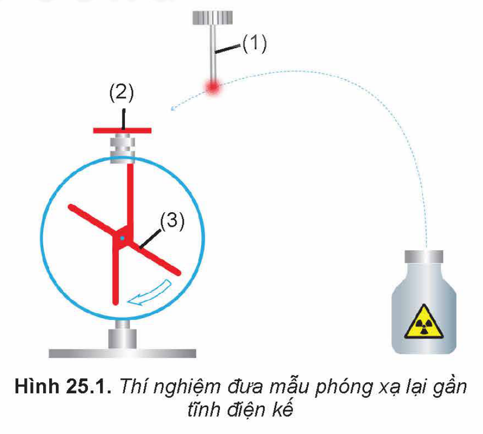
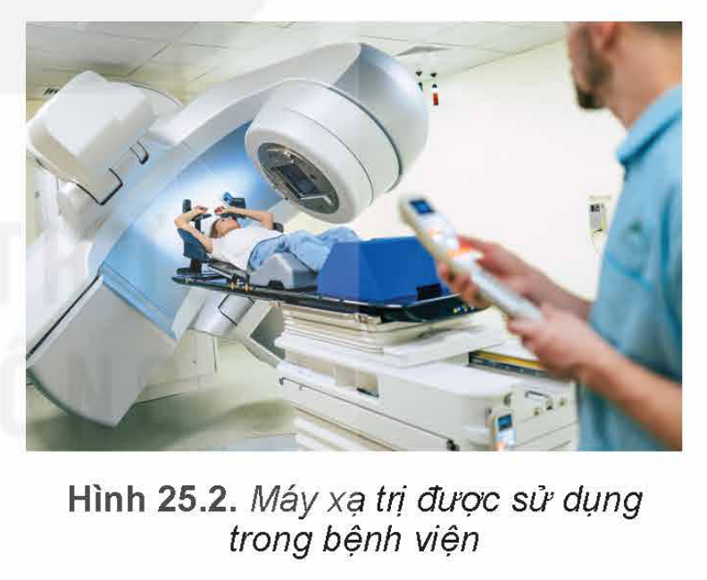
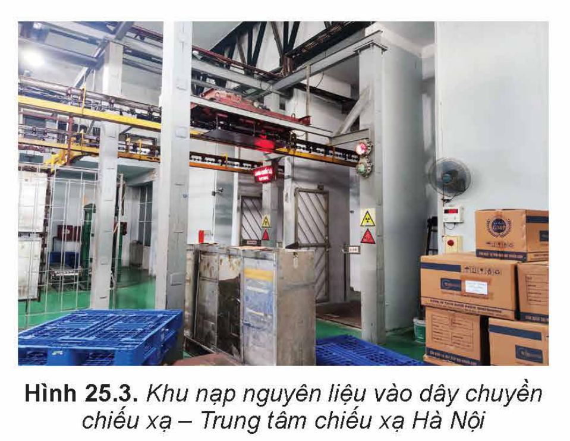
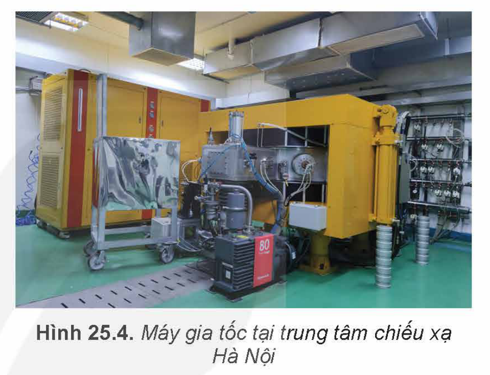

<!-- pdf:121 -->

# BÀI 25: BÀI TẬP VỀ VẬT LÍ HẠT NHÂN

## 🔴 Mở đầu

> Cần vận dụng những kiến thức cơ bản nào để giải những bài tập về vật lí hạt nhân?

## I. MỘT SỐ LƯU Ý TRONG VIỆC GIẢI BÀI TẬP VỀ VẬT LÍ HẠT NHÂN

Phần vật lí hạt nhân bao gồm bốn nội dung chính: cấu trúc hạt nhân, phản ứng hạt nhân, phóng xạ và ứng dụng công nghiệp hạt nhân.

### 1. Lưu ý khi giải bài tập định tính

Các bài tập này thường yêu cầu mô tả cấu tạo hạt nhân, đặc điểm của hạt nhân tham gia phản ứng hạt nhân, tính chất của các tia phóng xạ, giải thích các ứng dụng của vật lí hạt nhân trong đời sống và trong kĩ thuật.

### 2. Lưu ý khi giải bài tập định lượng

Các bài tập này thường yêu cầu vận dụng công thức xác định số lượng và loại nucleon; khối lượng, số lượng hạt nhân hoặc thời gian thực hiện phóng xạ của mẫu phóng xạ.

### 3. Lưu ý khi giải bài tập có nội dung thực tiễn

Các bài tập này thường yêu cầu rèn luyện khả năng liên tưởng giữa kiến thức vật lí hạt nhân đã được học và các nội dung thực tiễn; đồng thời cũng yêu cầu trừu tượng hoá, khái quát hoá thực tiễn để thiết lập các mô hình sao cho có thể vận dụng nội dung các kiến thức vật lí hạt nhân để giải quyết vấn đề.

## II. BÀI TẬP VÍ DỤ

1. Giải thích tại sao khi đưa mẫu phóng xạ (1) vào gần đầu thu điện (2) của một tĩnh điện kế đã được tích điện (Hình 25.1) thì độ lệch của kim điện kế (3) giảm rất nhanh?

*Giải*

Độ lệch kim điện kế giảm nhanh cho ta biết tĩnh điện kế nhận thêm điện tích trái dấu hoặc mất bớt điện tích.

Như vậy có thể có hai trường hợp:

- Các tia phóng xạ làm ion hoá không khí xung quanh mẫu phóng xạ do vậy không khí sẽ dẫn điện dễ dàng hơn.
- Điện tích của các hạt mang trong tia phóng xạ có thể trái dấu với điện tích đã tích điện trên tĩnh điện kế. Nếu vậy, tĩnh điện kế sẽ nhanh chóng trung hoà điện rồi lại tích điện trái dấu. Do đó độ lệch kim điện kế lúc đầu giảm dần sau đó tăng dần lên, không giống như hiện tượng đã mô tả.

<!-- pdf:122 -->

Dựa vào phân tích trên ta thấy sự ion hoá môi trường của tia phóng xạ chính là nguyên nhân. Không khí xung quanh tĩnh điện kế trở nên dẫn điện tốt hơn do bị ion hoá khi đưa mẫu phóng xạ lại gần tĩnh điện kế. Chính vì vậy điện tích của tĩnh điện kế nhanh chóng bị dẫn ra môi trường, làm kim điện kế nhanh chóng dịch về vị trí 0.

2. Viết phương trình phân hạch của $^{235}_{92}\text{U}$ khi hấp thụ $1$ neutron, biết rằng sản phẩm phân hạch gồm có $^{140}_{58}\text{Ce}$, $^{94}_{40}\text{Zr}$, các neutron và các tia $\beta^-$.

*Giải*

Gọi $x$ là hạt neutron $^{1}_{0}\text{n}$ và $y$ là số hạt electron $^{0}_{-1}\text{e}$ tạo thành trong phân hạch. Phương trình phản ứng hạt nhân có dạng:

$^{235}_{92}\text{U} + ^{1}_{0}\text{n} \rightarrow ^{140}_{58}\text{Ce} + ^{94}_{40}\text{Zr} + x^{1}_{0}\text{n} + y^{0}_{-1}\text{e}$

Ta thấy $x$ và $y$ bị ràng buộc bởi định luật bảo toàn số khối $A$ và nguyên tử số $Z$ của cả hạt tham gia phản ứng. Hai định luật cho ta hai phương trình liên hệ hai ẩn của $x$ và $y$, nhờ vậy có thể tìm được $x$ và $y$.

Từ định luật bảo toàn số khối và định luật bảo toàn điện tích ta có hệ phương trình:

$\begin{cases} 235 + 1 = 140 + 94 + x \cdot 1 + y \cdot 0 \\ 92 + 0 = 58 + 40 + x \cdot 0 + y \cdot (-1) \end{cases} \Rightarrow \begin{cases} x = 2 \\ y = 6 \end{cases}$

Do vậy, phương trình phản ứng là

$^{235}_{92}\text{U} + ^{1}_{0}\text{n} \rightarrow ^{140}_{58}\text{Ce} + ^{94}_{40}\text{Zr} + 2^{1}_{0}\text{n} + 6^{0}_{-1}\text{e}$

3. Máy xạ trị (Hình 25.2) thường sử dụng nguồn phóng xạ $^{60}_{27}\text{Co}$ có chu kì bán rã là $5,3$ năm. Để đáp ứng đúng các tiêu chí y học để điều trị bệnh, thiết bị sẽ bắt buộc phải bảo dưỡng để hiệu chỉnh lại chùm tia chiếu xạ trước khi độ phóng xạ giảm đi $7\%$ và phải thay nguồn phóng xạ mới khi độ phóng xạ giảm đi $50\%$. Các kĩ sư thiết kế máy xạ trị cần thiết lập lịch bảo dưỡng và thay thế nguồn phóng xạ của máy xạ trị như thế nào để đưa vào các bản hướng dẫn cho các bệnh viện?

*Giải*

Lịch bảo dưỡng và thay thế nguồn phóng xạ liên hệ với sự giảm của độ phóng xạ của nguồn phóng xạ $^{60}_{27}\text{Co}$. Như vậy khi biết chính xác sự phụ thuộc độ giảm độ phóng xạ theo thời gian ta có thể lập được lịch bảo dưỡng.

Độ phóng xạ $H_t$ tại thời điểm $t$ của nguồn phóng xạ có chu kì bán rã $T$ liên hệ với độ phóng xạ tại thời điểm ban đầu $H_0$ theo công thức $H_t = H_0 2^{-\frac{t}{T}}$. Từ công thức này ta thiết lập được các mốc thời gian ứng với độ giảm độ phóng xạ đã biết.

Gọi chu kì bảo dưỡng là $t_{bd}$, chính là khoảng thời gian khi độ phóng xạ giảm đi $7\%$. Ta có:

$\frac{H_0 - H_{t_{bd}}}{H_0} = \frac{H_0 - H_0 2^{-\frac{t_{bd}}{T}}}{H_0} = \frac{7}{100} \Rightarrow t_{bd} = T \log_2 \left(\frac{100}{93}\right) \approx 6,65\text{ tháng}$

<!-- pdf:123 -->

Gọi $t_{tm}$ là chu kì thay mới nguồn phóng xạ, đó chính là khoảng thời gian khi độ phóng xạ giảm đi $50\%$. Ta có:

$\frac{H_0 - H_{t_{tm}}}{H_0} = \frac{H_0 - H_0 2^{-\frac{t_{tm}}{T}}}{H_0} = \frac{50}{100} \Rightarrow t_{tm} = T \log_2 \left(\frac{100}{50}\right) = T = 5,3\text{ năm}$

Vậy lịch bảo dưỡng của máy xạ trị là sau mỗi $6$ tháng và lịch thay thế nguồn phóng xạ là sau mỗi $5,3$ năm.

## III. BÀI TẬP VẬN DỤNG

1. Lực nào đã làm thay đổi phương của hạt alpha ($^{4}_{2}\text{He}$) khi được bắn vào lá vàng mỏng?

   A. Lực hạt nhân giúp hạt nhân $^{197}_{79}\text{Au}$ đẩy $^{4}_{2}\text{He}$.

   B. Lực hạt nhân giúp hạt nhân $^{197}_{79}\text{Au}$ hút $^{4}_{2}\text{He}$.

   C. Lực đẩy tĩnh điện giữa hạt nhân $^{197}_{79}\text{Au}$ và $^{4}_{2}\text{He}$.

   D. Lực hút tĩnh điện giữa các electron của phân tử vàng và $^{4}_{2}\text{He}$.

2. Người ta đo độ phóng xạ $H$ của một đồng vị theo thời gian $t$ và điền kết quả vào Bảng 25.1.

   a) Vẽ đồ thị độ phóng xạ theo thời gian.

   b) Ước lượng chu kì bán rã của đồng vị này.

**Bảng 25.1.** *Độ phóng xạ theo thời gian*

| $t\text{ (s)}$ | 0 | 30 | 60 | 120 |
| --- | --- | --- | --- | --- |
| $H\text{ (Bq)}$ | 151 | 85 | 55 | 31 |
| $t\text{ (s)}$ | 180 | 240 | 300 | 360 |
| $H\text{ (Bq)}$ | 22 | 15 | 11 | 9 |

3. Dùng máy đo phóng xạ của một mẫu gỗ của một cổ vật phát hiện được $240$ phóng xạ mỗi phút. Biết rằng thành phần của mẫu gỗ có chứa $25\text{ g}$ $^{14}_{6}\text{C}$ và $^{12}_{6}\text{C}$, chu kì bán rã của $^{14}_{6}\text{C}$ là $5\,730$ năm và tỉ lệ nguyên tử $^{12}_{6}\text{C}$ và $^{14}_{6}\text{C}$ khi một sinh vật còn sống $10^{12} : 1$.

   a) Xác định số nguyên tử $^{14}_{6}\text{C}$ có trong mẫu gỗ.

   b) Xác định độ tuổi của mẫu gỗ này.

4. Một nhà máy điện hạt nhân sử dụng nguyên liệu hạt nhân là $^{235}\text{U}$. Biết rằng mỗi phân hạch sẽ toả năng lượng $200\text{ MeV}$. Hiệu suất phát điện của nhà máy là $36\%$. Công suất phát điện của nhà máy là $1\,400\text{ MW}$.

   a) Hãy tính khối lượng của nguyên liệu $^{235}\text{U}$ nhà máy tiêu thụ trong $1$ năm.

   b) Tính lượng than đá tiêu thụ để sản xuất ra năng lượng điện tương đương, biết rằng năng suất toả nhiệt của than đá là $30\text{ MJ/kg}$.

<!-- pdf:124 -->

5. Vào tháng 6 năm 2024, người lái xe tải sẽ phải chờ bao nhiêu lâu để toàn bộ lượng thuốc đông y chất đầy thùng xe tải được chiếu xạ để bảo quản tại Trung tâm chiếu xạ Hà Nội (Hình 25.3), biết rằng cũng tại nơi đó vào tháng 1 năm 2022 người lái xe đã phải chờ $150$ phút chiếu xạ cùng lượng thuốc như vậy và trung tâm chiếu xạ vẫn sử dụng nguồn chiếu xạ là $^{60}_{27}\text{Co}$ có chu kì bán rã là $5,3$ năm?

6. Dược chất phóng xạ FDG có thành phần là đồng vị $^{18}_{9}\text{F}$ với chu kì bán rã là $110$ phút, được sử dụng trong chụp ảnh cắt lớp PET. Dược chất này được sản xuất bằng cách bắn phá vào các hạt đồng vị $^{18}_{8}\text{O}$ nhờ một loại hạt được tăng tốc bằng máy gia tốc (Hình 25.4).

   a) Xác định loại hạt được tăng tốc trong máy gia tốc biết rằng ngoài $^{18}_{9}\text{F}$, sản phẩm bắn phá còn có neutron và phát xạ tia gamma.

   b) Trước khi chụp ảnh cắt lớp PET, bệnh nhân sẽ được tiêm liều lượng dược chất FDG để đảm bảo độ phóng xạ trên mỗi $\text{kg}$ cân nặng là $0,1\text{ mCi}$ không đổi. Hai bệnh nhân cùng cân nặng, cùng sử dụng FDG trong cùng một đợt sản xuất, nhưng được tiêm ở $2$ thời điểm cách nhau $60$ phút. Hỏi người nào sẽ được tiêm lượng FDG nhiều hơn? Xác định phần trăm lượng FDG nhiều hơn này cần được tiêm.

## 📌 Em đã học

- Cách giải các bài tập về vật lí hạt nhân.

## ✏️ Em có thể

- Vận dụng các kiến thức về cấu trúc hạt nhân, phản ứng hạt nhân, phóng xạ và ứng dụng công nghệ hạt nhân để giải các bài tập.

## 📷 Danh sách hình trong bài

| Mã hình | Trang PDF | Vị trí | Chú thích gốc |
| --- | --- | --- | --- |
| H12-vat_ly-b25-01 | 121 | Mục II, Bài tập 1 | Hình 25.1. Thí nghiệm đưa mẫu phóng xạ lại gần tĩnh điện kế |
| H12-vat_ly-b25-02 | 122 | Mục II, Bài tập 3 | Hình 25.2. Máy xạ trị được sử dụng trong bệnh viện |
| H12-vat_ly-b25-03 | 124 | Mục III, Bài tập 5 | Hình 25.3. Khu nạp nguyên liệu vào dây chuyền chiếu xạ – Trung tâm chiếu xạ Hà Nội |
| H12-vat_ly-b25-04 | 124 | Mục III, Bài tập 6 | Hình 25.4. Máy gia tốc tại trung tâm chiếu xạ Hà Nội |
